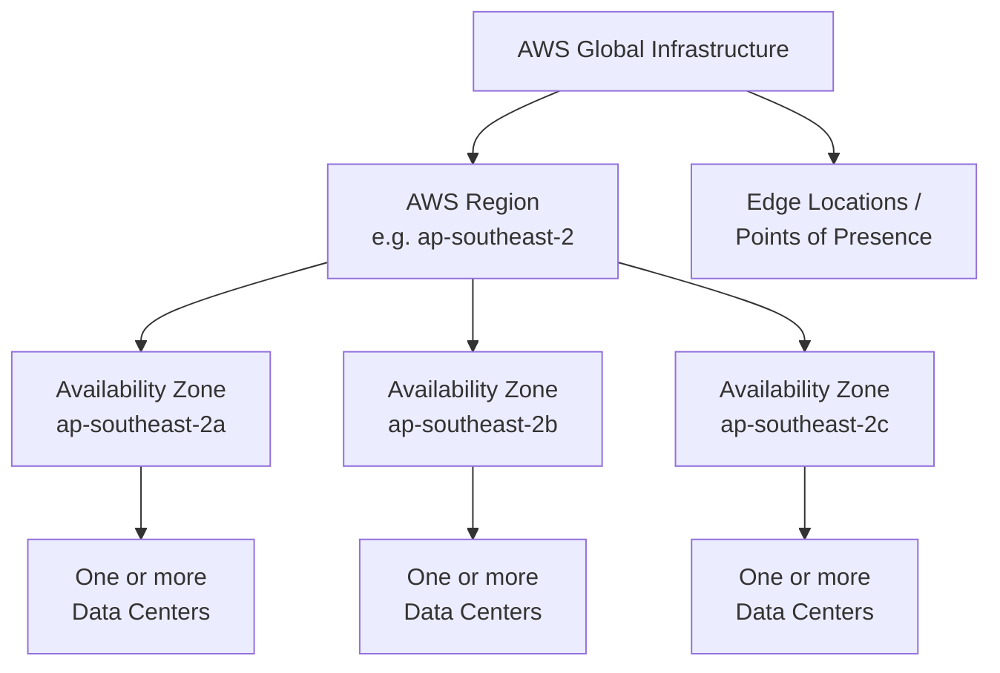
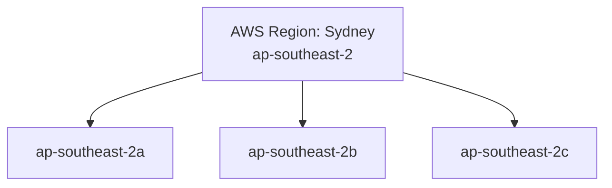

# Getting Started with AWS

## Key Concepts

### AWS Cloud History
- **2002**: Internally launched
- **2003**: Amazon recognizes its infrastructure as one of its core strengths — idea to bring it to market
- **2004**: Launched publicly with SQS
- **2006**: Re-launched publicly with SQS, S3 & EC2
- **2007**: Launched in Europe

### AWS Cloud Number Facts
- In 2023, AWS had **$90 billion** in annual revenue
- AWS accounts for **31%** of the cloud market in Q1 2024 (Microsoft is 2nd with 25%), per the Gartner Magic Quadrant
- Pioneer and Leader of the AWS Cloud Market for the **13th consecutive year**
- Over **1,000,000 active users**

### AWS Cloud Use Cases
AWS enables you to build sophisticated, scalable applications, applicable to a diverse set of industries. Use cases include:
- Enterprise IT
- Backup & Storage
- Big Data analytics
- Website hosting
- Mobile & Social Apps
- Gaming

## AWS Services / Features

### AWS Global Infrastructure
The global infrastructure is composed of, in decreasing order of scale:
- **AWS Regions**
- **AWS Availability Zones (AZs)**
- **AWS Data Centers**
- **AWS Edge Locations / Points of Presence**

Reference: https://infrastructure.aws/

### AWS Regions
- AWS has Regions all around the world
- Naming examples: `us-east-1`, `eu-west-3`
- A Region is a cluster of data centers
- **Most AWS services are Region-scoped**

Reference: https://aws.amazon.com/about-aws/global-infrastructure/

### How to Choose an AWS Region?
| Factor | Detail |
|---|---|
| Compliance | Data governance and legal requirements — data never leaves a Region without your explicit permission |
| Proximity to customers | Reduced latency |
| Available services within a Region | New services and new features aren't available in every Region |
| Pricing | Pricing varies Region to Region and is transparent on the service pricing page |

> [!NOTE]
> The source frames this as a question to consider: "If you need to launch a new application, where should you do it?" — the answer is driven by the four factors above.

### AWS Availability Zones
- Each Region has many Availability Zones (usually 3, minimum is 3, maximum is 6)
- Example naming: `ap-southeast-2a`, `ap-southeast-2b`, `ap-southeast-2c`
- Each AZ is one or more discrete data centers with redundant power, networking, and connectivity
- AZs are separate from each other, so they're isolated from disasters
- AZs are connected with high bandwidth, ultra-low latency networking

### AWS Points of Presence (Edge Locations)
- Amazon has **400+ Points of Presence** (400+ Edge Locations & 10+ Regional Caches)
- Spread across **90+ cities** in **40+ countries**
- Content is delivered to end users with lower latency

Reference: https://aws.amazon.com/cloudfront/features/

### Tour of the AWS Console — Global vs. Regional Services
| Global Services | Region-Scoped Services |
|---|---|
| Identity and Access Management (IAM) | Amazon EC2 (Infrastructure as a Service) |
| Route 53 (DNS service) | Elastic Beanstalk (Platform as a Service) |
| CloudFront (Content Delivery Network) | Lambda (Function as a Service) |
| WAF (Web Application Firewall) | Rekognition (Software as a Service) |

Reference (Region Table): https://aws.amazon.com/about-aws/global-infrastructure/regional-product-services

## Exam Tips
> [!TIP]
> Know the hierarchy cold: **Region → Availability Zone → Data Center**, plus separate **Edge Locations / Points of Presence** for content delivery.

> [!TIP]
> Memorize the four region-selection factors: **compliance, latency/proximity, service availability, pricing**.

> [!WARNING]
> Don't assume a service is available everywhere — most AWS services are Region-scoped, and new features roll out to Regions at different times. Only IAM, Route 53, CloudFront, and WAF are called out in the source as global services.

## Related Notes
- [[02-IAM-Basics]]
