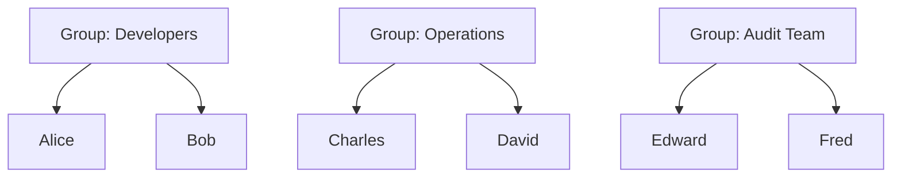
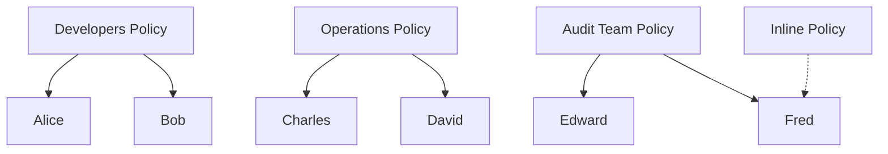
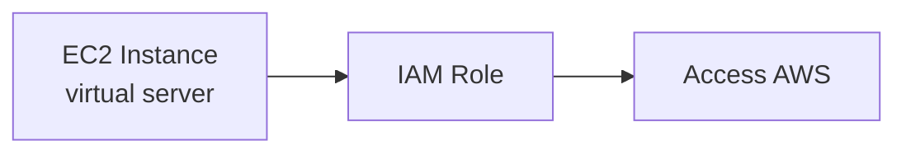

# IAM Basics

## Key Concepts

### IAM Users & Groups
- **IAM** = Identity and Access Management, a **Global service**
- A **root account** is created by default when you create an AWS account — it **shouldn't be used or shared**
- **Users** are people within your organization, and can be grouped
- **Groups** only contain users, not other groups
- A user doesn't have to belong to a group, and a user can belong to **multiple groups**



### IAM Permissions & Policies
- Users or Groups can be assigned JSON documents called **policies**
- Policies define the permissions of the users
- In AWS you apply the **least privilege principle**: don't give more permissions than a user needs

Example policy (from the source):
```json
{
    "Version": "2012-10-17",
    "Statement": [
        {
            "Effect": "Allow",
            "Action": "ec2:Describe*",
            "Resource": "*"
        },
        {
            "Effect": "Allow",
            "Action": "elasticloadbalancing:Describe*",
            "Resource": "*"
        },
        {
            "Effect": "Allow",
            "Action": [
                "cloudwatch:ListMetrics",
                "cloudwatch:GetMetricStatistics",
                "cloudwatch:Describe*"
            ],
            "Resource": "*"
        }
    ]
}
```

### IAM Policy Inheritance
Policies can be attached to a Group (inherited by all users in that group) or attached directly to an individual user as an **inline** policy.



### IAM Policy Structure
| Element | Level | Required? | Description |
|---|---|---|---|
| Version | Policy | Required | Policy language version — always include `"2012-10-17"` |
| Id | Policy | Optional | An identifier for the policy |
| Statement | Policy | Required | One or more individual statements |
| Sid | Statement | Optional | An identifier for the statement |
| Effect | Statement | Required | Whether the statement allows or denies access (`Allow`, `Deny`) |
| Principal | Statement | — | Account/user/role to which this policy applies |
| Action | Statement | — | List of actions this policy allows or denies |
| Resource | Statement | — | List of resources to which the actions applied |
| Condition | Statement | Optional | Conditions for when this policy is in effect |

### IAM Password Policy
Strong passwords = higher security for your account. In AWS, you can set up a password policy to:
- Set a minimum password length
- Require specific character types: uppercase letters, lowercase letters, numbers, non-alphanumeric characters
- Allow all IAM users to change their own passwords
- Require users to change their password after some time (password expiration)
- Prevent password re-use

### Multi-Factor Authentication (MFA)
- Users have access to your account and can possibly change configurations or delete resources
- You want to protect your **Root Account** and **IAM users**
- **MFA = password you know + security device you own**
- Main benefit: if a password is stolen or hacked, the account is not compromised (login still requires the physical device)

## AWS Services / Features

### MFA Device Options in AWS
| MFA Type | Provider | Notes |
|---|---|---|
| Virtual MFA device | Google Authenticator | Phone only; supports multiple tokens on a single device |
| Virtual MFA device | Authy | Phone only; supports multiple tokens on a single device |
| Universal 2nd Factor (U2F) Security Key | YubiKey by Yubico (3rd party) | Supports multiple root and IAM users using a single security key |
| Hardware Key Fob MFA Device | Gemalto (3rd party) | Physical key fob |
| Hardware Key Fob MFA Device for AWS GovCloud (US) | SurePassID (3rd party) | Physical key fob for GovCloud |

### How Can Users Access AWS?
To access AWS, you have three options:

| Access Method | Protected By |
|---|---|
| AWS Management Console | Password + MFA |
| AWS Command Line Interface (CLI) | Access Keys |
| AWS Software Developer Kit (SDK) — for code | Access Keys |

- Access Keys are generated through the AWS Console
- Users manage their own access keys
- Access Keys are secret, just like a password — don't share them
- **Access Key ID** ~= username
- **Secret Access Key** ~= password

Example (fake) access keys, from the source:
```
Access key ID: AKIASK4E37PV4983d6C
Secret Access Key: AZPN3zojWozWCndIjhB0Unh8239a1bzbzO5fqqkZq
```

> [!WARNING]
> Remember: don't share your access keys.

### AWS CLI vs AWS SDK
| | AWS CLI | AWS SDK |
|---|---|---|
| What it is | A tool to interact with AWS services using commands in your command-line shell | Language-specific APIs (a set of libraries) |
| Purpose | Direct access to the public APIs of AWS services; develop scripts to manage your resources | Access and manage AWS services programmatically, embedded within your application |
| Openness | Open-source (https://github.com/aws/aws-cli) | — |
| Language support | Shell-based | JavaScript, Python, PHP, .NET, Ruby, Java, Go, Node.js, C++; Mobile SDKs (Android, iOS); IoT Device SDKs (Embedded C, Arduino) |
| Relationship | Alternative to using the AWS Management Console | AWS CLI is built on the AWS SDK for Python |

### IAM Roles for Services
- Some AWS services need to perform actions on your behalf
- To do so, you assign permissions to AWS services with **IAM Roles**
- Common roles: **EC2 Instance Roles**, **Lambda Function Roles**, **Roles for CloudFormation**



### IAM Security Tools
| Tool | Scope | What It Does |
|---|---|---|
| IAM Credentials Report | Account-level | A report that lists all your account's users and the status of their various credentials |
| IAM Access Advisor | User-level | Shows the service permissions granted to a user and when those services were last accessed — use this information to revise your policies |

## Exam Tips
> [!TIP]
> **IAM Guidelines & Best Practices** (straight from the source — likely to appear as exam scenarios):
> - Don't use the root account except for AWS account setup
> - One physical user = One AWS user
> - Assign users to groups, and assign permissions to groups (not individual users)
> - Create a strong password policy
> - Use and enforce Multi-Factor Authentication (MFA)
> - Create and use Roles for giving permissions to AWS services
> - Use Access Keys for Programmatic Access (CLI / SDK)
> - Audit permissions using IAM Credentials Report & IAM Access Advisor
> - Never share IAM users & Access Keys

> [!TIP]
> Quick recall map — **IAM Section Summary**:
> - **Users**: mapped to a physical person, has a password for the AWS Console
> - **Groups**: contains users only
> - **Policies**: JSON document that outlines permissions for users or groups
> - **Roles**: for EC2 instances or AWS services
> - **Security**: MFA + Password Policy
> - **AWS CLI**: manage AWS services via the command line
> - **AWS SDK**: manage AWS services via a programming language
> - **Access Keys**: access AWS using the CLI or SDK
> - **Audit**: IAM Credential Reports & IAM Access Advisor

> [!WARNING]
> A Group can only contain **Users**, never other Groups. Don't confuse group nesting (not supported) with policy inheritance (supported via group membership).

> [!WARNING]
> Access Key ID / Secret Access Key are for **programmatic access (CLI/SDK)**; they are distinct from the Console password + MFA used for interactive login. Both must be protected, but they secure different access paths.

## Related Notes
- [[01-Getting-Started-AWS]]
