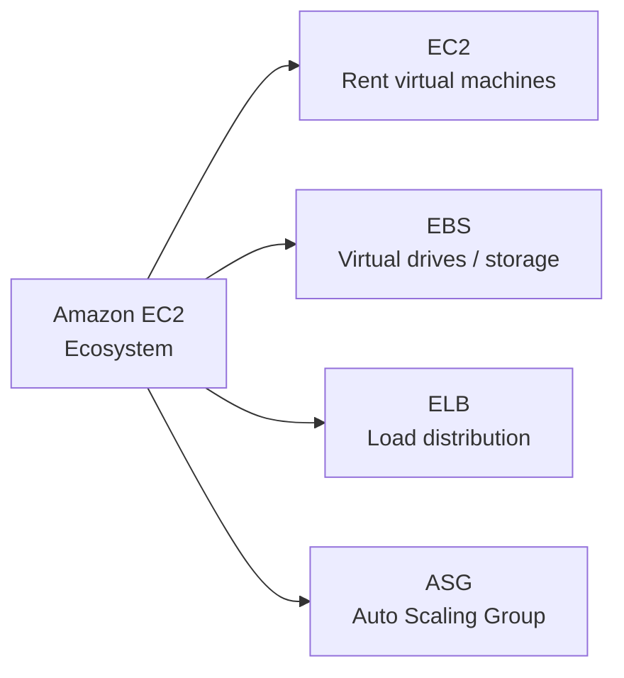
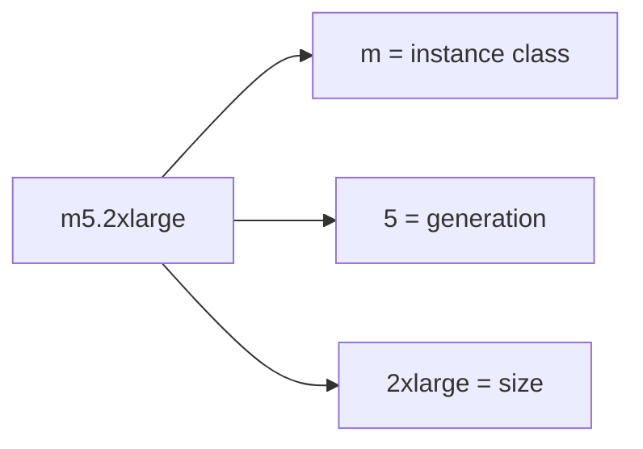
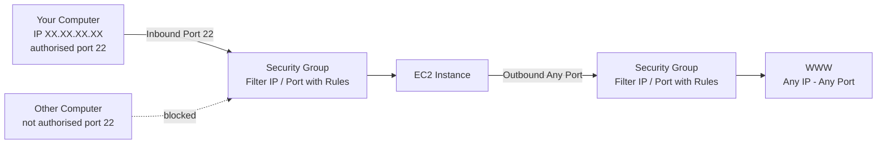

# EC2 Basics

## Key Concepts

### What is EC2?
- **EC2 = Elastic Compute Cloud = Infrastructure as a Service**
- EC2 is one of the most popular AWS offerings, and it's fundamental to understanding how the Cloud works
- It mainly consists of the capability of:
  - Renting virtual machines (**EC2**)
  - Storing data on virtual drives (**EBS**)
  - Distributing load across machines (**ELB**)
  - Scaling services using an auto-scaling group (**ASG**)

- An EC2 instance is a **Virtual Machine (VM)** — software-emulated computing
- Supported operating systems include Windows, Amazon Linux, Debian, Red Hat Enterprise Linux (RHEL), and Ubuntu
- The operating system of an instance **cannot be changed after the instance is purchased/launched**

### Benefits of EC2
- **Time to market**: quickly provision compute capacity
- **Scalability**: adjust capacity to match demand
- **Reliability**: achieved by using different Availability Zones
- **Security**
- **Full Control**
- **Services integration**: e.g., integration with RDS and other AWS services
- **Cost efficiency**

### EC2 Deployment Steps
1. Select an AMI
2. Configure networking and security
3. Choose the instance type or class
   - Flexibility to change post-implementation (see "Changing an EC2 Instance After Launch" below)
   - **Bare Metal Instances**: in most cases an instance runs as a virtual machine, but this instance class lets you run directly on the underlying hardware — used when you need access to something like Intel's virtualization technology extensions, or when applications must be licensed directly against the hardware
4. Choose the Availability Zone (AZ)
5. Attach storage (EBS)
6. Start the instance

### EC2 Sizing & Configuration Options
When launching an instance, you configure:
- **Operating System (OS)**: Linux, Windows, or Mac OS
- **Compute power & cores (CPU)**
- **Random-access memory (RAM)**
- **Storage space**:
  - Network-attached (EBS & EFS)
  - Hardware (EC2 Instance Store)
- **Network card**: speed of the card, public IP address
- **Firewall rules**: security group
- **Bootstrap script** (configured at first launch): EC2 User Data

### EC2 User Data (Bootstrapping)
- Allows **bootstrapping** instances — running commands automatically when the machine first starts
- **Bootstrapping** = a shortcut that helps launch an instance faster: the process of providing code to be run on an instance at launch, in addition to what's already baked into the AMI
- The script **runs only once**, at the instance's first start
- Used to automate boot tasks such as:
  - Installing updates and patches to the OS
  - Installing software
  - Downloading common files from the internet
  - Enrolling the instance in a directory service
- The EC2 User Data script **runs with the root user**
- Under **Advanced Details** at launch time, you can write this startup script for the instance

> [!NOTE]
> Launching, stopping, and terminating an EC2 instance from the AWS Console is covered as a hands-on lecture in the source; the web server example is launched via EC2 User Data.

### Capacity Reservation & T2/T3 Unlimited
- **Capacity Reservation**: reserve EC2 capacity in a specific AZ for when you want to guarantee certain levels of capacity are available
- **T2/T3 Unlimited**: enables **bursting** for an instance beyond its baseline performance (see burst credits under General Purpose instances below)

### EC2 Instance Types
- AWS offers different instance types optimized for different use cases
- Naming convention example: `m5.2xlarge`
  - **m**: instance class
  - **5**: generation (AWS improves generations over time)
  - **2xlarge**: size within the instance class

### Instance Type Families

| Family | Example Codes | Best For | Example Use Cases |
|---|---|---|---|
| **General Purpose** | T2, M3, M4, M5 | Diversity of workloads, balance of compute/memory/networking | Web servers, code repositories (course uses `t2.micro`); M-class good for development/staging; not for extremely busy workloads, basic web hosting, small DB instances |
| **Compute Optimized** | C3, C4, C5 | Compute-intensive tasks needing high-performance processors | Media coding, intensive batch jobs (heavy calculations), many concurrent users, gaming servers, high-performance web servers, HPC, scientific modeling & ML |
| **Memory Optimized** | X1e, X1, R3, R4 | Fast performance for workloads processing large data sets in memory | High-performance relational/non-relational databases, distributed web-scale cache stores, in-memory DBs for BI, large datasets, big data processing |
| **Storage Optimized** | H1, I3, D2 | High IOPS SSD, storage-intensive tasks needing high, sequential read/write access to large local data sets | High-frequency OLTP systems, relational & NoSQL databases, data warehousing, image storage and processing, distributed file systems |
| **Accelerated / Advanced Computing** | P3, P2, G3, F1 | Specialty hardware compute requirements | Graphic Processing Unit (GPU) workloads that speed up graphics processing; Field-Programmable Gate Array (FPGA) workloads |

- **Instance family cannot be changed after purchase** — only the instance type/size can change, and only within the same instance family (see "Changing an EC2 Instance After Launch" below)
- **T2 burst performance**: T2 instances accrue **credits during idle time**; those credits are then used to burst performance during sudden heavy usage (more users) — this is the basis of the T2/T3 Unlimited feature above
- If you choose a Memory Optimized instance, you can also pick the right EBS volume type to add storage-level optimization on top

> [!NOTE]
> This list evolves over time — the source recommends checking the AWS website (https://aws.amazon.com/ec2/instance-types/) for the latest information. A useful third-party comparison site mentioned in the source: https://instances.vantage.sh

**Instance type example comparison (from source):**

| Instance | vCPU | Mem (GiB) | Storage | Network Performance | EBS Bandwidth (Mbps) |
|---|---|---|---|---|---|
| t2.micro | 1 | 1 | EBS-Only | Low to Moderate | — |
| t2.xlarge | 4 | 16 | EBS-Only | Moderate | — |
| c5d.4xlarge | 16 | 32 | 1 x 400 NVMe SSD | Up to 10 Gbps | 4,750 |
| r5.16xlarge | 64 | 512 | EBS Only | 20 Gbps | 13,600 |
| m5.8xlarge | 32 | 128 | EBS Only | 10 Gbps | 6,800 |

### Security Groups
- The **fundamental of network security** in AWS
- Control how traffic is allowed **into or out of** EC2 instances
- Security groups only contain **rules** (allow rules — no explicit deny)
- Rules can reference **by IP or by security group**
- Act as a "firewall" on EC2 instances, regulating:
  - Access to ports
  - Authorized IP ranges — IPv4 and IPv6
  - Control of inbound network (from others to the instance)
  - Control of outbound network (from the instance to others)

**Security Groups — Good to Know**
- Can be attached to multiple instances
- Locked down to a **region / VPC combination**
- Live "outside" the EC2 — if traffic is blocked, the EC2 instance won't see it
- Good practice: maintain **one separate security group for SSH access**
- If your application is not accessible (timeout) → likely a **security group issue**
- If your application gives a "connection refused" error → **application error** or app not launched
- **All inbound traffic is blocked by default**
- **All outbound traffic is authorized by default**
- **Limited to five security groups per instance** (per the source outline)
- Security groups can be **layered** — multiple security groups can apply to the same instance at once
- Security groups are created either **while creating a VPC** or **when launching an instance**
- When launching a **Linux** instance, the security group created by default **allows SSH** communications
- To allow incoming traffic from **anywhere**, use the source `0.0.0.0/0`
- Instances receive a **default security group for the VPC**; additional security groups may be attached, but the default one **can be detached**
- Security groups are **stateful**: return traffic is automatically allowed, regardless of outbound rules — no inbound traffic is allowed by default without a matching request, and all outbound traffic is allowed by default
- Security groups **evaluate all rules** before deciding whether to allow traffic (no rule ordering/priority)
- By default, security groups are bound only to the **primary network interface** — they can also be bound to other interfaces (ENIs), so a single instance can have **different security groups enforcing rules on different network interfaces**

**Referencing Other Security Groups**
- A security group's inbound rule can authorize traffic from another security group (rather than an IP range), regardless of the IP address of the instances attached to the referenced security group

**Security Groups vs Network ACLs**

| Aspect | Security Group | Network ACL |
|---|---|---|
| Operates at | Instance level (firewall) | Subnet level (router) |
| Rule types | Allow rules only | Allow and deny rules |
| Unlisted port | Closed | Closed |
| Statefulness | Stateful — return traffic automatically allowed | Stateless — return traffic must be explicitly allowed by rules |
| Rule evaluation | All rules are evaluated before deciding | Rules processed **in number order** to decide |
| Scope of application | Applies only to the instance(s) it's specified on at launch | Applies to **all** instances in the subnet |

> [!WARNING]
> "Timeout" vs "connection refused" is a classic exam distinction: **timeout = security group problem**; **connection refused = application-level problem** (app not running or misconfigured), not a security group issue.

### Classic Ports to Know

| Port | Protocol | Purpose |
|---|---|---|
| 22 | SSH (Secure Shell) | Log into a Linux instance |
| 21 | FTP (File Transfer Protocol) | Upload files into a file share |
| 22 | SFTP (Secure File Transfer Protocol) | Upload files using SSH |
| 80 | HTTP | Access unsecured websites |
| 443 | HTTPS | Access secured websites |
| 3389 | RDP (Remote Desktop Protocol) | Log into a Windows instance |

### Connecting to EC2 (SSH)

| OS | Method |
|---|---|
| Mac / Linux | SSH (native terminal) |
| Windows < 10 | Putty |
| Windows >= 10 | SSH (native) or EC2 Instance Connect |
| All | EC2 Instance Connect |

- **SSH (Mac/Linux)**: control a remote machine via command line; can configure `~/.ssh/config` to simplify connecting
- **Putty (Windows)**: free tool used to configure the parameters necessary for SSH on Windows
- **EC2 Instance Connect**:
  - Connect to your EC2 instance within the browser
  - No need to use your downloaded key file
  - A **temporary key is uploaded onto EC2 by AWS**
  - Works only out-of-the-box with **Amazon Linux 2**
  - Port 22 must still be open

**SSH Troubleshooting**
1. Re-watch the lecture — you may have missed something
2. Read the troubleshooting guide
3. Try EC2 Instance Connect
- If one method works (SSH, Putty, or EC2 Instance Connect), you're good

### Key Pairs — How They Work
- A **key pair** allows you to SSH into an instance
- Consists of a **public key** (that AWS stores) and a **private key file** (that you store) — together they allow you to connect to the instance
- The private key file is **only downloadable at the time the instance/key pair is created**
- From **Linux**, connecting via SSH requires only the **`.pem` file** and the instance's **public IP**
- **PuTTY** is a common SSH client on Windows, but PuTTY does **not** natively support `.pem` files
  - You need both **PuTTY** and **PuTTYgen**
  - **PuTTYgen** converts a `.pem` file into a `.ppk` file, which PuTTY supports
- **`ec2-user`** is the default user account supported by AMI images when an instance starts

### Connecting to a Windows Instance (RDP)
- Windows instances do not use SSH by default — they use **Remote Desktop Protocol (RDP)**, which allows you to remote into the GUI and manage the instance graphically
  - You can optionally add an SSH server to a Windows instance and connect via SSH instead
- When launching a Windows instance, the **default rule type of the new security group is RDP**
- Connection steps: download a **`.rdp`** extension file, then connect — the password is derived from the key pair's `.pem` file

## AWS Services / Features

### EC2 Instance Purchasing Options — Overview

| Option | Best For | Key Trait |
|---|---|---|
| **On-Demand** | Short workload, predictable pricing | Pay by second, no commitment, highest cost |
| **Reserved Instances** (1 & 3 yr) | Long, steady-state workloads | Up to 72% discount |
| **Convertible Reserved Instances** | Long workloads needing flexible instance attributes | Up to 66% discount |
| **Savings Plans** (1 & 3 yr) | Long workload, commitment to $ amount of usage | Up to 72% discount |
| **Spot Instances** | Short, interruption-tolerant workloads | Up to 90% discount, can be reclaimed |
| **Dedicated Hosts** | Compliance / licensing needs, control instance placement | Book an entire physical server, most expensive |
| **Dedicated Instances** | No hardware sharing with other customers | No control over instance placement |
| **Capacity Reservations** | Guarantee capacity in a specific AZ for any duration | On-Demand rate, no discount, no time commitment |

### On-Demand Instances
- Pay for what you use:
  - Linux, Windows (incl. Windows+SQL variants), and RHEL-based instances (per an April 2024 change) — billing **per second**, with a 60-second minimum
  - All other OS (e.g. SLES) — billed as a full hour per partial hour consumed
- Highest cost but **no upfront payment**, **no long-term commitment**

> [!NOTE] Conflict resolved — On-Demand billing granularity
> An XMind study source said billing is always rounded up to 60-second increments. Verified 2026-07 against [AWS EC2 On-Demand docs](https://docs.aws.amazon.com/AWSEC2/latest/UserGuide/ec2-on-demand-instances.html): *"You pay only for the seconds that your On-Demand Instances are in the running state, with a 60-second minimum."* This note's per-second (after a 60s floor) description was already correct — 60-second rounding was the policy before AWS introduced per-second billing in October 2017.
- Recommended for **short-term, un-interrupted workloads** where behavior is unpredictable

### Reserved Instances (RIs)
- Up to **72% discount** compared to On-Demand
- Reserve specific instance attributes: **Instance Type, Region, Tenancy, OS**
- **Reservation period**: 1 year (+discount) or 3 years (+++discount)
- **Payment options**: No Upfront (+), Partial Upfront (++), All Upfront (+++)
- **Scope**: Regional or Zonal (reserve capacity in a specific AZ)
- Recommended for **steady-state usage applications** (e.g., databases)
- Can buy and sell in the **Reserved Instance Marketplace**
- **Convertible Reserved Instances**: can change instance type, instance family, OS, scope, and tenancy — up to 66% discount

> [!NOTE]
> The source notes that the exact discount percentages change over time and are illustrative only — the numbers themselves are not required for the exam.

### Savings Plans

- Commit to eligible usage measured in **USD/hour**, with the term and eligible usage determined by the plan; a discount does not reserve capacity.
- **Compute Savings Plans** cover eligible EC2, Lambda and Fargate usage across instance families and Regions.
- **EC2 Instance Savings Plans** commit to an instance family in a particular Region, with flexibility across size, operating system and tenancy within that scope.
- Current documentation also lists **Database Savings Plans** and **SageMaker AI Savings Plans**. Verify current eligibility rather than treating an old three-type list as exhaustive.
- Usage beyond the commitment is billed at applicable On-Demand rates. Compare flexibility and commitment risk; do not memorize marketing discount percentages as universal savings.

### Spot Instances
- Discount of up to **90%** compared to On-Demand — the **most cost-efficient** option in AWS
- Spot uses spare capacity at an EC2-set price, **not a highest-bid auction**. Instances can be interrupted when EC2 reclaims capacity; staying below a maximum price does not guarantee availability.
- Useful for workloads resilient to failure: batch jobs, data analysis, image processing, distributed workloads, flexible start/end time
- Additional use cases: analytics, financial modeling, big data, media encoding, scientific computing, testing
- Best for interruptible/checkpointed work. Avoid relying on Spot alone for an irreplaceable stateful database or a workload that cannot tolerate interruption.

**Spot Instance Requests**
- A maximum price is optional; availability also depends on spare capacity. Prefer diverse instance types/AZs and capacity-aware allocation strategies.
- Hourly spot price varies based on offer and capacity
- Interruption can result from capacity reclamation or price/constraint conditions. A stop/terminate interruption normally has a **two-minute notice**; hibernation begins immediately, so do not treat two minutes as guaranteed processing time.
- To terminate: you can only **cancel Spot Instance requests** that are open, active, or disabled — cancelling a request does **not** terminate the instance; you must first cancel the request, then terminate the associated Spot Instance(s)

**Spot Fleets**
- A set of Spot Instances + (optional) On-Demand Instances
- Tries to meet target capacity within price constraints
- Define launch pools: instance type, OS, Availability Zone (can have multiple pools)
- Stops launching instances when reaching capacity or max cost
- **Allocation strategies**:
  - `lowestPrice` — pool with lowest price (cost optimization, short workloads)
  - `diversified` — spread across all pools (great for availability, long workloads)
  - `capacityOptimized` — pool with optimal capacity for the instance count
  - `priceCapacityOptimized` (**recommended**) — pools with highest capacity available, then lowest price among those (best choice for most workloads)

### Dedicated Hosts
- A physical server with EC2 instance capacity **fully dedicated to your use**
- Addresses compliance requirements and lets you use existing server-bound software licenses (per-socket, per-core, per-VM — **BYOL**, Bring Your Own License)
- Purchasing options: On-Demand (pay per second) or Reserved (1 or 3 yr; No/Partial/All Upfront)
- **The most expensive option**
- Useful for complicated licensing models or strong regulatory/compliance needs
- Enables **more accurate licensing management** and **more detailed reporting/compliance management**, since some software is licensed per physical hardware
- Lets you **determine host placement during instance restarts** — with shared tenancy, you don't know which host your instance will come back up on after a restart
- **Not available in the AWS Free Tier**
- **Host Recovery**: automatically restarts your EC2 instance onto a new replacement host if there is a problem with the current dedicated host (or a new host becomes available)

### Dedicated Instances
- Instances run on hardware dedicated to you
- **May share hardware** with other instances in the **same account** — it's the only instance from another customer running on that physical machine
- **No control over instance placement** (hardware can change after a Stop/Start)
- Fixes some compliance issues, but has **less accurate licensing management** than Dedicated Hosts, with some extra performance enhancement
- **Not available in the AWS Free Tier**

### Capacity Reservations
- Reserve **On-Demand** instance capacity in a specific AZ, for any duration
- Guarantees access to EC2 capacity when needed
- **No time commitment** (create/cancel anytime), **no billing discounts**
- Can combine with Regional Reserved Instances / Savings Plans to get billing discounts
- **Charged at On-Demand rate whether you run instances or not**
- Suitable for **short-term, uninterrupted workloads** that must run in a specific AZ

### Tenancy Options
- Multiple customers can share the time and space of the same physical machine

| Tenancy | Description | Trade-offs |
|---|---|---|
| **Shared Tenancy** (default) | The default tenancy model for all EC2 instances — a single host machine may house instances from different customers | Reduced costs, simpler deployment, but lower performance and less control |
| **Dedicated Host** | A physical server with EC2 instance capacity fully dedicated to a single customer's use | More accurate licensing management, detailed reporting, compliance management, control over host placement on restart; not in Free Tier |
| **Dedicated Instances** | Run on hardware dedicated to a single customer, but may share that hardware with your own other instances | Fixes compliance issues; less accurate licensing management than Dedicated Host; not in Free Tier |

> [!TIP]
> The source's hotel analogy for purchasing options: **On-Demand** = pay full price whenever you stay; **Reserved** = plan ahead for a long stay, get a discount; **Savings Plans** = commit to eligible hourly spend, with flexibility depending on the plan; **Spot** = use discounted spare rooms that can be reclaimed; **Dedicated Hosts** = book an entire building; **Capacity Reservations** = book a room for a period at full price even if you don't stay.

**Price comparison example (m4.large, us-east-1 — illustrative only):**

| Price Type | Price (per hour) |
|---|---|
| On-Demand | $0.10 |
| Spot Instance | $0.038 – $0.039 (up to 61% off) |
| Reserved Instance (1 yr) | $0.062 (No Upfront) – $0.058 (All Upfront) |
| Reserved Instance (3 yr) | $0.043 (No Upfront) – $0.037 (All Upfront) |
| EC2 Savings Plan (1 yr) | $0.062 (No Upfront) – $0.058 (All Upfront) |
| Reserved Convertible Instance (1 yr) | $0.071 (No Upfront) – $0.066 (All Upfront) |
| Dedicated Host | On-Demand Price |
| Dedicated Host Reservation | Up to 70% off |
| Capacity Reservations | On-Demand Price |

### Instance Metadata & Management
- **Instance metadata** available for a running instance includes: Security Groups, Instance ID, Instance Type, and the AMI the instance is based on
- **Tags** can be used to help manage instances
- You can activate **termination protection** on an instance to prevent accidental termination
- **Security groups can be changed "on the fly"** — no need to stop the instance
- **Changing the instance type**: possible, but you must **stop the instance first**, then change the type, then start it again

### Changing an EC2 Instance After Launch
- **CANNOT** change the operating system of an existing instance
- **CANNOT** change the instance family
- **CAN** change the instance type — but **only to another type within the same instance family**, and the instance must be stopped first
- **CAN** change the Availability Zone

### Billing
- Billing begins when Amazon EC2 initiates the boot sequence of an AMI instance, and billing ends when the instance shuts down
- Cost components: instance running time, storage costs, and network throughput costs
- **AWS Cost Management** provides recommendations (for EC2 and other services) on how to reduce cost

## Exam Tips
> [!TIP]
> Match the workload to the purchasing option: **unpredictable/short-term → On-Demand**; **steady-state, long-term → Reserved/Savings Plans**; **interruption-tolerant, cost-sensitive → Spot**; **licensing/compliance → Dedicated Host**; **must-have capacity in a specific AZ regardless of cost → Capacity Reservation**.

> [!WARNING]
> Cancelling a Spot Instance **request** does not terminate the instance — you must cancel the request AND separately terminate the instance.

> [!TIP]
> Remember the "timeout vs. connection refused" rule for troubleshooting security groups: timeout → SG issue; connection refused → app issue.

> [!WARNING]
> EC2 Instance Connect only works out-of-the-box with **Amazon Linux 2** — don't assume it works on any AMI.

## Related Notes
- [[02-EC2-Associate]]
- [[03-EC2-Instance-Storage]]
- [[04-High-Availability-Scalability]]
- [[00-Cluster-MOC]]

## Checked corrections — 2026-11-09

Only the changes listed here were verified in this audit; other course-derived details still need checking when used.

- Distinguished Compute versus EC2 Instance Savings Plans and corrected the Spot auction/availability analogy.
  - [AWS documentation](https://docs.aws.amazon.com/savingsplans/latest/userguide/plan-types.html)
  - [AWS documentation](https://docs.aws.amazon.com/AWSEC2/latest/UserGuide/using-spot-instances.html)
  - [AWS documentation](https://docs.aws.amazon.com/AWSEC2/latest/UserGuide/spot-interruptions.html)
