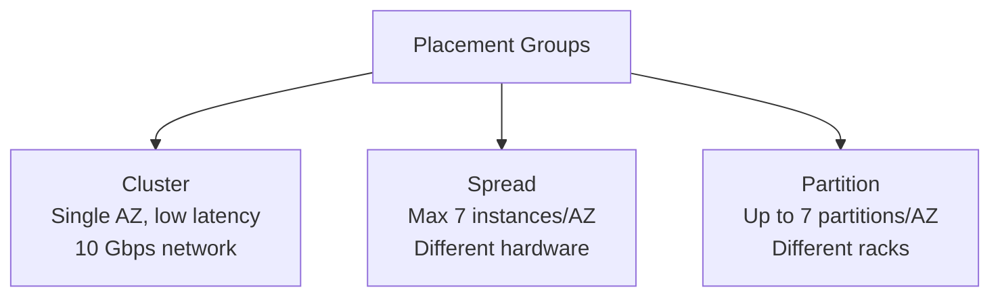
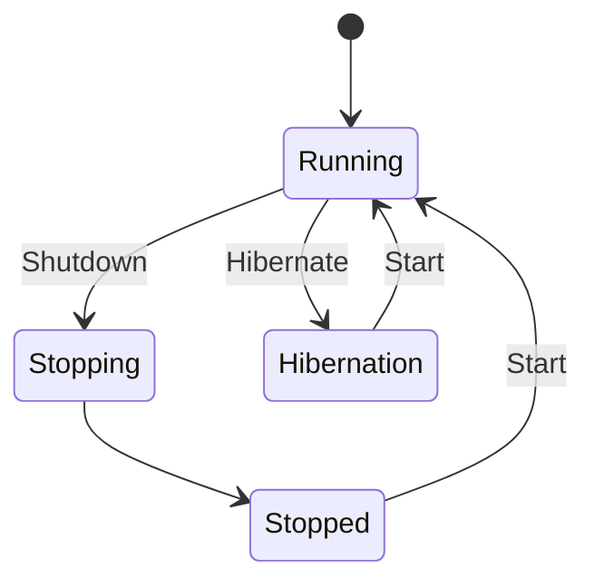

# EC2 Associate

## Key Concepts

### Private vs Public IP (IPv4)
- Networking has two IP formats:
  - **IPv4**: e.g., `1.160.10.240` — still the most common format used online, allows for **3.7 billion** different addresses in the public space
  - **IPv6**: e.g., `3ffe:1900:4545:3:200:f8ff:fe21:67cf` — newer, solves address-space problems for IoT
- Format: `[0-255].[0-255].[0-255].[0-255]`

**Fundamental differences:**

| | Public IP | Private IP |
|---|---|---|
| Identification | Identifies the machine on the internet (WWW) | Identifies the machine only on a private network |
| Uniqueness | Must be unique across the **whole web** | Must be unique across the **private network** only — two different private networks (e.g., two companies) **can** reuse the same IPs |
| Geolocation | Can be geo-located easily | N/A |
| Internet access | Direct | Machines connect to WWW using a **NAT + internet gateway** (a proxy) |
| Range | Any public address | Only a specified range of IPs can be used |

- By default, an EC2 machine comes with a **private IP** (for the internal AWS network) and a **public IP** (for the WWW)
- When SSHing into an EC2 instance, you **cannot use the private IP** (you're not on the same network) — you must use the **public IP**
- If the machine is stopped and then started, **the public IP can change**

### Elastic IPs
- When you stop then start an EC2 instance, its public IP can change
- An **Elastic IP** is a public IPv4 address **you own** as long as you don't delete it — fixes this problem
- Can attach it to **one instance at a time**
- Lets you mask the failure of an instance/software by rapidly **remapping the address to another instance** in your account
- You can only have **5 Elastic IPs** per account by default (can request an increase)

> [!WARNING]
> The source explicitly advises: **try to avoid using Elastic IPs** — they often reflect poor architectural decisions. Instead, use a random public IP with a registered DNS name, or (better) use a **Load Balancer** and don't expose a public IP at all.

**DNS Redirection**
- For an instance to be publicly accessible in a stable way, you can get a **different DNS host name that points to an Elastic IP**
- For **internal** use (within your private network), using the plain public IP directly is fine — no DNS redirection needed

### Placement Groups
Placement groups let you control the EC2 instance placement strategy. Three strategies:

| Strategy | Behavior | Pros | Cons | Use Cases |
|---|---|---|---|---|
| **Cluster** | Clusters instances into a low-latency group in a **single AZ** | Great network — 10 Gbps bandwidth between instances (with Enhanced Networking) | If the AZ fails, all instances fail together | Big data jobs needing fast completion; apps needing extremely low latency and high network throughput |
| **Spread** | Spreads instances across underlying hardware (max **7 instances per group per AZ**) | Can span multiple AZs; reduced risk of simultaneous failure; instances on different physical hardware | Limited to 7 instances per AZ per group | Apps needing maximum high availability; critical apps where each instance must be isolated from failure of others |
| **Partition** | Spreads instances across partitions (different racks) within an AZ; scales to 100s of instances | Up to 7 partitions per AZ; can span multiple AZs in the same Region; a partition failure only affects that partition | — | Hadoop, Cassandra, Kafka, HDFS, HBase |

- Partition EC2 instances get access to partition information as **metadata**
- An existing supported instance can **join, leave, or change a placement group while stopped**; then start it again. Check capacity and placement constraints before moving it.
- **Placement groups cannot be merged**

### Traffic Mirroring
- An EC2/VPC feature that lets you **copy network traffic going into and out of an ENI** of an EC2 instance, then send it wherever you want for inspection
- Use cases:
  - Content inspection
  - Threat monitoring
  - Looking for security incidents that might occur in your system
  - Troubleshooting a communication problem

### Elastic Network Interfaces (ENI)
- A logical component in a VPC representing a **virtual network card**
- Attributes:
  - Primary private IPv4, one or more secondary IPv4
  - One Elastic IP (IPv4) **per private IPv4**
  - One Public IPv4
  - One or more security groups
  - A MAC address
- Can be created independently and **attached/moved on the fly** between EC2 instances (useful for failover)
- **Bound to a specific Availability Zone (AZ)**

### EC2 Hibernate
- Instances can be **stopped** (data on the root EBS volume kept intact) or **terminated** (any EBS volumes set to be destroyed are lost)
- On start:
  - First start: OS boots & the EC2 User Data script runs
  - Following starts: OS boots up, then the application starts and caches warm up — this can take time
- **Hibernate**:
  - The **in-memory (RAM) state is preserved**
  - Instance boot is **much faster** (OS is not stopped/restarted)
  - Under the hood: RAM state is written to a file on the **root EBS volume**
  - The **root EBS volume must be encrypted**
  - Use cases: long-running processing, saving RAM state, services that take time to initialize

**EC2 Hibernate — Good to Know**
- Supported instance families: C3, C4, C5, I3, M3, M4, R3, R4, T2, T3, …
- Instance RAM size must be **less than 150 GB**
- **Not supported for bare metal instances**
- Supported AMIs: Amazon Linux 2, Linux AMI, Ubuntu, RHEL, CentOS & Windows…
- Root volume must be **EBS, encrypted, not instance store**, and large enough
- Available for **On-Demand, Reserved, and Spot Instances**
- An instance **cannot be hibernated for more than 60 days**

## AWS Services / Features

| Feature | Purpose | Key Constraint |
|---|---|---|
| Elastic IP | Fixed public IPv4 address you own | Max 5 per account (default); attach to one instance at a time |
| Placement Group | Control instance placement strategy | 3 strategies: Cluster, Spread, Partition |
| ENI | Virtual network card, attachable/movable | Bound to a specific AZ |
| EC2 Hibernate | Preserve RAM state across stop/start | Root EBS volume must be encrypted; RAM < 150 GB; max 60 days |

## Exam Tips
> [!TIP]
> If a scenario needs a **fixed** public IP that survives stop/start, the answer is **Elastic IP** — but remember the source frames it as a last resort compared to a Load Balancer or DNS name.

> [!TIP]
> Placement group choice is a classic scenario question: **Cluster** = lowest latency, single AZ, all-or-nothing failure risk. **Spread** = max isolation, capped at 7 instances/AZ. **Partition** = large-scale distributed systems (Hadoop/Cassandra/Kafka) needing rack-level fault isolation.

> [!WARNING]
> A Spread placement group is limited to **7 instances per Availability Zone per group** — don't confuse this with Partition's much higher scale (100s of instances).

> [!NOTE] Conflict resolved — Placement Groups and multi-AZ support
> An XMind study source said placement groups in general are confined to a single AZ. Verified 2026-07 against [AWS EC2 placement strategies docs](https://docs.aws.amazon.com/AWSEC2/latest/UserGuide/placement-strategies.html): only **Cluster** is single-AZ; **Spread** and **Partition** can both span multiple AZs in the same Region, as this note's table already stated.

> [!WARNING]
> EC2 Hibernate requires the **root EBS volume to be encrypted** — this is a common exam trap when a scenario mentions hibernation without mentioning encryption.

## Related Notes
- [[01-EC2-Basics]]
- [[03-EC2-Instance-Storage]]
- [[04-High-Availability-Scalability]]
- [[00-Cluster-MOC]]

## Checked corrections — 2026-11-09

Only the changes listed here were verified in this audit; other course-derived details still need checking when used.

- Corrected placement-group changes for existing stopped instances.
  - [AWS documentation](https://docs.aws.amazon.com/AWSEC2/latest/UserGuide/change-instance-placement-group.html)
