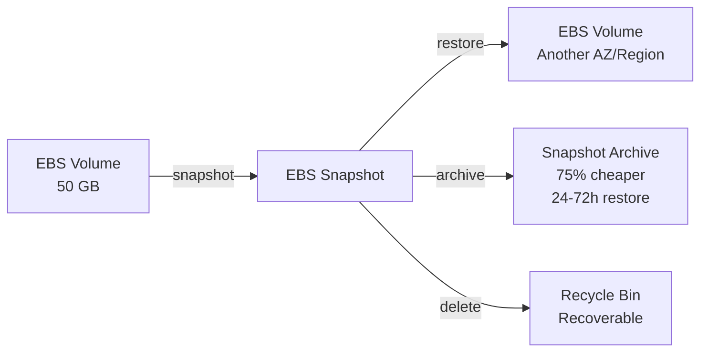
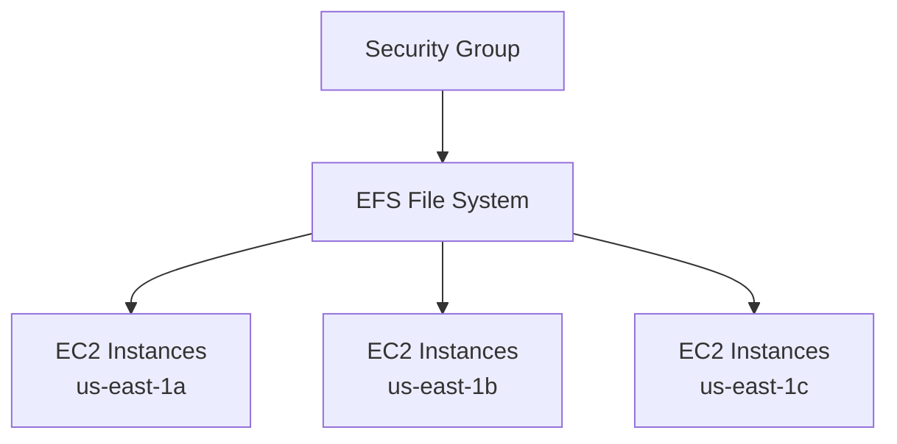

# EC2 Instance Storage

## Key Concepts

### What's an EBS Volume?
- An **EBS (Elastic Block Store) Volume** is a **network drive** you can attach to your instances while they run
- Allows instances to **persist data**, even after termination
- Can only be mounted to **one instance at a time** (at the CCP/associate level — see the EBS Multi-Attach exception below)
- **Bound to a specific Availability Zone**
- Analogy from the source: think of it as a **"network USB stick"**

### EBS Volume — Details
- It's a **network drive** (not physical) — communication over the network means some latency
- Can be **detached** from one EC2 instance and **attached** to another quickly
- **Locked to an AZ** — an EBS volume in `us-east-1a` cannot be attached to `us-east-1b`
  - To move a volume across AZs, first **snapshot** it
- Has provisioned capacity (size in GBs, and IOPS) — you're **billed for all provisioned capacity**
- You can **increase the capacity** of a volume over time

### EBS – Delete on Termination Attribute
- Controls EBS behavior when an EC2 instance terminates
- By default: **root EBS volume is deleted** (attribute enabled)
- By default: **any other attached EBS volume is NOT deleted** (attribute disabled)
- Controllable via AWS Console / AWS CLI
- Use case: preserve the root volume when the instance is terminated

### EBS Snapshots
- Backup of an EBS volume at a point in time
- Not necessary to detach the volume to snapshot it, but **recommended**
- Snapshots can be **copied across AZ or Region**

**EBS Snapshot Features:**
- **EBS Snapshot Archive**: move a snapshot to an "archive tier" that is **75% cheaper**; restoring from archive takes **24 to 72 hours**
- **Recycle Bin for EBS Snapshots**: set retention rules (1 day to 1 year) to recover accidentally deleted snapshots
- **Fast Snapshot Restore (FSR)**: forces full initialization of a snapshot for no latency on first use ($$$)

### AMI (Amazon Machine Image)
- **AMI = Amazon Machine Image** — a customization of an EC2 instance
- You add your own software, configuration, operating system, monitoring, etc.
- **Faster boot/configuration time** because software is pre-packaged
- AMIs are built for a **specific Region** (can be copied across Regions)
- You can launch EC2 instances from:
  - A **Public AMI**: published by AWS, free
  - **Your own AMI**: you make and maintain it
  - An **AWS Marketplace AMI**: made by someone else, free or paid
  - A **Community AMI**: free — generated and customized from existing instances; people create an AMI from an instance and place it in the AWS Marketplace under "Community"
  - **Uploaded Virtual Servers**: importing an existing (on-premises) virtual machine into EC2 (**VM Import/Export**)

**AMI creation process (from an EC2 instance):**
1. Start an EC2 instance and customize it
2. Stop the instance (for data integrity)
3. Build an AMI — this also creates EBS snapshots
4. Launch instances from the new AMI

**Who Can Launch an Instance from an AMI**
- **Public**: anyone can launch it
- **Explicit**: specified accounts are granted launch permission
- **Implicit (default)**: only the AMI's **owner** can launch it

### AMI Virtualization Types (Linux)
| Type | Description |
|---|---|
| **HVM (Hardware Virtual Machine)** | AMIs fully virtualize the hardware; requires hardware-assisted virtualization (the CPU itself has special capabilities to make virtualization work better); benefits from improvements to the Xen Hypervisor, newer generation CPUs with new instruction sets, EC2 driver improvements, and overall AWS infrastructure changes |
| **PV (Paravirtual Machine)** | A lighter form of virtualization that performs better with storage and network operations; can run on hosts without specific hardware support for virtualization, but doesn't perform as well overall as HVM |

### Instance Root Volume: Instance Store-Backed vs EBS-Backed AMI
- Every instance has a **root volume** — the volume that contains the boot sector — and it can be stored in different ways depending on the AMI type:

| AMI Type | Root Volume Location | Stop Action Support | On Failure |
|---|---|---|---|
| **Instance store-backed AMI** | Root volume on **instance-store disks**; the AMI bundle is stored in S3 | **No support for the Stop action** | Data in the instance store is **lost** |
| **EBS-backed AMI** | Root volume stored in an **EBS volume** | Supported | Data in the EBS volume is **not lost** |

> [!WARNING]
> You can encrypt EBS volumes, including the root volume, **when launching from an AMI backed by unencrypted snapshots**. An already existing unencrypted EBS volume cannot be encrypted in place; replace it using an encrypted snapshot/volume workflow.

### EC2 Instance Store
- EBS volumes are network drives with good but "limited" performance
- For **high-performance hardware disk**, use **EC2 Instance Store**
- Better I/O performance (very high IOPS)
- **Ephemeral** — Instance Store loses its storage if the instance is **stopped**
- Good for buffer / cache / scratch data / temporary content
- **Risk of data loss** if hardware fails
- **Backups and replication are your responsibility**

### EBS Volume Types
EBS Volumes come in **6 types**, falling into two families:

| Type | Media | Description |
|---|---|---|
| **gp2 / gp3** | SSD | General purpose — balances price and performance for a wide variety of workloads |
| **io1 / io2 Block Express** | SSD | Highest-performance — mission-critical, low-latency or high-throughput workloads |
| **st1** | HDD | Low cost — frequently accessed, throughput-intensive workloads |
| **sc1** | HDD | Lowest cost — less frequently accessed workloads |

- Characterized by **Size | Throughput | IOPS**
- Only **gp2/gp3 and io1/io2 Block Express** can be used as **boot volumes**

**General Purpose SSD (gp2/gp3)**
- Cost-effective, low-latency; system boot volumes, virtual desktops, dev/test environments
- **gp2 size**: 1 GiB – 16 TiB; **gp3 size**: 1 GiB – 64 TiB for standard regional EBS.
- **gp3**: baseline 3,000 IOPS + 125 MiB/s; provision performance separately from capacity, up to **80,000 IOPS** and **2,000 MiB/s**, subject to size, IOPS-to-throughput, and instance limits. Outposts retains lower gp3 ceilings; do not apply regional maxima there.
- **gp2**: small volumes can burst IOPS to 3,000; size and IOPS are **linked** (3 IOPS per GiB) — max IOPS (16,000) reached at 5,334 GiB

**Provisioned IOPS SSD (io1 / io2 Block Express)**
- Critical business apps needing sustained predictable I/O, low latency, or greater durability; do not select io2 solely because an old gp3 limit said 16,000 IOPS.
- Great for database workloads (sensitive to storage performance and consistency)
- **io1** (4 GiB – 16 TiB): max PIOPS 64,000 (Nitro instances) / 32,000 (other); IOPS can be increased independently of storage size
- **io2 Block Express** (4 GiB – 64 TiB): sub-millisecond latency; max PIOPS **256,000** with an IOPS:GiB ratio of 1,000:1; **supports EBS Multi-Attach**

**Hard Disk Drives (HDD)**
- **Cannot be a boot volume**; 125 GiB – 16 TiB
- **st1 (Throughput Optimized HDD)**: Big Data, Data Warehouses, Log Processing — max throughput 500 MiB/s, max IOPS 500
- **sc1 (Cold HDD)**: infrequently accessed data, lowest cost priority — max throughput 250 MiB/s, max IOPS 250

**EBS Volume Types — Summary Comparison**

| Volume Type | Media | Boot Volume? | Max Size | Best For |
|---|---|---|---|---|
| gp3 | SSD | Yes | 64 TiB (regional EBS) | General purpose, independently tunable IOPS/throughput |
| gp2 | SSD | Yes | 16 TiB | General purpose, IOPS tied to size |
| io1 | SSD | Yes | 16 TiB | High-performance databases, up to 64,000 PIOPS |
| io2 Block Express | SSD | Yes | 64 TiB | Mission-critical, sub-ms latency, up to 256,000 PIOPS, Multi-Attach |
| st1 | HDD | No | 16 TiB | Throughput-intensive: big data, log processing |
| sc1 | HDD | No | 16 TiB | Lowest cost, infrequent access |

Reference: https://docs.aws.amazon.com/AWSEC2/latest/UserGuide/ebs-volume-types.html#solid-state-drives

### EBS Multi-Attach – io1/io2 family
- Attach the **same EBS volume to multiple EC2 instances** in the **same AZ**
- Each instance has **full read & write** permissions to the volume
- Use case: higher application availability in clustered Linux applications (e.g., Teradata)
- Applications **must manage concurrent write operations** themselves
- Up to **16 EC2 instances** at a time
- Must use a **cluster-aware file system** (not XFS, EXT4, etc.)

### EBS Encryption
When you create an encrypted EBS volume:
- Data **at rest** is encrypted inside the volume
- All data **in flight** between the instance and the volume is encrypted
- All **snapshots** are encrypted
- All **volumes created from the snapshot** are encrypted
- Encryption/decryption handled **transparently** — nothing for you to do
- **Minimal impact on latency**
- Leverages keys from **KMS (AES-256)**
- Copying an unencrypted snapshot **allows encryption**
- Snapshots of encrypted volumes are always encrypted

**Encrypting an unencrypted EBS volume:**
1. Create an EBS snapshot of the volume
2. Encrypt the snapshot (using copy)
3. Create a new EBS volume from the snapshot (the new volume is encrypted)
4. Attach the encrypted volume to the original instance

### Amazon EFS – Elastic File System
- **Managed NFS (network file system)** that can be mounted on many EC2 instances
- Works with EC2 instances **across multiple AZs**
- Highly available, scalable — but **expensive (3x gp2)**, pay per use
- Use cases: content management, web serving, data sharing, WordPress
- Uses **NFSv4.1** protocol
- Uses a **security group** to control access
- **Compatible with Linux-based AMIs only** (not Windows)
- **Encryption at rest using KMS**
- **POSIX file system** (Linux-like) with a standard file API
- Scales automatically, pay-per-use, **no capacity planning**

**EFS – Performance & Storage Classes**
- Scale: 1,000s of concurrent NFS clients, 10 GB+/s throughput, grows to petabyte-scale automatically
- **Performance Mode** (set at creation time):
  - **General Purpose** (default): latency-sensitive use cases (web server, CMS)
  - **Max I/O**: higher latency, higher throughput, highly parallel (big data, media processing)
- **Throughput Mode**:
  - **Bursting**: 1 TB = 50 MiB/s + burst up to 100 MiB/s
  - **Provisioned**: set throughput independent of storage size (e.g., 1 GiB/s for 1 TB storage)
  - **Elastic**: automatically scales throughput up/down based on workload; up to 3 GiB/s reads and 1 GiB/s writes; used for unpredictable workloads

**EFS – Storage Classes**
- Storage tiers with lifecycle management (move files after N days):
  - **Standard**: frequently accessed files
  - **Infrequent Access (EFS-IA)**: cost to retrieve, lower price to store
  - **Archive**: rarely accessed (few times/year), 50% cheaper
- Availability and durability:
  - **Standard**: Multi-AZ, great for production
  - **One Zone**: single AZ, great for dev, backup enabled by default, compatible with IA (EFS One Zone-IA) — over 90% cost savings

**EFS – File Locking & Concurrent Writes** *(not in slides — looked up in official AWS docs, approved 2026-07-23)*
- EFS provides **close-to-open consistency** (the standard NFS consistency model): writes are guaranteed visible to other clients after a synchronous write (e.g., `fsync`, `O_DIRECT`) or after the file is closed
- Supports **NFSv4 file locking** (whole-file and byte-range), but locking is **advisory only** — EFS does **not** check for conflicting locks before executing read/write operations
- Same as EBS Multi-Attach in spirit: the **application must handle concurrent write coordination itself** — EFS gives you locking primitives, it doesn't enforce them
- Lock limit: up to 65,536 file locks per NFS mount (raised from 8,192 in a 2022 update)
- Source: [AWS EFS User Guide — Features](https://docs.aws.amazon.com/efs/latest/ug/features.html)

## AWS Services / Features

### EBS vs EFS vs Instance Store

| Aspect | EBS | EFS | Instance Store |
|---|---|---|---|
| Attach scope | One instance (except Multi-Attach io1/io2) | 100s of instances, across AZs | One instance (physically attached) |
| AZ scope | Locked to one AZ | Multi-AZ | Locked to the host hardware |
| OS support | Linux & Windows | Linux only (POSIX) | Linux & Windows |
| Persistence | Persists independent of instance | Persists independent of instance | **Ephemeral** — lost on stop |
| Performance | Network drive, good performance | Managed NFS, scalable | Physically attached — very high IOPS |
| Cost | Moderate | Higher (3x gp2) | Included with instance (no separate billing) |
| Migrating across AZ | Snapshot then restore in target AZ | N/A — already multi-AZ | Not possible (data is lost with instance) |

- To migrate an EBS volume across AZ: **take a snapshot**, then **restore** it in the target AZ
- EBS backups **use I/O** — avoid running them while the application handles heavy traffic
- **Root EBS volumes are terminated by default** when the EC2 instance is terminated (can be disabled)

## Exam Tips
> [!TIP]
> Classic exam differentiator — **EBS** (block storage, single instance, AZ-locked) vs **EFS** (managed NFS, many instances, multi-AZ, Linux only) vs **Instance Store** (physically attached, ephemeral, highest raw IOPS).

> [!WARNING]
> EC2 Instance Store data is **lost when the instance is stopped** (not just terminated) — a common trap in scenario questions about "temporary vs. durable" storage.

> [!TIP]
> If a scenario needs >16,000 IOPS or requires **EBS Multi-Attach**, the answer is **io1/io2 (Block Express)** — gp2/gp3 tops out at 16,000 IOPS and does not support Multi-Attach.

> [!WARNING]
> Only **gp2/gp3 and io1/io2 Block Express** can be used as boot volumes — **st1 and sc1 (HDD) cannot boot an instance**.

> [!TIP]
> To move an EBS volume between AZs, you must **snapshot it and restore in the target AZ** — EBS volumes themselves cannot cross AZ boundaries directly.

## Related Notes
- [[01-EC2-Basics]]
- [[02-EC2-Associate]]
- [[04-High-Availability-Scalability]]
- [[00-Cluster-MOC]]

## Checked corrections — 2026-11-09

Only the changes listed here were verified in this audit; other course-derived details still need checking when used.

- Corrected launch-time encryption and instance-store root location; updated regional gp3 limits with Outposts caveat.
  - [AWS documentation](https://docs.aws.amazon.com/AWSEC2/latest/UserGuide/AMIEncryption.html)
  - [AWS documentation](https://docs.aws.amazon.com/AWSEC2/latest/UserGuide/RootDeviceStorage.html)
  - [AWS documentation](https://docs.aws.amazon.com/ebs/latest/userguide/general-purpose.html)
