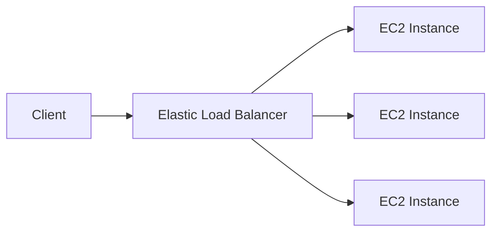
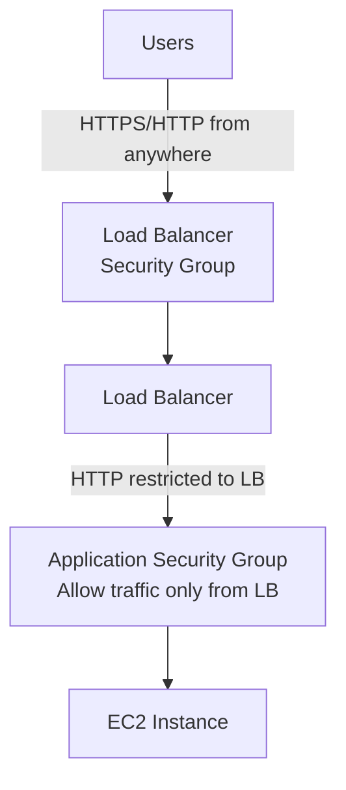
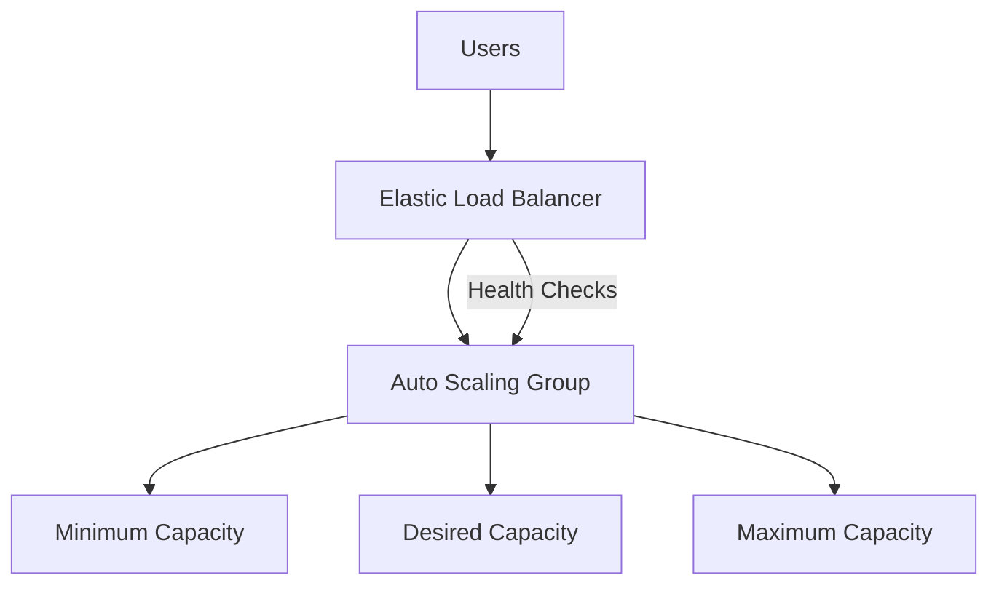

# High Availability & Scalability

## Key Concepts

### Scalability vs High Availability
- **Scalability**: an application/system can handle greater loads by adapting
  - **Vertical Scalability**
  - **Horizontal Scalability** (= elasticity)
- Scalability is linked but **different** from High Availability

**Vertical Scalability**
- Increasing the **size** of the instance (scale up/down)
- Example: `t2.micro` → `t2.large`
- Very common for **non-distributed systems**, such as a database
- **RDS, ElastiCache** are services that can scale vertically
- Usually a hardware limit to how far you can scale

**Horizontal Scalability**
- Increasing the **number** of instances/systems for your application (scale out/in)
- Implies **distributed systems** — very common for web/modern applications
- Easy to achieve thanks to cloud offerings such as **Amazon EC2**

**High Availability**
- Usually goes hand in hand with horizontal scaling
- Means running your application/system in **at least 2 data centers** (== Availability Zones)
- Goal: **survive a data center loss**
- Can be **passive** (e.g., RDS Multi-AZ) or **active** (horizontal scaling)

**For EC2 specifically:**

| Scaling Type | Mechanism | Example |
|---|---|---|
| Vertical Scaling | Increase instance size | `t2.nano` (0.5 GB RAM, 1 vCPU) → `u-12tb1.metal` (12.3 TB RAM, 448 vCPUs) |
| Horizontal Scaling | Increase number of instances | Auto Scaling Group, Load Balancer |
| High Availability | Run instances across multi-AZ | ASG multi-AZ, Load Balancer multi-AZ |

### What is Load Balancing?
- Load balancers are servers that **forward traffic** to multiple downstream servers (e.g., EC2 instances)

**Why use a load balancer?**
- Spread load across multiple downstream instances
- Expose a **single point of access (DNS)** to your application
- Seamlessly handle failures of downstream instances
- Do regular **health checks** on instances
- Provide **SSL termination (HTTPS)** for websites
- Enforce **stickiness** with cookies
- High availability across zones
- Separate public traffic from private traffic

**Why use an Elastic Load Balancer (managed)?**
- AWS guarantees it will be working; handles upgrades, maintenance, high availability
- AWS provides only a few configuration knobs (less effort, less flexibility than self-managed)
- Integrated with many AWS offerings: EC2, EC2 ASG, Amazon ECS, ACM, CloudWatch, Route 53, AWS WAF, AWS Global Accelerator

### Health Checks
- Crucial for load balancers — let the LB know if instances are available to reply to requests
- Done on a **port and a route** (`/health` is common)
- If response is not **200 (OK)** → instance is **unhealthy**

### Types of Load Balancer on AWS

| Type | Generation / Year | Layer | Protocols |
|---|---|---|---|
| **Classic Load Balancer (CLB)** | v1 (old) — 2009 | Layer 4 & 7 | HTTP, HTTPS, TCP, SSL (secure TCP) |
| **Application Load Balancer (ALB)** | v2 (new) — 2016 | Layer 7 | HTTP, HTTPS, WebSocket |
| **Network Load Balancer (NLB)** | v2 (new) — 2017 | Layer 4 | TCP, TLS (secure TCP), UDP |
| **Gateway Load Balancer (GWLB)** | 2020 | Layer 3 | IP Protocol |

- Recommended to use the **newer generation** load balancers (more features)
- Some load balancers can be set up as **internal (private)** or **external (public)**

### Classic Load Balancer (v1)
- Supports TCP (Layer 4), HTTP & HTTPS (Layer 7)
- Health checks are TCP or HTTP based
- Fixed hostname: `XXX.region.elb.amazonaws.com`

### Application Load Balancer (v2)
- **Layer 7 (HTTP)**
- Load balances to multiple HTTP applications across machines (**target groups**)
- Load balances to multiple applications on the **same machine** (e.g., containers)
- Supports **HTTP/2 and WebSocket**
- Supports **redirects** (e.g., HTTP → HTTPS)
- Routing table options to different target groups:
  - **Path in URL** (`example.com/users` & `example.com/posts`)
  - **Hostname in URL** (`one.example.com` & `other.example.com`)
  - **Query String / Headers** (`example.com/users?id=123&order=false`)
- Great fit for **microservices & container-based applications** (e.g., Docker, Amazon ECS)
- Has a **port mapping feature** to redirect to a dynamic port in ECS
- In comparison, you'd need **multiple Classic Load Balancers** to achieve this

**ALB Target Groups**
- EC2 instances (can be managed by an ASG) — HTTP
- ECS tasks (managed by ECS itself) — HTTP
- Lambda functions — HTTP request translated into a JSON event
- IP addresses — **must be private IPs**
- ALB can route to **multiple target groups**
- **Health checks are at the target group level**

**ALB — Good to Know**
- Fixed hostname: `XXX.region.elb.amazonaws.com`
- The application servers **don't see the client's IP directly**
- The true client IP is inserted in the header **`X-Forwarded-For`**
- Also available: **`X-Forwarded-Port`** and **`X-Forwarded-Proto`**

### Network Load Balancer (v2)
- **Layer 4** — forwards **TCP & UDP** traffic
- Handles **millions of requests per second**
- **Ultra-low latency**
- **One static IP per AZ**, supports assigning an **Elastic IP** (helpful for whitelisting)
- Used for **extreme performance**, TCP or UDP traffic

**NLB Target Groups**
- EC2 instances
- IP addresses — must be private IPs
- Application Load Balancer
- Health checks support **TCP, HTTP, and HTTPS** protocols

### Gateway Load Balancer
- Deploy, scale, and manage a fleet of **3rd-party network virtual appliances** in AWS
- Examples: firewalls, intrusion detection/prevention systems, deep packet inspection, payload manipulation
- Operates at **Layer 3 (Network Layer)** — IP packets
- Combines two functions:
  - **Transparent Network Gateway** — single entry/exit point for all traffic
  - **Load Balancer** — distributes traffic to virtual appliances
- Uses the **GENEVE protocol on port 6081**

**GWLB Target Groups**
- EC2 instances
- IP addresses — must be private IPs

### Load Balancer Comparison — ALB vs NLB vs GWLB (vs CLB)

| Feature | CLB (v1) | ALB (v2) | NLB (v2) | GWLB |
|---|---|---|---|---|
| OSI Layer | 4 & 7 | 7 (HTTP) | 4 (TCP/UDP) | 3 (IP) |
| Protocols | HTTP, HTTPS, TCP, SSL | HTTP, HTTPS, WebSocket | TCP, TLS, UDP | IP Protocol |
| Year introduced | 2009 | 2016 | 2017 | 2020 |
| Target types | Instances | EC2, ECS, Lambda, IP | EC2, IP, ALB | EC2, IP |
| Multiple SSL certs | No (one only) | Yes (via SNI) | Yes (via SNI) | N/A |
| Static IP / Elastic IP | No | No | Yes (static IP per AZ, EIP support) | N/A |
| Use case | Legacy | Microservices, containers, path/host routing | Extreme performance, TCP/UDP, static IP | 3rd-party virtual appliances (firewalls, IDS/IPS) |

### Sticky Sessions (Session Affinity)
- Redirects the same client to the same instance behind a load balancer
- Works for **CLB, ALB, and NLB**
- For CLB & ALB, the stickiness **cookie has an expiration date** you control
- Use case: ensure the user doesn't lose session data
- **Enabling stickiness may bring imbalance** to load across backend instances

**Sticky Sessions — Cookie Names**
- **Application-based cookies**:
  - Custom cookie — generated by the target, can include custom attributes, cookie name specified per target group; **must not use** `AWSALB`, `AWSALBAPP`, or `AWSALBTG` (reserved for the ELB)
  - Application cookie — generated by the load balancer, cookie name is `AWSALBAPP`
- **Duration-based cookies**: generated by the load balancer, cookie name is `AWSALB` for ALB, `AWSELB` for CLB

### Cross-Zone Load Balancing
- **With** Cross-Zone LB: each load balancer node distributes traffic **evenly across all registered instances in all AZs**
- **Without**: requests stay within the instances of the node's own AZ

| Load Balancer | Default State | Inter-AZ Data Charges? |
|---|---|---|
| **ALB** | Enabled by default (can disable at target group level) | No charge |
| **NLB / GWLB** | Disabled by default | **You pay ($)** if enabled |
| **CLB** | Disabled by default | No charge even if enabled |

### SSL/TLS Basics
- An **SSL Certificate** encrypts traffic between clients and your load balancer (in-flight encryption)
- **SSL** = Secure Sockets Layer; **TLS** = Transport Layer Security (newer) — people still colloquially say "SSL"
- Public SSL certs issued by **Certificate Authorities (CA)**: Comodo, Symantec, GoDaddy, GlobalSign, Digicert, Let's Encrypt, etc.
- Certificates have an **expiration date** and must be renewed

**Load Balancer SSL Certificates**
- The LB uses an **X.509 certificate** (SSL/TLS server certificate)
- Manage certificates using **ACM (AWS Certificate Manager)**, or upload your own
- HTTPS listener: must specify a **default certificate**, can add an optional list to support multiple domains
- Clients use **SNI (Server Name Indication)** to specify the hostname they want to reach

**SNI (Server Name Indication)**
- Solves the problem of loading multiple SSL certs onto one web server (multiple websites)
- Requires the client to indicate the target hostname during the initial SSL handshake
- Server then finds the correct cert, or returns the default one
- **Only works for ALB & NLB (newer gen) and CloudFront — does NOT work for CLB**

**ELB SSL Certificate Support Summary**

| Load Balancer | SSL Certificate Support |
|---|---|
| CLB (v1) | Only **one** SSL certificate — needs multiple CLBs for multiple hostnames |
| ALB (v2) | Multiple listeners with multiple SSL certs, via **SNI** |
| NLB (v2) | Multiple listeners with multiple SSL certs, via **SNI** |

### Connection Draining
- Feature name differs by LB type: **Connection Draining** (CLB) vs **Deregistration Delay** (ALB & NLB)
- Time to complete "in-flight requests" while an instance is de-registering or unhealthy
- Stops sending **new** requests to the de-registering instance
- Range: **1 to 3,600 seconds** (default: **300 seconds**)
- Can be **disabled** (set to 0)
- Set to a low value if requests are short

## AWS Services / Features

### Auto Scaling Groups (ASG)
- Goal:
  - **Scale out** (add EC2 instances) to match increased load
  - **Scale in** (remove EC2 instances) to match decreased load
  - Ensure a **minimum and maximum** number of instances running
  - Automatically **register new instances to a load balancer**
  - **Re-create** an instance if a previous one is terminated (e.g., unhealthy)
- **ASGs are free** — you only pay for the underlying EC2 instances; usage of ASGs still results in cost from the resources they create/use, such as more EC2 instances, CloudWatch, and ELB load balancers
- An ASG is a **collection of instances with similar characteristics**, scaled based on criteria such as network communications or CPU utilization
- **Unhealthy instances are auto-replaced** — any instance state **other than "Running" is considered unhealthy**

**ASG Group Considerations**
- Time needed to launch and configure a server
- Knowing the relevant metrics for your application: CPU utilization, network throughput, free memory
- What AZs should the Auto Scaling Group span? (you can span multiple AZs)
- Should you scale for more capacity, or for redundancy?
- What is the minimum number of instances that should always be running?

### Other Scalable AWS Resources (Application Auto Scaling)
Beyond EC2 Auto Scaling Groups, several other AWS resources can be scaled automatically:
- Aurora DB clusters
- DynamoDB Global Secondary Indexes (GSIs)
- DynamoDB tables
- ECS services
- Spot Fleet requests

**ASG Attributes (Launch Template)**
- **Launch Template** (older "Launch Configurations" are deprecated) containing:
  - AMI + Instance Type
  - EC2 User Data
  - EBS Volumes
  - Security Groups
  - SSH Key Pair
  - IAM Roles for EC2 instances
  - Network + Subnets information
  - Load Balancer information
- Min Size / Max Size / Initial (Desired) Capacity
- Scaling Policies

**Auto Scaling — CloudWatch Alarms & Scaling**
- Scale an ASG based on CloudWatch alarms
- An alarm monitors a metric (e.g., Average CPU, or a custom metric) computed across the overall ASG
- Based on the alarm: create **scale-out** (increase) or **scale-in** (decrease) policies

**Scaling Policies**

| Policy Type | Description | Example |
|---|---|---|
| **Target Tracking Scaling** | Simplest to set up | Keep average ASG CPU around 40% |
| **Simple / Step Scaling** | React to a specific CloudWatch alarm | CPU > 70% → add 2 units; CPU < 30% → remove 1 |
| **Scheduled Scaling** | Anticipate scaling from known usage patterns | Increase min capacity to 10 at 5pm on Fridays |
| **Predictive Scaling** | Continuously forecast load and schedule scaling ahead of time | — |

**Good Metrics to Scale On**
- `CPUUtilization` — average CPU utilization across instances
- `RequestCountPerTarget` — ensures request count per instance stays stable
- **Average Network In/Out** — for network-bound applications
- Any **custom metric** pushed via CloudWatch

**Scaling Cooldowns**

- The default cooldown (300 seconds unless changed) is associated with **simple scaling**, allowing a previous scaling activity to take effect.
- **Target tracking and step scaling** use instance warmup rather than waiting for the simple-scaling cooldown before scaling out.
- Scheduled scaling and replacement of unhealthy instances can proceed during a cooldown. It is not a universal freeze on launches or terminations.
- Use a ready-to-use AMI and appropriate instance warmup so new capacity can actually serve requests before metrics are interpreted.

### ASG Termination Policies
When an ASG scales in, it decides which instance to terminate using a termination policy:

**Custom Termination Policies** (you can choose the criterion):
- Oldest instance
- Newest instance
- Oldest launch configuration
- Closest to the next instance (billing) hour

**Default Termination Policy** (the algorithm AWS uses if you don't set a custom one):
1. Select the AZ with the **most instances** (to keep instances balanced across AZs)
2. If multiple AZs tie for the most instances:
   - Select the instance with the **oldest launch configuration**, or an instance in an AZ where termination is otherwise possible
   - An unprotected instance using the oldest launch configuration is treated as "suffering from lack of restart" performance
   - Otherwise, select the instance **closest to its next billing hour**
   - If there's still a tie, **select randomly**

### Methods to Launch an Auto Scaling Group
| Method | Description |
|---|---|
| **Launch Template** | Create a template specifying the parameters to launch instances with. (1) The launch template must include all parameters required to launch an EC2 instance (e.g., AMI ID and instance type) — otherwise you get the error "you must use a fully formed launch template." (2) The IAM user or role performing the action needs the `ec2:RunInstances` permission. |
| **Launch Configuration** | The (deprecated) older way to define how instances added to an ASG are launched — see "ASG Attributes" above. |
| **From an EC2 Instance** | Take an existing instance and launch an ASG from it — this is equivalent to creating an AMI from that instance first. |
| **Amazon EC2 Launch Wizard** | When creating an instance, you can specify how many you want; the wizard has a link to put them directly into an Auto Scaling Group. |

## Exam Tips
> [!TIP]
> ALB vs NLB vs GWLB is one of the most-tested comparisons on the exam: **ALB = Layer 7 HTTP/HTTPS, path/host routing, microservices**; **NLB = Layer 4 TCP/UDP, extreme performance, static IP/Elastic IP support**; **GWLB = Layer 3, 3rd-party virtual appliances (firewalls/IDS)**.

> [!WARNING]
> Only **ALB and NLB** support **SNI** for multiple SSL certificates on one load balancer — **CLB supports only one certificate**, requiring multiple CLBs for multiple hostnames.

> [!TIP]
> Cross-Zone Load Balancing billing is a common trick: it's **free with ALB** (enabled by default) but **you pay for inter-AZ data with NLB/GWLB** if you enable it (disabled by default).

> [!TIP]
> Vertical scaling (bigger instance) has a hardware ceiling and suits non-distributed systems like databases (RDS, ElastiCache); horizontal scaling (more instances) is the elastic, cloud-native approach for distributed web apps.

> [!WARNING]
> Distinguish **simple-scaling cooldown** from **instance warmup**. Target tracking/step scaling, scheduled actions and unhealthy-instance replacement do not follow a blanket 300-second no-scaling rule.

## Related Notes
- [[01-EC2-Basics]]
- [[02-EC2-Associate]]
- [[03-EC2-Instance-Storage]]
- [[00-Cluster-MOC]]

## Checked corrections — 2026-11-09

Only the changes listed here were verified in this audit; other course-derived details still need checking when used.

- Corrected cooldown behavior and separated it from instance warmup.
  - [AWS documentation](https://docs.aws.amazon.com/autoscaling/ec2/userguide/ec2-auto-scaling-scaling-cooldowns.html)
