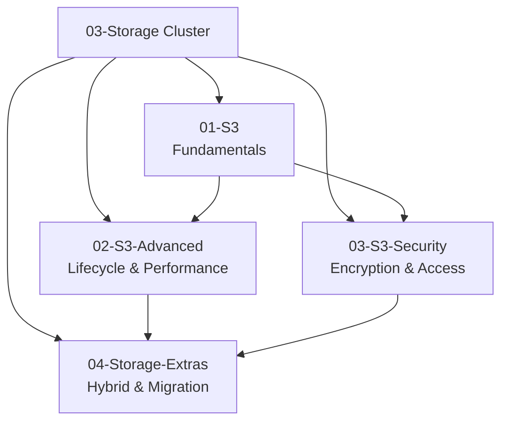

# 03-Storage — Cluster Map of Content

## Key Concepts

- This cluster covers AWS storage services from the SAA-C03 slide deck (source pages 267–374): Amazon S3 fundamentals, S3 advanced/performance features, S3 security & encryption, and the wider storage portfolio (Snow family, FSx, Storage Gateway, Transfer Family, DataSync).
- Study order: start with [[01-S3]] for the fundamentals, then [[02-S3-Advanced]] for lifecycle/performance, then [[03-S3-Security]] for encryption and access control, and finish with [[04-Storage-Extras]] for hybrid/migration services.

## Notes in this Cluster

| Note | Covers | Exam Domains |
|---|---|---|
| [[01-S3]] | S3 buckets, objects, security overview, bucket policies, static website hosting, versioning, replication (CRR/SRR), storage classes, durability/availability, S3 Express One Zone | 1, 3, 4 |
| [[02-S3-Advanced]] | S3 Lifecycle Rules (transition/expiration), Storage Class Analysis, Requester Pays, Event Notifications (Lambda/SQS/SNS/EventBridge), baseline performance, multi-part upload, Transfer Acceleration, byte-range fetches, Batch Operations, Storage Lens | 3, 4 |
| [[03-S3-Security]] | SSE-S3/SSE-KMS/SSE-C/Client-Side encryption, encryption in transit, CORS, MFA Delete, access logs, pre-signed URLs, Glacier Vault Lock, S3 Object Lock, Access Points, S3 Object Lambda | 1 |
| [[04-Storage-Extras]] | AWS Snowball & edge computing, Amazon FSx (Windows/Lustre/ONTAP/OpenZFS), AWS Storage Gateway (S3 File/Volume/Tape), AWS Transfer Family, AWS DataSync, storage service comparison | 3, 4 |

## AWS Services / Features

## Exam Tips

> [!TIP]
> - S3 storage class trade-offs (durability vs. availability vs. retrieval time vs. cost) are tested constantly — review the comparison tables in [[01-S3]].
> - Storage Gateway type selection (S3 File / Volume Cached / Volume Stored / Tape) is a classic scenario question — review the comparison table in [[04-Storage-Extras]].
> - Encryption method selection (SSE-S3 vs SSE-KMS vs SSE-C vs Client-Side) depends on who needs to manage/audit the key — review [[03-S3-Security]].

## Related Notes
- [[01-S3]]
- [[02-S3-Advanced]]
- [[03-S3-Security]]
- [[04-Storage-Extras]]
