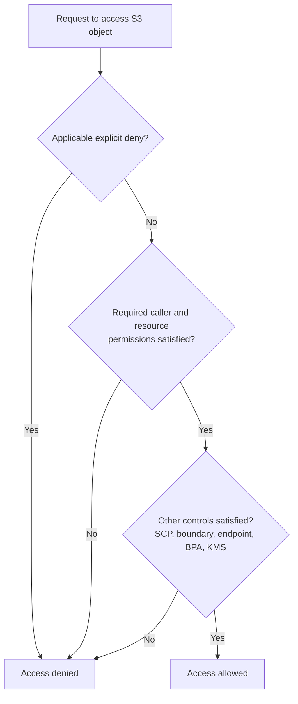
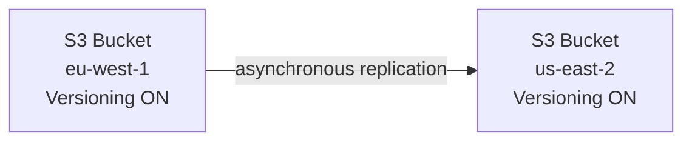

# Amazon S3 — Buckets, Objects, Versioning & Storage Classes

## Key Concepts

- Amazon S3 (Simple Storage Service) is advertised as "infinitely scaling" object storage and is one of the main building blocks of AWS.
- **Use cases**: backup and storage, disaster recovery, archive, hybrid cloud storage, application hosting, media hosting, data lakes & big data analytics, software delivery, static website hosting.
  - Example: Nasdaq stores 7 years of data into S3 Glacier; Sysco runs analytics on its data to gain business insights.
- S3 looks like a global service, but **buckets are created in a specific region**.
- **Bucket naming**:
  - Shared Global Namespace — must be unique across accounts and Regions **within an AWS partition**.
  - Account Regional Namespace — allows reuse of the same bucket name across regions.
  - Naming constraints: no uppercase, no underscore, not an IP address, must start with a lowercase letter or number, must NOT start with prefix `xn--`, must NOT end with suffix `-s3alias`.
- **Objects (files)** have a **Key** = the full key inside the bucket, e.g. `my_folder1/another_folder/my_file.txt`. In `s3://my-bucket/my_folder1/another_folder/my_file.txt`, the bucket name and URI scheme are not part of the key.
  - There is no real concept of "directories" within buckets (the console UI tricks you into thinking otherwise) — just keys containing slashes (`/`).
- **Object composition**:
  - Value = the content of the body. Max object size is **50 TB** (50,000 GB) via multipart upload (objects from 5 MB to 50 TB); a single `PUT` operation is capped at 5 GB.
  - If uploading a file larger than 5 GB, you **must** use multi-part upload.

> [!NOTE] Conflict resolved — object size limit
> An XMind study source used to cross-check this vault stated a 5 TB max object size. Verified 2026-07 against [AWS S3 docs — Uploading objects](https://docs.aws.amazon.com/AmazonS3/latest/userguide/upload-objects.html) and the [S3 FAQs](https://aws.amazon.com/s3/faqs/): the current max is **50 TB**. 5 TB was the correct figure from December 2010 until AWS raised it to 50 TB in a December 2025 update — the mind map source was accurate for its time but is now outdated.
  - Metadata: list of text key/value pairs (system or user metadata).
    - **System metadata**: date last modified, object size, checksum/ETag metadata (an ETag is **not universally an MD5 digest**, especially with multipart/encrypted uploads), HTTP Content-Type.
    - **User metadata**: optional, and can only be specified at the time an object is created.
  - Tags: Unicode key/value pairs (up to 10) — useful for security and lifecycle rules (e.g., allowing some objects in a bucket to have lifecycle rules but not others, by using tags or prefixes), and to track cost against projects or other criteria.
  - Version ID (if versioning is enabled).
  - Objects can range from 0 bytes in size, are of any file type, and there is **no limit** on the number of objects that can be stored in a bucket.
  - Objects can be addressed by URLs, but access is private by default; an address does not grant authorization.
  - Objects are automatically replicated across at least three Availability Zones in most S3 storage classes.

## AWS Services / Features

### S3 Security Overview

- **User-based**: IAM Policies — which API calls are allowed for a specific IAM user.
- **Resource-based**:
  - Bucket Policies — bucket-wide rules set from the S3 console, allows cross-account access.
  - Object Access Control List (ACL) — finer grain (can be disabled).
  - Bucket Access Control List (ACL) — less common (can be disabled).
  - Access can be opened at the bucket and object levels in three ways: (1) ACL rules, (2) finer-grained S3 bucket policies, or (3) IAM policies. **AWS recommends applying S3 bucket policies or IAM policies instead of ACLs** — ACLs are considered leftovers from before AWS created IAM.
- For same-account requests, an identity policy or resource policy can grant access, subject to explicit denies and other applicable controls. **Cross-account access normally needs permission in both the caller account and the resource account**. SCPs, permissions boundaries, session policies, endpoint policies, Block Public Access, and KMS permissions can affect the result; a simple OR test is incomplete.
- Encryption: objects in S3 can be encrypted using encryption keys (see [[03-S3-Security]] for full detail).

This is a study aid, not a complete IAM policy-evaluation algorithm.

### S3 Bucket Policies

- JSON-based policies.
- **Resources**: buckets and objects. **Effect**: Allow / Deny. **Actions**: set of APIs to allow or deny. **Principal**: the account or user the policy applies to.
- Use an S3 bucket policy to:
  - Grant public access to the bucket.
  - Force objects to be encrypted at upload.
  - Grant access to another account (cross-account).
- Common conditions used to scope a bucket policy: **IP address range**, **AWS account**, or **objects with a specific prefix**.
- **Access examples**:
  - Public access → use a Bucket Policy allowing anonymous access.
  - IAM user access → use an IAM Policy attached to the user.
  - EC2 instance access → use an IAM Role attached to the instance.
  - Cross-account access → use a Bucket Policy that allows the other account's IAM user/role.
- **Block Public Access settings**: created to prevent company data leaks. If a bucket should never be public, leave these settings on. Can be set at the account level.

### S3 REST API & CRUD Operations

- S3 manages data at the **application level** using a **REST API** — the language used to talk to S3 when writing code, allowing for **CRUD operations** (Create, Read, Update, Delete).
- HTTP methods map to CRUD operations:
  - **Create** → HTTP `PUT` or `POST`.
  - **Read** → HTTP `GET`.
  - **Update** → HTTP `POST` or `PUT`.
  - **Delete** → HTTP `DELETE`.
- Use conditional writes for concurrency control: `If-None-Match: *` prevents replacing an existing current object; `If-Match` checks its ETag before updating. Versioning preserves versions; Object Lock protects retained versions. These solve different problems.

### S3 Data Consistency Model

- S3 provides **strong read-after-write consistency** for object PUTs (new and overwrite), DELETEs, and subsequent reads/listing after a successful response.
- Strong consistency does not make a multi-object operation transactional and does not make cross-Region replication synchronous.
- Concurrent writers still need application coordination or conditional writes; do not use an obsolete eventual-consistency delay to explain overwrite/delete behavior.

### S3 Static Website Hosting

- S3 can host static websites, accessible on the Internet.
- URL format (region-dependent):
  - `http://bucket-name.s3-website-aws-region.amazonaws.com`
  - `http://bucket-name.s3-website.aws-region.amazonaws.com`

> [!WARNING]
> If you get a **403 Forbidden** error on a static website, check that the bucket policy allows public reads.

### S3 Versioning

- Enabled at the **bucket level**.
- An overwrite of the same key creates another version with an opaque version ID, not a sequential counter.
- Best practice to version your buckets:
  - Protects against unintended deletes (ability to restore a version).
  - Easy rollback to a previous version.
- Notes:
  - Files not versioned prior to enabling versioning have version "null".
  - Once enabled on a bucket, versioning can only be **suspended** — it **cannot be disabled**. Suspending versioning does **not** delete previous versions; old version files are retained, and only one new "latest version" file is created on the next upload.

### S3 Replication (CRR & SRR)

- Must enable **Versioning** in both source and destination buckets.
- **Cross-Region Replication (CRR)** and **Same-Region Replication (SRR)**.
- Buckets can be in different AWS accounts. Copying is **asynchronous**.
- Must give proper IAM permissions to S3.
- Use cases: CRR — compliance, lower latency access, replication across accounts. SRR — log aggregation, live replication between production and test accounts.
- After enabling replication, **only new objects** are replicated.
  - Optionally use **S3 Batch Replication** to replicate existing objects and objects that failed replication.
- DELETE operations: delete markers can optionally be replicated from source to target. Deletions **with a version ID** are **not** replicated (to avoid malicious deletes).
- **No "chaining"** of replication — if bucket 1 replicates to bucket 2, which replicates to bucket 3, objects created in bucket 1 are **not** replicated to bucket 3.

### S3 Storage Classes

- Amazon S3 Standard - General Purpose
- Amazon S3 Standard-Infrequent Access (IA)
- Amazon S3 One Zone-Infrequent Access
- Amazon S3 Glacier Instant Retrieval
- Amazon S3 Glacier Flexible Retrieval
- Amazon S3 Glacier Deep Archive
- Amazon S3 Intelligent-Tiering
- Objects can move between classes manually or automatically using S3 Lifecycle configurations (see [[02-S3-Advanced]]).

### Durability and Availability

- **Durability**: high durability, **99.999999999% (11 nines)** of objects across multiple AZs. If you store 10,000,000 objects in S3, you can expect to lose a single object on average once every 10,000 years. Durability is the **same for all storage classes**. Data is automatically replicated **within a region**; Amazon S3 data is **NOT backed up to tape**.
- **Availability**: measures how readily available a service is; **varies by storage class**. Example: S3 Standard has 99.99% availability = not available ~53 minutes a year.

> [!NOTE] Conflict resolved — S3 Standard downtime figure
> An XMind study source stated ~9 hours/year of downtime for S3 Standard. Verified 2026-07: AWS states two different percentages for S3 Standard depending on which figure you mean — **99.99% "designed for" availability** (~53 min/year downtime, per the [S3 storage class comparison](https://docs.aws.amazon.com/AmazonS3/latest/userguide/storage-class-intro.html) and [S3 FAQs](https://aws.amazon.com/s3/faqs/)) is the number tested on the exam and used in this note's table above, vs. the **99.9% contractual SLA** (~8.76 hours/year, per the [S3 SLA](https://aws.amazon.com/s3/sla/)) that AWS commits to with service credits. Both figures are legitimately AWS's own — they answer different questions, not a factual error in either source. Know 99.99% / ~53 min for exam purposes.

> [!IMPORTANT]
> Durability (11 nines) is identical across all S3 storage classes. Only **availability** differs. This is a classic exam trap.

### S3 Standard – General Purpose

- 99.99% Availability. Used for frequently accessed data. Low latency and high throughput.
- Sustains 2 concurrent facility (AZ) failures.
- Use cases: big data analytics, mobile & gaming applications, content distribution.

### Infrequent Access Classes

- For data less frequently accessed but requiring rapid access when needed. Lower cost than S3 Standard.
- **S3 Standard-IA**: 99.9% Availability. Use cases: disaster recovery, backups.
- **S3 One Zone-IA**: high durability (11 nines) in a **single AZ** — data is lost if that AZ is destroyed. 99.5% Availability. Use cases: secondary backup copies of on-premises data, or data you can recreate.

### Glacier Storage Classes

- Low-cost object storage for archiving/backup. Pricing = storage cost + object retrieval cost.
- **S3 Glacier Instant Retrieval**: millisecond retrieval, great for data accessed once a quarter. Minimum storage duration 90 days.
- **S3 Glacier Flexible Retrieval** (formerly S3 Glacier): Expedited (1–5 min), Standard (3–5 hours), Bulk (5–12 hours, free). Minimum storage duration 90 days.
- **S3 Glacier Deep Archive**: for long-term storage. Standard (12 hours), Bulk (48 hours). Minimum storage duration 180 days.

### Amazon S3 Glacier — Vault & Archive Model

- An extremely low-cost storage service with **unlimited** volume of data and **unlimited** number of archives.
- Use cases: data that does not require real-time access, long-term backups, scientific data storage, healthcare information archiving.
- Glacier stores data in **archives**, which are contained in **vaults**. Unlike S3's "human-readable" key names, Glacier archives are given **machine-generated IDs**.
- Glacier vault names do **not** have to be globally unique.
- Glacier's archives are **encrypted by default**, using **AES 256-bit encryption** — the assumption is that this is archival data.
- An account can create up to **1,000 vaults per Region**.
- Glacier supports **multipart uploads** of archives — a large archive is not required to be uploaded in a single action.
- **Billing** is based on: storage capacity (you define the region for data storage), the number of upload requests, retrieval operations (data retrievals; PUT, COPY, POST, or LIST requests are all charged), and data transfer across all other Regions. Snow devices can also be used to import data into Glacier.
- **Data retrieval settings**:
  - **Free tier**: can retrieve up to 5% of data for free each month. Only empty vaults can be deleted.
  - **Max retrieval rate**: you can set a rate (e.g., 1 GB/hour), at a cost (e.g., $7.2/month).
  - **No retrieval limit**: cost varies based on usage.
- **Event notifications**: know when someone retrieved something or performed an action on a vault.
- **AWS Storage Gateway** can connect to Glacier to back up or archive data.
- When an Amazon Glacier object is retrieved, it is copied to **Amazon S3 Reduced Redundancy Storage (RRS)**.

### S3 Reduced Redundancy Storage (RRS) — Legacy

- Should only be used for **replicated or reproducible data**.
- Durability and availability of **99.99%**.
- **Cannot** be used with S3 Lifecycle rules.
- Use cases: non-critical or reproducible data, storing thumbnails and other resized images.

### S3 Intelligent-Tiering

- Small monthly monitoring and auto-tiering fee. Moves objects automatically between access tiers based on usage. **No retrieval charges**.
- Frequent Access tier (automatic): default tier.
- Infrequent Access tier (automatic): objects not accessed for 30 days.
- Archive Instant Access tier (automatic): objects not accessed for 90 days.
- Archive Access tier (optional): configurable from 90 days to 700+ days.
- Deep Archive Access tier (optional): configurable from 180 days to 700+ days.

### S3 Storage Classes Comparison

| Class | Durability | Availability | Availability SLA | AZs | Min Storage Duration | Min Billable Object Size | Retrieval Fee |
|---|---|---|---|---|---|---|---|
| Standard | 11 9's | 99.99% | 99.9% | ≥ 3 | None | None | None |
| Intelligent-Tiering | 11 9's | 99.9% | 99% | ≥ 3 | None | None | None |
| Standard-IA | 11 9's | 99.9% | 99% | ≥ 3 | 30 days | 128 KB | Per GB retrieved |
| One Zone-IA | 11 9's | 99.5% | 99% | 1 | 30 days | 128 KB | Per GB retrieved |
| Glacier Instant Retrieval | 11 9's | 99.9% | 99% | ≥ 3 | 90 days | 128 KB | Per GB retrieved |
| Glacier Flexible Retrieval | 11 9's | 99.99% | 99.9% | ≥ 3 | 90 days | 40 KB | Per GB retrieved |
| Glacier Deep Archive | 11 9's | 99.99% | 99.9% | ≥ 3 | 180 days | 40 KB | Per GB retrieved |

### S3 Storage Classes – Price Comparison (example: us-east-1)

| Class | Storage Cost (per GB/month) | Retrieval Time |
|---|---|---|
| Standard | $0.023 | Instantaneous |
| Intelligent-Tiering | $0.0025 – $0.023 | Instantaneous |
| Standard-IA | $0.0125 | Instantaneous |
| One Zone-IA | $0.01 | Instantaneous |
| Glacier Instant Retrieval | $0.004 | Instantaneous |
| Glacier Flexible Retrieval | $0.0036 | Expedited (1–5 min) / Standard (3–5 hrs) / Bulk (5–12 hrs) |
| Glacier Deep Archive | $0.00099 | Standard (12 hrs) / Bulk (48 hrs) |

> [!NOTE]
> Source: `https://aws.amazon.com/s3/storage-classes/` and `https://aws.amazon.com/s3/pricing/` (as cited in the slides).

### S3 Express One Zone

- High performance, **single Availability Zone** storage class.
- Objects stored in a **Directory Bucket** (a bucket confined to a single AZ).
- Handles 100,000s of requests per second with single-digit millisecond latency.
- Designed for very low latency with compute and data in one AZ; verify current price/performance claims rather than treating older marketing percentages as guarantees.
- High Durability (99.999999999%) and Availability (99.95%).
- Co-locate storage and compute resources in the same AZ to reduce latency.
- Use cases: latency-sensitive apps, data-intensive apps, AI & ML training, financial modeling, media processing, HPC.
- Best integrated with SageMaker Model Training, Athena, EMR, Glue.

## Exam Tips

> [!TIP]
> - Durability is **11 9's for every storage class** — only availability changes between classes.
> - Files > 5 GB **must** use multi-part upload; recommended for files > 100 MB (see [[02-S3-Advanced]]).
> - Replication requires **versioning enabled on both** source and destination buckets, and is **not retroactive** for existing objects unless you use S3 Batch Replication.
> - There is **no chaining** of replication across three or more buckets.
> - S3 One Zone-IA and S3 Express One Zone both live in a **single AZ** — data is lost if that AZ is destroyed, but they solve different problems (cheap infrequent access vs. ultra-low-latency high performance).
> - Know the minimum storage duration charges: Standard-IA/One Zone-IA = 30 days, Glacier Instant/Flexible = 90 days, Glacier Deep Archive = 180 days — early deletion is billed for the remainder of the minimum duration.
> - **Reduced Redundancy Storage (RRS)** is a legacy storage class — only for replicated/reproducible data (e.g., thumbnails), and it cannot be used with Lifecycle rules.
> S3 provides **strong consistency for new writes, overwrites, deletes, and object listing** after a successful response. Cross-Region replication remains asynchronous.

## Related Notes
- [[02-S3-Advanced]]
- [[03-S3-Security]]
- [[04-Storage-Extras]]
- [[00-Cluster-MOC]]

## Checked corrections — 2026-11-09

Only the changes listed here were verified in this audit; other course-derived details still need checking when used.

- Corrected strong consistency, conditional writes, version IDs and cross-account access evaluation.
  - [AWS documentation](https://docs.aws.amazon.com/AmazonS3/latest/userguide/Welcome.html)
  - [AWS documentation](https://docs.aws.amazon.com/AmazonS3/latest/userguide/conditional-writes.html)
  - [AWS documentation](https://docs.aws.amazon.com/IAM/latest/UserGuide/reference_policies_evaluation-logic-cross-account.html)
