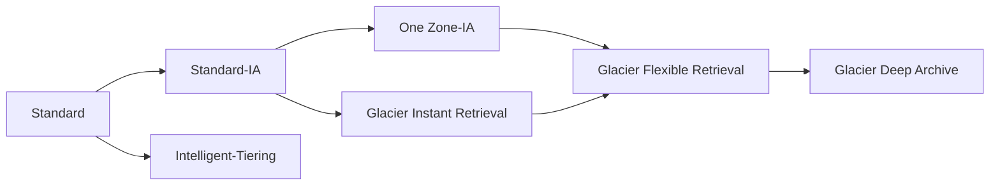
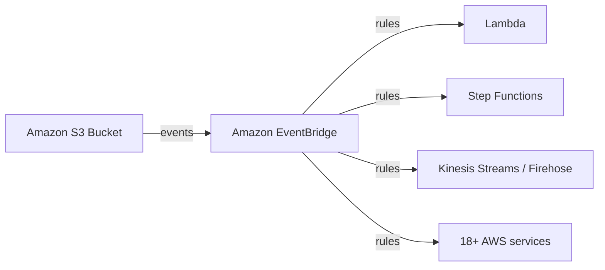

# Amazon S3 — Lifecycle Rules, Performance & Analytics

## Key Concepts

- Objects can be transitioned between S3 storage classes manually or automatically via **Lifecycle Rules**.
  - For infrequently accessed objects, move them to Standard-IA.
  - For archive objects you don't need fast access to, move them to Glacier or Glacier Deep Archive.
- Amazon S3 automatically scales to handle high request rates with **100–200 ms** latency.

## AWS Services / Features

### S3 Lifecycle Rules

- **Transition Actions** — configure objects to transition to another storage class.
  - E.g., move objects to Standard-IA 60 days after creation; move to Glacier for archiving after 6 months.
- **Expiration Actions** — configure objects to expire (delete) after some time.
  - E.g., delete access log files after 365 days.
  - Can delete old versions of files (if versioning enabled).
  - Can delete incomplete multi-part uploads.
- Rules can target a specific **prefix** (e.g., `s3://mybucket/mp3/*`) or specific **object tags** (e.g., `Department: Finance`).

#### Lifecycle Scenario 1

> An application on EC2 creates image thumbnails after profile photos are uploaded to S3. Thumbnails can be easily recreated and only need to be kept for 60 days. Source images should be immediately retrievable for 60 days, after which the user can wait up to 6 hours.

- Source images: **S3 Standard**, with a lifecycle rule to transition to **Glacier** after 60 days.
- Thumbnails: **S3 One Zone-IA**, with a lifecycle rule to **expire (delete)** after 60 days.

#### Lifecycle Scenario 2

> Deleted S3 objects must be recoverable immediately for 30 days (rare event), then recoverable within 48 hours for up to 365 days total.

- Enable **S3 Versioning** so "deleted objects" are hidden behind a delete marker and can be recovered.
- Transition **noncurrent versions** to Standard-IA.
- Transition noncurrent versions afterwards to **Glacier Deep Archive**.

#### Lifecycle Scenario 3

> Store backup data initially in Amazon S3 Standard.

- After 30 days, transition to Standard-IA (there are minimum times, e.g. 30 days, before a transition can occur).
- After 90 days, transition to Amazon Glacier.
- After 3 years, delete the object.
- In addition to the S3 Intelligent-Tiering storage class (which changes storage tiers automatically), lifecycle rules can be **manually configured** on a bucket to change storage tiers on a schedule like this.

### S3 Analytics – Storage Class Analysis

- Helps decide when to transition objects to the right storage class.
- Provides recommendations for **Standard and Standard-IA only** — does **NOT** work for One Zone-IA or Glacier.
- Report updated daily; 24–48 hours to start seeing data analysis.
- Good first step before building (or improving) Lifecycle Rules.

### S3 – Requester Pays

- Normally, the bucket owner pays for all S3 storage and data transfer costs.
- With **Requester Pays** buckets, the requester (not the owner) pays for the request and data download.
- Helpful for sharing large datasets with other accounts.
- The requester **must be authenticated** in AWS (cannot be anonymous).

### S3 Event Notifications

- Events: `S3:ObjectCreated`, `S3:ObjectRemoved`, `S3:ObjectRestore`, `S3:Replication`, etc.
- Object name filtering possible (e.g., `*.jpg`).
- Destinations: **Lambda Function**, **SQS**, **SNS**.
- Use case: generate thumbnails of images uploaded to S3.
- You can create as many "S3 events" as desired.
- Events typically deliver in seconds, but can sometimes take a minute or longer.
- IAM permissions: the destination (Lambda resource policy, SNS resource/access policy, SQS resource/access policy) must allow S3 to invoke/publish to it.

### S3 Event Notifications with Amazon EventBridge

- All S3 bucket events can be routed through **Amazon EventBridge**.
- Advanced filtering with JSON rules (metadata, object size, name…).
- Multiple destinations — e.g., Step Functions, Kinesis Streams/Firehose, and over **18 AWS services** as destinations.
- EventBridge capabilities: Archive, Replay Events, reliable delivery.

### S3 Baseline Performance

- S3 automatically scales to high request rates.
- Achieves at least **3,500 PUT/COPY/POST/DELETE** or **5,500 GET/HEAD** requests per second **per prefix** in a bucket.
- No limit on the number of prefixes in a bucket.
- Example prefixes: `bucket/folder1/sub1/file` → prefix `/folder1/sub1/`; `bucket/1/file` → prefix `/1/`.
- Spreading reads evenly across 4 prefixes can achieve 22,000 requests/second for GET and HEAD.

### S3 Performance — Multi-Part Upload & Transfer Acceleration

- **Multi-part upload**: recommended for files > 100 MB, **must** be used for files > 5 GB. Parallelizes uploads to speed up transfers.
- **S3 Transfer Acceleration**: increases transfer speed by routing uploads through the nearest AWS **edge location**, which forwards data to the S3 bucket over the AWS private network. Compatible with multi-part upload.

### S3 Performance — Byte-Range Fetches

- Parallelize GETs by requesting specific **byte ranges**.
- Better resilience in case of failures — can be used to speed up downloads.
- Can also retrieve only partial data (e.g., just the header of a file).

### S3 Batch Operations

- Perform bulk operations on existing S3 objects with a single request, e.g.:
  - Modify object metadata & properties.
  - Copy objects between S3 buckets.
  - Encrypt un-encrypted objects.
  - Modify ACLs, tags.
  - Restore objects from S3 Glacier.
  - Invoke a Lambda function to perform a custom action on each object.
- A job = a list of objects + the action to perform + optional parameters.
- Jobs are created based on a **manifest** — a listing of all the objects in a bucket, in either **CSV or JSON** format.
- S3 Batch Operations manages retries, tracks progress, sends completion notifications, generates reports.
- Use **S3 Inventory** to get the object list, and **Athena** to query/filter objects before running a batch job.

### S3 Storage Lens

- Understand, analyze, and optimize storage across an entire AWS Organization.
- Discovers anomalies, identifies cost efficiencies, applies data protection best practices (30 days of usage & activity metrics).
- Aggregates data at Organization, account, region, bucket, or prefix level.
- Default dashboard, or build custom dashboards.
- Can export metrics daily to an S3 bucket (CSV, Parquet).

**Default Dashboard**
- Visualizes summarized insights and trends for free and advanced metrics.
- Shows multi-region and multi-account data. Preconfigured by S3.
- Cannot be deleted, but can be disabled.

**Metrics categories**
- **Summary Metrics**: general insights (StorageBytes, ObjectCount…) — identify fastest-growing or unused buckets/prefixes.
- **Cost-Optimization Metrics**: NonCurrentVersionStorageBytes, IncompleteMultipartUploadStorageBytes… — identify incomplete multipart uploads older than 7 days, objects to move to lower-cost classes.
- **Data-Protection Metrics**: VersioningEnabledBucketCount, MFADeleteEnabledBucketCount, SSEKMSEnabledBucketCount, CrossRegionReplicationRuleCount… — identify buckets not following data-protection best practices.
- **Access-Management Metrics**: ObjectOwnershipBucketOwnerEnforcedBucketCount… — identify Object Ownership settings in use.
- **Event Metrics**: EventNotificationEnabledBucketCount — identify buckets with S3 Event Notifications configured.
- **Performance Metrics**: TransferAccelerationEnabledBucketCount — identify buckets with S3 Transfer Acceleration enabled.
- **Activity Metrics**: AllRequests, GetRequests, PutRequests, ListRequests, BytesDownloaded…
- **Detailed Status Code Metrics**: 200OKStatusCount, 403ForbiddenErrorCount, 404NotFoundErrorCount…

**Free vs. Paid**

| | Free Metrics | Advanced Metrics & Recommendations |
|---|---|---|
| Availability | All customers, automatic | Additional paid feature |
| Metric count | ~28 usage metrics | Activity, Advanced Cost Optimization, Advanced Data Protection, Status Code metrics |
| CloudWatch publishing | — | Included at no extra charge |
| Prefix aggregation | — | Yes, collects metrics at the prefix level |
| Query retention | 14 days | 15 months |

## Exam Tips

> [!TIP]
> - Lifecycle Rules have two action types: **Transition** (move storage class) and **Expiration** (delete). Memorize the two worked scenarios above — they are classic exam patterns.
> - S3 Analytics – Storage Class Analysis only recommends **Standard ↔ Standard-IA**, never Glacier or One Zone-IA.
> - S3 performance limits (3,500 PUT/COPY/POST/DELETE, 5,500 GET/HEAD) are **per prefix**, not per bucket — spread objects across prefixes to scale throughput.
> - Multi-part upload is **required** above 5 GB and **recommended** above 100 MB.
> - S3 Transfer Acceleration uses **edge locations**, not Direct Connect or VPN.
> - Storage Lens is for **fleet-wide** (organization-level) analytics; S3 Analytics – Storage Class Analysis is **per-bucket**.

> [!WARNING]
> Requester Pays requires the requester to be an **authenticated AWS identity** — anonymous requests are not permitted, even if the object itself would otherwise be publicly readable.

## Related Notes
- [[01-S3]]
- [[03-S3-Security]]
- [[04-Storage-Extras]]
- [[00-Cluster-MOC]]
