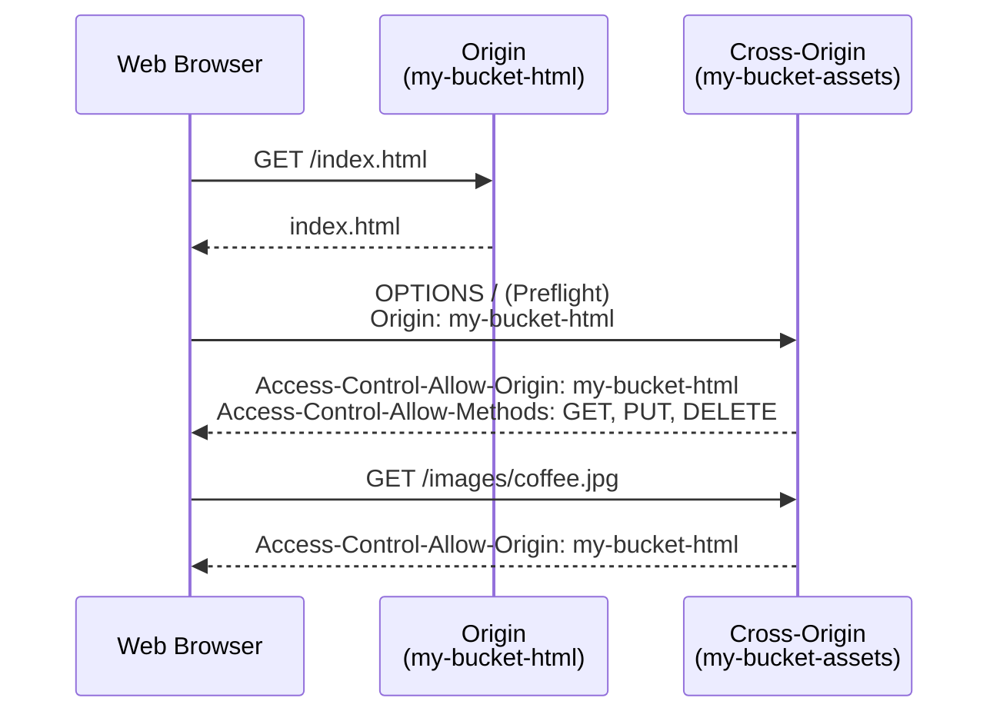
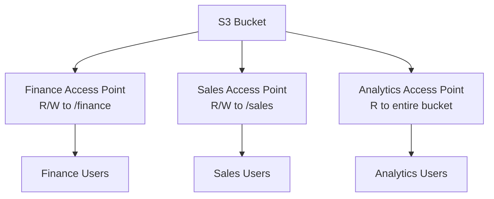

# Amazon S3 — Security, Encryption & Access Control

## Key Concepts

- Distinguish **SSE-S3, SSE-KMS, DSSE-KMS, SSE-C and client-side encryption**. Server-side options differ in key ownership, auditability and request requirements; client-side encryption occurs before S3 receives the object.
- Security controls layer on top of each other: encryption (data at rest), TLS (data in transit), bucket/IAM policies (access), CORS (browser cross-origin access), MFA Delete / Object Lock / Vault Lock (data protection & compliance), Access Points / Object Lambda (access simplification & transformation).

## AWS Services / Features

### S3 Object Encryption — Overview

| Method | Key management | Explicit request header / default behavior |
|---|---|---|
| SSE-S3 | AWS (S3-owned key) | `AES256` when explicit; **no encryption header needed** for default SSE-S3 |
| SSE-KMS | AWS managed or customer managed KMS key | `aws:kms` when explicitly selected; can be the bucket default |
| DSSE-KMS | KMS-based dual-layer server-side encryption | `aws:kms:dsse` when explicitly selected; can be the bucket default |
| SSE-C | Customer, provided per-request (AWS never stores it) | Key sent in HTTP header on every request (HTTPS mandatory) |
| Client-Side | Customer, entirely outside AWS | N/A — object is already encrypted before upload |

### SSE-S3

- Encryption using keys handled, managed, and owned by AWS.
- Object encrypted **server-side**. Encryption type is **AES-256**.
- To request SSE-S3 explicitly, use `x-amz-server-side-encryption: AES256`; the header is **not required** for automatic default encryption.
- **Enabled by default** for new buckets & new objects.

### SSE-KMS

- Encryption using keys managed by **AWS KMS**.
- Advantages: user control over the key + audit key usage via **CloudTrail**.
- Select SSE-KMS in the request or configure it as bucket default. A request without encryption headers follows the bucket default, subject to policy requirements.
- SSE-KMS can use supported imported key material. KMS key lifecycle includes enable/disable, rotation and scheduled deletion; do not assume a generic key-archiving operation.

> [!WARNING]
> **SSE-KMS limitation**: uploads call the KMS `GenerateDataKey` API and downloads call the KMS `Decrypt` API. These count toward the **KMS request quota per second** (5,500 / 10,000 / 30,000 req/s depending on region). Request a quota increase via the **Service Quotas Console** if you hit limits at scale.

### SSE-C

- Server-side encryption using keys **fully managed by the customer outside of AWS**.
- Amazon S3 does **NOT store** the encryption key you provide.
- **HTTPS must be used** — the encryption key must be provided in the HTTP headers for **every** HTTP request made.

### Client-Side Encryption

- Uses client libraries such as the **Amazon S3 Client-Side Encryption Library**.
- Clients must encrypt data themselves before sending to S3, and decrypt it themselves after retrieving it.
- The customer fully manages the keys and the encryption cycle.

### Encryption in Transit (SSL/TLS)

- Also called encryption "in flight".
- S3 exposes two endpoints: **HTTP** (non-encrypted) and **HTTPS** (encryption in flight).
- HTTPS is recommended, and **mandatory for SSE-C**. Most clients use HTTPS by default.
- **Force encryption in transit**: use a bucket policy with the condition key `aws:SecureTransport` to deny any non-HTTPS request.

### Default Encryption vs. Bucket Policies

- SSE-S3 encryption is automatically applied to new objects stored in an S3 bucket.
- Optionally, "force encryption" via a bucket policy that refuses any PUT request without encryption headers (SSE-KMS or SSE-C).

> [!IMPORTANT]
> **Bucket Policies are evaluated before Default Encryption.** A bucket policy that denies unencrypted uploads will reject the request even if default encryption would otherwise have applied.

### CORS (Cross-Origin Resource Sharing)

- **Origin** = scheme (protocol) + host (domain) + port. Example: `https://www.example.com` (implied port 443 for HTTPS, 80 for HTTP).
- CORS is a **web browser** mechanism allowing requests to other origins while visiting a main origin.
  - Same origin: `http://example.com/app1` & `http://example.com/app2`.
  - Different origins: `http://www.example.com` & `http://other.example.com`.
- Cross-origin requests are not fulfilled unless the other origin allows them via CORS headers (e.g., `Access-Control-Allow-Origin`).
- For S3, if a client makes a cross-origin request against a bucket, you must enable the correct CORS headers. This is a **popular exam question**.
- You can allow a specific origin or `*` (all origins).

### MFA Delete

- Requires users to generate an MFA code (mobile device or hardware) before performing important S3 operations.
- **MFA required** to: permanently delete an object version; suspend Versioning on the bucket.
- **MFA NOT required** to: enable Versioning; list deleted versions.
- Versioning must be enabled on the bucket to use MFA Delete.
- Only the **bucket owner (root account)** can enable/disable MFA Delete.

### S3 Access Logs

- For audit purposes, log all access to S3 buckets — provides details about access requests, and you get notified any time these events are logged.
- Any request to S3 (from any account, authorized or denied) is logged into another S3 bucket.
- **Tracking S3 events to log files is disabled by default.**
- S3 buckets are also used by other AWS services — **CloudWatch** and **CloudTrail** — to store their own logs or other objects (e.g., **EBS Snapshots**).
- When configuring logging, you specify both a **source bucket** and a **target bucket**; you can also specify **delimiters and prefixes**.
- You can apply **log retention policies** to logs using Lifecycle rules.
- Logged data can be analyzed with data analysis tools.
- The target logging bucket **must be in the same AWS region**.
- **Two logging types**: **Server access logging** and **Object level logging**.
- S3-generated logs contain basic operation details:
  - Account and IP address of the requestor.
  - Source bucket name.
  - Action that was requested (`GET`, `PUT`, `POST`, `DELETE`, etc.).
  - Time the request was issued.
  - Response status (including the error code).

> [!WARNING]
> Do **not** set the logging bucket to be the same bucket you are monitoring — this creates a **logging loop**, and the bucket will grow exponentially.

### S3 Pre-Signed URLs

- Generated using the S3 Console, AWS CLI, or SDK.
- URL expiration:
  - S3 Console: 1 minute up to 720 minutes (12 hours).
  - AWS CLI: `--expires-in` parameter in seconds (default 3600 s, max 604,800 s ≈ 168 hours).
- Users given a pre-signed URL **inherit the permissions** of the user who generated the URL, for GET / PUT.
- Examples:
  - Allow only logged-in users to download a premium video.
  - Allow an ever-changing list of users to download files via dynamically generated URLs.
  - Temporarily allow a user to upload a file to a precise location in a bucket.

### S3 Glacier Vault Lock

- Adopts a **WORM** (Write Once Read Many) model.
- Create a **Vault Lock Policy**, then lock the policy for future edits (it can no longer be changed or deleted).
- Helpful for compliance and data retention.

### S3 Object Lock (Versioning must be enabled)

- Enable Object Lock on a **new or existing bucket** using the console, CLI, SDK or REST API. Versioning is required; once Object Lock is enabled, you cannot disable Object Lock or suspend versioning.
- Also adopts a **WORM** model — blocks an object version's deletion for a specified amount of time.
- **Retention mode – Compliance**: object versions can't be overwritten or deleted by **any** user, including the root user. Retention mode can't be changed and retention periods can't be shortened.
- **Retention mode – Governance**: most users can't overwrite/delete an object version or alter its lock settings, but some users have special permissions to change retention or delete the object.
- **Retention Period**: protects the object for a fixed period; it can be extended.
- **Legal Hold**: protects the object indefinitely, independent of the retention period. Can be freely placed/removed via the `s3:PutObjectLegalHold` IAM permission.

| | Vault Lock (Glacier) | Object Lock (S3) |
|---|---|---|
| Applies to | Glacier vaults | Versioned S3 objects |
| Prerequisite | Vault Lock Policy | Versioning enabled |
| Model | WORM | WORM |
| Flexibility | Locked permanently once applied | Compliance mode (immutable) or Governance mode (some users can override) + Legal Hold |

### S3 Access Points

- Simplify security management for S3 buckets at scale.
- Each Access Point has its own **DNS name** (Internet Origin or VPC Origin) and its own **access point policy** (similar to a bucket policy).
- Example: a single bucket with `/finance/…` and `/sales/…` prefixes can expose a **Finance Access Point** (R/W to `/finance`), a **Sales Access Point** (R/W to `/sales`), and an **Analytics Access Point** (R only, entire bucket) — instead of one complex bucket policy.

**VPC Origin**
- An Access Point can be restricted to be accessible **only from within a VPC**.
- Requires a **VPC Endpoint** (Gateway or Interface) to reach the Access Point.
- The VPC Endpoint Policy must allow access to the target bucket and Access Point.

### S3 Object Lambda

- Uses **AWS Lambda functions** to change an object before it is returned to the calling application.
- Only one S3 bucket is needed, on top of which you create an **S3 Access Point** and an **S3 Object Lambda Access Point**.
- Use cases:
  - Redacting personally identifiable information for analytics or non-production environments.
  - Converting across data formats (e.g., XML to JSON).
  - Resizing and watermarking images on the fly using caller-specific details.

## Exam Tips

> [!TIP]
> - SSE-S3 = AWS-managed key, `AES256` header, enabled by default. SSE-KMS = AWS KMS key, auditable via CloudTrail, subject to **KMS API quotas**. SSE-C = customer key, never stored by S3, **HTTPS mandatory**. Client-Side = encrypted before it ever reaches S3.
> - `aws:SecureTransport` bucket policy condition is the standard way to **force HTTPS**.
> - Bucket Policies evaluate **before** Default Encryption settings.
> - CORS is required whenever a browser on one S3-hosted origin needs to call another S3-hosted origin — a very common exam scenario with static websites.
> - MFA Delete requires MFA for **deleting a version** or **suspending versioning**, but not for enabling versioning or listing versions.
> - Object Lock **Compliance mode** = nobody (not even root) can override. **Governance mode** = privileged users can override. Legal Hold is independent of retention period.
> - Pre-signed URLs inherit the **permissions of the creator** — if the creator's access is later revoked, the URL stops working even before it expires.
> - As a general best practice, data stored on S3 should **always be encrypted**, whether server-side or client-side.

> [!WARNING]
> Never point an S3 access-logging bucket at itself — it causes an infinite logging loop and runaway storage growth.

## Related Notes
- [[01-S3]]
- [[02-S3-Advanced]]
- [[04-Storage-Extras]]
- [[00-Cluster-MOC]]

## Checked corrections — 2026-11-09

Only the changes listed here were verified in this audit; other course-derived details still need checking when used.

- Corrected Object Lock setup for existing buckets.
  - [AWS documentation](https://docs.aws.amazon.com/AmazonS3/latest/userguide/object-lock-configure.html)

- Default encryption does not require explicit SSE-S3 headers; added DSSE-KMS as a distinct server-side option.
  - [AWS default encryption](https://docs.aws.amazon.com/AmazonS3/latest/userguide/default-bucket-encryption.html)
