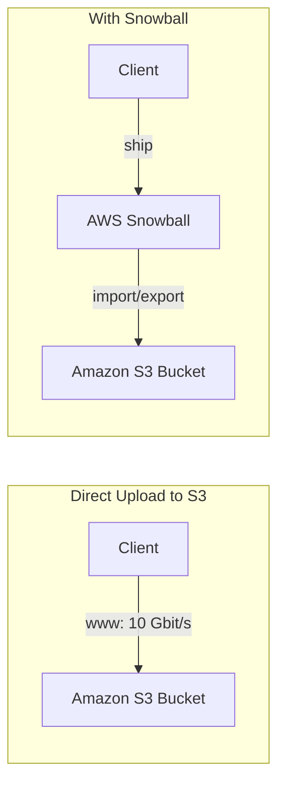
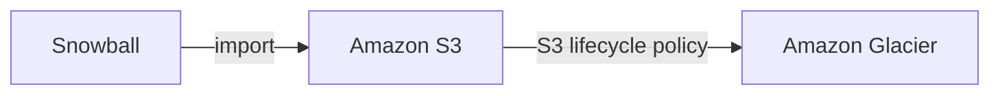
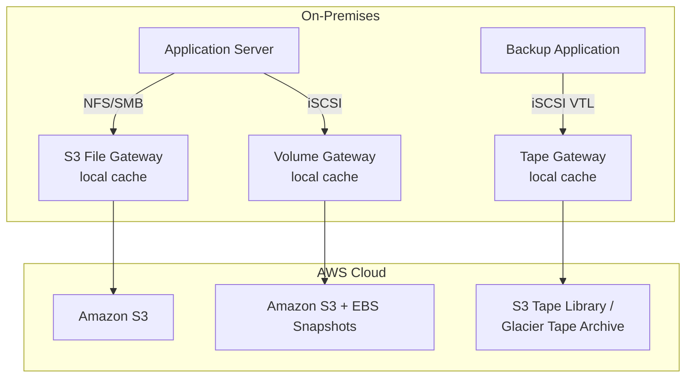
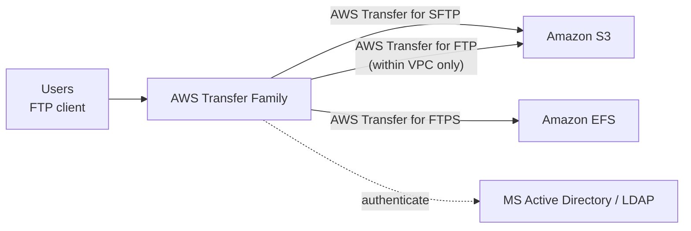
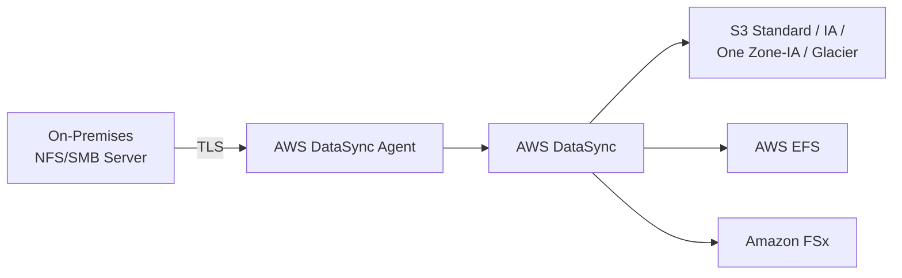

# AWS Storage Extras — Snowball, FSx, Storage Gateway, Transfer Family & DataSync

## Key Concepts

- Beyond S3, AWS offers services for **physical data migration** (Snow family), **third-party managed file systems** (FSx), **hybrid cloud bridging** (Storage Gateway), **managed FTP/SFTP** (Transfer Family), and **scheduled data synchronization** (DataSync).
- AWS Storage native options by type:

| Type | Services |
|---|---|
| Block | Amazon EBS, EC2 Instance Store |
| File | Amazon EFS, Amazon FSx |
| Object | Amazon S3, Amazon Glacier |

## AWS Services / Features

### AWS Snowball

- Highly-secure, portable devices to collect and process data at the edge, and migrate data into/out of AWS. Helps migrate up to **petabytes** of data.

**Benefits**
- AWS ships a physical, appropriately-sized device to migrate a company's backup from its own servers to the cloud — Amazon then transfers the received data to buckets on S3.
- Snow devices are **256-bit encrypted** and **HIPAA-compliant**.
- Billing: you pay for S3 storage space as a storage fee.

| Device | Compute | Memory | Storage (SSD) |
|---|---|---|---|
| Snowball Edge Storage Optimized | 104 vCPUs | 416 GB | 210 TB |
| Snowball Edge Compute Optimized | 104 vCPUs | 512 GB total (416 GB customer-usable) | 28 TB NVMe |

> [!NOTE] Conflict resolved — Snowball Edge specs
> An XMind study source gave different specs (Storage Optimized: 40 vCPUs/80GB/80TB; Compute Optimized: 52 vCPUs/208GB/42TB). Verified 2026-07 against [AWS Snowball Edge device hardware info](https://docs.aws.amazon.com/snowball/latest/developer-guide/device-differences.html): the table above (from the slide deck) matches current AWS docs almost exactly. The mind map's numbers match an older, pre-refresh hardware generation — AWS doubled Compute Optimized's compute capacity and moved to all-NVMe storage in an October 2022 update.

> [!WARNING] Snowball Edge sunset for new customers
> As of November 7, 2025, AWS Snowball Edge is no longer available to new customers (per the current AWS docs banner). Existing customers retain support. Worth knowing for exam-currency, though the exam itself still tests Snowball Edge concepts.

### AWS Snow Family — Snowcone, Snowball, and Snowmobile

- **Snowcone**: the smallest device in the family — 9×6×3 inches, **22 TB** of usable storage, **4 vCPUs**, **4 GB** of usable memory, with both **RJ45** and **Wi-Fi** connectivity.
- **Snowball**: **50 Terabytes** of capacity (distinct from the Snowball Edge variants above).
- **Snowmobile**: a **waterproof and tamper-resistant, 45-foot-long container**, used for **petabyte- or exabyte-scale** data migrations.

**Data Migrations with Snowball — time to transfer over the network**

| Data Size | 100 Mbps | 1 Gbps | 10 Gbps |
|---|---|---|---|
| 10 TB | 12 days | 30 hours | 3 hours |
| 100 TB | 124 days | 12 days | 30 hours |
| 1 PB | 3 years | 124 days | 12 days |

- Challenges with network transfer: limited connectivity, limited bandwidth, high network cost, shared bandwidth, connection stability.
- **AWS Snowball**: offline devices to perform data migrations. **If it takes more than a week to transfer over the network, use Snowball devices.**

**Edge Computing**
- Process data while it's being created at an edge location (a truck on the road, a ship at sea, a mining station underground…).
- These locations may have limited internet and no access to computing power.
- Set up a **Snowball Edge** device to do edge computing.
  - **Snowball Edge Compute Optimized** (dedicated for this use case) and **Storage Optimized**.
  - Run EC2 instances or Lambda functions at the edge.
  - Use cases: preprocess data, machine learning, transcoding media.

**Snowball into Glacier**
- Snowball **cannot** import data directly into Glacier.
- Must import into **Amazon S3 first**, combined with an S3 lifecycle policy to transition into Glacier.

### Amazon FSx — Overview

- Launch **3rd-party high-performance file systems** on AWS as a fully managed service: **FSx for Windows File Server**, **FSx for Lustre**, **FSx for NetApp ONTAP**, **FSx for OpenZFS**.

**FSx for Windows File Server**
- Fully managed Windows file system share drive. Supports **SMB protocol** and **Windows NTFS**.
- Microsoft Active Directory integration, ACLs, user quotas.
- Can be mounted on Linux EC2 instances.
- Supports Microsoft's Distributed File System (DFS) Namespaces (group files across multiple file systems).
- Scales up to 10s of GB/s, millions of IOPS, 100s of PB of data.
- Storage options: **SSD** (latency-sensitive: databases, media processing, data analytics) or **HDD** (broad spectrum: home directories, CMS).
- Accessible from on-premises infrastructure (VPN or Direct Connect). Can be configured **Multi-AZ** for high availability. Data backed up daily to S3.

**FSx for Lustre**
- Lustre = parallel distributed file system for large-scale computing ("Lustre" derives from "Linux" + "cluster").
- Use cases: Machine Learning, High Performance Computing (HPC), Video Processing, Financial Modeling, Electronic Design Automation.
- Scales up to 100s of GB/s, millions of IOPS, sub-millisecond latencies.
- Storage options: **SSD** (low-latency, IOPS-intensive, small & random file operations) or **HDD** (throughput-intensive, large & sequential file operations).
- Seamless S3 integration: can "read S3" as a file system through FSx, and write computation output back to S3.
- Can be used from on-premises servers (VPN or Direct Connect).

*FSx for Lustre — deployment options:*

| Option | Persistence | Performance | Use Case |
|---|---|---|---|
| Scratch File System | Not replicated — data lost if file server fails | High burst (6x faster, 200 MBps per TiB) | Short-term processing, cost optimization |
| Persistent File System | Data replicated within the same AZ; failed files replaced within minutes | Long-term durable performance | Long-term processing, sensitive data |

**FSx for NetApp ONTAP**
- Managed NetApp ONTAP on AWS. Compatible with **NFS, SMB, iSCSI** protocols.
- Move workloads running on ONTAP or NAS to AWS.
- Works with Linux, Windows, macOS, VMware Cloud on AWS, Amazon WorkSpaces & AppStream 2.0, EC2, ECS, EKS.
- Storage shrinks or grows automatically. Snapshots, replication, low-cost, compression, and data de-duplication.
- Point-in-time instantaneous cloning (helpful for testing new workloads).

**FSx for OpenZFS**
- Managed OpenZFS file system on AWS. Compatible with **NFS (v3, v4, v4.1, v4.2)**.
- Move workloads running on ZFS to AWS.
- Works with the same client set as FSx for NetApp ONTAP (Linux, Windows, macOS, VMware Cloud on AWS, WorkSpaces/AppStream 2.0, EC2, ECS, EKS).
- Up to 1,000,000 IOPS with < 0.5 ms latency.
- Snapshots, compression, low-cost. Point-in-time instantaneous cloning.

### Hybrid Cloud for Storage

- AWS is pushing for "hybrid cloud": part of the infrastructure on the cloud, part on-premises — due to long cloud migrations, security requirements, compliance requirements, or IT strategy.
- S3 is a **proprietary** storage technology (unlike EFS/NFS), so exposing S3 data on-premises requires **AWS Storage Gateway**.

### AWS Storage Gateway

- Bridge between on-premises data and cloud data.
- Use cases: disaster recovery, backup & restore, tiered storage, on-premises cache & low-latency file access.
- Three types: **S3 File Gateway**, **Volume Gateway**, **Tape Gateway**.

**S3 File Gateway**
- Configured S3 buckets accessible using **NFS and SMB** protocols.
- Most recently used data is cached in the file gateway.
- Supports S3 Standard, S3 Standard-IA, S3 One Zone-IA, S3 Intelligent-Tiering.
- Transition to S3 Glacier via a Lifecycle Policy.
- Bucket access using IAM roles for each File Gateway.
- SMB protocol integrates with Active Directory (AD) for user authentication.

**Volume Gateway**
- Block storage using the **iSCSI** protocol, backed by S3.
- Backed by EBS snapshots, which help restore on-premises volumes.
- **Cached volumes**: low-latency access to the **most recent data** (frequently accessed data is cached locally, the full dataset is in S3).
- **Stored volumes**: **entire dataset** is kept on-premises, with scheduled backups (as EBS snapshots) to S3.

**Tape Gateway**
- Some companies still run backup processes using physical tapes.
- Tape Gateway lets companies use the same backup processes, but in the cloud.
- **Virtual Tape Library (VTL)** backed by Amazon S3 and Glacier.
- Backs up data using existing tape-based processes (iSCSI interface).
- Works with leading backup software vendors.

*Storage Gateway — deployment options and backing storage*

| Gateway Type | Protocol | Backing Storage | Local Cache |
|---|---|---|---|
| S3 File Gateway | NFS / SMB | Amazon S3 (excluding Glacier & Glacier Deep Archive) | Yes |
| Volume Gateway (Cached) | iSCSI | Amazon S3 (+ AWS EBS snapshots) | Yes — recent data only |
| Volume Gateway (Stored) | iSCSI | Amazon S3 (+ AWS EBS snapshots) | Entire dataset on-prem, backed up to S3 |
| Tape Gateway | iSCSI VTL | Amazon S3 Tape Library → any S3 class including Glacier; Tape Archive → Glacier & Glacier Deep Archive | Yes |

- Gateway is deployed as a **VM** (VMware, Hyper-V, KVM) on-premises, or as a hardware appliance.
- Encryption in transit over Internet or Direct Connect.
- Tapes can be "ejected" from the backup application into Glacier / Glacier Deep Archive for archival.

### AWS Transfer Family

- Fully-managed service for file transfers into/out of **Amazon S3** or **Amazon EFS** using FTP-family protocols — for when you **don't want to use the S3 APIs** directly and instead need an FTP-style interface.
- Managed infrastructure — scalable, reliable, highly available (multi-AZ).
- Supports three kinds of protocols:

| Protocol | Full Name | Encryption |
|---|---|---|
| **FTP** | File Transfer Protocol | Unencrypted |
| **FTPS** | File Transfer Protocol over SSL | Encrypted in transit |
| **SFTP** | Secure File Transfer Protocol | Encrypted in transit |

- Pricing: pay per provisioned endpoint per hour + data transfers in GB.
- Stores and manages users' credentials within the service, or integrates with existing authentication systems (Microsoft Active Directory, LDAP, Okta, Amazon Cognito, custom).
- Use cases: to have an FTP interface for sharing files, datasets, CRM, ERP, etc.

### AWS DataSync

- Moves large amounts of data:
  - **On-premises / other cloud → AWS** (NFS, SMB, HDFS, S3 API…) — requires an **agent**.
  - **AWS → AWS** (between different storage services) — **no agent needed**.
- Can synchronize to: **Amazon S3** (any storage class, including Glacier), **Amazon EFS**, **Amazon FSx** (Windows, Lustre, NetApp ONTAP, OpenZFS…).
- Replication tasks can be scheduled hourly, daily, or weekly.
- File permissions and metadata are preserved (NFS POSIX, SMB…) — security/permissions carry over during sync.
- One agent task can use **10 Gbps**; a bandwidth limit can be configured.
- Synchronization can be **one-way or two-way (bidirectional)** — you can synchronize files from AWS back down to on-premises, not just up to AWS.
- The **AWS Snowcone** device comes with the **DataSync agent pre-installed** — useful when you want to use DataSync but don't have the network capacity to run an agent-based sync directly.

### Storage Comparison Summary

| Service | Type |
|---|---|
| S3 | Object Storage |
| S3 Glacier | Object Archival |
| EBS volumes | Network storage for one EC2 instance at a time |
| Instance Store | Physical storage for your EC2 instance (high IOPS) |
| EFS | Network File System for Linux instances, POSIX filesystem |
| FSx for Windows | Network File System for Windows servers |
| FSx for Lustre | High Performance Computing Linux file system |
| FSx for NetApp ONTAP | High OS compatibility |
| FSx for OpenZFS | Managed ZFS file system |
| Storage Gateway | S3 & FSx File Gateway, Volume Gateway (cached & stored), Tape Gateway |
| Transfer Family | FTP, FTPS, SFTP interface on top of S3 or EFS |
| DataSync | Scheduled data sync from on-premises to AWS, or AWS to AWS |
| Snowcone / Snowball / Snowmobile | Physically move large amounts of data to the cloud |
| Database | Specific workloads, usually with indexing and querying |

## Exam Tips

> [!TIP]
> - Rule of thumb: **if network transfer takes more than a week, use Snowball**.
> - Snowball **cannot** load directly into Glacier — it must land in S3 first, then transition via a lifecycle policy.
> - FSx for Windows = SMB + Active Directory; FSx for Lustre = HPC/ML + native S3 read/write; FSx for NetApp ONTAP = broadest protocol/OS compatibility (NFS/SMB/iSCSI); FSx for OpenZFS = NFS-only, high IOPS, cloning.
> - Storage Gateway type by protocol: **S3 File Gateway = NFS/SMB**, **Volume Gateway = iSCSI (block)**, **Tape Gateway = iSCSI VTL**.
> - Volume Gateway **Cached** = low-latency access to recent data, full dataset in S3. Volume Gateway **Stored** = full dataset on-premises, async backup to S3. This distinction is a classic exam scenario question.
> - AWS Transfer Family exposes **S3 or EFS** over FTP/FTPS/SFTP — it does not create new storage, it's a protocol front-end.
> - AWS DataSync needs an **agent** for on-premises/other-cloud sources, but **no agent** for AWS-to-AWS transfers. DataSync sync can run **one-way or two-way**, and **Snowcone ships with the DataSync agent pre-installed** for low-network-capacity situations.
> - AWS Transfer Family protocol encryption: **FTP = unencrypted**, **FTPS and SFTP = encrypted in transit**. If a scenario requires encryption in transit for file transfers, FTP is the wrong answer.

> [!WARNING]
> Don't confuse **AWS Transfer Family** (FTP/FTPS/SFTP access to S3/EFS for external users) with **AWS DataSync** (scheduled, agent-based bulk data synchronization) — they solve different problems and are frequently swapped as distractors on the exam.

## Related Notes
- [[01-S3]]
- [[02-S3-Advanced]]
- [[03-S3-Security]]
- [[00-Cluster-MOC]]
