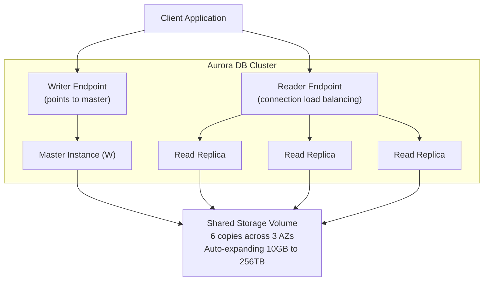
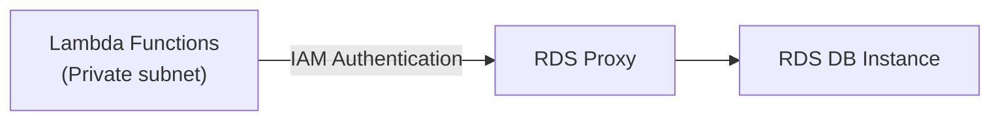
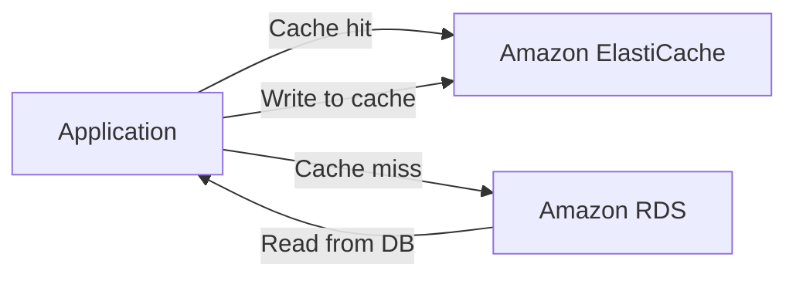

# RDS, Aurora & ElastiCache

## Key Concepts

### Amazon RDS Overview
RDS (Relational Database Service) is a managed DB service for databases that use SQL as a query language. It allows you to create databases in the cloud that are managed by AWS. Supported engines: Postgres, MySQL, MariaDB, Oracle, Microsoft SQL Server, IBM DB2, Aurora (AWS proprietary database).
- AWS takes care of provisioning, monitoring, and maintaining the database
- You can migrate an existing database into RDS using the **AWS Database Migration Service (DMS)**
- You can implement DB instances with previous (older) engine versions, not just the latest
- The database engine type is only selectable at creation time — it cannot be changed afterward
- DB instances are managed from the **RDS dashboard** — you have no access to the instance from the EC2 dashboard

### Advantages of RDS over deploying a DB on EC2
RDS is a managed service providing:
- Automated provisioning, OS patching
- Continuous backups and restore to specific timestamp (Point in Time Restore)
- Monitoring dashboards
- Read replicas for improved read performance
- Multi-AZ setup for DR (Disaster Recovery)
- Maintenance windows for upgrades
- Scaling capability (vertical and horizontal)
- Storage backed by EBS
- BUT you can't SSH into your instances

### RDS Storage Auto Scaling
Helps increase storage on your RDS DB instance dynamically. When RDS detects you are running out of free database storage, it scales automatically — avoiding manual storage scaling.
- You must set a **Maximum Storage Threshold** (maximum limit for DB storage)
- Automatically modifies storage if:
  - Free storage is less than 10% of allocated storage
  - Low-storage condition lasts at least 5 minutes
  - 6 hours have passed since last modification
- Useful for applications with unpredictable workloads
- Supports all RDS database engines

> [!NOTE]
> Storage Auto Scaling only scales **storage**. RDS does not support auto-scaling of the DB instance class/type (compute) — changing the instance class requires a manual modification. This differs from a self-managed database running on your own EC2 instance, where EC2 Auto Scaling can be used for compute.

### RDS Enhanced Monitoring
- Enable Enhanced Monitoring to get more insight into performance metrics for monitoring — useful when the database is large and has many concurrent users
- RDS uses **CloudWatch** to store the Enhanced Monitoring statistics

### RDS Pricing
RDS billing is based on:
- **DB instance hours** — based on the instance class consumed (e.g., `db.t2.micro`, `db.m4.large`)
- **Provisioned IOPS** — charged at the provisioned IOPS rate, regardless of how much IOPS is actually consumed
- **Database storage**
- **Backup storage**
- **I/O requests** — total number of storage I/O requests
- **Data transfer** — internet data transfer in and out of your DB instance

### RDS DB Instance Limits by Engine

| Engine | Databases per instance | Notes |
|---|---|---|
| SQL Server | 30 databases per instance | — |
| Oracle | 1 database per instance | License Included or Bring-Your-Own-License (BYOL) |
| MySQL | No limit | — |
| PostgreSQL | No limit | — |
| MariaDB | No limit | — |
| Amazon Aurora | No limit | Cheaper than the alternatives |

### RDS Read Replicas (Read Scalability)
- Up to **15 Read Replicas** — this cap applies uniformly across MySQL, MariaDB, PostgreSQL, Oracle, SQL Server, and Aurora (verified 2026-07 against each engine's official RDS docs). AWS recommends keeping Oracle and SQL Server replicas to ≤5 to limit replication lag, but that's a performance guideline, not a hard limit — the actual maximum is 15 for every engine.
- Can be within AZ, Cross-AZ, or Cross-Region
- Replication is **ASYNC**, so reads are eventually consistent
- Replicas can be promoted to their own standalone DB
- Applications must update the connection string to leverage read replicas
- Used for `SELECT` (read) only statements — not `INSERT`, `UPDATE`, `DELETE` — read-only by default, but can be made read/write by setting the `read_only` parameter to `false`
- Always connect to a DB instance using its **DNS name, not its IP address** — if the primary instance fails, an IP-based connection cannot reach the failover instance, whereas RDS redirects the DNS name to the failover instance in the second AZ

**Use case:** A production database is taking on normal load. You want to run a reporting/analytics application. Create a Read Replica to run the new workload there so the production application is unaffected.

**Network cost:** In AWS there's a network cost when data crosses AZs.
- Read Replicas within the **same region** (different AZ): no transfer fee
- Read Replicas **cross-region**: incurs cost ($$$)

### RDS Multi-AZ DB Instance Deployment (Availability)
- **SYNC** replication to a standby instance in another AZ
- One DNS name — automatic application failover to standby, achieved by **changing the CNAME** to switch between master and standby DB
- Increases availability and durability
- RDS **automatically chooses** the AZ for the standby (different from the master's AZ) — you cannot choose the AZ yourself
- Failover occurs automatically without user intervention when:
  - Loss of availability in the primary Availability Zone
  - Loss of network connectivity to primary
  - Compute unit failure on primary
  - Storage failure on primary
- RDS performs failover automatically, but applications must reconnect/retry and honor DNS changes; existing connections can be interrupted.
- In a **Multi-AZ DB instance deployment**, the standby is not readable and is not a read-scaling target.
- A **Multi-AZ DB cluster deployment** is different: one writer and **two readable standby instances across three AZs**. Read traffic can use the reader endpoint; supported engines and configurations differ.
- Note: Read Replicas can also be set up as Multi-AZ for Disaster Recovery

### RDS – From Single-AZ to Multi-AZ
RDS can convert a supported Single-AZ DB instance to Multi-AZ without a planned shutdown, but performance impact is possible; do not promise zero impact. Internally:
1. A snapshot is taken
2. A new DB is restored from the snapshot in a new AZ
3. Synchronization is established between the two databases

### Database High Availability Architectures

Do not infer failover, read scaling or cost from the word “standby” alone. RDS Multi-AZ DB instances provide managed failover to an unreadable standby; supported Multi-AZ DB clusters add two readable standbys. Aurora has shared cluster storage and replica failover. A self-managed database on EC2 has whatever replication/failover automation you actually configure. Regional HA and cross-Region DR solve different failure scopes; neither implies a free standby or zero recovery time.

### RDS Maintenance Window
- Amazon RDS performs maintenance periodically — updates to the DB instance and updates to the DB cluster's operating system
- Most maintenance events complete within **30 minutes**
- Maintenance takes your DB instance or DB cluster offline
- A **Multi-AZ deployment** can further reduce the impact of a maintenance event
- If you enter a maintenance window value that overlaps the backup window, an error message appears
- The maintenance window **cannot be skipped** — RDS will use the default time based on the RDS region if you do not configure one

### RDS Custom
Managed Oracle and Microsoft SQL Server database with OS and database customization.
- RDS: automates setup, operation, and scaling of the database
- RDS Custom: access to the underlying database and OS to configure settings, install patches, enable native features, and access the underlying EC2 instance via SSH or SSM Session Manager
- De-activate Automation Mode to perform customization (best to take a DB snapshot first)

> [!NOTE]
> RDS vs RDS Custom: standard RDS manages the entire database and OS for you with no shell access. RDS Custom gives full admin access to the underlying OS and database (currently for Oracle and SQL Server).

### Amazon Aurora
- Proprietary AWS technology (not open sourced)
- Supports Postgres and MySQL as Aurora DB (drivers work as if Aurora were Postgres or MySQL)
- "AWS cloud optimized" — claims 5x performance improvement over MySQL on RDS, 3x over Postgres on RDS
- Same security, availability, and reliability of commercial databases for just 1/10 of the cost (per source, comparing Aurora to commercial databases)
- Hosted on distributed, fault-tolerant, self-healing storage systems with low latency
- Optimized for **Online Transaction Processing (OLTP)** — i.e., doing transactions/making changes to the database; very fast writes, though not as fast as Redshift for reads
- Storage automatically grows in increments of 10 GB, up to a version-dependent ceiling: **256 TiB** for the newest engine versions (Aurora PostgreSQL 17.5+/16.9+/15.13+, Aurora MySQL 3.10+ as of a July 2025 increase), or **128 TiB** for all other/older engine versions — most existing clusters are still on the 128 TiB ceiling unless upgraded. (Resolves a conflict: an XMind source said 64 TB, which was correct only before AWS's September 2020 increase to 128 TB — both figures were outdated at different points; verified 2026-07 against the [official Aurora quotas page](https://docs.aws.amazon.com/AmazonRDS/latest/AuroraUserGuide/CHAP_Limits.html).)
- Supported instance classes and sizes vary by engine/Region; the old 32-vCPU/244-GiB maximum is not a current Aurora limit.
- Up to 15 replicas, replication process faster than MySQL (sub-10ms replica lag)
- Aurora supports automatic failover, but it is **not instantaneous**. Applications need reconnection/retry logic; recovery depends on replicas and workload conditions.
- Compare actual engine, instance, storage and I/O charges; Aurora is not universally a fixed percentage more expensive or cheaper than RDS.
- Aurora uses **distributed shared cluster storage**, not an RDS-style customer-provisioned gp3/io2 volume. Compare **Aurora Standard** and **Aurora I/O-Optimized** according to I/O usage and current pricing.

### Aurora High Availability and Read Scaling
- 2 DB copies in each AZ, minimum of 3 AZs — your Aurora DB is spread across 6 copies of your data
  - 4 out of 6 copies needed for writes (write capability continues with up to 2 copies lost)
  - 3 out of 6 copies needed for reads (read capability continues with up to 3 copies lost)
- Self-healing with peer-to-peer replication
- Storage striped across hundreds of volumes
- One Aurora Instance takes writes (master)
- Automated failover for master in less than 30 seconds
- Master + up to 15 Aurora Read Replicas serve reads, with automatic failover
- Support for Cross-Region Replication

> [!NOTE]
> Aurora Replicas (up to 15) support automatic failover. Standard RDS Read Replicas (MySQL, MariaDB, PostgreSQL, Oracle, SQL Server — also up to 15 each) do **NOT** support automatic failover — that's the real differentiator, not the replica count. (An earlier version of this note and a cross-checked XMind study source both said standard RDS engines cap at 5 replicas — verified 2026-07 against official AWS RDS docs per-engine: the actual max is 15 for all engines; 5 is only AWS's lag-avoidance *recommendation* for Oracle/SQL Server, not a hard limit.)

### Features of Aurora
Automatic fail-over, backup and recovery, isolation and security, industry compliance, push-button scaling, automated patching with zero downtime, advanced monitoring, routine maintenance, and **Backtrack**: restore data at any point in time without using backups.

### Aurora Custom Endpoints
Define a subset of Aurora Instances as a Custom Endpoint (e.g., run analytical queries on specific replicas). The Reader Endpoint is generally not used once Custom Endpoints are defined.

### Aurora Serverless
- An on-demand, autoscaling configuration for Amazon Aurora
- Automatically starts up, shuts down, and scales capacity up or down based on your application's needs
- Automated database instantiation and auto-scaling based on actual usage
- Good for infrequent, intermittent, or unpredictable workloads
- No capacity planning needed — can run your database on AWS without managing database capacity
- Pay per second — can be more cost-effective

**Historical Aurora Serverless v1 limitations (not v2 guidance):**

Aurora Serverless v1 reached end of life on March 31, 2025. Use supported **v2** configurations for new designs. Do not carry v1 restrictions into v2.
- You can't export Aurora Serverless v1 snapshots to Amazon S3 buckets
- You can't use AWS Database Migration Service (DMS) and Change Data Capture (CDC) with it

### Aurora Cross-Region Options
- **Aurora Cross Region Read Replicas:** useful for disaster recovery, simple to set up
- **Aurora Global Database (recommended):**
  - 1 Primary Region (read/write)
  - Up to 10 secondary (read-only) regions, replication lag < 1 second
  - Up to 16 Read Replicas per secondary region
  - Helps decrease latency
  - Promoting another region for disaster recovery has an RTO of < 1 minute
  - Typical cross-region replication takes less than 1 second

### Aurora Machine Learning
Enables adding ML-based predictions to applications via SQL. Simple, optimized, secure integration between Aurora and AWS ML services.
- Supported services: **Amazon SageMaker** (any ML model), **Amazon Comprehend** (sentiment analysis)
- No ML experience required
- Use cases: fraud detection, ads targeting, sentiment analysis, product recommendations

### Babelfish for Aurora PostgreSQL
Allows Aurora PostgreSQL to understand commands targeted for MS SQL Server (e.g., T-SQL). Microsoft SQL Server based applications can work on Aurora PostgreSQL with little to no code changes (same MS SQL Server client driver). Enables using the same application after migrating a database (using AWS SCT and DMS).

### Backups
**RDS Backups:**
- Automated backups: daily full snapshot during the backup window; transaction logs backed up every 5 minutes → restore to any point in time (from oldest backup to 5 minutes ago)
- 1 to 35 days retention, **default is 7 days**; set to 0 to disable automated backups
- When you delete a DB instance, RDS creates a final snapshot and deletes the other automated snapshots
- Manual DB Snapshots: user-initiated, restore to that specific state at any time, retained until you explicitly delete them
- You can restore, copy, and share snapshots (both automated and manual)
- Restoring a snapshot always launches a **new** DB instance (never the existing one); you can choose to encrypt the database during restoration
- The amount of data in the database impacts how long it takes to create a snapshot
- In a Multi-AZ deployment, backups are taken from the **standby** DB instance, not the master, to avoid I/O suspension on the primary
- Trick: a stopped RDS database still incurs storage charges — if stopping for a long time, snapshot & restore instead

**Backup charges:** No additional charge for backup storage up to 100% of the total provisioned database storage. Example: instance size is 20 GB, and 2 snapshots have been taken — RDS allows free snapshot/automated backup storage up to 20 GB.

**Aurora Backups:**
- Automated backups: 1 to 35 days (cannot be disabled), point-in-time recovery within that timeframe
- Manual DB Snapshots: user-triggered, retained as long as you want

### RDS & Aurora Restore Options
Restoring a backup or snapshot always creates a **new** database.
- Restoring MySQL RDS from S3: back up on-premises DB, store on S3, restore onto a new RDS MySQL instance
- Restoring MySQL Aurora cluster from S3: back up on-premises DB using Percona XtraBackup, store on S3, restore onto a new Aurora MySQL cluster

### Aurora Database Cloning
- Create a new Aurora DB Cluster from an existing one, faster than snapshot & restore
- Uses copy-on-write protocol: new cluster initially shares the same data volume as the original (no copying needed)
- When updates are made to the new cluster, additional storage is allocated and data is copied/separated
- Very fast & cost-effective
- Useful for creating a "staging" database from "production" without impacting production

### RDS & Aurora Security
- **At-rest encryption:** master & replica encryption using AWS KMS, must be defined at launch time (can also be enabled manually during a recovery/restore). If the master is not encrypted, read replicas cannot be encrypted. To encrypt an unencrypted database, go through a DB snapshot & restore as encrypted.
  - At-rest encryption is for compliance purposes — it is **not** useful for protecting against SQL injection attacks (that's an application-layer concern)
- **In-flight encryption:** TLS-ready by default, use AWS TLS root certificates client-side
- **IAM Authentication:** IAM roles to connect to the database instead of username/password
- **IAM permissions:** set via IAM policies — there is no administration access via IAM; data access is based on database capabilities, including Create, Read, Update, and Delete (CRUD)
- **Security Groups:** control network access to RDS/Aurora
- No SSH available except on RDS Custom
- Audit Logs can be enabled and sent to CloudWatch Logs for longer retention

### Amazon RDS Proxy
- Fully managed database proxy for RDS
- Allows apps to pool and share DB connections established with the database
- Improves database efficiency by reducing stress on DB resources (CPU, RAM) and minimizing open connections/timeouts
- Serverless, autoscaling, highly available (multi-AZ)
- Reduces RDS & Aurora failover time by up to 66%
- Supports RDS (MySQL, PostgreSQL, MariaDB, MS SQL Server) and Aurora (MySQL, PostgreSQL)
- No code changes required for most apps
- Enforces IAM Authentication for the DB and securely stores credentials in AWS Secrets Manager
- RDS Proxy is **never** publicly accessible — must be accessed from within a VPC

### Amazon ElastiCache Overview
The same way RDS gives you managed relational databases, ElastiCache gives you managed **Redis** or **Memcached**.
- Caches are in-memory databases with high performance, low latency
- Helps reduce load off databases for read-intensive workloads
- Helps make applications stateless
- AWS handles OS maintenance/patching, optimizations, setup, configuration, monitoring, failure recovery, and backups
- Using ElastiCache involves heavy application code changes
- **Use cases:** social networking, gaming, AdTech, media sharing, Q&A portals

### ElastiCache Solution Architectures
**DB Cache:** Application queries ElastiCache first (cache hit); if not available (cache miss), reads from RDS and writes the result into ElastiCache. Relieves load on RDS. Must have an invalidation strategy to ensure only current data is used.

**User Session Store:** User logs into an application instance, which writes session data to ElastiCache. When the user hits another instance, that instance retrieves the session data from ElastiCache and the user is already logged in.

### ElastiCache – Redis vs Memcached

| Feature | Redis | Memcached |
|---|---|---|
| High availability | Supported node-based Valkey/Redis OSS replication groups have Multi-AZ failover; Serverless is managed across AZs | Node-based Memcached does not replicate; **ElastiCache Serverless for Memcached replicates across AZs** |
| Read scaling | Read Replicas to scale reads and provide HA | Multi-node for partitioning of data (sharding) |
| Data durability | Engine/deployment dependent; snapshots and replication are not interchangeable with a source database | Node-based cache is disposable; Serverless supports replication and snapshots |
| Backup & restore | Yes | No for classic (node-based) Memcached; **Yes** for ElastiCache Serverless (added June 2024) |
| Data structures | Supports Sets and Sorted Sets | — |
| Architecture | — | Multi-threaded architecture |

> [!WARNING]
> Distinguish **node-based Memcached** from **ElastiCache Serverless for Memcached**. The node-based cache has no replication, while Serverless replicates across AZs and supports snapshots. Choose engine/deployment from data structures, latency, availability and recovery requirements; keep durable source data in the appropriate database.

### ElastiCache Engine Details

**Memcached:**
- Simple key/value caching model; **security, network access, encryption and compliance requirements still apply**.
- Multi-threaded caching can fit simple workloads; performance depends on configuration and workload, not a universal faster-than-Redis rule.
- A widely adopted memory object caching system
- **Node type** = the actual instance type — choose an instance type with enough memory for your workload
- Horizontal scale: add cache nodes, up to **20 nodes max**

**Redis:**
- Extra benefit of compliance capabilities — can be **HIPAA or PCI-DSS compliant** when regulatory compliance is required
- A fast, open-source, in-memory data store and cache
- Single-threaded ("One Thread") architecture
- Data types supported: set, list, string, hash, sorted set
- Horizontal scale: create Read Replicas, up to **5 replicas max**, and you can choose the AZ

**Common features of Redis and Memcached:**
- Open source
- Master/Slave replication (terminology per source)

### ElastiCache Security
- Supports **IAM Authentication for Redis** (IAM policies on ElastiCache are only used for AWS API-level security)
- **Redis AUTH:** set a "password/token" when creating a Redis cluster — extra layer of security on top of security groups
- Supports SSL in-flight encryption
- **Memcached:** supports SASL-based authentication (advanced)

### Patterns for ElastiCache
- **Lazy Loading:** only requested data is cached; data can become stale in the cache
- **Write Through:** adds/updates data in the cache when written to the DB (no stale data)
- **Session Store:** store temporary session data in a cache using TTL features
- Quote from the source: "There are only two hard things in Computer Science: cache invalidation and naming things"

### ElastiCache Redis Use Case: Gaming Leaderboards
Gaming leaderboards are computationally complex. Redis **Sorted Sets** guarantee both uniqueness and element ordering — each time a new element is added, it's ranked in real time and inserted in the correct order, enabling real-time leaderboards.

## AWS Services / Features

| Service | Purpose |
|---|---|
| Amazon RDS | Managed relational database (SQL/OLTP) — Postgres, MySQL, MariaDB, Oracle, SQL Server, DB2, Aurora |
| Amazon Aurora | AWS-proprietary cloud-optimized relational database, Postgres/MySQL compatible |
| Amazon RDS Proxy | Managed connection pooling proxy in front of RDS/Aurora |
| Amazon ElastiCache | Managed in-memory cache — Redis or Memcached |

## Read Replicas vs Multi-AZ

| Deployment | Main purpose | Read traffic | Failover / replication |
|---|---|---|---|
| Standard RDS read replica | Read scaling; cross-Region copies where supported | Yes | Asynchronous; promotion normally explicit |
| RDS Multi-AZ DB instance | Availability within a Region | Primary only; standby not readable | Synchronous standby; managed failover |
| RDS Multi-AZ DB cluster | Availability plus readable standbys | Writer plus two readers | Three AZs; managed failover; replication differs from the instance deployment |
| Aurora cluster | Availability plus read scaling | Writer and Aurora replicas | Distributed shared storage; Aurora-managed failover |

Check supported engines, replica limits and topology. Replication is not a substitute for backups, and Multi-AZ within one Region does not by itself provide Region-wide DR.

## Exam Tips
> [!TIP]
> Identify the deployment: a standard **RDS Multi-AZ DB instance** has an unreadable standby; a **Multi-AZ DB cluster** has two readable standbys. Ordinary read replicas primarily scale reads and normally need explicit promotion. Aurora replicas can be failover targets.

> [!TIP]
> Aurora Global Database is the recommended way to do cross-region DR/low-latency reads for Aurora (RTO < 1 minute), vs simple Aurora Cross-Region Read Replicas which are simpler but less integrated.

> [!WARNING]
> If the master RDS/Aurora database is not encrypted at launch, its read replicas cannot be encrypted either. The only way to encrypt an existing unencrypted database is snapshot & restore as encrypted — encryption cannot be turned on in place.

> [!TIP]
> RDS Proxy reduces failover time by up to 66% and is never publicly accessible — it must be reached from within a VPC. It pools connections, which is critical for Lambda functions that would otherwise open many short-lived DB connections.

## Related Notes
- [[02-Databases-Overview]]
- [[03-Data-Analytics]]

## Checked corrections — 2026-11-09

Only the changes listed here were verified in this audit; other course-derived details still need checking when used.

- Distinguished RDS Multi-AZ deployment types, reconnection needs and Aurora shared storage; marked v1 historical.
  - [AWS documentation](https://docs.aws.amazon.com/AmazonRDS/latest/UserGuide/Concepts.MultiAZ.html)
  - [AWS documentation](https://docs.aws.amazon.com/AmazonRDS/latest/UserGuide/Concepts.MultiAZSingleStandby.html)
  - [AWS documentation](https://docs.aws.amazon.com/AmazonRDS/latest/AuroraUserGuide/Concepts.AuroraHighAvailability.html)
  - [AWS documentation](https://docs.aws.amazon.com/AmazonRDS/latest/AuroraUserGuide/Aurora.Overview.StorageReliability.html)
  - [AWS documentation](https://docs.aws.amazon.com/AmazonRDS/latest/AuroraUserGuide/WhatsNew.html)

- Removed misleading generic standby/free-tier rules and qualified Memcached HA by deployment type.
  - [AWS ElastiCache components](https://docs.aws.amazon.com/AmazonElastiCache/latest/dg/WhatIs.corecomponents.html)
