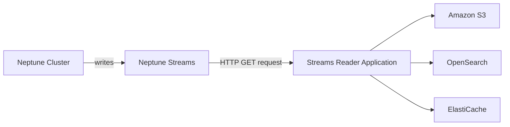
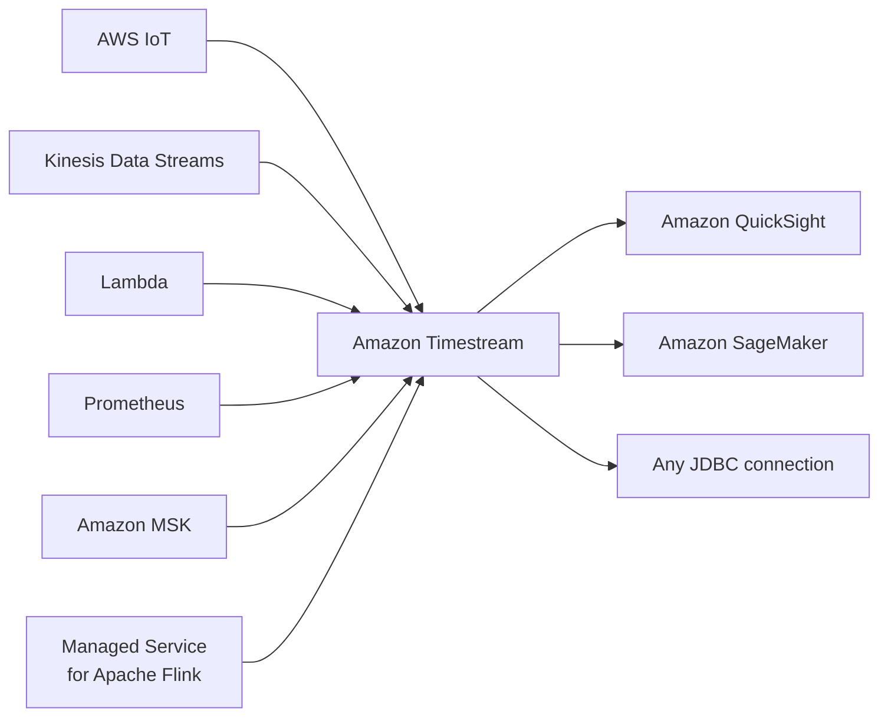

# Databases Overview

## Key Concepts

### Choosing the Right Database
AWS offers many managed databases to choose from. Questions to ask when choosing the right database for your architecture:
- Read-heavy, write-heavy, or balanced workload? Throughput needs? Will it change — does it need to scale or fluctuate during the day?
- How much data to store, and for how long? Will it grow? Average object size? How are objects accessed?
- Data durability? What is the source of truth for the data?
- Latency requirements? Concurrent users?
- Data model? How will you query the data — joins? Structured? Semi-structured?
- Strong schema, or more flexibility? Reporting? Search? RDBMS or NoSQL?
- License costs? Would switching to a cloud-native DB such as Aurora help?

### Database Types
- **RDBMS (SQL / OLTP):** RDS, Aurora — great for joins
- **NoSQL database** (no joins, no SQL): DynamoDB (~JSON), ElastiCache (key/value pairs), Neptune (graphs), DocumentDB (for MongoDB), Keyspaces (for Apache Cassandra)
- **Object Store:** S3 (for big objects) / Glacier (for backups/archives)
- **Data Warehouse (SQL Analytics / BI):** Redshift (OLAP), Athena, EMR
- **Search:** OpenSearch (JSON) — free text, unstructured searches
- **Graphs:** Amazon Neptune — displays relationships between data
- **Ledger:** Amazon Quantum Ledger Database
- **Time series:** Amazon Timestream

> [!NOTE]
> The source notes that some databases (Redshift, Athena, EMR, OpenSearch, etc.) are discussed in more detail in the Data & Analytics section — see [[03-Data-Analytics]].

### Amazon RDS — Summary
- Managed PostgreSQL / MySQL / Oracle / SQL Server / DB2 / MariaDB / Custom
- Provisioned RDS Instance Size and EBS Volume Type & Size
- Auto-scaling capability for Storage
- Support for Read Replicas and Multi-AZ
- Security through IAM, Security Groups, KMS, SSL in transit
- Automated Backup with Point in Time Restore feature (up to 35 days)
- Manual DB Snapshot for longer-term recovery
- Managed and scheduled maintenance (with downtime)
- Support for IAM Authentication, integration with Secrets Manager
- RDS Custom for access to and customization of the underlying instance (Oracle & SQL Server)
- **Use case:** Store relational datasets (RDBMS / OLTP), perform SQL queries, transactions

### Amazon Aurora — Summary
- Compatible API for PostgreSQL / MySQL, separation of storage and compute
- Storage: data stored in 6 replicas across 3 AZs — highly available, self-healing, auto-scaling
- Compute: cluster of DB instances across multiple AZs, auto-scaling of Read Replicas
- Cluster: custom endpoints for writer and reader DB instances
- Same security / monitoring / maintenance features as RDS
- Know the backup & restore options for Aurora
- Aurora Serverless — for unpredictable/intermittent workloads, no capacity planning
- Aurora Global: up to 16 DB Read Instances in each region, < 1 second storage replication
- Aurora Machine Learning: perform ML using SageMaker & Comprehend on Aurora
- Aurora Database Cloning: new cluster from existing one, faster than restoring a snapshot
- **Use case:** Same as RDS, but with less maintenance / more flexibility / more performance / more features

### Amazon ElastiCache — Summary
- Managed Redis / Memcached (similar offering to RDS, but for caches)
- In-memory data store, sub-millisecond latency
- Select an ElastiCache instance type (e.g., `cache.m6g.large`)
- Support for Clustering (Redis) and Multi-AZ, Read Replicas (sharding)
- Security through IAM, Security Groups, KMS, Redis Auth
- Backup / Snapshot / Point-in-Time Restore feature
- Managed and scheduled maintenance
- Requires some application code changes to be leveraged
- **Use case:** Key/value store, frequent reads with fewer writes, cache results for DB queries, store session data for websites — cannot use SQL

### Amazon DynamoDB — Summary
- AWS proprietary technology, managed serverless NoSQL database, millisecond latency at any scale — will respond to 5 million users in milliseconds
- Stores everything on SSD, spread across 3 distinct datacenters
- You can **NOT** select a specific Availability Zone for a DynamoDB table
- Capacity modes: provisioned capacity with optional auto-scaling, or on-demand capacity
- Can replace ElastiCache as a key/value store (e.g., storing session data using the TTL feature)
- Highly available, Multi-AZ by default, reads and writes are decoupled, transaction capability
- DAX cluster for read cache — microsecond read latency
- Security, authentication, and authorization done through IAM
- Event Processing: DynamoDB Streams integrate with AWS Lambda or Kinesis Data Streams
- Global Table feature: active-active setup
- Automated backups up to 35 days with PITR (restore to new table), or on-demand backups
- Export to S3 without using RCU within the PITR window; import from S3 without using WCU
- Great for rapidly evolving schemas
- **Use case:** Serverless application development (small documents, 100s of KB), distributed serverless cache; example: recommendation-style read/write patterns like "which ad video you clicked" or "people who liked this product also liked that product" — fast reads and writes of data

### DynamoDB Read Consistency Types
- **Eventually consistent reads:** delays are a few seconds — at one moment the database may not be consistent, but it will be in another moment
- **Strongly consistent reads:** delays are milliseconds
- The difference between the two is the time in which synchronization happens across all locations — and the cost

### DynamoDB Pricing
- **Storage:** $0.25 per GB, billed monthly
- **Throughput:**
  - Write: billed per hour for every 10 units
  - Read: billed per hour for every 50 units
  - 1 unit = 1 write per second (e.g., 11 transactions per second is billed as 20 units)

### Amazon S3 — Summary
- S3 is a key/value store for objects
- Great for bigger objects, not so great for many small objects
- Serverless, scales infinitely, max object size 50 TB, versioning capability
- Tiers: S3 Standard, S3 Infrequent Access, S3 Intelligent, S3 Glacier + lifecycle policy
- Features: Versioning, Encryption, Replication, MFA-Delete, Access Logs
- Security: IAM, Bucket Policies, ACL, Access Points, Object Lambda, CORS, Object/Vault Lock
- Encryption: SSE-S3, SSE-KMS, SSE-C, client-side, TLS in transit, default encryption
- Batch operations on objects using S3 Batch, listing files using S3 Inventory
- Performance: Multi-part upload, S3 Transfer Acceleration, S3 Select
- Automation: S3 Event Notifications (SNS, SQS, Lambda, EventBridge)
- **Use cases:** static files, key/value store for big files, website hosting

### DocumentDB
- Aurora is an "AWS-implementation" of PostgreSQL/MySQL; DocumentDB is the same concept for MongoDB (a NoSQL database)
- MongoDB is used to store, query, and index JSON data
- Similar deployment concepts to Aurora
- Fully managed, highly available with replication across 3 AZs
- Storage automatically grows in increments of 10 GB, up to 64 TB
- Automatically scales to workloads with millions of requests per second

### Amazon Neptune
- Fully managed graph database
- Popular graph dataset example: a social network (users have friends, posts have comments, comments have likes from users, users share and like posts)
- Highly available across 3 AZs, with up to 15 read replicas
- Build and run applications working with highly connected datasets — optimized for complex and hard queries
- Can store up to billions of relations and query the graph with millisecond latency
- **Use cases:** knowledge graphs (Wikipedia), fraud detection, recommendation engines, social networking

**Neptune Streams:**
- Real-time ordered sequence of every change to graph data
- Changes available immediately after writing, no duplicates, strict order
- Streams data accessible via an HTTP REST API
- **Use cases:** send notifications on changes, keep graph data synchronized in another data store (e.g., S3, OpenSearch, ElastiCache), replicate data across regions in Neptune

### Amazon Keyspaces (for Apache Cassandra)
- Apache Cassandra is an open-source NoSQL distributed database
- Managed Apache Cassandra-compatible database service
- Serverless, scalable, highly available, fully managed by AWS
- Automatically scales tables up/down based on the application's traffic
- Tables replicated 3 times across multiple AZs
- Uses the Cassandra Query Language (CQL)
- Single-digit millisecond latency at any scale, thousands of requests per second
- Capacity: on-demand mode or provisioned mode with auto-scaling
- Encryption, backup, Point-In-Time Recovery (PITR) up to 35 days
- **Use cases:** store IoT devices info, time-series data

> [!TIP]
> Exam mnemonic (per source): whenever you see **Apache Cassandra** in a question, think **Amazon Keyspaces**.

### Amazon Timestream
- Fully managed, fast, scalable, serverless time series database
- Automatically scales up/down to adjust capacity
- Stores and analyzes trillions of events per day
- 1000s of times faster and 1/10th the cost of relational databases (per source)
- Scheduled queries, multi-measure records, SQL compatibility
- Data storage tiering: recent data kept in memory, historical data kept in cost-optimized storage
- Built-in time series analytics functions to identify patterns in near real-time
- Encryption in transit and at rest
- **Use cases:** IoT apps, operational applications, real-time analytics

### Amazon QLDB — Historical, Not a New Architecture Choice

QLDB was a centralized ledger database with a verifiable transaction journal. AWS lists it as fully shut down on **July 31, 2025**. Do not recommend provisioning it or teach “financial ledger = QLDB” as a current SAA answer shortcut. Use the current exam guide to determine scope and design a supported database/audit solution around the actual integrity and verification requirements; an ordinary Aurora migration does not automatically reproduce QLDB's cryptographic guarantees.

Source checked 2026-11-09: [AWS service lifecycle](https://docs.aws.amazon.com/general/latest/gr/full_shutdown_services.html).

### Custom Database on EC2 (Self-Managed / BYOL)
As an alternative to a hosted service like RDS, you can run your own database on EC2, accomplishing **Bring Your Own License (BYOL)**:
- Build an EC2 instance and use it for your database — you manage everything yourself
- You can select an AMI that already has the database installed
- Or launch an instance running Linux or Windows from scratch and install the database yourself:
  - Database providers such as Microsoft and Oracle give downloadable executables you can use to install the database
  - Alternatively, use an ISO image: put it in an S3 bucket, give EC2 access to that bucket, then mount the ISO image and install it
- Unlike RDS, a self-managed database on EC2 **can** use EC2 Auto Scaling for compute — RDS itself does not support auto-scaling the DB instance class

## RDS vs Aurora vs DynamoDB

| Aspect | RDS | Aurora | DynamoDB |
|---|---|---|---|
| Model | RDBMS (SQL / OLTP) | RDBMS (SQL / OLTP), Postgres/MySQL-compatible | NoSQL, serverless |
| Engines | PostgreSQL, MySQL, Oracle, SQL Server, DB2, MariaDB, Custom | AWS-proprietary, Postgres/MySQL compatible | AWS-proprietary |
| Scaling storage | Storage Auto Scaling (manual max threshold) | Auto-grows in 10 GB increments up to 256 TiB (newest engine versions) or 128 TiB (older versions)* | Fully serverless; provisioned (with optional auto-scaling) or on-demand capacity modes |
| High availability | Multi-AZ (SYNC standby, manual not required for failover) | HA-native, 6 copies across 3 AZs, failover < 30 sec | Highly available, Multi-AZ by default |
| Read scaling | Up to 15 Read Replicas (all RDS engines), ASYNC, no automatic failover | Up to 15 Aurora Read Replicas, sub-10ms lag, automatic failover | Reads/writes decoupled; DAX cluster for microsecond read cache |
| Backups | Automated (1-35 days) + Manual snapshots, PITR | Automated (1-35 days, cannot disable) + Manual snapshots, PITR | Automated backups up to 35 days with PITR, or on-demand backups |
| Security | IAM, Security Groups, KMS, SSL in transit | Same as RDS | IAM only (auth & authz) |
| Event integration | — | — | DynamoDB Streams → Lambda or Kinesis Data Streams |
| Use case (per source) | Store relational datasets (RDBMS/OLTP), SQL queries, transactions | Same as RDS but less maintenance / more flexibility / more performance / more features | Serverless application development (small documents, 100s KB), distributed serverless cache |

*Aurora's storage ceiling depends on engine version — see [[01-RDS-Aurora-ElastiCache]] for details.

> [!NOTE] Conflicts resolved — Aurora storage &amp; RDS read replica count
> An XMind study source cross-check flagged two discrepancies here, both verified 2026-07 against official AWS docs: (1) Aurora max storage — the source said 64 TB, this table previously said a flat 256 TB; the actual answer is version-dependent (256 TiB newest engines, 128 TiB older — see [[01-RDS-Aurora-ElastiCache]]). (2) RDS read replica count — the source said non-Aurora engines cap at 5; the actual hard limit is 15 for every RDS engine (5 is only AWS's lag-avoidance recommendation for Oracle/SQL Server, not a limit).

> [!TIP]
> Per the source summaries: choose RDS/Aurora when you need relational data, joins, and SQL transactions. Choose Aurora over RDS when you want better performance and more managed features for the same relational model (at ~20% higher cost). Choose DynamoDB when you need a serverless, millisecond-latency NoSQL key/value or document store that can also replace ElastiCache as a session store.

## AWS Services / Features

| Service | Category | Query language | Key differentiator |
|---|---|---|---|
| RDS | RDBMS (SQL/OLTP) | SQL | Managed relational DB, multiple engines |
| Aurora | RDBMS (SQL/OLTP) | SQL (Postgres/MySQL compatible) | AWS-proprietary, 6 copies/3 AZ, faster & more features than RDS |
| DynamoDB | NoSQL | API (no SQL) | Serverless, millisecond latency, key/value & document |
| ElastiCache | NoSQL (in-memory) | Redis/Memcached commands | Cache, sub-millisecond latency |
| DocumentDB | NoSQL (document) | MongoDB API | Aurora-like managed MongoDB |
| Neptune | Graph | Graph query | Highly connected data, relationships |
| Keyspaces | NoSQL (wide-column) | CQL | Managed Apache Cassandra |
| Timestream | Time series | SQL-compatible | Time series data, IoT/operational analytics |
| S3 / Glacier | Object store | N/A | Big objects, key/value for files, archives |
| Redshift | Data Warehouse (OLAP) | SQL | BI / analytics at scale |
| Athena | Data Warehouse (Query) | SQL | Serverless query of S3 data |
| EMR | Data Warehouse (Big Data) | Varies (Spark/Hadoop) | Big data processing clusters |
| OpenSearch | Search | Not native SQL | Free text/unstructured search |
| QLDB (historical) | Retired ledger service | Historical SQL interface | Fully shut down; not a provisioning recommendation |

## Exam Tips
> [!TIP]
> When a scenario question describes a data model, map it directly to a database category: joins/transactions → RDBMS (RDS/Aurora); simple key/value or document at massive scale/serverless → DynamoDB; caching/session store → ElastiCache; MongoDB compatibility → DocumentDB; relationships/connections → Neptune; Cassandra compatibility → Keyspaces; time-stamped IoT/metrics data → Timestream; big S3-based analytics → Redshift/Athena/EMR; free-text search → OpenSearch. For financial/audit history, identify the required integrity controls and select supported services; QLDB is retired.

> [!WARNING]
> DynamoDB, ElastiCache, Neptune, DocumentDB, and Keyspaces are all NoSQL — none of them support joins or SQL natively. Don't assume any AWS "database" service supports SQL joins unless it's explicitly RDBMS-based (RDS, Aurora) or a SQL-compatible analytics service (Redshift, Athena, Timestream).

## Related Notes
- [[01-RDS-Aurora-ElastiCache]]
- [[03-Data-Analytics]]
