# Data & Analytics

## Key Concepts

### Amazon Athena
- Serverless query service to analyze data stored in Amazon S3
- Uses standard SQL (built on Presto)
- Supports CSV, JSON, ORC, Avro, and Parquet
- Pricing: $5.00 per TB of data scanned
- Commonly used with Amazon QuickSight for reporting/dashboards
- **Use cases:** business intelligence/analytics/reporting, analyze & query VPC Flow Logs, ELB Logs, CloudTrail trails, etc.

> [!TIP]
> Exam tip from the source: to analyze data in S3 using serverless SQL, use Athena.

**Athena – Performance Improvement:**
- Use columnar data for cost savings (less data scanned) — Apache Parquet or ORC recommended, huge performance improvement
- Use Glue to convert data to Parquet or ORC
- Compress data for smaller retrievals (bzip2, gzip, lz4, snappy, zlib, zstd)
- Partition datasets in S3 for easy querying on virtual columns, e.g.:
  `s3://yourBucket/pathToTable/<PARTITION_COLUMN_NAME>=<VALUE>/...`
  Example: `s3://athena-examples/flight/parquet/year=1991/month=1/day=1/`
- Use larger files (> 128 MB) to minimize overhead

**Athena – Federated Query:**
- Run SQL queries across data stored in relational, non-relational, object, and custom data sources (AWS or on-premises)
- Uses Data Source Connectors that run on AWS Lambda to run Federated Queries (e.g., CloudWatch Logs, DynamoDB, RDS)
- Stores results back in Amazon S3

### Amazon Redshift
- Based on PostgreSQL, but not used for OLTP
- It's **OLAP** — online analytical processing (analytics and data warehousing)
- 10x better performance than other data warehouses, scales to petabytes of data
- Columnar storage of data (instead of row-based) & parallel query engine
- Two modes: Provisioned cluster or Serverless cluster
- SQL interface for performing queries
- BI tools such as Amazon QuickSight or Tableau integrate with it
- vs Athena: faster queries/joins/aggregations thanks to indexes

**Redshift Cluster:**
- **Leader node:** query planning, results aggregation
- **Compute nodes:** perform the queries, send results to leader
- Provisioned mode: choose instance types in advance, can reserve instances for cost savings

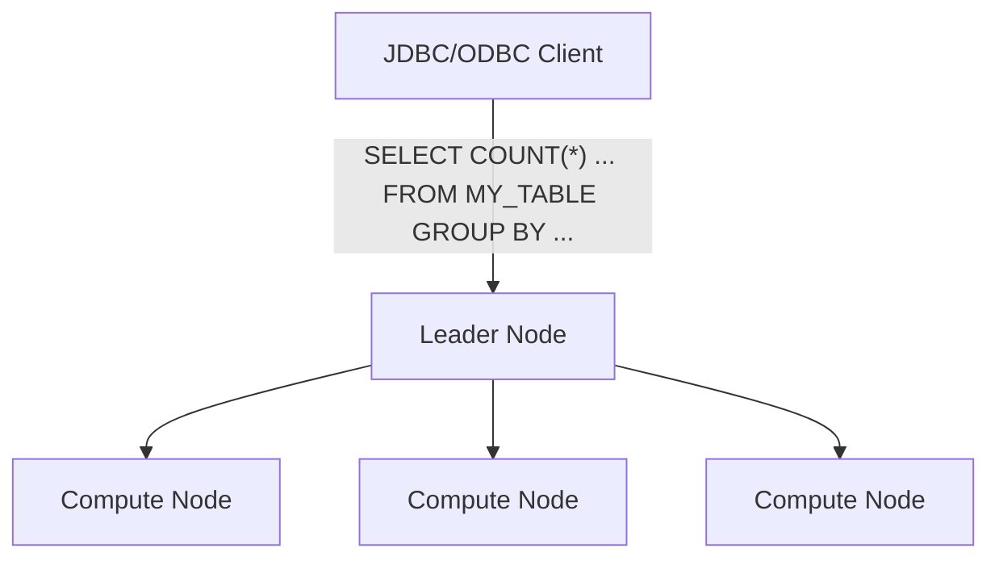

**Redshift – Snapshots & DR:**
- Redshift has "Multi-AZ" mode for some clusters
- Snapshots are point-in-time backups of a cluster, stored internally in S3
- Snapshots are incremental (only changes are saved)
- You can restore a snapshot into a new cluster
- Automated: every 8 hours, every 5 GB, or on a schedule; retention 1 to 35 days
- Manual: snapshot retained until you delete it
- Can configure Redshift to automatically copy snapshots (automated or manual) to another AWS Region

**Loading data into Redshift:** Large inserts are much better than many small ones.
- Amazon Kinesis Data Firehose can load directly into a Redshift cluster (through S3 copy)
- `COPY` command loads from an S3 bucket: `copy customer from 's3://mybucket/mydata' iam_role 'arn:aws:iam::0123456789012:role/MyRedshiftRole';`
- Enhanced VPC Routing routes COPY/UNLOAD traffic through the VPC instead of the internet
- Better to write data in batches from EC2/JDBC driver rather than single-row inserts

**Redshift Spectrum:**
- Query data that is already in S3 **without loading it** into Redshift
- Must have a Redshift cluster available to start the query
- The query is then submitted to thousands of Redshift Spectrum nodes

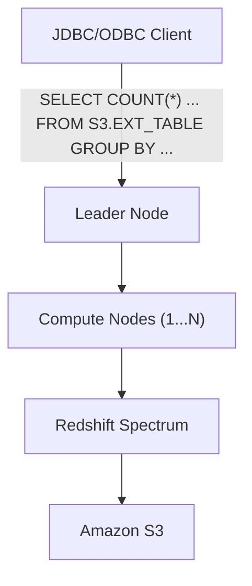

### Amazon CloudSearch
- Not available in all regions — may cause cost or performance issues
- **Use case:** you have lots of offline data that you want to bring to your central repository and make it searchable
- **Features:**
  - Create and configure a search domain — a boundary for your data, similar to an S3 bucket
  - Upload the data you want to search
  - Send search requests to your domain

### Amazon OpenSearch Service
- Successor to Amazon ElasticSearch
- CloudSearch is not going to expand as large as OpenSearch can
- You create a domain, like CloudSearch, but within it you can launch an Elasticsearch cluster
- DynamoDB queries only exist by primary key or indexes; OpenSearch lets you search any field, even partial matches
- Common to use OpenSearch as a complement to another database
- Two modes: managed cluster or serverless cluster
- Does not natively support SQL (can be enabled via a plugin)
- Ingestion from Kinesis Data Firehose, AWS IoT, and CloudWatch Logs
- Security through Cognito & IAM, KMS encryption, TLS
- Comes with OpenSearch Dashboards (visualization)
- **Features:** create Elasticsearch clusters; manage your cluster and monitor traffic; load and query data for analyzing; purchase Reserved Instances for cost savings

**OpenSearch patterns:**

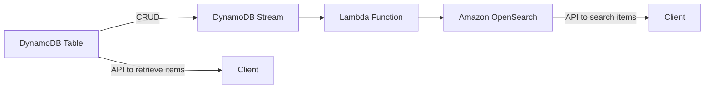

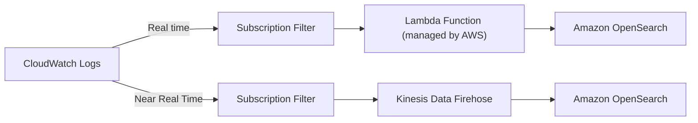

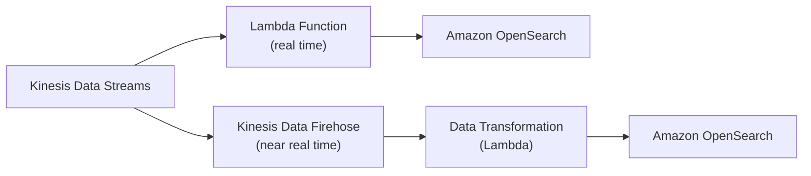

### Amazon EMR
- EMR = "Elastic MapReduce"
- Helps create Hadoop clusters (Big Data) to analyze and process vast amounts of data
- Clusters can be made of hundreds of EC2 instances
- Comes bundled with Apache Spark, HBase, Presto, Flink
- EMR handles all provisioning and configuration
- Auto-scaling and integrated with Spot Instances
- **Use cases:** data processing, machine learning, web indexing, big data

**EMR – Node types & purchasing:**
- **Master Node:** manages the cluster, coordinates, manages health — long running; coordinates job distribution across the Core and Task nodes
- **Core Node:** runs tasks assigned by the Master Node and stores data in the cluster — long running; runs **HDFS** and **Node Manager**
- **Task Node (optional):** runs only tasks that do not store data — usually Spot; runs only **Node Manager**
- Purchasing options:
  - On-demand: reliable, predictable, won't be terminated
  - Reserved (min 1 year): cost savings (EMR automatically uses if available)
  - Spot Instances: cheaper, can be terminated, less reliable
- Can be a long-running cluster or a transient (temporary) cluster

**EMR – Worked example (processing a 10 million-record file):**
- Goal: look up information, do a calculation, and store the results for a big file with 10 million records.
- The **Master Node** gives the file to a **Core Node**.
- The **Core Node** pulls in the records (e.g., a million lines at a time), then passes them to a **Task Node** to process.
- The **Task Node** processes the records and returns the results to the **Core Node**, which stores them.

### Amazon QuickSight
- Serverless machine learning-powered business intelligence service to create interactive dashboards
- Fast, automatically scalable, embeddable, with per-session pricing
- **Use cases:** business analytics, building visualizations, ad-hoc analysis, business insights from data
- Integrated with RDS, Aurora, Athena, Redshift, S3
- In-memory computation using the **SPICE** engine if data is imported into QuickSight
- Enterprise edition: Column-Level Security (CLS)

**QuickSight Integrations:** Data Sources (AWS Services): RDS, Redshift, Athena, S3, OpenSearch, Aurora, Timestream. Data Sources (SaaS): ELF & CLF (Log Format). Data Sources (Imports): On-Premises Databases (JDBC).

**QuickSight – Dashboard & Analysis:**
- Define Users (Standard edition) and Groups (Enterprise edition) — these only exist within QuickSight, not IAM
- A **dashboard** is a read-only snapshot of an analysis that you can share; it preserves the configuration of the analysis (filtering, parameters, controls, sort)
- You can share the analysis or the dashboard with Users or Groups
- To share a dashboard, you must first publish it
- Users who see the dashboard can also see the underlying data

### AWS Glue
- Managed extract, transform, and load (ETL) service
- Useful to prepare and transform data for analytics
- Fully serverless service

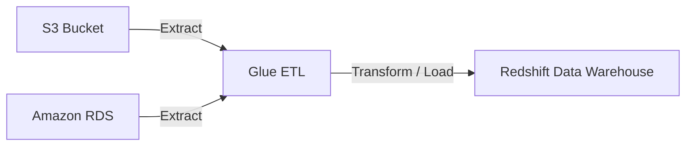

**Glue – Convert data into Parquet format:**

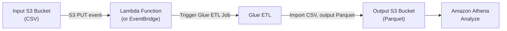

**Glue Data Catalog:** catalog of datasets.

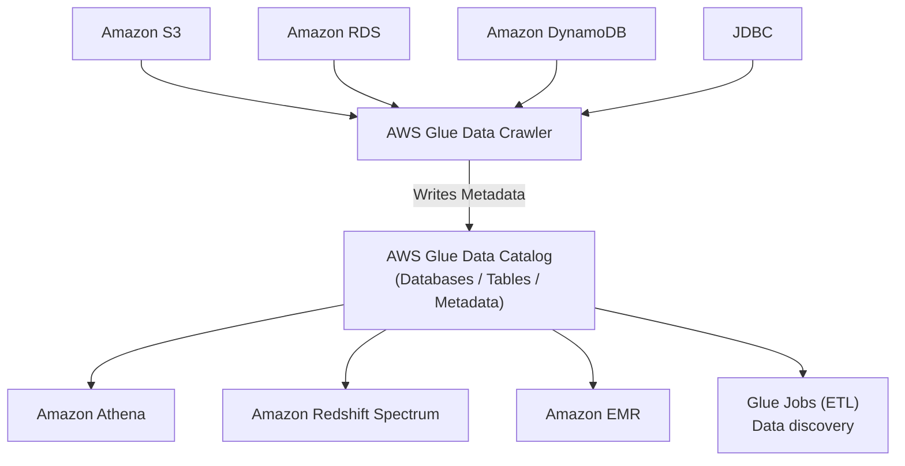

**Glue — things to know at a high level:**
- **Glue Job Bookmarks:** prevent re-processing old data in case you run a new ETL job
- **Glue Elastic Views:** combine and replicate data across multiple data stores using SQL — e.g., create a view across an RDS DB; no custom code needed, Glue monitors for changes in the source data; creates a virtual table (materialized view)
- **Glue DataBrew:** clean and normalize data using pre-built transformations
- **Glue Studio:** GUI to create, run, and monitor ETL jobs in Glue
- **Glue Streaming ETL** (built on Apache Spark Structured Streaming): compatible with Kinesis Data Streaming, Kafka, MSK (managed Kafka)

### AWS Lake Formation
- Data lake = central place to have all your data for analytics purposes
- Fully managed service that makes it easy to set up a data lake in days
- Discover, cleanse, transform, and ingest data into your Data Lake
- Automates many complex manual steps (collecting, cleansing, moving, cataloging data) and de-duplicates (using ML Transforms)
- Combines structured and unstructured data in the data lake
- Out-of-the-box source blueprints: S3, RDS, Relational & NoSQL DBs — these blueprints help you migrate data from one place into the central data lake
- Fine-grained Access Control for applications (row and column-level) — any application connected to Lake Formation gets this Fine-grained Access Control
- Built on top of AWS Glue, but you don't interact with Glue directly

**Why Lake Formation:** Centralized permissions. Without it, you can have many different data sources, and each one manages its own security separately — this becomes a complicated mess. With Lake Formation, you ingest all data so it sits in a central S3 bucket, and within Lake Formation you manage all access control (column & row-level security) in one place — e.g., Athena will only see what it's allowed to see.

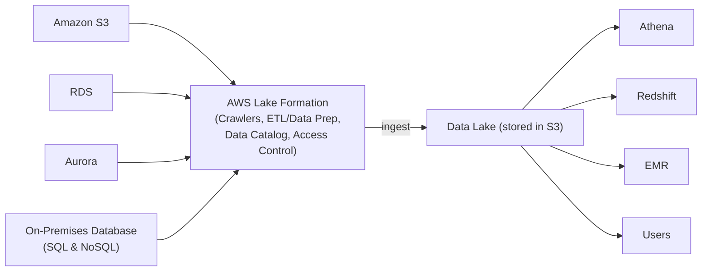

**Lake Formation Centralized Permissions Example:** Column-level security via Lake Formation Access Control governs data flowing from S3/RDS/Aurora into the data lake, consumed by Athena, QuickSight, and Users.

### AWS Data Pipeline
- A managed ETL (Extract-Transform-Load) service
- A web service for scheduling data movement and data processing; integrates with on-premise and cloud-based storage systems
- Provides built-in activities for common actions: copying data between S3 and RDS, running a query against S3 log data
- Supports JDBC, RDS, and Redshift databases
- Allows you to create data transformations through APIs and also through JSON
- Integrates with S3, DynamoDB, RDS, EMR, EC2, and Redshift
- Context (from source): IoT Core allows you to harvest data from IoT devices; Firehose helps with data delivery to S3 in real time (1 minute)

**Components:**
- **Pipeline definition:** specifies the logic of your data management
- **Pipeline:** schedules and runs tasks by creating EC2 instances — Data Pipeline determines the tasks, schedules them, and assigns them to task runners
- **Task Runner:** polls for tasks and then performs those tasks

### AWS Data Exchange
- Allows AWS customers to easily discover, subscribe to, and use third-party data in the AWS Cloud
- You can create, view, manage, and access data sets for use across a variety of AWS analytics and machine learning services
- Eliminates the need for data storage, delivery, billing, and entitling infrastructure
- Organizations can distribute, source, exchange, share, and commercialize data and/or orchestrate data ecosystems
- Provides a single API through which customers can consume your data in the AWS
- World's most comprehensive service for third-party data sets
- Allows you to centralize all third-party data consumption from existing subscriptions

**Data organization — three types:**
- **Data sets:** a container for related data, e.g., end-of-day pricing for equities trading in the US
- **Revisions:** data sets are subject to a series of revisions; data providers publish as needed to make new assets available
- **Assets:** any file that can be stored in S3, e.g., CSV, Parquet, or image files

**Benefits:**
- Easily package and publish data products — package and publish data sets inside free or paid offerings in minutes, for the price and terms you specify
- Reach millions of AWS customers — customers can find, subscribe to, and integrate your published data products into data lakes, apps, and analytics
- Built-in security and compliance controls — end-to-end encryption is provided by AWS Data Exchange

**Pricing:**
- Data product fees: subscription-based products, pay-as-you-go based products
- Data transfer fees
- AWS service costs: for services used to store, process, or analyze the data

### Amazon Managed Service for Apache Flink
- Previously named: Kinesis Data Analytics for Apache Flink
- Flink (Java, Scala, or SQL) is a framework for processing data streams
- Run any Apache Flink application on a managed cluster on AWS
- Provisioned compute resources, parallel computation, automatic scaling
- Application backups implemented as checkpoints and snapshots
- Use any Apache Flink programming features to transform data

> [!WARNING]
> Important from the source: Flink does not read from Amazon Data Firehose. Sources shown are Amazon MSK (Apache Kafka) and Kinesis Data Streams.

### Amazon Managed Streaming for Apache Kafka (Amazon MSK)
- Alternative to Amazon Kinesis — Apache Kafka is a way to stream data; a Kafka cluster is made of multiple brokers, producers ingest data (e.g., from Kinesis, IoT, RDS) and send it directly into a Kafka topic that is fully replicated across two other brokers (Kafka topic has real-time streaming); consumers pull from the topic to consume the data, process it, or send it to destinations such as EMR, S3, SageMaker, Kinesis, and RDS
- Fully managed Apache Kafka on AWS — deploy Kafka on AWS with one click
- Allows you to create, update, delete clusters on the fly
- MSK creates & manages Kafka broker nodes & Zookeeper nodes for you
- Deploy the MSK cluster in your VPC, multi-AZ (up to 3 for HA)
- Automatic recovery from common Apache Kafka failures
- Data is stored on EBS volumes for as long as you want — as long as you pay for the underlying EBS storage
- **MSK Serverless:** run Apache Kafka on MSK without managing capacity — MSK automatically provisions resources and scales compute & storage

**MSK Producer and Consumer:**
- **Producer:** only one option — the Kafka Producer
- **Consumer:** multiple options — Kinesis Data Analytics for Apache Flink (run a Flink application that reads directly from the MSK cluster), Glue to do streaming ETL jobs (powered by Apache Spark Streaming), Lambda functions with MSK as an event source, or your own Kafka consumer running on any platform (e.g., Amazon EC2, ECS cluster, or EKS cluster)

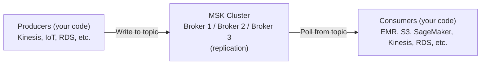

**Kinesis Data Streams vs. Amazon MSK:**

| Feature | Kinesis Data Streams | Amazon MSK |
|---|---|---|
| Message size limit | 1 MB message size limit | 1 MB default, configurable higher (e.g. 10 MB) |
| Unit of parallelism | Data Streams with Shards; to scale up do Shard Splitting, to scale down do Merging | Kafka Topics with Partitions; can only add partitions to a topic — you cannot remove partitions |
| In-flight encryption | TLS | PLAINTEXT or TLS |
| At-rest encryption | KMS | KMS |

**Amazon MSK Consumers:** Kinesis Data Analytics for Apache Flink, AWS Glue Streaming ETL Jobs (powered by Apache Spark Streaming), Lambda, and applications running on Amazon EC2, ECS, EKS.

### Big Data Ingestion Pipeline (Example Architecture)
Goal: fully serverless ingestion pipeline that collects data in real time, transforms it, queries the transformed data using SQL, stores reports in S3, and loads data into a warehouse for dashboards.

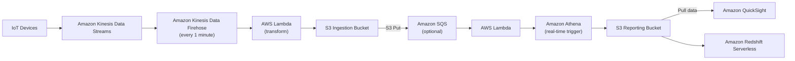

**Pipeline discussion (from source):**
- IoT Core allows you to harvest data from IoT devices
- Kinesis is great for real-time data collection
- Firehose helps with data delivery to S3 in near real-time (1 minute)
- Lambda can help Firehose with data transformations
- Amazon S3 can trigger notifications to SQS
- Lambda can subscribe to SQS (could also connect S3 directly to Lambda)
- Athena is a serverless SQL service and results are stored in S3
- The reporting bucket contains analyzed data and can be used by reporting tools such as AWS QuickSight, Redshift, etc.

## AWS Services / Features

| Service | Type | Key differentiator |
|---|---|---|
| CloudSearch | Search domain for offline data | Not available in all regions; domain is a boundary like an S3 bucket |
| Athena | Serverless SQL query on S3 | No infrastructure, pay per TB scanned, built on Presto |
| Redshift | Data warehouse (OLAP) | Provisioned/Serverless cluster, columnar storage, faster joins/aggregations than Athena |
| Redshift Spectrum | Query S3 from Redshift | Query S3 data without loading it into the cluster |
| OpenSearch | Search / analytics | Free-text & partial-match search, not native SQL; does not scale as large limits as CloudSearch |
| EMR | Big data processing | Hadoop/Spark/HBase/Presto/Flink clusters on EC2, Spot-friendly |
| QuickSight | BI / dashboards | Serverless, SPICE in-memory engine, per-session pricing |
| Glue | Serverless ETL | Extract/transform/load, Data Catalog, Crawlers, Elastic Views (SQL-based materialized views) |
| Lake Formation | Data lake setup | Built on Glue (no direct Glue interaction), centralized fine-grained access control |
| AWS Data Pipeline | Managed ETL / scheduling | Schedules data movement/processing via EC2 task runners, on-prem & cloud storage |
| AWS Data Exchange | Third-party data marketplace | Subscribe to / publish data sets (data sets, revisions, assets) via a single API |
| Managed Service for Apache Flink | Stream processing | Formerly Kinesis Data Analytics for Apache Flink; does not read from Firehose |
| Amazon MSK | Managed Kafka | Alternative to Kinesis, topics/partitions (can only add, not remove), brokers on EBS, one-click deploy |

## Exam Tips
> [!TIP]
> Athena vs Redshift: both query data for analytics, but Athena is serverless SQL directly on S3 (pay per TB scanned, best for ad-hoc/infrequent queries), while Redshift is a provisioned/serverless **data warehouse** with indexes that is faster for joins/aggregations at scale — you load data into Redshift first (or use Redshift Spectrum to query S3 without loading).

> [!TIP]
> If you see "analyze data directly in S3 using SQL, no infrastructure to manage" → Athena. If you see "data warehouse, BI tool integration, need best query performance on large structured datasets" → Redshift.

> [!WARNING]
> Amazon Managed Service for Apache Flink (formerly Kinesis Data Analytics for Apache Flink) does **not** read from Amazon Data Firehose — remember its sources are Kinesis Data Streams and Amazon MSK.

> [!TIP]
> Use Glue to convert data to columnar formats (Parquet/ORC) before querying with Athena or Redshift Spectrum — this reduces the amount of data scanned and significantly improves both cost and performance.

## Related Notes
- [[01-RDS-Aurora-ElastiCache]]
- [[02-Databases-Overview]]
