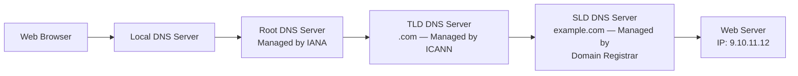
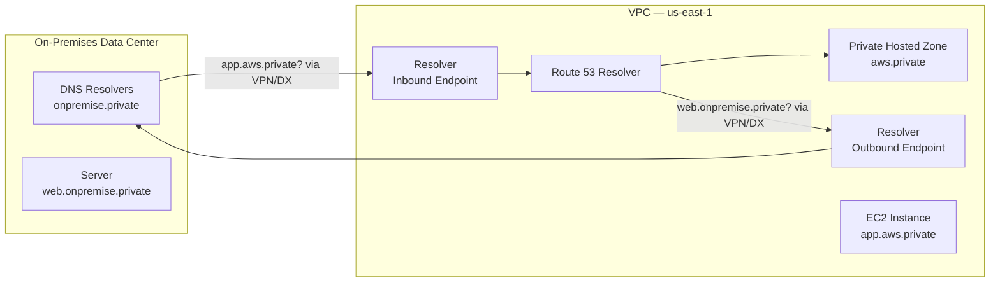

# Amazon Route 53

## Key Concepts

### What is DNS?
- Domain Name System — translates human-friendly hostnames into machine IP addresses (e.g., `www.google.com` => `172.217.18.36`)
- DNS is the backbone of the Internet
- DNS uses a hierarchical naming structure
- DNS is based on **Request For Comments (RFC) 1034 and 1035**: RFC 1034 describes the hierarchical structure of DNS; RFC 1035 describes the protocol that talks to DNS
- A **Domain** can be defined as a specified boundary of activity — e.g., in `aws.amazon.com`, `aws` is the host name, `amazon.com` is the domain name, `.com` is the top level domain; `services.aws.amazon.com` is a sub-domain, showing the hierarchy
- **DNS options are typically configured at the VPC level** — you can launch an instance, run your own DNS server, and reconfigure the VPC to use your DNS server instead
- Each VPC has its own DNS configuration set

### DNS Terminology
- **Domain Registrar** — Amazon Route 53, GoDaddy, …
- **DNS Records** — A, AAAA, CNAME, NS, …
- **Zone File** — contains DNS records
- **Name Server** — resolves DNS queries (Authoritative or Non-Authoritative)
- **Top Level Domain (TLD)** — `.com`, `.us`, `.in`, `.gov`, `.org`, …
- **Second Level Domain (SLD)** — `amazon.com`, `google.com`, …
- **FQDN** (Fully Qualified Domain Name) is built from: Protocol, Sub Domain, SLD, TLD

### How DNS Works
The resolution chain for `example.com` walks: Local DNS Server → Root DNS Server (managed by IANA, branch of ICANN) → TLD DNS Server `.com` (managed by ICANN) → SLD DNS Server `example.com` (managed by the Domain Registrar, e.g., Amazon Registrar Inc.) → Web Server IP returned, cached per the record's **TTL**.

### DNS Hosting — Name Resolution Concepts
A DNS hosting provider provides name resolution using:
- **Caching** — the answer is kept in cached memory so it's ready for the next requestor
- **Recursion** — the DNS server is enabled to perform the resolution itself (rather than just referring the requestor elsewhere)
- **Stores a DNS database** — called a **zone file**; a **zone** is the realm of host names that you manage
- **Aliasing** — allows you to have different names point to the same target destination
- **DNS zone transfers** — transfer a zone to another DNS server for caching or redundancy; this offloads name resolution processing to a different DNS server acting on its behalf

### DNS Resolution — Forward vs Reverse Lookup
- **Forward lookup** — requesting the IP address of a host name
- **Reverse lookup** — requesting the host name of an IP address (useful when you only have an IP address in a log)
- The requestor (any device that needs to resolve a domain name to an IP — e.g., a phone or a DNS server) is configured with a DNS server address

## AWS Services / Features

### Amazon Route 53
- A highly available, scalable, fully managed and **Authoritative DNS** — Authoritative means the customer (you) can update the DNS records
- Route 53 is also a **Domain Registrar**
- Ability to check the health of your resources
- The **only AWS service which provides a 100% availability SLA**
- Name origin: "53" is a reference to the traditional DNS port

### Route 53 — Records
Each record contains:
- **Domain/subdomain Name** — e.g., `example.com`
- **Record Type** — e.g., A or AAAA
- **Value** — e.g., `12.34.56.78`
- **Routing Policy** — how Route 53 responds to queries
- **TTL** — amount of time the record is cached at DNS Resolvers

Supported record types:
- **(must know)** A / AAAA / CNAME / NS
- **(advanced)** CAA / DS / MX / NAPTR / PTR / SOA / TXT / SPF / SRV

| Record Type | Purpose |
|---|---|
| A | Maps a hostname to IPv4 |
| AAAA | Maps a hostname to IPv6 |
| CNAME | Maps a hostname to another hostname (target must have an A or AAAA record) |
| NS | Name Servers for the Hosted Zone; control how traffic is routed for a domain |

> [!WARNING]
> You **can't create a CNAME record for the top node of a DNS namespace** (Zone Apex) — e.g., you can't create one for `example.com`, but you can for `www.example.com`.

**Advanced record types — detail**

| Record Type | Description |
|---|---|
| MX (Mail Xchange) | A decimal number (priority) plus the domain name of an email server |
| NS (Name Server) | The name servers for the hosted zone; used for resolving a domain to a hostname |
| PTR | Formatted as a domain name (used for reverse lookups) |
| SOA (Start of Authority) | Provides information about a domain |
| SPF (Sender Policy Framework) | Used to verify the identity of the sender of email messages — **not recommended to use** |
| SRV | Consists of four space-separated values: `priority weight port domain-name` — e.g., `10 5 80 hostname.example.com` |
| TXT (Text) | A space-separated list of double-quoted strings |

### Route 53 — Hosted Zones
A container for records that define how to route traffic to a domain and its subdomains.
- **Public Hosted Zones** — contain records that specify how to route traffic on the Internet (public domain names), e.g., `application1.mypublicdomain.com`
- **Private Hosted Zones** — contain records that specify how you route traffic within one or more VPCs (private domain names), e.g., `application1.company.internal`
- You pay **$0.50 per month per hosted zone**

### Route 53 — Records TTL (Time To Live)
The client caches the result for the TTL of the record.

| TTL | Trade-off |
|---|---|
| High TTL (e.g., 24 hr) | Less traffic on Route 53; possibly outdated records |
| Low TTL (e.g., 60 sec) | More traffic on Route 53 ($$); records outdated for less time; easy to change records |

- Except for **Alias records**, TTL is mandatory for each DNS record

### CNAME vs Alias
AWS resources (Load Balancer, CloudFront, …) expose an AWS hostname (e.g., `lb1-1234.us-east-2.elb.amazonaws.com`) and you want `myapp.mydomain.com` to point to it.

| | CNAME | Alias |
|---|---|---|
| Points a hostname to | Any other hostname | An AWS resource |
| Root domain support | Only for **non-root** domain (`something.mydomain.com`) | Works for **root** and non-root domain (`mydomain.com`) |
| Cost | — | Free of charge |
| Health check | — | Native health check |

### Route 53 — Alias Records
- Maps a hostname to an AWS resource; an extension to DNS functionality
- Automatically recognizes changes in the resource's IP addresses
- Unlike CNAME, it **can be used for the top node of a DNS namespace (Zone Apex)**, e.g., `example.com`
- Alias Record is always of type **A/AAAA** for AWS resources (IPv4 / IPv6)
- **You can't set the TTL**

Alias Record targets:
- Elastic Load Balancers
- CloudFront Distributions
- API Gateway
- Elastic Beanstalk environments
- S3 Websites
- VPC Interface Endpoints
- Global Accelerator accelerator
- Route 53 record in the same hosted zone

> [!WARNING]
> You **cannot set an ALIAS record for an EC2 DNS name**.

**EC2 public DNS hostnames** — each EC2 instance has an automatically generated DNS host name. You cannot change this generated host name directly, but to point your own domain at the instance's public DNS you can either: take the instance's public IP and create an alias (A record) that points to that IP, or create a CNAME alias that redirects to that address.

### Route 53 — Routing Policies
Define how Route 53 responds to DNS queries.

> [!NOTE]
> Don't get confused by the word "Routing" — it's not the same as Load Balancer routing which routes traffic. DNS does not route any traffic, it only **responds to DNS queries**.

Supported routing policies: Simple, Weighted, Failover, Latency-based, Geolocation, Multi-Value Answer, Geoproximity (via Route 53 Traffic Flow), IP-based.

#### Simple
- Typically routes traffic to a single resource
- Can specify multiple values in the same record — if multiple values are returned, a random one is chosen by the **client**
- When Alias is enabled, specify only **one** AWS resource
- **Can't be associated with Health Checks**

#### Weighted
- Control the % of requests that go to each specific resource
- Traffic (%) = weight for a specific record / sum of all the weights for all records
- Weights **don't need to sum up to 100**
- DNS records must have the **same name and type**
- Can be associated with Health Checks
- Use cases: load balancing between regions, testing new application versions
- Assign a weight of **0** to a record to stop sending traffic to a resource
- If **all** records have a weight of 0, then all records will be returned equally

#### Latency-based
- Redirects to the resource with the least **latency** close to the user
- Latency is based on traffic between users and AWS Regions (not physical distance) — e.g., German users may be directed to the US if that's the lowest latency
- Can be associated with Health Checks (has a failover capability)

#### Geolocation
- **Different from Latency-based!** Routing is based on the user's **location**, not latency
- Specify location by Continent, Country, or US State (if overlapping, the most precise location is selected)
- Should create a **"Default"** record in case there's no match on location
- Use cases: website localization, restrict content distribution, load balancing
- Can be associated with Health Checks

#### Geoproximity (Route 53 Traffic Flow)
- Routes traffic based on the geographic location of users **and** resources
- Ability to shift more traffic to resources using **bias** values
  - To **expand** (1 to 99) — more traffic to the resource
  - To **shrink** (-1 to -99) — less traffic to the resource
- Resources can be AWS resources (specify AWS Region) or Non-AWS resources (specify Latitude/Longitude)
- **Must use Route 53 Traffic Flow** to use this feature

#### IP-based Routing
- Routing is based on the clients' IP addresses
- You provide a list of CIDRs for your clients and the corresponding endpoints/locations (user-IP-to-endpoint mappings), grouped in a **CIDR Collection**
- Use cases: optimize performance, reduce network costs
- Example: route end users from a particular ISP to a specific endpoint

#### Failover (Active-Passive)
- Routes to a Primary resource; if its Health Check fails, fails over to a Secondary (Disaster Recovery) resource
- Health Check is **mandatory** for Failover

#### Multi-Value Answer
- Use when routing traffic to multiple resources
- Route 53 returns multiple values/resources
- Can be associated with Health Checks (returns only values for healthy resources)
- Up to **8 healthy records** are returned per Multi-Value query
- **Multi-Value is not a substitute for having an ELB**

### Route 53 Routing Policy Comparison

| Policy | Basis | Health Check? | Typical Use Case |
|---|---|---|---|
| Simple | Single/random value | No | Basic routing to one resource |
| Weighted | Assigned % weight | Yes | Load balancing between regions, A/B testing |
| Latency-based | Lowest latency to Region | Yes (with failover) | Optimize response time globally |
| Geolocation | User's location | Yes | Localization, content restriction |
| Geoproximity | Location + bias | Via Traffic Flow | Shift traffic geographically |
| IP-based | Client IP / CIDR | No (source-based) | ISP-based routing, cost optimization |
| Failover | Primary/Secondary health | Yes (mandatory) | Active-Passive DR |
| Multi-Value Answer | Multiple healthy values | Yes | Simple client-side load distribution (not an ELB replacement) |

### Route 53 — Health Checks
- HTTP Health Checks are only for **public** resources
- Health Check => Automated DNS Failover, in three forms:
  1. Health checks that monitor an endpoint (application, server, other AWS resource)
  2. Health checks that monitor other health checks (**Calculated Health Checks**)
  3. Health checks that monitor **CloudWatch Alarms** (full control — e.g., DynamoDB throttles, RDS alarms, custom metrics — helpful for private resources)
- Health Checks are integrated with CloudWatch metrics

#### Monitor an Endpoint
- About **15 global health checkers** check the endpoint health
- Healthy/Unhealthy Threshold — **3** (default)
- Interval — **30 sec** (can set to 10 sec — higher cost)
- Supported protocols: HTTP, HTTPS, TCP
- If **> 18%** of health checkers report healthy, Route 53 considers the endpoint **Healthy**; otherwise **Unhealthy**
- Ability to choose which locations Route 53 uses for checks
- Health Checks pass only when the endpoint responds with **2xx and 3xx** status codes
- Health Checks can pass/fail based on text found in the **first 5120 bytes** of the response
- Configure your router/firewall to allow incoming requests from Route 53 Health Checkers (published at `https://ip-ranges.amazonaws.com/ip-ranges.json`)

#### Calculated Health Checks
- Combine the results of multiple Health Checks into a single Health Check
- Use OR, AND, or NOT
- Can monitor up to **256 child Health Checks**
- Specify how many child health checks need to pass for the parent to pass
- Usage: perform maintenance on your website without causing all health checks to fail

#### Health Checks — Private Hosted Zones
- Route 53 health checkers are **outside** the VPC — they can't access private endpoints (private VPC or on-premises resource)
- Workaround: create a **CloudWatch Metric** + **CloudWatch Alarm**, then create a Health Check that checks the alarm itself

### Domain Registrar vs. DNS Service
- You buy/register your domain name with a **Domain Registrar**, typically paying annual charges (e.g., GoDaddy, Amazon Registrar Inc.)
- The Domain Registrar usually provides a DNS service to manage your DNS records — but **you can use a different DNS service**
- Example: purchase the domain from GoDaddy and use **Route 53** to manage your DNS records

### 3rd Party Registrar with Amazon Route 53
If you buy your domain on a 3rd party registrar, you can still use Route 53 as the DNS Service provider:
1. Create a Hosted Zone in Route 53
2. Update NS Records on the 3rd party website to use Route 53 Name Servers

> [!NOTE]
> Domain Registrar != DNS Service — but every Domain Registrar usually comes with some DNS features.

### Route 53 — Hybrid DNS
By default, **Route 53 Resolver** automatically answers DNS queries for:
- Local domain names for EC2 instances
- Records in Private Hosted Zones
- Records in public Name Servers

Hybrid DNS = resolving DNS queries between a VPC (Route 53 Resolver) and your networks (other DNS Resolvers). Networks can be: the VPC itself / Peered VPC, or an On-premises Network (connected through Direct Connect or AWS VPN).

### Route 53 — Resolver Endpoints
- **Inbound Endpoint** — allows your on-premises DNS Resolvers to resolve domain names for AWS resources (e.g., EC2 instances) and records in Private Hosted Zones
- **Outbound Endpoint** — Route 53 Resolver forwards DNS queries to your on-premises DNS Resolvers

## Exam Tips
> [!TIP]
> Know the **routing policy triggers** cold: "lowest latency" = Latency-based; "user's physical/geographic location" = Geolocation; "% split traffic" = Weighted; "primary/DR failover" = Failover (mandatory health check); "route based on client IP/CIDR" = IP-based; "return several healthy IPs, not a real load balancer" = Multi-Value Answer.

> [!TIP]
> **Alias vs CNAME**: Alias is free, works at the zone apex (root domain), has native health checks, and only targets AWS resources. CNAME cannot be used at the zone apex and can point to any hostname.

> [!WARNING]
> Route 53 Health Checkers live **outside the VPC** and cannot check private resources directly — for private endpoints, route the check through a CloudWatch Alarm instead.

> [!TIP]
> Route 53 is the **only AWS service with a 100% availability SLA** — a classic exam distractor fact.

## Related Notes
- [[02-VPC]]
- [[03-CloudFront-Global-Accelerator]]
