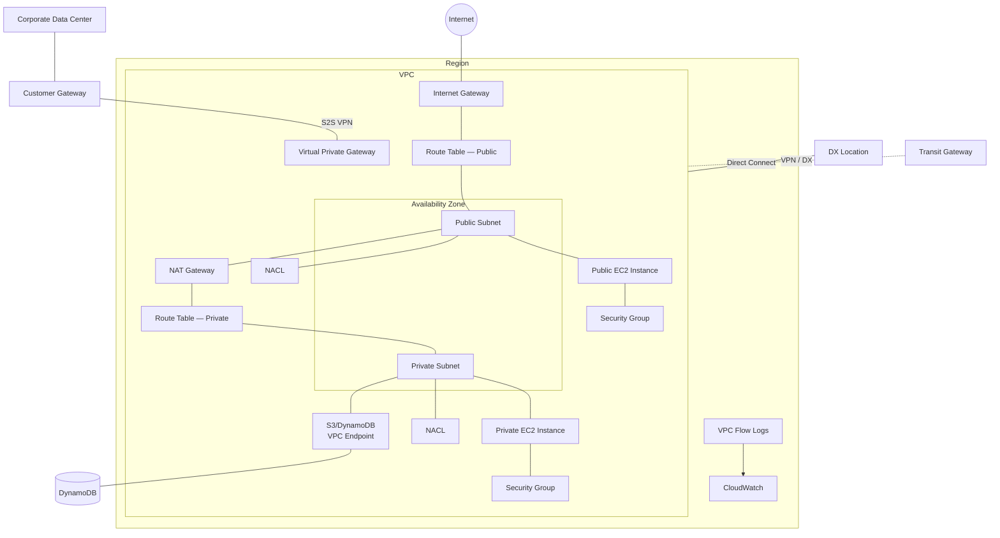
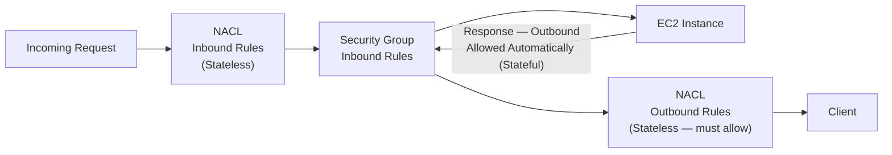

# Amazon VPC

## Key Concepts

### VPC Components Overview
A VPC lives inside a Region and spans its Availability Zones. Core building blocks: Subnets (public/private), Route Tables, an Internet Gateway, NAT Gateway, Security Groups, NACLs, VPC Peering Connections, VPC Endpoints, VPC Flow Logs, a Virtual Private Gateway + Customer Gateway (Site-to-Site VPN), a Direct Connect connection, and a Transit Gateway for hub-and-spoke connectivity.

### Understanding CIDR — IPv4
- CIDR (Classless Inter-Domain Routing) — a method for allocating IP addresses
- Used in Security Group rules and AWS networking in general
- `WW.XX.YY.ZZ/32` => one IP
- `0.0.0.0/0` => all IPs
- Example: `192.168.0.0/26` => `192.168.0.0 – 192.168.0.63` (64 IP addresses)

A CIDR has two components:
- **Base IP** — an IP contained in the range (e.g., `10.0.0.0`, `192.168.0.0`)
- **Subnet Mask** — defines how many bits can change in the IP (e.g., `/0`, `/24`, `/32`); can also be written `/16 ↔ 255.255.0.0`, `/24 ↔ 255.255.255.0`, `/32 ↔ 255.255.255.255`

**Quick memo:**
- `/32` — no octet can change
- `/24` — last octet can change
- `/16` — last 2 octets can change
- `/8` — last 3 octets can change
- `/0` — all octets can change

| CIDR | Usable IPs | Range (from 192.168.0.0) |
|---|---|---|
| /32 | 1 (2⁰) | 192.168.0.0 |
| /31 | 2 (2¹) | 192.168.0.0 – 192.168.0.1 |
| /30 | 4 (2²) | 192.168.0.0 – 192.168.0.3 |
| /29 | 8 (2³) | 192.168.0.0 – 192.168.0.7 |
| /28 | 16 (2⁴) | 192.168.0.0 – 192.168.0.15 |
| /27 | 32 (2⁵) | 192.168.0.0 – 192.168.0.31 |
| /26 | 64 (2⁶) | 192.168.0.0 – 192.168.0.63 |
| /25 | 128 (2⁷) | 192.168.0.0 – 192.168.0.127 |
| /24 | 256 (2⁸) | 192.168.0.0 – 192.168.0.255 |
| /16 | 65,536 (2¹⁶) | 192.168.0.0 – 192.168.255.255 |
| /0 | All IPs | 0.0.0.0 – 255.255.255.255 |

> [!TIP]
> Quick exercise from the source: `134.56.78.123/32` = just that single IP. `0.0.0.0/0` = all IPs. When in doubt, use a CIDR calculator such as ipaddressguide.com.

### Public vs. Private IP (IPv4)
IANA established blocks of IPv4 addresses for private (LAN) use. All other addresses are Public.

| Private Range | CIDR | Typical Use |
|---|---|---|
| 10.0.0.0 – 10.255.255.255 | 10.0.0.0/8 | Big networks |
| 172.16.0.0 – 172.31.255.255 | 172.16.0.0/12 | **AWS default VPC** range |
| 192.168.0.0 – 192.168.255.255 | 192.168.0.0/16 | e.g., home networks |

### Default VPC
- All new AWS accounts have a default VPC
- New EC2 instances are launched into the default VPC if no subnet is specified
- Default VPC has Internet connectivity, and all EC2 instances inside it have **public IPv4 addresses**
- You also get a public and a private IPv4 DNS name

### VPC in AWS — IPv4
- VPC = Virtual Private Cloud
- You can have **multiple VPCs in an AWS Region** (max. 5 per Region — soft limit)
- Max. **5 CIDRs per VPC**; for each CIDR:
  - Min. size is **/28** (16 IP addresses)
  - Max. size is **/16** (65,536 IP addresses)
- RFC1918 ranges are recommended; **non-RFC1918 IPv4 ranges are also permitted**, subject to AWS CIDR restrictions.
- Your VPC CIDR should **NOT overlap** with your other networks (e.g., corporate)

### VPC — Subnet (IPv4)
- AWS reserves **5 IP addresses** (first 4 and last 1) in each subnet — not available for use by EC2 instances
- Example: for CIDR block `10.0.0.0/24`:

| Reserved IP | Purpose |
|---|---|
| 10.0.0.0 | Network Address |
| 10.0.0.1 | Reserved by AWS for the VPC router |
| 10.0.0.2 | Reserved by AWS for mapping to Amazon-provided DNS |
| 10.0.0.3 | Reserved by AWS for future use |
| 10.0.0.255 | Network Broadcast Address (AWS does not support broadcast in a VPC) |

> [!TIP]
> Exam trick: if you need 29 usable IP addresses for EC2 instances, a `/27` (32 IPs, 32 − 5 = 27 < 29) is **too small**. You need a `/26` (64 IPs, 64 − 5 = 59 > 29).

## AWS Services / Features

### Internet Gateway (IGW)
- Allows resources (e.g., EC2 instances) in a VPC to connect to the Internet
- Scales horizontally, highly available and redundant
- Must be **created separately** from a VPC
- One VPC can only be attached to **one** IGW and vice versa
- IGWs on their own do **not** allow Internet access — **Route Tables must also be edited**

### Elastic Network Interface (ENI)
- A **virtual network interface** that can be attached to an EC2 instance
- **Termination behavior when the EC2 instance is terminated**:
  - If the ENI was **created through the Console**, it **is terminated** along with the instance
  - If the ENI was **created via the Command Line**, it is **NOT terminated**
- **Configuring an ENI** — depends on when it's attached:
  - **Hot attach** — while the instance is **running**: manually configure interfaces, private IP addresses, and route tables
  - **Warm attach** — while the instance is **stopped**: manually configure interfaces, private IP addresses, and route tables
  - **Cold attach** — while the instance is **being launched**
- **Attachment rules**:
  - Normally **one ENI per instance**, but **one instance can have more than one ENI**
  - When you attach additional ENIs, AWS **automatically configures** interfaces, private IP addresses, and route tables
  - An ENI can be in a **different subnet** than the instance's primary interface, but it must be in the **same VPC** and the **same Availability Zone**

### Bastion Hosts
- Used to SSH into private EC2 instances
- The bastion sits in the **public subnet**, connected to all other private subnets
- Bastion Host Security Group must allow inbound from the internet on **port 22** from a restricted CIDR (e.g., your corporate public CIDR)
- Security Group of the target EC2 Instances must allow the Security Group (or private IP) of the Bastion Host

### NAT Instance (outdated, but still testable)
- NAT = Network Address Translation
- Allows EC2 instances in private subnets to connect to the Internet
- Must be launched in a **public subnet**
- Must **disable** the EC2 setting: **Source/Destination Check**
- Must have an **Elastic IP** attached
- Route Tables must route traffic from private subnets to the NAT Instance

**NAT Instance — Comments**
- Pre-configured Amazon Linux AMI available; reached end of standard support on **December 31, 2020**
- Not highly available/resilient out of the box — you need an ASG across multi-AZ + a resilient user-data script
- Internet bandwidth depends on the EC2 instance type
- You must manage Security Groups & rules:
  - Inbound: allow HTTP/HTTPS from Private Subnets; allow SSH from your home network (via IGW)
  - Outbound: allow HTTP/HTTPS to the Internet

### NAT Gateway
- AWS-managed NAT — higher bandwidth, high availability, no administration
- Pay per hour for usage and bandwidth
- Created in a **specific Availability Zone**, uses an **Elastic IP**
- Can't be used by an EC2 instance in the **same** subnet (only from other subnets)
- Requires an IGW (Private Subnet => NAT Gateway => IGW)
- **5 Gbps** of bandwidth with automatic scaling up to **100 Gbps**
- **No Security Groups** to manage/required

**High Availability**
- NAT Gateway is resilient within a **single AZ**
- Must create multiple NAT Gateways across multiple AZs for fault tolerance
- No cross-AZ failover needed — if an AZ goes down, resources in it don't need NAT anyway

### NAT Gateway vs NAT Instance

| | NAT Gateway | NAT Instance |
|---|---|---|
| Availability | Highly available within an AZ (create one per AZ) | Use a script to manage failover between instances |
| Bandwidth | Up to 100 Gbps | Depends on EC2 instance type |
| Maintenance | Managed by AWS | Managed by you (software, OS patches, …) |
| Cost | Per hour & amount of data transferred | Per hour, EC2 instance type/size, + network cost |
| IP | Public/Elastic IP | Public or Private IPv4 |
| Security Groups | Not used | Used — you manage the rules |
| Use as Bastion Host? | No | Yes |

### Regional NAT Gateway (RNAT)
- Highly available NAT Gateway associated with a VPC (not per-AZ)
- RNAT has its own route tables
- Eliminates the need for per-AZ deployments (shared across AZs)
- You **don't need to create Public Subnets** to host RNAT
- Automatically detects resources in a new AZ and expands to that AZ

### Security Groups vs NACLs

Traffic flow: for an **incoming request**, it is evaluated by the subnet's **NACL inbound rules** first, then the instance's **Security Group inbound rules**; the response goes out **stateful** (automatically allowed) through the Security Group, then must be explicitly allowed by the **NACL outbound rules (stateless)**.

**Network Access Control List (NACL)**
- NACLs are like a firewall controlling traffic **from and to subnets**
- **One NACL per subnet**; new subnets are assigned the **Default NACL**
- NACL rules have a number (1–32766) — **lower number = higher precedence**
- **First rule match** drives the decision (e.g., rule #100 ALLOW beats rule #200 DENY for the same IP)
- The last rule is an asterisk (`*`) and **denies** a request if no rule matches
- AWS recommends adding rules in **increments of 100**
- **Newly created NACLs deny everything** by default
- Great way to block a specific IP address at the subnet level

**Default NACL** — accepts everything inbound/outbound for its associated subnets. **Do NOT modify the Default NACL** — instead create custom NACLs.

**Ephemeral Ports**
- For two endpoints to establish a connection, they use ports — clients connect to a defined port and expect a response on an **ephemeral port**
- Different OSes use different ranges:
  - IANA & MS Windows 10: **49152 – 65535**
  - Many Linux kernels: **32768 – 60999**
- Because NACLs are **stateless**, you must explicitly allow the ephemeral port range in both directions for return traffic (e.g., Web tier allows inbound TCP 3306 to the DB subnet CIDR and outbound TCP on the ephemeral range from the DB subnet CIDR)
- NACL rules must be created for **each target subnet's CIDR**, including across multiple AZs (e.g., Web Subnet A/B, DB Subnet A/B)

| | Security Group | NACL |
|---|---|---|
| Level | Instance level | Subnet level |
| Rule types | Allow rules **only** | Allow **and** deny rules |
| State | **Stateful** — return traffic automatically allowed, regardless of rules | **Stateless** — return traffic must be explicitly allowed (think ephemeral ports) |
| Evaluation | **All** rules evaluated before deciding | Rules evaluated **in order** (lowest to highest); first match wins |
| Scope of application | Applies to an EC2 instance only when specified by someone | Automatically applies to **all** EC2 instances in the associated subnet |

**Security Group defaults & limits**
- A default Security Group: **allows no inbound traffic** and **allows all outbound traffic**
- Limit of **500 Security Groups per VPC**
- Stateful behavior means: return traffic is automatically allowed regardless of any inbound/outbound rules — responses to allowed inbound traffic are allowed to flow outbound (and vice versa), so an explicit rule for the response is not needed

> [!WARNING]
> NACLs are stateless — a very common exam trap is forgetting to open the **ephemeral port range** on the return-traffic direction, which silently breaks connectivity even though the "forward" rule looks correct.

> [!NOTE]
> Don't confuse **Network ACLs** (subnet-level firewall for VPC traffic) with **S3 ACLs** — a separate, legacy access-control mechanism attached to S3 buckets/objects where you add an AWS account and grant it read/write permission. They are unrelated features that happen to share the "ACL" name.

### VPC Peering
- Privately connects two VPCs using AWS's network so they behave as if on the same network
- Traffic is routed directly between peered VPCs **using private IP addresses**
- CIDRs **must not overlap** — cannot create a peering connection if the VPCs have matching or overlapping CIDR blocks
- **NOT transitive** — must be established for each pair of VPCs that need to communicate (A–B, B–C, A–C are three separate peering connections); cannot route packets from VPC B to VPC C through VPC A
- **Cannot have more than one VPC peering connection between the same two VPCs at the same time**
- You must **update route tables** in each VPC's subnets so EC2 instances can communicate

**Good to know**
- Can create a VPC Peering connection between VPCs in **different AWS accounts/Regions**
- Can reference a **Security Group** in a peered VPC (works cross-account, same Region)

### VPC Endpoints (AWS PrivateLink)
- Every AWS service is publicly exposed via a public URL
- VPC Endpoints (powered by **AWS PrivateLink**) let you connect to AWS services using a **private network** instead of the public Internet
- Redundant and scale horizontally
- Remove the need for IGW, NAT Gateway, etc. to reach AWS services
- Troubleshooting: check DNS Setting Resolution in your VPC; check Route Tables

**Types of Endpoints**

| | Interface Endpoint | Gateway Endpoint |
|---|---|---|
| Mechanism | ENI (private IP address) as entry point — powered by PrivateLink | A gateway used as a **target in a route table** |
| Security | Must attach a Security Group | Does **not** use security groups |
| Service support | Most AWS services | Only **S3** and **DynamoDB** |
| Cost | $ per hour + $ per GB of data processed | **Free** |

**Gateway or Interface Endpoint for S3?**
- **Gateway is almost always preferred at the exam** — it's free
- **Interface Endpoint** is preferred when access is required from **on-premises** (Site-to-Site VPN or Direct Connect), a **different VPC**, or a **different Region**

**Example — Lambda in VPC accessing DynamoDB**
- Option 1: access via public internet — Lambda in a VPC needs a NAT Gateway in a public subnet plus an Internet Gateway
- Option 2 (better & free): deploy a **VPC Gateway Endpoint** for DynamoDB and update the Route Tables

### AWS PrivateLink vs VPC Peering
- **AWS PrivateLink** provides private connectivity between VPCs, AWS services, and your on-premises networks **without exposing your traffic to the public internet**
- No need to configure an Internet Gateway, VPC Peering, or Transit VPC to enable this connectivity

| | VPC Peering | AWS PrivateLink |
|---|---|---|
| Purpose | Enables you to privately connect **VPCs** to each other | Enables you to configure applications/services in VPCs as **endpoints** that your VPC peering connections can connect to |
| Route table changes | Required | **Not required** |

**PrivateLink features**
- Secures traffic by using a **private IP address** when exchanging data with SaaS applications
- Connects with **simplified network and firewall management** rules
- Accelerates migrations by combining PrivateLink with **Direct Connect** or a **VPN**

### VPC Flow Logs
- Capture information about IP traffic into your interfaces at three levels: **VPC**, **Subnet**, or **ENI**
- Helps monitor & troubleshoot connectivity issues
- Data can go to **S3**, **CloudWatch Logs**, or **Kinesis Data Firehose**
- Also captures traffic from AWS-managed interfaces: ELB, RDS, ElastiCache, Redshift, WorkSpaces, NAT Gateway, Transit Gateway, …

**Syntax fields**: version, account-id, interface-id, srcaddr, dstaddr, srcport, dstport, protocol, packets, bytes, start, end, **action** (success/failure of request due to SG/NACL), log-status.
- Can be used for analytics on usage patterns or malicious behavior
- Query using **Athena on S3** or **CloudWatch Logs Insights**

**Troubleshooting SG & NACL issues (look at the ACTION field)**
- Incoming Requests: Inbound REJECT => NACL or SG; Inbound ACCEPT + Outbound REJECT => NACL
- Outgoing Requests: Outbound REJECT => NACL or SG; Outbound ACCEPT + Inbound REJECT => NACL

**Example architectures**
- VPC Flow Logs → CloudWatch Logs → CloudWatch Contributor Insights (top-10 IP addresses) → CW Alarm → SNS Alert
- VPC Flow Logs → CloudWatch Logs (query via Metric Filter, e.g., SSH/RDP attempts)
- VPC Flow Logs → S3 Bucket → Athena → QuickSight (analysis/visualization)

**IAM Permissions** — the IAM Service Role associated with VPC Flow Logs needs `logs:CreateLogGroup`, `logs:CreateLogStream`, `logs:PutLogEvents` to publish to CloudWatch Logs.

> [!NOTE]
> Storing Flow Logs in CloudWatch (or S3) **incurs cost**. Conceptually: **NACLs are for restriction** (they block/allow traffic), while **Flow Logs are for monitoring** (they record what traffic moved through your environment — source, destination, protocol info — for analytics and intrusion detection/prevention use cases).

### AWS VPN
- AWS VPN is a **fully-managed remote access VPN solution** used to securely access resources within both AWS and your on-premises network
- **Fully elastic**
- Two flavors: **AWS Client VPN** and **AWS Site-to-Site VPN**

### AWS Client VPN
- A fully-managed remote access VPN solution used to securely access resources within both AWS and your on-premises network
- Fully elastic — scales automatically

### AWS Site-to-Site VPN
- **Virtual Private Gateway (VGW)** — the VPN concentrator on the AWS side; created and attached to the VPC from which you want the connection; ASN (Autonomous System Number) can be customized
- **Customer Gateway (CGW)** — software application or physical device on the customer side of the connection

**Site-to-Site VPN Connections**
- Customer Gateway Device needs a **public Internet-routable IP address**; if it's behind a NAT device with NAT Traversal (NAT-T), use the NAT device's public IP
- Important: enable **Route Propagation** for the Virtual Private Gateway in the route table associated with your subnets
- To ping EC2 instances from on-premises, add the **ICMP protocol** to the inbound of your Security Groups

**AWS VPN CloudHub**
- Secure communication between multiple sites with multiple VPN connections
- Low-cost **hub-and-spoke** model for primary or secondary network connectivity between different locations (VPN only — travels over the public Internet)
- Setup: connect multiple VPN connections on the same VGW, set up dynamic routing, configure route tables

### Direct Connect (DX)
- Provides a **dedicated private connection** from a remote network to your VPC
- Dedicated connection set up between your Data Center and an **AWS Direct Connect location**
- Requires setting up a **Virtual Private Gateway** on your VPC
- Access both public resources (S3) and private (EC2) resources on the **same connection**
- Use cases: increase bandwidth throughput for large datasets at lower cost; more consistent network experience for real-time data feeds; hybrid environments
- Supports both **IPv4 and IPv6**

**Direct Connect Gateway**
- If you want DX to one or more VPCs across **many different Regions** (same account), you must use a Direct Connect Gateway

**Connection Types**

| Type | Speed | Notes |
|---|---|---|
| Dedicated Connections | 1 Gbps to 400 Gbps | Physical ethernet port dedicated to a customer; requested via AWS, completed by AWS Direct Connect Partners |
| Hosted Connections | 50 Mbps to 25 Gbps | Requested via AWS Direct Connect Partners; capacity can be added/removed on demand; lead times often > 1 month |

**Encryption**
- Data in transit over DX is **not encrypted**, but is private
- **AWS Direct Connect + VPN** provides an **IPsec-encrypted** private connection — extra security, but more complex

**Resiliency**
- **High Resiliency**: one connection at multiple locations
- **Maximum Resiliency**: separate connections terminating on separate devices in more than one location

**Site-to-Site VPN as backup** — in case Direct Connect fails, set up either a backup Direct Connect connection (expensive) or a Site-to-Site VPN connection.

### VPN vs Direct Connect

| | Site-to-Site VPN | Direct Connect |
|---|---|---|
| Path | Over the **public Internet** | **Dedicated private connection** |
| Setup speed | Fast (minutes) | Slow — often **> 1 month** lead time |
| Encryption | Encrypted (IPsec) by default | **Not encrypted** by default (pair with VPN for IPsec) |
| Bandwidth consistency | Variable (subject to internet conditions) | Consistent, dedicated bandwidth (1 Gbps – 400 Gbps) |
| Cost model | Lower cost, pay for connection/data | Higher cost, pay for port speed |
| Common pairing | Used as **backup** for DX | Primary; VPN as failover, or combined with VPN for encryption |

### Transit Gateway
- For **transitive** peering between thousands of VPCs and on-premises networks — **hub-and-spoke (star)** connection model
- **Regional resource**, can work **cross-region** (peer Transit Gateways across Regions)
- Share cross-account using **AWS Resource Access Manager (RAM)**
- **Route Tables** on the Transit Gateway limit which VPCs can talk to each other
- Works with Direct Connect Gateway and VPN connections
- Supports **IP Multicast** (not supported by any other AWS service)

**Site-to-Site VPN ECMP**
- ECMP = Equal-Cost Multi-Path routing — forwards packets over multiple best paths
- Use case: create **multiple Site-to-Site VPN connections** to increase bandwidth to AWS via Transit Gateway (e.g., 1 VPN connection with 2 tunnels via VGW ≈ 1.25 Gbps; via Transit Gateway with ECMP across 2 tunnels ≈ 2.5 Gbps, scaling further with more connections)

**Sharing Direct Connect across accounts** — use a **Direct Connect Gateway** + **Transit Gateway**, shared via **AWS Resource Access Manager**, so multiple accounts' VPCs can use the same DX connection.

### VPC Traffic Mirroring
- Capture and inspect network traffic in your VPC
- Route traffic to security appliances you manage
- **Source**: ENIs
- **Target**: an ENI or a Network Load Balancer
- Capture all packets, or only packets of interest (optionally truncate)
- Source and Target can be in the **same VPC or different VPCs** (via VPC Peering)
- Use cases: content inspection, threat monitoring, troubleshooting

### IPv6 in VPC
- IPv4 designed for ~4.3 billion addresses (soon exhausted); **IPv6** provides 3.4 × 10³⁸ unique addresses
- AWS supports both public and private IPv6 addressing; an IPv6 address alone does not grant Internet access.
- A **VPC requires an IPv4 CIDR**, but it can contain dual-stack or **IPv6-only subnets** with supported resources. Do not assume every subnet/ENI must have IPv4.
- Dual-stack Internet access still depends on routes, gateways and security controls.

**IPv4 Troubleshooting**
- If a resource needs IPv4 in an IPv4/dual-stack subnet, check available subnet addresses.
- You cannot enlarge an existing subnet or attach another CIDR to that subnet. Add an allowed CIDR to the **VPC**, create a **new subnet**, and migrate/launch resources there as appropriate.

**Egress-only Internet Gateway**
- Used for **IPv6 only** (conceptually similar to a NAT Gateway, but for IPv6)
- Allows instances outbound IPv6 connections while **preventing the internet from initiating** an IPv6 connection to your instances
- You must update the Route Tables

## Networking Cost & Protection Notes

### Networking Costs in AWS per GB (Simplified)
- Traffic **within the same AZ** using a private IP: **free**
- Traffic **within the same AZ** using a Public/Elastic IP: **$0.01/GB**
- Traffic **across AZs** in the same Region: **$0.02/GB** (using Public/Elastic IP); same-Region private-IP cross-AZ transfer also incurs a per-GB cost
- **Inter-region** traffic: **$0.02/GB**
- Ingress traffic (into AWS) is typically **free**

> [!TIP]
> Use **Private IP instead of Public IP** for savings and better network performance. Use the **same AZ** for maximum savings (at the cost of high availability).

### Minimizing Egress Traffic Network Cost
- **Egress** = outbound traffic (AWS → outside); **Ingress** = inbound traffic (outside → AWS, typically free)
- Try to keep as much traffic **within AWS** to minimize costs
- A Direct Connect location **co-located in the same AWS Region** results in lower egress network cost

### S3 Data Transfer Pricing (USA example)
- S3 ingress: **free**
- S3 to Internet: **$0.09/GB**
- S3 Transfer Acceleration: 50–500% faster transfer, additional **+$0.04 to $0.08/GB**
- S3 to CloudFront: **$0.00/GB**
- CloudFront to Internet: **$0.085/GB** (slightly cheaper than direct S3-to-Internet, plus caching reduces S3 request costs ~7x)
- S3 Cross Region Replication: **$0.02/GB**

### NAT Gateway vs Gateway VPC Endpoint Pricing
- NAT gateways have hourly and data-processing charges; other applicable transfer charges depend on the path and Region. Use current Region-specific pricing rather than treating the old worked-example prices as universal.
- An **S3 gateway endpoint has no additional endpoint hourly or data-processing charge**. There is no generic $0.01/GB same-Region gateway-endpoint fee; underlying S3 request/storage and any applicable transfer charges still follow the service pricing.

> [!TIP]
> A classic cost-optimization exam scenario: replace a NAT Gateway route to S3 with a **Gateway VPC Endpoint** to eliminate per-GB NAT processing charges for S3 traffic.

### AWS Network Firewall
- Protects your **entire Amazon VPC** — Layer 3 to Layer 7 protection
- Can inspect: VPC-to-VPC traffic, outbound to internet, inbound from internet, to/from Direct Connect & Site-to-Site VPN
- Internally uses the **AWS Gateway Load Balancer**
- Rules can be centrally managed cross-account by **AWS Firewall Manager** across many VPCs

**Fine-grained controls**
- Supports thousands of rules: IP & port filtering (10,000s of IPs), protocol blocking (e.g., block SMB outbound), stateful domain list rules (e.g., only allow outbound to `*.mycorp.com`), general pattern matching via regex
- Traffic filtering actions: **Allow, drop, or alert**
- Active flow inspection with intrusion-prevention capabilities (like a fully AWS-managed Gateway Load Balancer)
- Sends logs of rule matches to S3, CloudWatch Logs, or Kinesis Data Firehose

> [!NOTE]
> Other network protection tools referenced alongside Network Firewall: NACLs, Security Groups, **AWS WAF** (malicious request protection), **AWS Shield / Shield Advanced**, and **AWS Firewall Manager** (cross-account management).

## VPC Section Summary (source recap)

- **CIDR** – an IP Range
- **VPC** – define a list of IPv4 & IPv6 CIDRs
- **Subnets** – tied to an AZ, define a CIDR
- **Internet Gateway** – at the VPC level, provides IPv4 & IPv6 Internet access
- **Route Tables** – must be edited for routes to the IGW, VPC Peering, VPC Endpoints, …
- **Bastion Host** – public EC2 instance for SSH into private-subnet instances
- **NAT Instance** – old, must be in a public subnet, disable Source/Destination Check
- **NAT Gateway** – AWS-managed, scalable Internet access for private EC2 instances (IPv4 target)
- **NACL** – stateless, subnet-level rules, don't forget ephemeral ports
- **Security Groups** – stateful, instance-level
- **VPC Peering** – non-overlapping CIDR, non-transitive
- **VPC Endpoints** – private access to AWS Services (S3, DynamoDB, CloudFormation, SSM) within a VPC
- **VPC Flow Logs** – VPC/Subnet/ENI level, ACCEPT/REJECT traffic, identify attacks, analyze via Athena or CloudWatch Logs Insights
- **Site-to-Site VPN** – Customer Gateway on-prem + Virtual Private Gateway on VPC, over public Internet
- **AWS VPN CloudHub** – hub-and-spoke VPN model
- **Direct Connect** – Virtual Private Gateway on VPC + direct private connection to a DX Location
- **Direct Connect Gateway** – DX to many VPCs across Regions
- **AWS PrivateLink / VPC Endpoint Services** – connect services privately from your service VPC to customer VPCs; no VPC Peering/public Internet/NAT/Route Tables needed; must use NLB & ENI
- **ClassicLink** – connect EC2-Classic instances privately to your VPC
- **Transit Gateway** – transitive peering for VPC, VPN & DX
- **Traffic Mirroring** – copy network traffic from ENIs for analysis
- **Egress-only Internet Gateway** – like a NAT Gateway, but for IPv6 targets

## Exam Tips
> [!TIP]
> **VPC is one of the most heavily tested topics on the SAA-C03.** Know cold: SG vs NACL (stateful/instance vs stateless/subnet), NAT Gateway vs NAT Instance, Gateway vs Interface VPC Endpoint, VPN vs Direct Connect, and when to reach for Transit Gateway (transitive, many VPCs) vs VPC Peering (non-transitive, pairwise).

> [!WARNING]
> **VPC Peering is NOT transitive.** If A↔B and B↔C are peered, A cannot talk to C through B — a dedicated A↔C peering connection (or a Transit Gateway) is required.

> [!WARNING]
> An Internet Gateway alone does not grant Internet access — **Route Tables must be explicitly updated** to point `0.0.0.0/0` at the IGW (public subnet) or NAT Gateway (private subnet).

> [!TIP]
> For S3/DynamoDB access from within a VPC, prefer the **free Gateway Endpoint** over a NAT Gateway or Interface Endpoint — unless you need access from on-premises, a different VPC, or a different Region, in which case use an **Interface Endpoint**.

> [!TIP]
> Remember the CIDR reserved-IP math: a subnet always loses **5 IP addresses** to AWS reservations — factor this into sizing decisions (e.g., needing 29 usable IPs requires at least a /26, not a /27).

## Related Notes
- [[01-Route53]]
- [[03-CloudFront-Global-Accelerator]]

## Checked corrections — 2026-11-09

Only the changes listed here were verified in this audit; other course-derived details still need checking when used.

- Corrected CIDR restrictions, IPv6-only subnets and S3 gateway endpoint costs.
  - [AWS documentation](https://docs.aws.amazon.com/vpc/latest/userguide/vpc-cidr-blocks.html)
  - [AWS documentation](https://docs.aws.amazon.com/vpc/latest/userguide/vpc-ip-addressing.html)
  - [AWS documentation](https://docs.aws.amazon.com/vpc/latest/privatelink/vpc-endpoints-s3.html)
