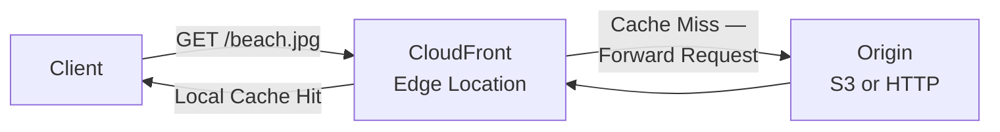
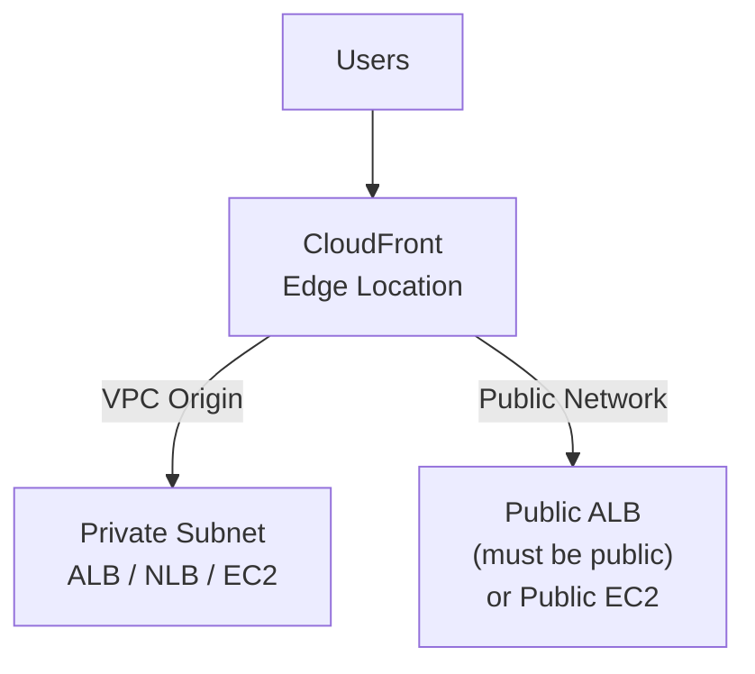
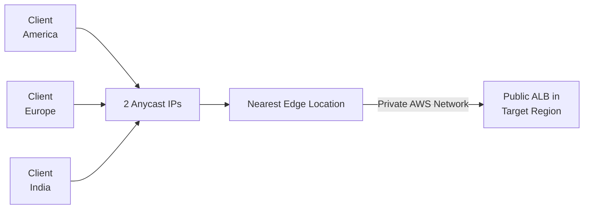

# CloudFront & Global Accelerator

## Key Concepts

### Unicast IP vs Anycast IP
- **Unicast IP** — one server holds one IP address
- **Anycast IP** — all servers hold the same IP address and the client is routed to the nearest one

This distinction underpins how Global Accelerator achieves consistent low-latency routing (Anycast), versus CloudFront's edge-caching model.

### The Problem: Global Users, Public Internet Hops
An application deployed with global users accessing it directly over the public internet incurs latency due to many network hops. AWS's edge network (CloudFront and Global Accelerator) exists to route traffic through AWS's own backbone as much as possible to minimize this latency.

## AWS Services / Features

### Amazon CloudFront
- **Content Delivery Network (CDN)**
- Improves read performance — content is **cached at the edge**
- Improves user experience
- Hundreds of **Points of Presence** globally (edge locations, caches)
- DDoS protection (because worldwide), integration with **AWS Shield** and **AWS WAF**
- Distributes content to localized regions, reducing **latency** (how long it takes to get from A to B) and providing high **data transfer speeds** (the total time window to get the content)
- **Content sources**: S3 (with read operations), a **MediaPackage channel** (packages media for the target you want to deliver to), or an **HTTP server** (used for website caching)
- **Content access**: public, or restricted so only specified/authorized users can see the content
- **Content constraints**: HTTPS can be set as required or optional for the end consumer to connect with; **Geo-restrictions** based on the end consumer's geographic location
- **Content types** served: dynamic, static, streaming, and interactive
- Edge locations aren't read-only caches — they can also be used to **write**, not just read
- CloudFront uses both **regional edge caches** and **edge locations** to provide localized content

### CloudFront — Origins
- **S3 bucket**
  - For distributing files and caching them at the edge
  - For uploading files to S3 through CloudFront
  - Secured using **Origin Access Control (OAC)**
- **VPC Origin**
  - For applications hosted in VPC **private subnets**
  - Private Application Load Balancer / Network Load Balancer / EC2 Instances
- **Custom Origin (HTTP)**
  - S3 website (must first enable the bucket as a static S3 website)
  - Any public HTTP backend you want (e.g., a Public ALB)

### CloudFront — S3 as an Origin
- S3 bucket is the private **Origin**; edge locations (e.g., Los Angeles, Mumbai, Melbourne, São Paulo) serve cached content to the public www
- Secured with **Origin Access Control (OAC) + S3 bucket policy** so the bucket stays private and only CloudFront can read it
- **OAC** is the recommended mechanism for protecting supported S3 origins. **OAI** is a separate legacy mechanism, not an older name for OAC.

### CloudFront vs S3 Cross Region Replication

| | CloudFront | S3 Cross Region Replication |
|---|---|---|
| Scope | Global Edge network | Must be set up for **each** region you want replication to happen |
| Freshness | Files cached for a TTL (e.g., a day) | Files updated in **near real-time** |
| Write access | — | **Read only** |
| Best for | Static content that must be available everywhere | Dynamic content needing low-latency availability in a few specific regions |

### CloudFront — ALB or EC2 as an Origin

**Using VPC Origins**
- Deliver content from applications hosted in **VPC private subnets** — no need to expose them on the Internet
- Delivers traffic to private: Application Load Balancer, Network Load Balancer, EC2 Instances

**Using Public Network**
- Application Load Balancer origin **must be Public**; EC2 Instances **can be Private**
- If EC2 instances are used directly as the origin over the public network, they **must be Public**
- Security Groups must:
  - Allow the Security Group of the Load Balancer, **and**
  - Allow the Public IP range of CloudFront Edge Locations (published at `http://d7uri8nf7uskq.cloudfront.net/tools/list-cloudfront-ips`)

### CloudFront Geo Restriction
- Restrict who can access your distribution
- **Allowlist** — allow users to access content only if they're in one of the approved countries
- **Blocklist** — prevent users from accessing content if they're in one of the banned countries
- "Country" is determined using a **3rd party Geo-IP database**
- Blocklisted requests receive an HTTP **403** response code
- Use case: copyright laws / controlling access to content (common in TV/media industry)

### CloudFront — Cache Invalidations
- If you update the back-end origin, CloudFront doesn't know about it and only gets refreshed content after the **TTL** expires
- You can force an entire or partial cache refresh (bypassing the TTL) with a **CloudFront Invalidation**
- Invalidate all files (`*`) or a specific path (e.g., `/images/*`)

### CloudFront — Use Cases
- Accelerate static website content delivery
- Live and On-Demand Video Streaming
- Encrypt specific fields throughout system processing — CloudFront doesn't just distribute content, it also manages the **security** of that content
- Customize at the Edge — e.g., translate content into different languages
- Serve private content by using **Lambda@Edge** customizations — Lambda functions running at the edge to customize what users are seeing
- Security and DDoS Mitigation

### CloudFront — Distribution Types

CloudFront serves static/dynamic web and streaming content over HTTP(S). **RTMP distributions were discontinued in 2020**; the old Web-versus-RTMP comparison is historical and should not guide a new design. S3 website endpoints are custom origins and differ from private S3 REST origins protected using OAC.

### CloudFront — HTTP Methods & Caching

| Method | Cached by default? |
|---|---|
| GET | Yes — cached (subject to TTL); cannot be changed |
| HEAD | Yes — cached by default; cannot be changed |
| PUT, POST, PATCH, DELETE | Not cached |
| OPTIONS | Caching is configurable when the distribution/service is created |

### CloudFront — Zone Apex
- Use **Route 53** to point a domain (zone apex) at a CloudFront distribution
- CloudFront supports a **wildcard CNAME**, which allows subdomains to be supported

### AWS Direct Connect
- Creates a **dedicated network connection** to AWS between an on-premises datacenter/network and AWS
- Provides the **shortest path** to your AWS resources
- Network traffic **never touches the public internet**
- Delivers data through a private network connection between AWS and your datacenter:
  - Links your internal network to a **Direct Connect location**
  - Runs over a standard **Ethernet fiber-optic cable**
  - With this connection, you can create **virtual interfaces** directly to AWS services or to a VPC
- **Connection speeds**: 1 Gbps, 10 Gbps, and 100 Gbps
- Can connect **thousands of VPCs in multiple Regions** to on-premises networks using **1/2/5/10 Gbps** connections
- **Connection features**: hosted connection, dedicated connection
- **Pricing**: pay only for the network ports you use, plus the data you transfer

**Use cases:**
- Building hybrid networks
- Managing large datasets — reliable data transfers, rapid data backup, broadcast media processing

### AWS Global Accelerator
- A service that improves the **availability and performance** of applications with local or global users, using the **AWS global network**
- Leverages the **AWS internal network** to route to your application
- **2 Anycast IPs** are created for your application, providing **static IPs** that act as a fixed entry point in a single Region or across multiple Regions
- The Anycast IPs send traffic directly to **Edge Locations**
- The Edge Locations send the traffic to your application over the AWS private network
- Improves **TCP and UDP** routing to regional endpoints over the AWS network. **Global Accelerator does not cache content or copy the application to edge locations**; CloudFront provides caching.

**Key characteristics:**
- Works with **Elastic IP, EC2 instances, ALB, NLB** — public or private
- **Consistent Performance** — intelligent routing to lowest latency and fast regional failover
- **No client cache issue** — because the IP doesn't change
- Traffic travels over the **internal AWS network** for most of the path
- **Health Checks** — Global Accelerator performs health checks of your applications; detects an unhealthy endpoint and redirects traffic to a healthy endpoint in **less than 1 minute**; great for disaster recovery
- **Fault tolerance using network zones** — a network zone is similar in concept to an AZ, used to serve the accelerator's static IP addresses
- **Global performance-based routing**
- **Fine-grained traffic control**
- **Continuous availability monitoring**
- **Client affinity**
- **Security** — only **2 external IPs** need to be whitelisted; DDoS protection via **AWS Shield**

### AWS Global Accelerator vs CloudFront

> [!NOTE]
> Simple framing: **CloudFront is focused on content delivery network functions for websites**; Global Accelerator is focused on improving availability and performance for applications (TCP/UDP) with local or global users.

| | CloudFront | Global Accelerator |
|---|---|---|
| Shared foundation | Both use the AWS global network and edge locations; both integrate with **AWS Shield** for DDoS protection | |
| Content served at | The **edge** (cached) | Edge locations act as **proxy** to Regions — not cached |
| Protocol | Improves performance for cacheable content (images, videos) **and** dynamic content (API acceleration, dynamic sites) — HTTP/HTTPS | Improves performance over **TCP or UDP** |
| Best fit | HTTP(S) content delivery, static/dynamic websites | Non-HTTP use cases — gaming (UDP), IoT (MQTT), Voice over IP; also HTTP use cases needing **static IP addresses** or **deterministic, fast regional failover** |

## Exam Tips
> [!TIP]
> **CloudFront caches content at the edge** — great for static, cacheable content served globally. **Global Accelerator proxies packets** over the AWS backbone without caching — great for TCP/UDP applications, static entry-point IPs, and fast regional failover.

> [!TIP]
> Remember the two Anycast IPs of Global Accelerator never change — this solves DNS client-caching problems that plague simple DNS failover approaches.

> [!WARNING]
> When using CloudFront with an ALB/EC2 origin over the **public network** (not VPC Origins), the Security Group must allow the **CloudFront edge location IP ranges**, not just "allow all" — a common exam scenario trap.

> [!TIP]
> **OAC (Origin Access Control)** + S3 bucket policy is how you keep an S3 origin bucket private while still letting CloudFront serve its content.

## Related Notes
- [[01-Route53]]
- [[02-VPC]]

## Checked corrections — 2026-11-09

Only the changes listed here were verified in this audit; other course-derived details still need checking when used.

- Corrected Global Accelerator no-cache behavior, retired RTMP distributions and OAC/OAI distinction.
  - [AWS documentation](https://aws.amazon.com/global-accelerator/faqs/)
  - [AWS documentation](https://docs.aws.amazon.com/AmazonCloudFront/latest/DeveloperGuide/WhatsNew.html)
  - [AWS documentation](https://docs.aws.amazon.com/AmazonCloudFront/latest/DeveloperGuide/private-content-restricting-access-to-s3.html)
