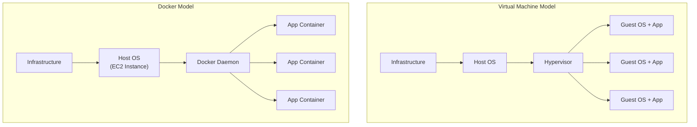
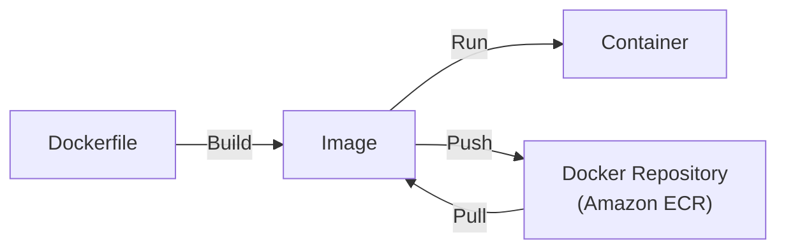
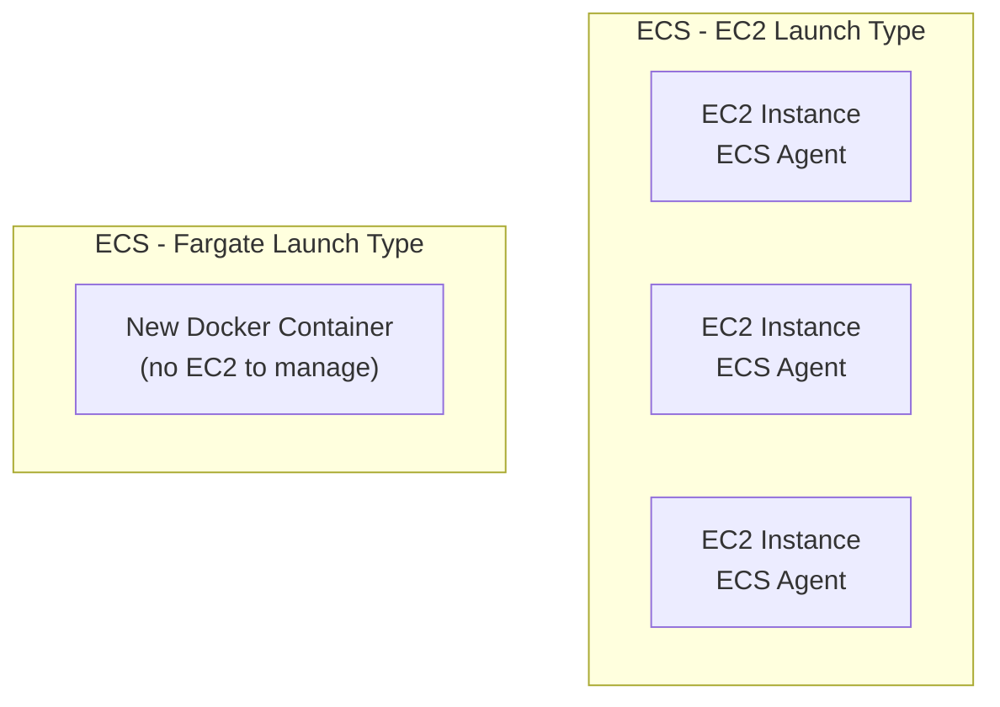
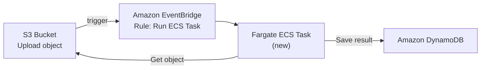
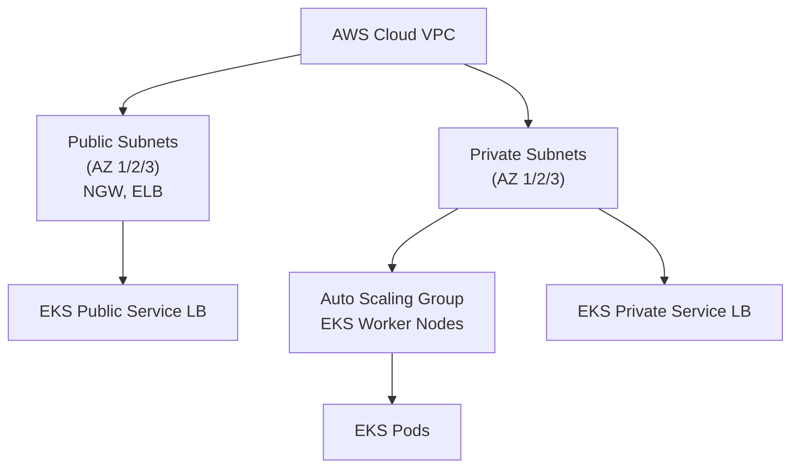

# Containers on AWS

## Key Concepts

### What is Docker?
- Docker is a software development platform to deploy apps
- Apps are packaged in **containers** that can be run on any OS
- Apps run the same, regardless of where they're run:
  - Any machine
  - No compatibility issues
  - Predictable behavior
  - Less work — easier to maintain and deploy
  - Works with any language, any OS, any technology
- Use cases: microservices architecture, lift-and-shift apps from on-premises to the AWS cloud, …

### Docker vs. Virtual Machines
- Docker is "sort of" a virtualization technology, but not exactly
- Resources are shared with the host, so many containers can run on one server
- A VM setup runs a **Hypervisor** on the Host OS, with each VM having its own Guest OS
- Docker runs a **Docker Daemon** directly on the Host OS (e.g., an EC2 instance) — no Guest OS per app, which is why containers are lighter-weight than VMs

### Where Docker Images Are Stored
- Docker images are stored in **Docker Repositories**
- **Docker Hub** (hub.docker.com): public repository, base images for many technologies/OS (Ubuntu, MySQL, …)
- **Amazon ECR** (Elastic Container Registry): private repository, plus a public repository option (Amazon ECR Public Gallery — gallery.ecr.aws)

### Getting Started with Docker Workflow

## AWS Services / Features

### Docker Container Management on AWS
- **Amazon ECS** (Elastic Container Service) — Amazon's own container platform
- **Amazon EKS** (Elastic Kubernetes Service) — Amazon's managed Kubernetes (open source)
- **AWS Fargate** — Amazon's own serverless container platform; works with both ECS and EKS
- **Amazon ECR** — stores container images

### Amazon ECS Overview
- Amazon ECS (Elastic Container Service) allows you to easily run applications on a managed cluster of EC2 instances
- Using API calls, you can: launch and stop container-enabled applications; query the complete state of clusters; access features like security groups, ELB, EBS volumes, and IAM roles
- No virtual machine builds required — no need to launch an instance and install Docker yourself; from the ECS dashboard you launch your container instance directly (uses Fargate in the backend)
- The concept of microservices is supported by ECS — used to deploy and scale containers
- ECS is a way to implement Docker containers for **Multi-Tier (N-Tier) Applications**: break an application into different parts (web server, application server, message queue server, each backend worker process), make each part its own application/Docker container, then deploy all of those containers on one instance — because each part is in its own container, you can break them apart and scale out to a very large capacity demand

### Amazon ECS — Objects
| Object | Description |
|---|---|
| Container definition | The Docker container itself |
| Task definition | The process of running from that container |
| Service | A virtual service that represents what that container does — runs as a service, accessed as a service on the network |
| Cluster | Multiple instances of container + task + service |

### Amazon ECS — Pricing
- No additional charge for Amazon ECS itself
- You pay for the resources created (EC2 instances and EBS volumes)
- For Fargate, you pay based on the number and configuration of the tasks you run

### Amazon ECS — EC2 Launch Type
- ECS = Elastic Container Service
- Launching Docker containers on AWS = launching **ECS Tasks** on **ECS Clusters**
- EC2 Launch Type: you must provision & maintain the infrastructure (the EC2 instances)
- Each EC2 instance must run the **ECS Agent** to register in the ECS Cluster
- AWS takes care of starting/stopping containers

### Amazon ECS — Fargate Launch Type
- Launch Docker containers on AWS
- You do **not** provision the infrastructure — no EC2 instances to manage
- It's all serverless
- You just create **task definitions**
- AWS runs ECS Tasks for you based on the CPU/RAM you need
- To scale, just increase the number of tasks — no more EC2 instances to manage

### ECS — IAM Roles
- **EC2 Instance Profile** (EC2 Launch Type only) — used by the ECS Agent:
  - Makes API calls to the ECS service
  - Sends container logs to CloudWatch Logs
  - Pulls Docker images from ECR
  - References sensitive data in Secrets Manager or SSM Parameter Store
- **ECS Task Role**:
  - Allows each task to have a specific role
  - Use different roles for the different ECS Services you run
  - Task Role is defined in the task definition

> [!WARNING]
> Know the difference: the **EC2 Instance Profile** role is shared by the ECS Agent on the host (EC2 launch type only) for infrastructure-level actions (pull from ECR, push logs to CloudWatch). The **ECS Task Role** is per-task and controls what that specific task's application code can access (e.g., S3, DynamoDB). Mixing these up is a classic exam trick when troubleshooting permission errors.

### ECS — Load Balancer Integrations
- **Application Load Balancer** — supported and works for most use cases
- **Network Load Balancer** — recommended only for high throughput/high performance use cases, or to pair with AWS PrivateLink
- **Classic Load Balancer** — supported but not recommended (no advanced features, no Fargate support)

### ECS — Data Volumes (EFS)
- Mount **EFS** file systems onto ECS tasks
- Works for both EC2 and Fargate launch types
- Tasks running in any AZ will share the same data in the EFS file system
- Fargate + EFS = fully serverless
- Use case: persistent multi-AZ shared storage for containers

> [!WARNING]
> Amazon **S3 cannot be mounted as a file system** on ECS tasks — use EFS for shared, persistent, multi-AZ container storage.

### ECS Service Auto Scaling
- Automatically increases/decreases the desired number of ECS tasks
- Amazon ECS Auto Scaling uses **AWS Application Auto Scaling** based on:
  - ECS Service Average CPU Utilization
  - ECS Service Average Memory Utilization — scale on RAM
  - ALB Request Count Per Target — metric coming from the ALB
- Scaling types:
  - **Target Tracking** — scale based on a target value for a specific CloudWatch metric
  - **Step Scaling** — scale based on a specified CloudWatch Alarm
  - **Scheduled Scaling** — scale based on a specified date/time (predictable changes)
- ECS Service Auto Scaling (task level) ≠ EC2 Auto Scaling (EC2 instance level)
- Fargate Auto Scaling is much easier to set up because it's serverless

### EC2 Launch Type — Auto Scaling EC2 Instances
- Accommodate ECS Service Scaling by adding underlying EC2 instances:
  - **Auto Scaling Group Scaling** — scale your ASG based on CPU Utilization, adds EC2 instances over time
  - **ECS Cluster Capacity Provider** — automatically provisions and scales the infrastructure for your ECS Tasks; paired with an ASG; adds EC2 instances when capacity (CPU, RAM) is missing

> [!TIP]
> With the EC2 launch type, scaling is a **two-layer** problem: ECS Service Auto Scaling adds/removes tasks, and (separately) ASG/Capacity Provider scaling adds/removes the underlying EC2 instances that host those tasks. With Fargate, there's only one layer — just scale the task count.

### ECS Event-Driven Patterns
- **ECS tasks invoked by EventBridge**: an S3 upload event triggers an EventBridge rule that runs a new Fargate ECS Task, which can read from S3 and save results to DynamoDB via an ECS Task Role.
- **ECS tasks invoked by EventBridge Schedule**: an EventBridge scheduled rule (e.g., every 1 hour) runs a Fargate ECS Task for batch processing against S3.
- **ECS with an SQS queue**: ECS tasks (behind ECS Service Auto Scaling) poll an SQS queue for messages.
- **Intercept stopped tasks using EventBridge**: when ECS task containers exit, EventBridge captures the event (via an event pattern) and can trigger SNS to email an administrator.

### Amazon ECS Anywhere
- AWS offers ECS Anywhere for extending ECS container management beyond the Amazon cloud
- Run containers on your on-premises infrastructure
- Use cases: deploy data processing workloads at the edge; deploy GPU-based container workloads; run Windows container workloads

### Amazon ECR
- ECR = Elastic Container Registry, a managed Docker container registry service
- Makes it easy for developers to store, manage, and deploy Docker container images
- Store and manage Docker images on AWS
- Private and public repository (Amazon ECR Public Gallery — gallery.ecr.aws)
- ECR hosts your images in a highly available and scalable architecture:
  - Push container images to Amazon ECR without installing or scaling infrastructure
  - Pull images using any management tool
  - Share and download images securely over HTTPS with automatic encryption and access controls
  - Manage image lifecycle policies
- Eliminates the need to manage your images on platforms like GitHub or to build and administer your own container repositories
- Fully integrated with both ECS and EKS, backed by Amazon S3
- Access is controlled through IAM (permission errors point to an IAM policy issue)
- Supports image vulnerability scanning, versioning, image tags, image lifecycle, …

### AWS Fargate
- A serverless compute engine for containers — works with both ECS and EKS
- Benefits: no manual provisioning, patching, cluster capacity management, or any infrastructure management required
- Use case: launching containers without having to provision or manage EC2; a managed service for container cluster management
- Configuration: ECS task definitions for Fargate require you to specify CPU and memory at the task level
- Pricing: pay for the amount of vCPU and memory resources consumed

### Amazon EKS Overview
- Amazon EKS = Amazon Elastic Kubernetes Service
- A way to launch managed Kubernetes clusters on AWS — a managed service that allows you to run Kubernetes on AWS without installing, operating, or maintaining it yourself
- Kubernetes is an open-source system for automatic deployment, scaling, and management of containerized (usually Docker) applications; it's an open source container orchestrator originally built by Google
- It's an alternative to ECS — similar goal, different API; EKS is designed to play a largely similar role as ECS, but it isn't tied to one platform
- ECS vs EKS: ECS supports Docker Containers directly; EKS is compatible with upstream Kubernetes
- EKS supports EC2 (worker nodes) or Fargate (serverless containers)
- Use case: if your company is already using Kubernetes on-premises or in another cloud, and wants to migrate to AWS using Kubernetes
- Use cases: deploy across hybrid environments; model machine learning (ML) workflows; build and run web applications
- Kubernetes is cloud-agnostic (can be used in any cloud — Azure, GCP…)
- For multiple regions, deploy one EKS cluster per region
- Collect logs and metrics using CloudWatch Container Insights

### Amazon EKS — Node Types
| Node Type | Description |
|---|---|
| Managed Node Groups | Creates and manages Nodes (EC2 instances) for you; nodes are part of an ASG managed by EKS; supports On-Demand or Spot Instances |
| Self-Managed Nodes | Nodes created by you and registered to the EKS cluster and managed by an ASG; can use a prebuilt Amazon EKS Optimized AMI; supports On-Demand or Spot Instances |
| AWS Fargate | No maintenance required; no nodes managed |

### Amazon EKS — Data Volumes
- Need to specify a **StorageClass** manifest on your EKS cluster
- Leverages a **Container Storage Interface (CSI)** compliant driver
- Supports: Amazon EBS, Amazon EFS (works with Fargate), Amazon FSx for Lustre, Amazon FSx for NetApp ONTAP

### Amazon EKS Distro
- A freely available package you can download to build EKS-compatible environments of your own
- Makes it easy to closely control the versions and environment dependencies
- You can do it yourself wherever you want using Kubernetes — but EKS Distro handles a lot of the updates and standardization that can sometimes become overly distracting
- An open-source distribution of Kubernetes from AWS, used to manually create Kubernetes clusters anywhere
- Does not include the support services offered by AWS

### Amazon EKS Anywhere
- AWS offers EKS Anywhere for extending EKS container management beyond the Amazon cloud
- Create and operate Kubernetes clusters on your own infrastructure — simplifies on-premises Kubernetes management
- Provides open-source software that's up to date and patched, so you can have an on-premises Kubernetes environment that's more reliable than a self-managed Kubernetes deployment
- Amazon EKS Anywhere uses EKS Distro and provides automation tooling that simplifies cluster creation

### ECS vs. EKS vs. Fargate — Comparison

| | Amazon ECS | Amazon EKS | AWS Fargate |
|---|---|---|---|
| Orchestration API | AWS proprietary | Kubernetes (open source) | N/A — a launch/compute type |
| Infrastructure management | You manage EC2 instances (EC2 launch type) or none (Fargate launch type) | You manage EC2 worker nodes (self-managed/managed node groups) or none (Fargate) | Fully serverless — no EC2 to manage |
| Best fit | AWS-native container workloads, simpler setup | Teams already using Kubernetes on-premises/other clouds; cloud-agnostic portability | Least operational overhead — pairs with either ECS or EKS |
| Data volumes | EFS for shared files; managed EBS per task on supported EC2/Linux Fargate configurations | Node/driver dependent; EC2-backed nodes support EBS/EFS and supported FSx integrations | ECS supports EFS and managed EBS; EKS Fargate supports EFS, not EBS volumes |
| Scaling | ECS Service Auto Scaling (+ ASG/Capacity Provider if EC2 launch type) | Kubernetes-native scaling + ASG for self-managed nodes | Just increase task count — no instance scaling |

### AWS Elastic Beanstalk
- Can deploy, monitor, and scale an application — creates the entire infrastructure needed to run a web application
- Builds the entire environment that you would otherwise need to do manually:
  - Creating security groups
  - Creating an Elastic IP for the instance
  - Creating and launching an instance
  - Making sure the app is running on the instance
  - Doing all the work to build your environment code
- Supports application platforms such as .NET, Java, Node.js, Python, Go, and Ruby
- Used to build out entire solutions — can include multiple instances, databases, VPCs, subnets, and more

> [!WARNING]
> You **cannot change the environment tier** after creating an Elastic Beanstalk environment.

## Exam Tips
> [!TIP]
> "Least operational overhead" + containers → **Fargate**. No EC2 instances to patch, scale, or manage — just define task CPU/RAM and let AWS run it.

> [!TIP]
> "Already using Kubernetes" or "cloud-agnostic / multi-cloud portability" → **EKS**, not ECS. ECS is AWS-proprietary.

> [!WARNING]
> S3 **cannot** be mounted as a file system for ECS tasks — the answer for shared persistent container storage is always **EFS**.

> [!WARNING]
> Classic Load Balancer does **not** support Fargate and lacks advanced features — it is not recommended for ECS. Use ALB (most cases) or NLB (high throughput/performance, or PrivateLink pairing).

> [!TIP]
> ECR is backed by Amazon S3 and access is controlled entirely through IAM — permission errors on push/pull mean check the IAM policy.

## Related Notes
- [[02-Serverless-Overview]]
- [[03-Serverless-Architectures]]

## Checked corrections — 2026-11-09

Only the changes listed here were verified in this audit; other course-derived details still need checking when used.

- Added ECS managed EBS support and qualified Fargate storage by orchestrator.
  - [AWS documentation](https://docs.aws.amazon.com/AmazonECS/latest/developerguide/ebs-volumes.html)
  - [AWS documentation](https://docs.aws.amazon.com/eks/latest/userguide/fargate.html)
