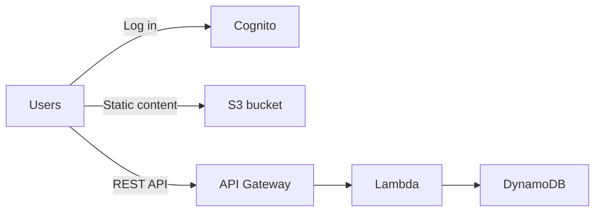
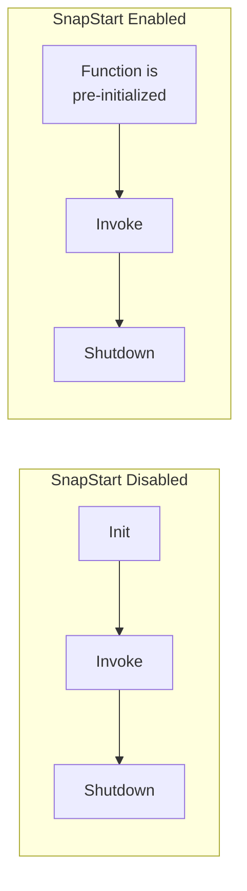
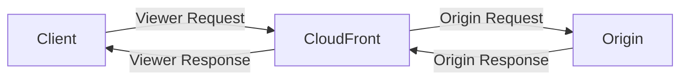
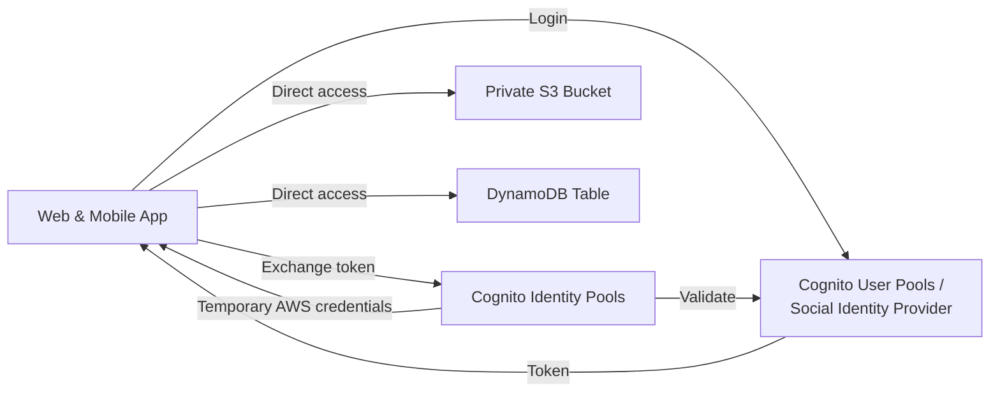

# Serverless Overview

## Key Concepts

### What's Serverless?
- Serverless is a new paradigm in which developers don't have to manage servers anymore — they just deploy code, they just deploy **functions**
- Initially, serverless == **FaaS** (Function as a Service)
- Serverless was pioneered by AWS Lambda but now also includes anything that's managed: databases, messaging, storage, etc.
- Serverless does **not** mean there are no servers — it means you just don't manage/provision/see them

### Serverless in AWS
- AWS Lambda
- DynamoDB
- AWS Cognito
- AWS API Gateway
- Amazon S3
- AWS SNS & SQS
- AWS Kinesis Data Firehose
- Aurora Serverless
- Step Functions
- Fargate

### Why AWS Lambda?
| Amazon EC2 | AWS Lambda |
|---|---|
| Virtual servers in the cloud | Virtual functions — no servers to manage! |
| Limited by RAM and CPU | Limited by time — short executions |
| Continuously running | Runs on-demand |
| Scaling means manual intervention to add/remove servers | Scaling is automated! |

### Benefits of AWS Lambda
- Easy pricing: pay per request and compute time
- Free tier of 1,000,000 AWS Lambda requests and 400,000 GB-seconds of compute time
- Integrated with the whole AWS suite of services
- Integrated with many programming languages
- Easy monitoring through AWS CloudWatch
- Easy to get more resources per function (up to 10 GB of RAM); increasing RAM also improves CPU and network
- Lambda API activity can be logged and monitored using **AWS CloudTrail**

### AWS Lambda Language Support
- Node.js (JavaScript)
- Python
- Java
- C# (.NET Core) / PowerShell
- Ruby
- Custom Runtime API (community supported — e.g., Rust or Golang)
- Lambda Container Image — the container image must implement the Lambda Runtime API (ECS/Fargate is preferred for running arbitrary Docker images)

> [!NOTE] Conflict resolved — Go as a Lambda runtime
> An XMind study source listed Go as a native runtime alongside Node.js/Java/C#/Python. Verified 2026-07 against [AWS Lambda runtimes docs](https://docs.aws.amazon.com/lambda/latest/dg/lambda-runtimes.html): there is no current native Go runtime — the old `go1.x` managed runtime was deprecated January 8, 2024. This note's classification (Go = Custom Runtime API only, same tier as Rust) is correct today; the mind map's version was accurate before 2024 but is now outdated.

## AWS Services / Features

### AWS Lambda — Integrations
Main integrations: CloudWatch Logs, CloudTrail, SNS, Cognito, SQS, S3, Kinesis, API Gateway, DynamoDB, CloudFront, CloudWatch Events / EventBridge

**Example — Serverless Thumbnail Creation**: a new image pushed to S3 triggers a Lambda function that creates a thumbnail, pushes the new thumbnail to S3, and writes metadata (image name, size, creation date, …) to DynamoDB.

**Example — Serverless CRON Job**: EventBridge (CloudWatch Events) triggers a Lambda function on a schedule (e.g., every 1 hour) to perform a task.

### AWS Lambda — Use Cases

**Data Processing**
- **Real-time File Processing** (using Amazon S3): generate thumbnail images, transcode videos, index files, process logs, validate content, aggregate and filter data in real-time
- **Real-time Stream Processing** (using Amazon Kinesis): social media analysis, IoT device data telemetry and metering
- **Extract, Transform, Load (ETL)** (using DynamoDB): data validation, filtering, sorting, or other transformations for every data change in a DynamoDB table, then load the transformed data into another data store

**Backends**
- **IoT Backends** (using Amazon Kinesis)
- **Mobile Backends** (using Amazon API Gateway): authenticate and process API requests
- **Web Applications**

### AWS Lambda — Pricing (example)
- Pay per calls: first 1,000,000 requests free; $0.20 per 1 million requests thereafter ($0.0000002 per request)
- Pay per duration (in 1 ms increments): 400,000 GB-seconds of compute time per month free
  - == 400,000 seconds if function is 1 GB RAM
  - == 3,200,000 seconds if function is 128 MB RAM
  - After that, $1.00 for 600,000 GB-seconds
- It is usually very cheap to run AWS Lambda, so it's very popular

### AWS Lambda — Limits to Know (per region)
| Category | Limit |
|---|---|
| Memory allocation | 128 MB – 10 GB (1 MB increments) |
| Maximum execution time | 900 seconds (15 minutes) |
| Environment variables | 4 KB |
| Disk capacity in `/tmp` | 512 MB to 10 GB |
| Concurrency executions | 1,000 (can be increased via support ticket) |
| Deployment package size (compressed .zip) | 50 MB |
| Uncompressed deployment size (code + dependencies) | 250 MB (can use `/tmp` to load other files at startup) |

### Lambda Concurrency and Throttling
- Concurrency limit: up to 1,000 concurrent executions (per region, can be increased)
- Can set a **reserved concurrency** at the function level (= a limit for that function)
- Each invocation over the concurrency limit triggers a **Throttle**
- Throttle behavior:
  - Synchronous invocation → returns `ThrottleError` — HTTP 429
  - Asynchronous invocation → retries automatically, then goes to a Dead Letter Queue (DLQ)
- If you need a higher limit, open a support ticket

> [!WARNING]
> If you don't reserve/limit concurrency, a single function can consume the entire account's 1,000 concurrent execution limit — starving other Lambda functions and causing them to throttle, even if they individually have low traffic. Set reserved concurrency to isolate noisy functions.

### Concurrency and Asynchronous Invocations
- If a function doesn't have enough concurrency available to process all events, additional requests are throttled
- For throttling errors (429) and system errors (500-series), Lambda returns the event to the queue and attempts to run the function again for up to 6 hours
- The retry interval increases exponentially from 1 second after the first attempt to a maximum of 5 minutes

### Cold Starts & Provisioned Concurrency
- **Cold Start**: a new instance is created — code is loaded and code outside the handler runs (init). If the init is large (code, dependencies, SDKs…), this can take time. The first request served by a new instance has higher latency than the rest.
- **Provisioned Concurrency**: concurrency is allocated *before* the function is invoked (in advance), so cold start never happens and all invocations have low latency. Application Auto Scaling can manage provisioned concurrency (on a schedule or by target utilization).
- Note: cold starts in a VPC were dramatically reduced in Oct/Nov 2019.

| | Reserved Concurrency | Provisioned Concurrency |
|---|---|---|
| Purpose | Caps/guarantees max concurrent executions for a function | Pre-warms instances so cold starts never happen |
| Effect on cold starts | No effect — still has cold starts | Eliminates cold starts for the provisioned amount |
| Effect on throttling | Prevents a function from consuming all account concurrency (isolates it); can also cause throttling if set too low | Not primarily a throttling control |

### Lambda SnapStart
- Improves Lambda function performance up to 10x, at no extra cost, for **Java, Python & .NET**
- When enabled, the function is invoked from a **pre-initialized state** — no function initialization from scratch
- When you publish a new version: Lambda initializes your function, takes a snapshot of the memory and disk state of the initialized function, and the snapshot is cached for low-latency access

### Customization at the Edge
- Many modern applications execute some form of logic at the edge
- **Edge Function**: code you write and attach to CloudFront distributions, runs close to your users to minimize latency
- CloudFront provides two types: **CloudFront Functions** and **Lambda@Edge**
- You don't manage any servers — deployed globally, pay only for what you use, fully serverless
- Use cases: website security/privacy, dynamic web apps at the edge, SEO, intelligent routing across origins/data centers, bot mitigation, real-time image transformation, A/B testing, user auth, user prioritization, user tracking/analytics

### CloudFront Functions vs. Lambda@Edge

| | CloudFront Functions | Lambda@Edge |
|---|---|---|
| Runtime support | JavaScript | Node.js, Python |
| # of Requests | Millions of requests per second | Thousands of requests per second |
| CloudFront Triggers | Viewer Request / Viewer Response | Viewer Request/Response, Origin Request/Response |
| Max execution time | < 1 ms | 5 – 10 seconds |
| Max memory | 2 MB | 128 MB up to 10 GB |
| Total package size | 10 KB | 1 MB – 50 MB |
| Network / File system access | No | Yes |
| Access to request body | No | Yes |
| Pricing | Free tier available, 1/6th price of Lambda@Edge | No free tier, charged per request & duration |

- **CloudFront Functions use cases**: cache key normalization, header manipulation (insert/modify/delete headers), URL rewrites or redirects, request authentication/authorization (JWT validation)
- **Lambda@Edge use cases**: longer execution time, adjustable CPU/memory, dependency on 3rd-party libraries (e.g., AWS SDK), network access to external services, file system or HTTP request body access
- Author Lambda@Edge functions in `us-east-1`; CloudFront replicates them to its locations

### Lambda Networking
- **By default**, a Lambda function is launched outside your own VPC (in an AWS-owned VPC) — it therefore **cannot** access resources in your VPC (RDS, ElastiCache, internal ELB…), though it can reach the public internet.
- **Lambda in a VPC**: you must define the VPC ID, subnets, and security groups. Lambda creates an **ENI** (Elastic Network Interface) in your subnets to reach VPC resources like RDS.

### Lambda with RDS Proxy
- If Lambda functions directly access a database, they may open too many connections under high load
- **RDS Proxy**:
  - Improves scalability by pooling and sharing DB connections
  - Improves availability by reducing failover time by 66% and preserving connections
  - Improves security by enforcing IAM authentication and storing credentials in Secrets Manager
- The Lambda function must be deployed in your VPC, because RDS Proxy is never publicly accessible

### Invoking Lambda from RDS & Aurora
- You can invoke Lambda functions from within your DB instance to process data events from within a database
- Supported for **RDS for PostgreSQL and Aurora MySQL**
- Must allow outbound traffic to the Lambda function from the DB instance (Public, NAT GW, or VPC Endpoints)
- The DB instance must have the required permissions to invoke the Lambda function (Lambda resource-based policy & IAM policy)
- Example: a user registration INSERT invokes Lambda, which uses Amazon SES to send an email

### RDS Event Notifications
- Notifications about the DB instance itself (created, stopped, started, …) — **not** about the data itself
- Subscribe to event categories: DB instance, DB snapshot, DB Parameter Group, DB Security Group, RDS Proxy, Custom Engine Version
- Near real-time events (up to 5 minutes)
- Send notifications to SNS, or subscribe to events using EventBridge

### Amazon DynamoDB
- Fully managed, highly available with replication across multiple AZs
- **NoSQL** database — not a relational database — with transaction support
- Scales to massive workloads, distributed database: millions of requests/second, trillions of rows, 100s of TB of storage
- Fast and consistent performance (single-digit millisecond)
- Integrated with IAM for security, authorization, and administration
- Low cost and auto-scaling capabilities
- No maintenance or patching, always available
- Standard & Infrequent Access (IA) table class

### DynamoDB — Basics
- DynamoDB is made of **Tables**
- Each table has a **Primary Key** (must be decided at creation time)
- Each table can have an infinite number of **Items** (rows)
- Each item has **attributes** (can be added over time, can be null)
- Maximum size of an item is **400 KB**
- Data types supported:
  - Scalar Types — String, Number, Binary, Boolean, Null
  - Document Types — List, Map
  - Set Types — String Set, Number Set, Binary Set
- Schemas can rapidly evolve in DynamoDB

### DynamoDB — Read/Write Capacity Modes
| Mode | Description |
|---|---|
| Provisioned Mode (default) | You specify the number of reads/writes per second; must plan capacity beforehand; pay for provisioned Read Capacity Units (RCU) & Write Capacity Units (WCU); can add auto-scaling for RCU/WCU |
| On-Demand Mode | Reads/writes automatically scale up/down with your workload; no capacity planning needed; pay for what you use (more expensive, $$$); great for unpredictable workloads / steep sudden spikes |

### DynamoDB Accelerator (DAX)
- Fully managed, highly available, seamless **in-memory cache** for DynamoDB
- Helps solve read congestion by caching
- Microseconds latency for cached data
- Doesn't require application logic modification — compatible with existing DynamoDB APIs
- 5-minute TTL for cache (default)

| | DynamoDB Accelerator (DAX) | Amazon ElastiCache |
|---|---|---|
| Cache type | Item cache **and Query/Scan result cache** for eventually consistent DynamoDB access | Application-managed caching of chosen objects/results, sessions, aggregations and other data |
| Sits in front of | DynamoDB (only) | Any application/database data your app chooses to cache |

### DynamoDB — Stream Processing
| | DynamoDB Streams | Kinesis Data Streams (newer) |
|---|---|---|
| Retention | 24 hours | 1 year |
| # of consumers | Limited | High |
| Processing | AWS Lambda Triggers, or DynamoDB Stream Kinesis Adapter | AWS Lambda, Managed Service for Apache Flink, Amazon Data Firehose, AWS Glue Streaming ETL, … |

- Ordered stream of item-level modifications (create/update/delete) in a table
- Use cases: react to changes in real time (e.g., welcome emails), real-time usage analytics, insert into derivative tables, implement cross-region replication, invoke Lambda on table changes

### DynamoDB Global Tables
- Makes a DynamoDB table accessible with low latency in multiple regions
- **Active-Active replication**: applications can READ and WRITE to the table in any region
- **MREC** global tables use DynamoDB Streams for replication. **MRSC** global tables use a different mechanism and do not require Streams for replication; consistency mode and supported Regions/features matter.

### DynamoDB — Time To Live (TTL)
- Automatically delete items after an expiry timestamp
- Use cases: reduce stored data by keeping only current items, adhere to regulatory obligations, web session handling…

### DynamoDB — Backups for Disaster Recovery
- **Continuous backups** using Point-In-Time Recovery (PITR): optionally enabled for the last 35 days; recovery to any time within the window creates a **new table**
- **On-demand backups**: full backups for long-term retention until explicitly deleted; doesn't affect performance or latency; can be configured/managed in AWS Backup (enables cross-region copy); recovery creates a **new table**

### DynamoDB — Integration with Amazon S3
- **Export to S3** (must enable PITR): works for any point in time in the last 35 days; doesn't affect read capacity; useful for data analysis, audit snapshots, ETL before re-import; exports in DynamoDB JSON or ION format
- **Import from S3**: import CSV, DynamoDB JSON, or ION format; doesn't consume write capacity; creates a **new table**; import errors are logged in CloudWatch Logs

### AWS API Gateway
- AWS Lambda + API Gateway = no infrastructure to manage
- Supports the WebSocket Protocol
- Handles API versioning (v1, v2…) and different environments (dev, test, prod…)
- Handles security (authentication and authorization)
- Creates API keys, handles request throttling
- Swagger/OpenAPI import to quickly define APIs
- Transforms and validates requests and responses
- Generates SDKs and API specifications
- Caches API responses

### API Gateway — Integrations (High Level)
| Integration Type | Description |
|---|---|
| Lambda Function | Invoke a Lambda function — easy way to expose a REST API backed by AWS Lambda |
| HTTP | Expose HTTP endpoints in the backend (e.g., internal HTTP API on-premises, an ALB); add rate limiting, caching, user authentication, API keys |
| AWS Service | Expose any AWS API through API Gateway (e.g., start a Step Functions workflow, post a message to SQS); add authentication, deploy publicly, rate control |

### API Gateway — Endpoint Types
| Type | Description |
|---|---|
| Edge-Optimized (default) | For global clients; requests routed through CloudFront Edge locations to improve latency; the API Gateway itself still lives in only one region |
| Regional | For clients within the same region; can manually combine with CloudFront for more control over caching/distribution |
| Private | Only accessible from your VPC using an interface VPC endpoint (ENI); use a resource policy to define access |

### API Gateway — Security
- User authentication through:
  - **IAM Roles** — useful for internal applications
  - **Cognito** — identity for external users (e.g., mobile users)
  - **Custom Authorizer** — your own logic
- Custom domain name HTTPS security through integration with AWS Certificate Manager (ACM):
  - Edge-Optimized endpoint → certificate must be in `us-east-1`
  - Regional endpoint → certificate must be in the API Gateway's region
- Must set up a CNAME or A-alias record in Route 53

### AWS Step Functions
- Build serverless visual workflows to orchestrate your Lambda functions
- Features: sequence, parallel, conditions, timeouts, error handling, …
- Can integrate with EC2, ECS, on-premises servers, API Gateway, SQS queues, etc.
- Possibility of implementing a human approval feature
- Use cases: order fulfillment, data processing, web applications, any workflow

### Amazon Cognito
- Gives users an identity to interact with your web or mobile application
- **Cognito User Pools (CUP)**: sign-in functionality for app users; integrates with API Gateway & Application Load Balancer
- **Cognito Identity Pools (Federated Identity)**: provides AWS credentials to users so they can access AWS resources directly; integrates with Cognito User Pools as an identity provider
- Cognito vs. IAM: think "hundreds of [thousands of] users", "mobile users", "authenticate with SAML"

### Cognito User Pools (CUP) — User Features
- Create a serverless database of users for your web & mobile apps
- Simple login: username (or email) / password combination
- Password reset
- Email & phone number verification
- Multi-factor authentication (MFA)
- Federated identities: users from Facebook, Google, SAML, …

### Cognito User Pools (CUP) — Integrations
- CUP integrates with **API Gateway** and **Application Load Balancer**
- Flow: client authenticates and retrieves a token from Cognito User Pools → passes the token in the REST API request → API Gateway/ALB evaluates the Cognito token before forwarding to the backend/target group

### Cognito Identity Pools (Federated Identities)
- Get identities for "users" so they obtain **temporary AWS credentials**
- User sources can be Cognito User Pools, 3rd-party logins, etc.
- Users can then access AWS services directly, or through API Gateway
- The IAM policies applied to the credentials are defined in Cognito
- Policies can be customized based on `user_id` for fine-grained control
- Default IAM roles exist for authenticated and guest users

- Cognito Identity Pools can implement **row-level security in DynamoDB** by scoping IAM policy conditions to the authenticated `user_id`.

## Exam Tips
> [!TIP]
> "Least operational overhead, event-driven, short-lived function" → **Lambda**. Remember the hard limits: 15-minute max execution, 10 GB max RAM, 1,000 concurrent executions per region (increasable).

> [!TIP]
> Eliminate cold starts → **Provisioned Concurrency**. Cap/isolate a function's usage of the account concurrency pool → **Reserved Concurrency**. These solve different problems — don't confuse them.

> [!WARNING]
> Lambda functions are **not** in your VPC by default and cannot reach RDS, ElastiCache, or internal ELBs unless you explicitly configure VPC settings (subnets, security groups) — which creates an ENI.

> [!WARNING]
> High-load Lambda-to-RDS access can exhaust DB connections — the fix is **RDS Proxy**, which requires the Lambda function to be deployed inside a VPC (RDS Proxy is never public).

> [!TIP]
> DynamoDB read scaling with microsecond latency and DynamoDB API-compatible integration → **DAX** (item and Query/Scan caches; client configuration changes are needed). Application-managed caching across services → **ElastiCache**.

> [!TIP]
> Need item-level change capture with Lambda triggers and simple use → **DynamoDB Streams** (24h retention). Need long retention (1 year) and many consumers → **Kinesis Data Streams**.

> [!TIP]
> "Global read/write, active-active, low latency in multiple regions" for DynamoDB → **Global Tables**; Streams replication applies to **MREC**, not **MRSC**.

> [!WARNING]
> Both DynamoDB PITR restore and on-demand backup restore always create a **new table** — they never restore in place.

> [!TIP]
> "Thousands/hundreds of thousands of app users, mobile sign-in, SAML" → **Cognito**, not IAM. **User Pools** = authentication (who are you, sign-in). **Identity Pools** = authorization to AWS resources (temporary AWS credentials).

> [!WARNING]
> Edge-Optimized API Gateway ACM certificates must be requested in `us-east-1` regardless of the API's actual region; Regional endpoint certificates must match the API Gateway's own region.

## Related Notes
- [[01-Containers]]
- [[03-Serverless-Architectures]]

## Checked corrections — 2026-11-09

Only the changes listed here were verified in this audit; other course-derived details still need checking when used.

- Corrected DAX query caching and differentiated global-table MREC versus MRSC replication.
  - [AWS documentation](https://docs.aws.amazon.com/amazondynamodb/latest/developerguide/DAX.consistency.html)
  - [AWS documentation](https://docs.aws.amazon.com/amazondynamodb/latest/developerguide/V2globaltables_HowItWorks.html)
