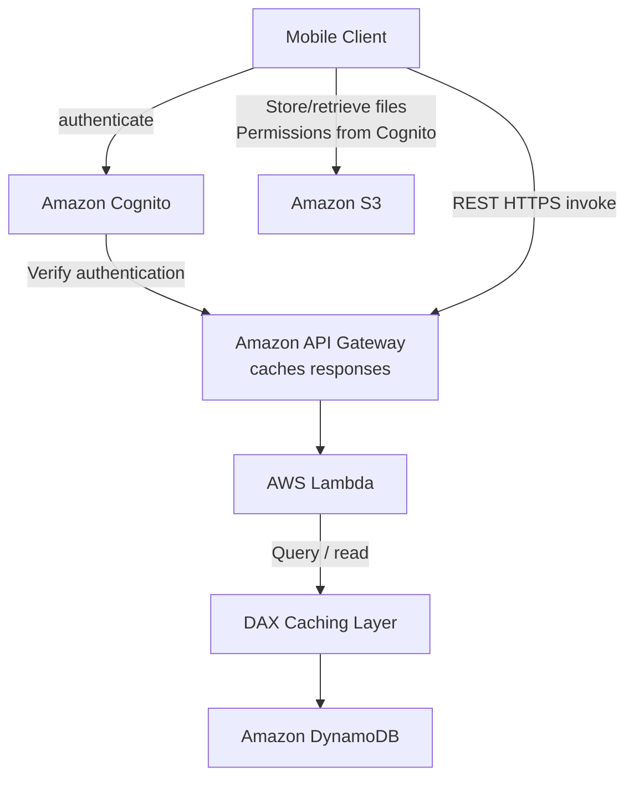
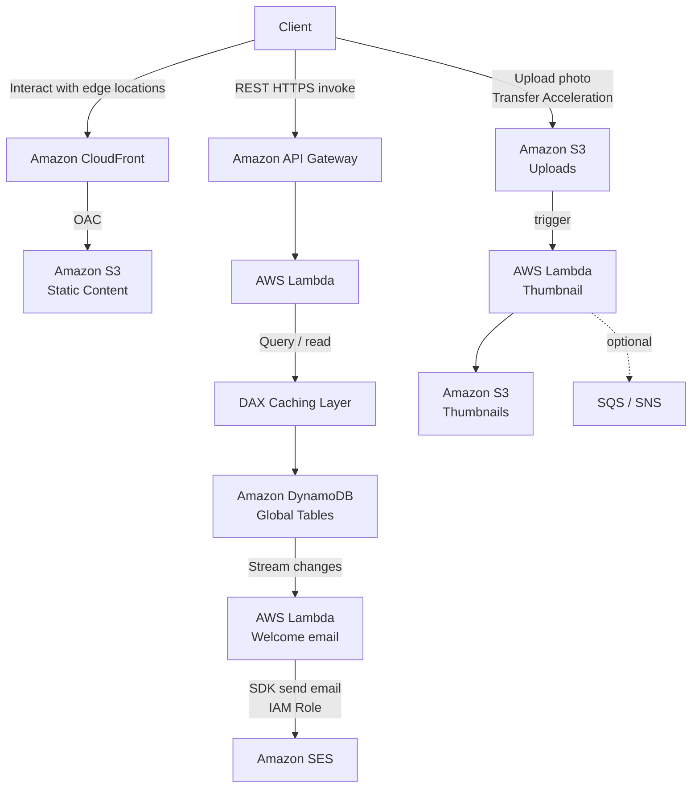
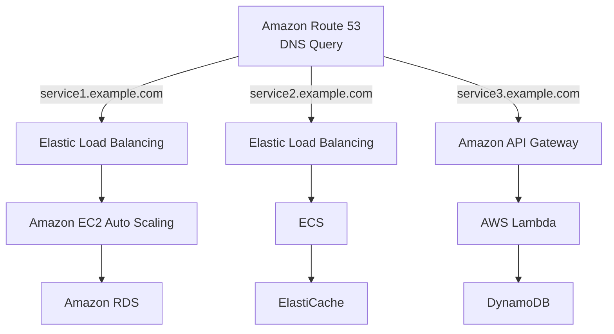
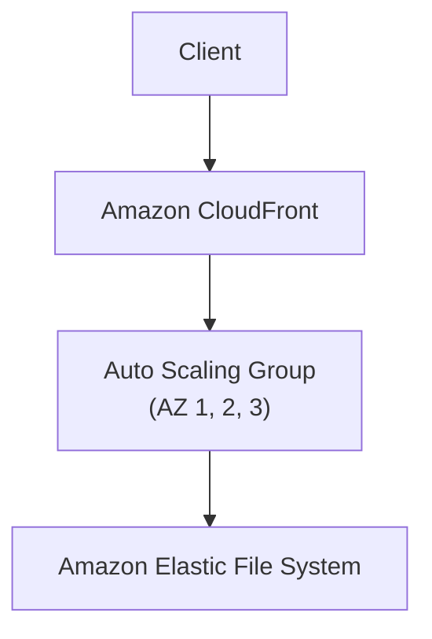

# Serverless Architectures

## Key Concepts
This note walks through four worked case studies from the source that combine the serverless services covered in [[02-Serverless-Overview]] and [[01-Containers]] into complete architectures — the kind of end-to-end scenario the exam tests.

### Case Study 1: Mobile App — MyTodoList
Requirements:
- Expose as REST API with HTTPS
- Serverless architecture
- Users should be able to directly interact with their own folder in S3
- Users should authenticate through a managed serverless service
- Users can write and read to-dos, but they mostly read them
- The database should scale, and have some high read throughput

**Step 1 — REST API layer**: mobile client authenticates via Amazon Cognito, then calls the REST API over HTTPS through API Gateway, which invokes Lambda, which queries DynamoDB. API Gateway verifies authentication with Cognito.

**Step 2 — Giving users direct access to S3**: Cognito also issues permissions so the mobile client can store/retrieve files directly in S3 (via temporary credentials — this is the Cognito Identity Pools pattern), without routing that traffic through Lambda.

**Step 3 — High read throughput on mostly-static data**: add a **DAX** caching layer in front of DynamoDB to serve the read-heavy to-do queries with microsecond latency.

**Step 4 — Caching at the API Gateway**: additionally cache REST API responses at the API Gateway level to reduce load further upstream.

**Summary of the pattern**:
- Serverless REST API: HTTPS, API Gateway, Lambda, DynamoDB
- Cognito generates temporary credentials so app users can directly access AWS resources (S3 here — same pattern applies to DynamoDB, Lambda, …) without proxying through the backend
- Caching the DynamoDB reads with DAX
- Caching the REST requests at the API Gateway level
- Security for authentication and authorization handled by Cognito

### Case Study 2: Serverless Hosted Website — MyBlog.com
Requirements:
- Scale globally
- Blogs are rarely written, but often read
- Part of the site is static files, the rest is a dynamic REST API
- Caching must be implemented where possible
- New subscribers should receive a welcome email
- Any photo uploaded to the blog should have a thumbnail generated

**Serving static content globally**: Amazon S3 origin behind Amazon CloudFront for global distribution, with clients interacting with nearby edge locations.

**Serving it securely**: add **Origin Access Control (OAC)** so the S3 bucket policy only authorizes access coming from the CloudFront distribution — S3 is not public directly.

**Adding the public serverless REST API**: API Gateway → Lambda → DynamoDB (with a DAX caching layer), alongside the CloudFront + S3 static content path.

**Serving data globally**: use **DynamoDB Global Tables** so the REST API's data layer is also low-latency and read/write in every region the app serves.

**User welcome email flow**: enable **DynamoDB Streams** on the table; a stream of changes (new subscriber inserted) invokes a second Lambda function, which uses **Amazon SES** (via an IAM role) to send the welcome email.

**Thumbnail generation flow**: a photo is uploaded to an S3 bucket (optionally via S3 Transfer Acceleration); this triggers a Lambda function that creates a thumbnail and stores it back in S3; SQS/SNS can optionally be layered in for further notification/fan-out.

**Summary of the pattern**:
- Static content distributed using CloudFront + S3
- The REST API was serverless and didn't need Cognito, because it was public
- Leveraged a Global DynamoDB Table to serve data globally (Aurora Global Database is called out as an alternative)
- Enabled DynamoDB Streams to trigger a Lambda function
- That Lambda function had an IAM role allowing it to use SES
- SES (Simple Email Service) was used to send emails in a serverless way
- S3 can trigger SQS/SNS/Lambda to notify of events

### Case Study 3: Microservices Architecture
Requirements:
- Switch to a microservices architecture
- Many services interact with each other directly using a REST API
- Each microservice's architecture may vary in form and shape
- Goal: a leaner development lifecycle per service

**Discussion**:
- You are free to design each microservice the way you want
- **Synchronous patterns**: API Gateway, Load Balancers
- **Asynchronous patterns**: SQS, Kinesis, SNS, Lambda triggers (e.g., from S3)
- Challenges with microservices:
  - Repeated overhead for creating each new microservice
  - Issues optimizing server density/utilization
  - Complexity of running multiple versions of multiple microservices simultaneously
  - Proliferation of client-side code requirements to integrate with many separate services
- Serverless patterns solve some of these challenges:
  - API Gateway and Lambda scale automatically and you pay per usage
  - You can easily clone APIs and reproduce environments
  - Generated client SDKs through Swagger/OpenAPI integration for the API Gateway

### Case Study 4: Software Update Offloading
Scenario:
- An application running on EC2 distributes software updates once in a while
- When a new update is released, a lot of requests come in and content is distributed in mass over the network — very costly
- Goal: don't change the application, but optimize cost and CPU

**Current state**: an Auto Scaling Group spread across 3 Availability Zones serves the update files, backed by Amazon EFS as shared storage.

**Fix**: put **Amazon CloudFront** in front of the ASG as a caching layer — no changes to the application architecture required.

**Why CloudFront works here**:
- No changes to architecture required
- Will cache software update files at the edge
- Software update files are static (never changing) — ideal for caching
- The EC2 instances aren't serverless, but CloudFront is, and it scales for you
- The ASG will not need to scale as much, saving tremendously on EC2 cost
- Also saves on availability risk and network bandwidth cost
- An easy way to make an existing (non-serverless) application more scalable and cheaper by adding a serverless caching layer in front of it

## AWS Services / Features

### Recurring Building Blocks Across These Patterns
- **CloudFront + S3 + OAC** — standard pattern for globally distributed, secured static content
- **API Gateway + Lambda + DynamoDB** — standard serverless REST API backend
- **Cognito Identity Pools** — used when app users need to directly touch AWS resources (S3, DynamoDB) with scoped, temporary credentials, bypassing the backend for that traffic
- **DynamoDB Streams → Lambda** — the standard "react to data changes" pattern (welcome emails, derived tables, replication)
- **S3 event → Lambda** — the standard "react to an uploaded object" pattern (thumbnails, ETL)
- **CloudFront as a caching layer in front of an existing, non-serverless app** — a low-effort way to add scalability/cost savings without re-architecting

## Exam Tips
> [!TIP]
> When a scenario says users need to interact **directly** with S3/DynamoDB from a mobile/web client (not through the backend), think **Cognito Identity Pools** issuing temporary AWS credentials — this avoids proxying heavy traffic (like file uploads) through Lambda/API Gateway.

> [!TIP]
> "Public REST API, no user accounts" → skip Cognito entirely, as in the MyBlog.com case study; Cognito is only needed when there's a concept of an authenticated app user.

> [!TIP]
> "Read-heavy, low-latency DynamoDB access" pattern in scenarios repeatedly pairs **DAX** in front of DynamoDB, plus **API Gateway response caching**, as two independent, stackable caching layers.

> [!TIP]
> "Make an existing EC2 app cheaper/more scalable without re-architecting, serving static/unchanging files" → put **CloudFront** in front of it. This is a recurring "easy win" pattern in the source.

> [!WARNING]
> Don't over-engineer: the source explicitly notes Aurora Global Database could have replaced DynamoDB Global Tables in the MyBlog.com case study — recognize that multiple valid services can satisfy "scale globally," and the exam expects you to pick based on the specific constraints given (NoSQL vs. relational, existing stack, etc.).

## Related Notes
- [[01-Containers]]
- [[02-Serverless-Overview]]
