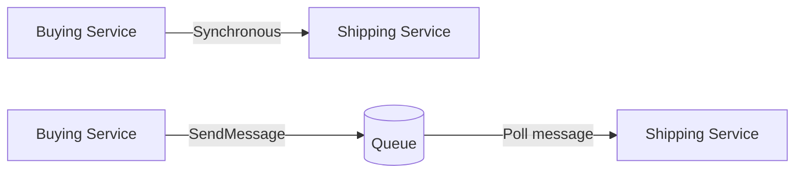
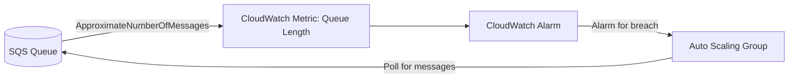
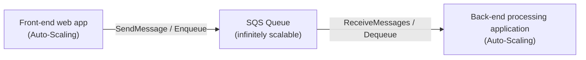
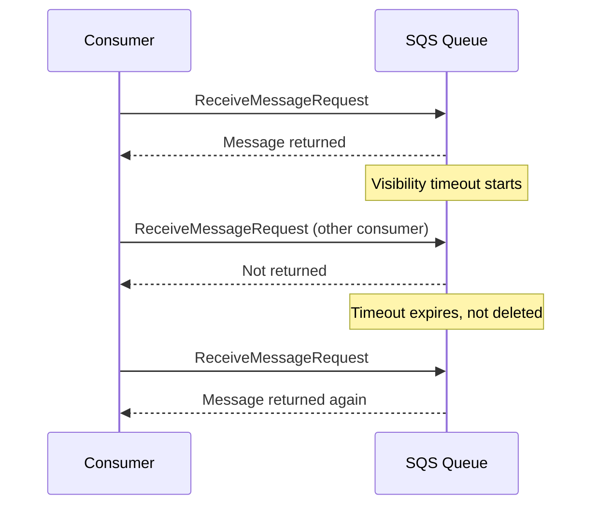
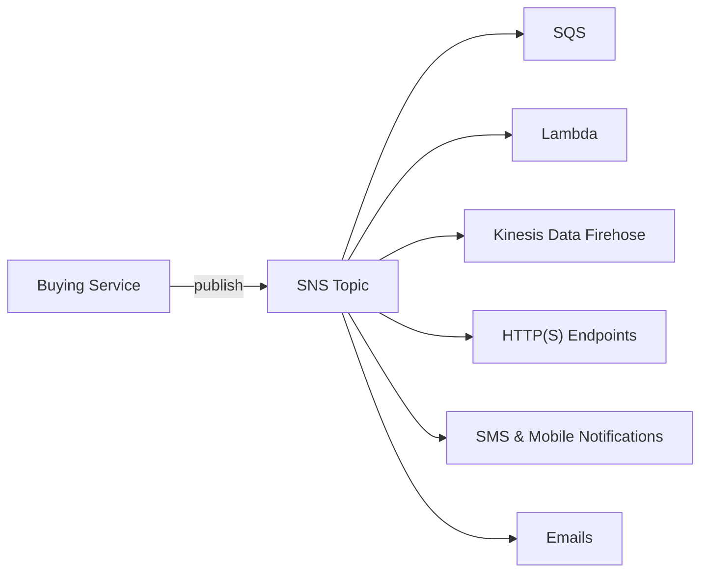
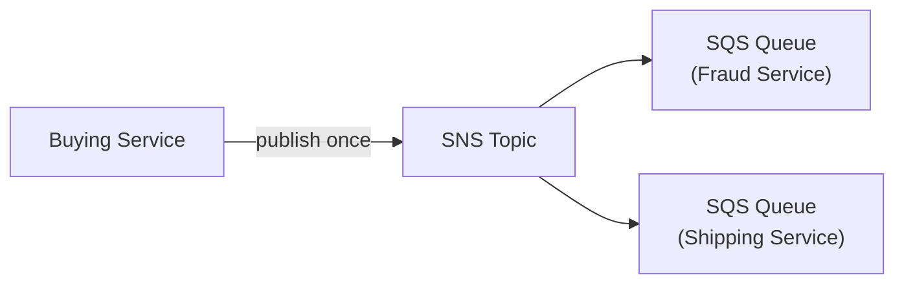
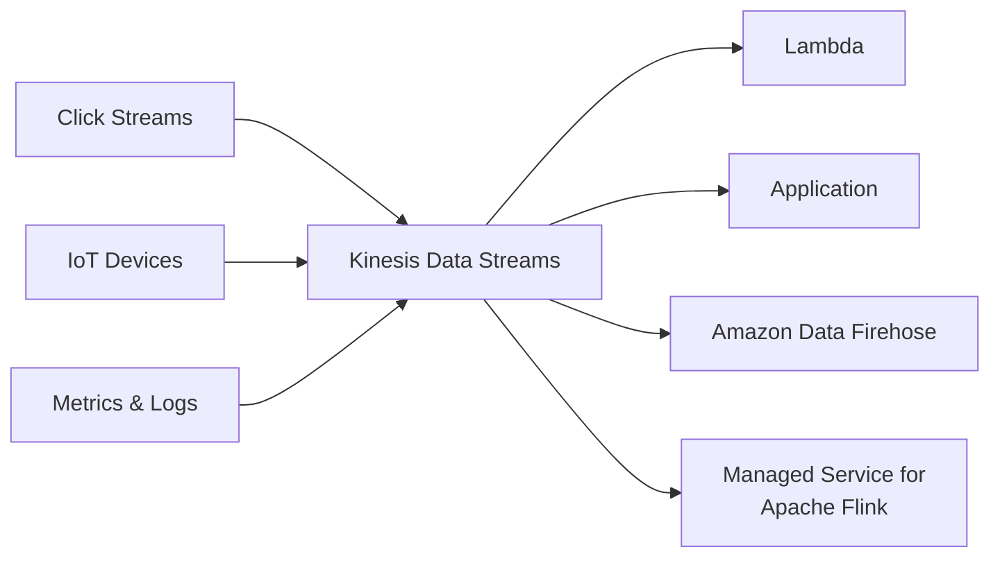
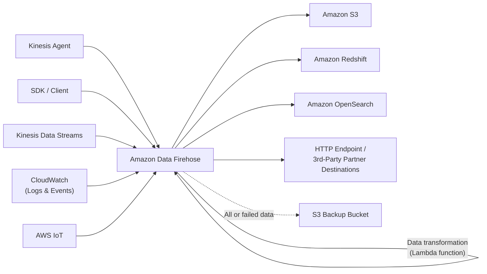
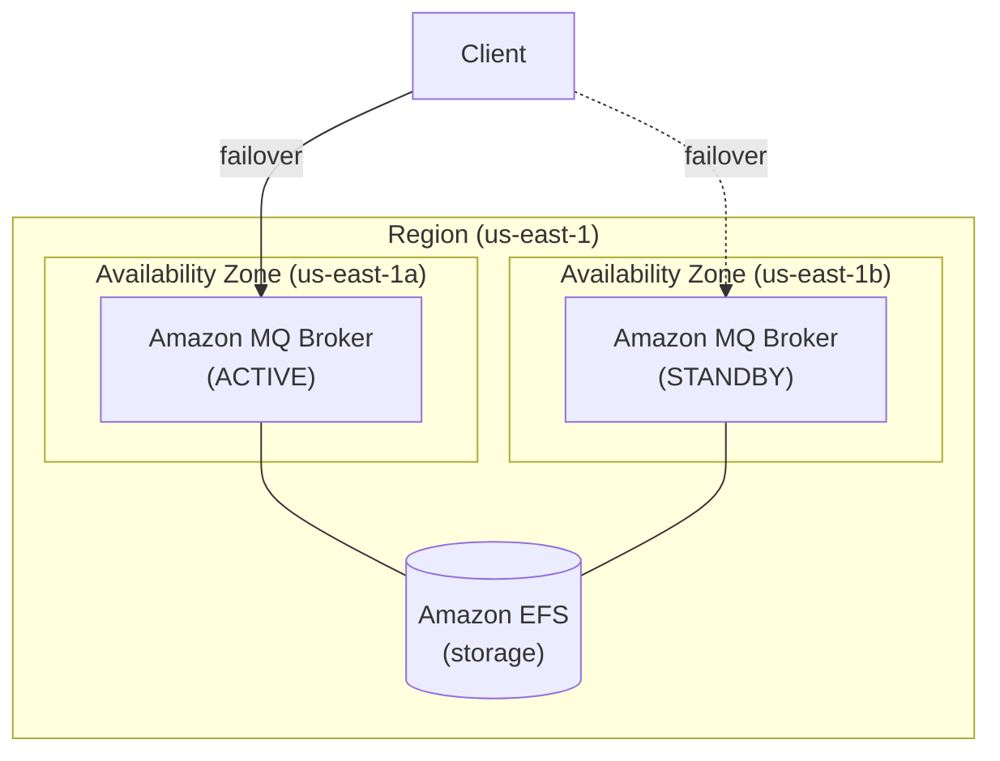

# SQS, SNS & Kinesis — Application Integration & Messaging

## Key Concepts

- Applications communicate in two patterns:
  - **Synchronous** (application to application, direct)
  - **Asynchronous / event-based** (application to queue to application)
- Synchronous communication becomes problematic under sudden traffic spikes (e.g., needing to encode 1000 videos instead of the usual 10) — a slow or overloaded downstream service can cause requests to be lost.
- The fix is to **decouple** applications so each side can scale independently:
  - **SQS** → queue model
  - **SNS** → pub/sub model
  - **Kinesis** → real-time streaming model

> [!NOTE]
> If a spike in traffic could overwhelm a downstream service, or a database can't keep up with write requests, that is the signal for a **buffer/queue** in an exam scenario — think SQS.

## AWS Services / Features

### Amazon SQS — What's a Queue?

- Producers **send messages** to an SQS queue; consumers **poll messages** from it.
- Multiple producers and multiple consumers can operate on the same queue at once.
- SQS messages are queued and processed **asynchronously** (out of order) — no need to process messages in the order they arrive.
- SQS queues are **redundant across multiple AZs** and **automatically scale**.
- Use cases: microservices, distributed systems, serverless applications.

### SQS Standard Queue

- Oldest offering (over 10 years old); fully managed service used to decouple applications.
- **Unlimited throughput**, unlimited number of messages in the queue.
- Default message retention: **4 days**; configurable maximum of **14 days**.
- Low latency: **< 10 ms** on publish and receive.
- Message size limit: **1,024 KB (1 MB)** per message.
- **At-least-once delivery** — can occasionally produce duplicate messages.

> [!NOTE] Conflict resolved — SQS max message size
> An XMind study source said 256 KB. Verified 2026-07 against [AWS's official SQS payload size increase announcement](https://aws.amazon.com/about-aws/whats-new/2025/08/amazon-sqs-max-payload-size-1mib/): AWS raised the max from 256 KiB to 1 MiB in August 2025. This note's **1,024 KB (1 MiB)** figure is current and correct; 256 KB was accurate before that August 2025 change.
- **Best-effort ordering** — messages can arrive out of order.

### SQS — Producing Messages

- Produced using the SDK's `SendMessage` API.
- The message persists in SQS until a consumer deletes it.
- Retention: default 4 days, up to 14 days.
- Example message content: order id, customer id, and any custom attributes.
- Standard queues: unlimited throughput.

### SQS — Consuming Messages

- Consumers (running on EC2, servers, or AWS Lambda):
  1. Poll SQS for messages (can receive **up to 10 messages** at a time).
  2. Process the messages (e.g., insert into an RDS database).
  3. Delete the message using the `DeleteMessage` API.

### SQS with Multiple Consumers

- Consumers receive and process messages **in parallel**.
- At-least-once delivery; best-effort ordering.
- Consumers delete messages after processing them.
- Consumers can be scaled **horizontally** to increase processing throughput.

### SQS with Auto Scaling Group (Buffer Pattern)

- The CloudWatch metric `ApproximateNumberOfMessages` drives a CloudWatch Alarm.
- The alarm triggers the Auto Scaling Group to scale EC2 instances that poll the queue.

### SQS to Decouple Application Tiers / Buffer Database Writes

> [!IMPORTANT]
> Without a queue, if load is too big, some transactions may be lost when writing directly to a database (RDS, Aurora, DynamoDB). Placing SQS as a buffer between the front-end and the database/back-end prevents this data loss and lets each tier scale independently.

### SQS Security

- **Encryption:**
  - In-flight encryption using the HTTPS API.
  - At-rest encryption using KMS keys.
  - Client-side encryption if the client wants to perform encryption/decryption itself.
- **Access Controls:** IAM policies regulate access to the SQS API.
- **SQS Access Policies** (similar to S3 bucket policies):
  - Useful for cross-account access to SQS queues.
  - Useful for allowing other services (SNS, S3, etc.) to write to an SQS queue.

### SQS — Message Visibility Timeout

- After a message is polled by a consumer, it becomes **invisible** to other consumers.
- Default visibility timeout: **30 seconds** — the message has 30 seconds to be processed.
- After the timeout expires, the message becomes visible again in SQS.
- If a message is not processed within the visibility timeout, it will be **processed twice**.
- A consumer can call `ChangeMessageVisibility` to get more processing time.
- If visibility timeout is set too **high** (hours) and the consumer crashes, re-processing takes a long time to recover.
- If visibility timeout is set too **low** (seconds), duplicate processing becomes more likely.

### SQS — Long Polling

- A consumer can optionally **wait** for messages to arrive when the queue is empty, instead of returning immediately — this is **Long Polling**.
- Long Polling decreases the number of API calls made to SQS, increases efficiency, and reduces latency.
- Wait time can be between **1 second and 20 seconds** (20 seconds preferable).
- Long Polling is preferable to Short Polling.
- Enabled at the queue level, or per-API-call using `WaitTimeSeconds`.

### SQS FIFO Queue

- FIFO = **F**irst **I**n **F**irst **O**ut — preserves message ordering.
- Limited throughput: **300 msg/s without batching**, **3,000 msg/s with batching**.
- **Exactly-once send** capability by removing duplicates using a **Deduplication ID**.
- Messages are processed in order by the consumer.
- Ordering is scoped by **Message Group ID** (all messages in the same group are ordered) — this is a **mandatory parameter** for FIFO queues.

### SQS Standard vs FIFO

| Attribute | SQS Standard | SQS FIFO |
|---|---|---|
| Throughput | Unlimited | 300 msg/s (3,000 msg/s with batching) |
| Delivery | At-least-once (can duplicate) | Exactly-once (via Deduplication ID) |
| Ordering | Best-effort | Strict, by Message Group ID |
| Message size | Up to 1,024 KB | Up to 1,024 KB |
| Retention | 4 days default, up to 14 days | 4 days default, up to 14 days |
| Use case | High throughput, order doesn't matter | Order and dedup matter |

### Amazon SNS

- Answers: what if you want to send **one message to many receivers**?
- Uses the **publish-subscribe (pub/sub) mechanism** based on **topics** — publishers and subscribers are **not aware of each other**.
- A **topic** is a placeholder to stick messages into (e.g., admin alerts, performance alerts).
- The **event producer** sends a message to **one SNS topic only**.
- As many **event receivers** (subscriptions) as needed can listen to the topic's notifications.
- Each subscriber to the topic receives **all** the messages (SNS also supports message filtering — see below).
- Limits: up to **12,500,000 subscriptions per topic**; **100,000 topics** limit.
- Subscriber types: SQS, Lambda, Kinesis Data Firehose, HTTP(S) endpoints, SMS & mobile notifications, Emails.
- Publisher examples: CloudWatch, Cost Explorer.
- Message size: up to **256 KB** of data per message.
- SMS: up to **140 bytes** per SMS message; larger messages are sent as multiple transmissions; aggregate SMS size is **1,600 bytes**.

### SNS — Storage & Delivery

- SNS topic data is **stored redundantly across multiple AZs**.
- Several delivery options are supported: HTTP/HTTPS, email, SMS, Lambda function, SQS.

### SNS Integrates Directly with Many AWS Services

Many AWS services can publish notifications directly to SNS, including:

- CloudWatch Alarms
- S3 Bucket (Events)
- Auto Scaling Group (Notifications)
- CloudFormation (State Changes)
- AWS Budgets
- Lambda
- AWS DMS (New Replic)
- DynamoDB
- RDS Events

### SNS — How to Publish

- **Topic Publish** (using the SDK): create a topic, create a subscription (or many), publish to the topic.
- **Direct Publish** (for mobile apps SDK): create a platform application, create a platform endpoint, publish to the platform endpoint. Works with Google GCM, Apple APNS, Amazon ADM, and others.

### SNS Security

- **Encryption:**
  - In-flight encryption using the HTTPS API.
  - At-rest encryption using KMS keys.
  - Client-side encryption if the client wants to perform encryption/decryption itself.
- **Access Controls:** IAM policies regulate access to the SNS API.
- **SNS Access Policies** (similar to S3 bucket policies):
  - Useful for cross-account access to SNS topics.
  - Useful for allowing other services (e.g., S3) to write to an SNS topic.

### SNS + SQS: Fan Out Pattern

- Push once into SNS, receive in **all** SQS queues that are subscribers.
- Fully decoupled, no data loss.
- SQS provides: data persistence, delayed processing, and retries of work.
- Ability to add more SQS subscribers over time.
- The SQS queue's access policy must allow SNS to write to it.
- **Cross-Region Delivery**: works with SQS queues in other regions.

> [!TIP]
> "Fan out" is a core exam pattern: SNS + SQS fan-out is the answer whenever a scenario needs the **same event delivered to multiple independent, decoupled consumers** with no data loss and the ability to add more consumers later.

### Application: S3 Events to Multiple Queues (Fan-Out)

- For the same combination of event type (e.g., object create) and prefix (e.g., `images/`), S3 allows only **one** S3 Event rule.
- To send the same S3 event to many SQS queues, use the SNS fan-out pattern: S3 → SNS Topic → multiple SQS Queues (and/or a Lambda Function).

### Application: SNS to Amazon S3 through Kinesis Data Firehose

- SNS can send messages to Kinesis Data Firehose, enabling this architecture:
  `SNS Topic → Kinesis Data Firehose → Amazon S3` (or any supported Kinesis Data Firehose destination).

### Amazon SNS — FIFO Topic

- FIFO = First In First Out (ordering of messages in the topic).
- Similar features to SQS FIFO:
  - Ordering by **Message Group ID** (all messages in the same group are ordered).
  - Deduplication using a **Deduplication ID** or **Content Based Deduplication**.
- Can have **SQS Standard and FIFO queues** as subscribers.
- Limited throughput — same throughput as SQS FIFO.

### SNS FIFO + SQS FIFO: Fan Out

- Used when you need fan-out **+** ordering **+** deduplication together.
- Pattern: Buying Service → SNS FIFO Topic → multiple SQS FIFO Queues (Fraud Service, Shipping Service).

### SNS — Message Filtering

- A JSON **filter policy** is used to filter which messages are sent to a topic's subscriptions.
- If a subscription has **no filter policy**, it receives **every** message.
- Example: a "New transaction" message with attribute `State: Placed` can be routed only to the subscription whose filter policy matches `State: Placed`, while other subscriptions filter for `State: Declined` or `State: Cancelled`, and an "All" queue with no filter receives everything.

### Amazon Kinesis Data Streams

- Collects and stores **streaming data in real-time**.
- Producers: click streams, IoT devices, metrics & logs, applications, Kinesis Agent.
- Consumers: Lambda, Applications, Amazon Data Firehose, Managed Service for Apache Flink.

- Data is captured and sent into Kinesis Data Streams in little chunks, stored in **shards**; processing tools then pull the stored data out of the shards for analysis — e.g., **Managed Service for Apache Flink**, EC2, Lambda, or **Spark running on Amazon EMR** — with results output into a database like **Redshift** for analysis, or read directly by the application, or output with analytics tools like Power BI.

Key attributes:

- Retention: **24 hours by default**, extendable up to **365 days (8,760 hours)** maximum (extended retention beyond the default incurs additional charges).
- Ability to **reprocess (replay)** data by consumers.
- Data **cannot be deleted** from Kinesis (until it expires).
- Data records up to **10 MiB** (typical use case is a lot of "small" real-time data).
- **Data ordering guarantee** for data sharing the same **Partition ID**.
- At-rest KMS encryption, in-flight HTTPS encryption.

> [!NOTE] Conflict resolved — Kinesis Data Streams retention period
> An XMind study source said 1–7 days. Verified 2026-07 against [AWS Kinesis extended retention docs](https://docs.aws.amazon.com/streams/latest/dev/kinesis-extended-retention.html): default is 24 hours, extendable to a 365-day (8,760-hour) maximum. The mind map's "1-7 days" predates a February 2021 AWS launch that extended long-term retention up to 365 days; this note's "up to 365 days" figure was already correct.
- **Kinesis Producer Library (KPL)** — to write an optimized producer application.
- **Kinesis Client Library (KCL)** — to write an optimized consumer application.

### Kinesis Data Streams — Capacity Modes

- **Provisioned mode:**
  - Choose the number of shards.
  - Each shard gets **1 MB/s in** (or 1,000 records per second).
  - Each shard gets **2 MB/s out**.
  - Scale manually to increase or decrease shard count.
  - You pay per shard provisioned per hour.
- **On-demand mode:**
  - No need to provision or manage capacity.
  - Default capacity: **4 MB/s in** or **4,000 records per second**.
  - Scales automatically based on observed throughput peak during the last 30 days.
  - Pay per stream per hour and per data in/out per GB.

### Amazon Data Firehose

- Note: formerly called "Kinesis Data Firehose".
- Fully managed service.
- Destinations: Amazon S3, Amazon Redshift, Amazon OpenSearch Service; 3rd party (Splunk, MongoDB, Datadog, NewRelic, and others); Custom HTTP Endpoint.
- Automatic scaling, serverless, pay for what you use.
- **Near real-time**, with buffering capability based on size / time.
- Supports CSV, JSON, Parquet, Avro, Raw Text, and Binary data.
- Supports conversions to Parquet / ORC, with compression using gzip / snappy.
- Custom data transformations using an AWS Lambda function (e.g., CSV to JSON).
- Producers write via Kinesis Agent, SDK, Kinesis Data Streams, CloudWatch (Logs & Events), or AWS IoT.
- Writes up to 1 MB record batches to destinations; can back up all-or-failed data to an S3 backup bucket.

### Kinesis Data Streams vs Amazon Data Firehose

| Attribute | Kinesis Data Streams | Amazon Data Firehose |
|---|---|---|
| Purpose | Streaming data collection | Load streaming data into S3 / Redshift / OpenSearch / 3rd party / custom HTTP |
| Code required | Producer & consumer code | Fully managed, no consumer code needed |
| Timing | Real-time | Near real-time |
| Scaling | Provisioned / On-Demand mode | Automatic scaling |
| Data storage | Up to 365 days | No data storage |
| Replay capability | Yes | Not supported |

> [!NOTE]
> Core difference between the two: with **Kinesis Data Streams**, data is stored temporarily and held in the stream until a consumer pulls it out; with **Amazon Data Firehose**, data is dumped to its destination (S3, Redshift, OpenSearch, Splunk, or any compatible destination) as soon as it comes in — it does not hold data for pull-based consumption the way Kinesis Data Streams does.

### Amazon Kinesis Video Streams

- Handles **video stream processing**.
- Steps: camera devices stream video to AWS using the **Kinesis Video Streams SDK**.
- Kinesis Video Streams ingests, stores, encrypts, and indexes video streams in real time.
- Output is consumed by machine learning, video processing, and media streaming services using **KVS APIs**, for example:
  - **AWS Rekognition** — e.g., check for any human in videos
  - **TensorFlow**
  - **Apache MXNet**

### Stream Analytics — Current and Historical Services

- **Amazon Managed Service for Apache Flink** runs managed stateful stream-processing applications. Use it when the workload needs streaming transformations, windows or aggregations; supported connectors link sources and destinations.
- **Kinesis Data Analytics for SQL applications is retired**: AWS began deleting applications on January 27, 2026. Its old SQL-only Kinesis/Firehose input architecture is historical, not the current Flink architecture.
- Distinguish transport from processing: **Kinesis Data Streams** retains replayable records, **Amazon Data Firehose** delivers to destinations, and **Managed Service for Apache Flink** processes streams. Check connector/service support before designing a pipeline.

### SQS vs SNS vs Kinesis

| | SQS | SNS | Kinesis |
|---|---|---|---|
| Model | Consumer "pulls" data | Push data to many subscribers | Standard: pull; Enhanced fan-out: push |
| Delivery | Data deleted after consumption | Data not persisted (lost if not delivered) | Possibility to replay data |
| Consumers | As many workers as needed | Up to 12,500,000 subscribers | 2 MB per shard (standard); 2 MB per shard per consumer (enhanced fan-out) |
| Throughput provisioning | No need to provision | No need to provision | Provisioned mode or on-demand capacity mode |
| Topics/queues limit | — | Up to 100,000 topics | — |
| Ordering | Only on FIFO queues | FIFO capability for SQS FIFO subscribers | Ordering at the shard level |
| Extra features | Individual message delay capability | Integrates with SQS for fan-out pattern | Meant for real-time big data, analytics, and ETL; data expires after X days |

### Amazon MQ

- SQS and SNS are "cloud-native" services using proprietary protocols from AWS.
- Traditional applications running on-premises may use open protocols such as **MQTT, AMQP, STOMP, OpenWire, WSS**.
- When migrating to the cloud, instead of re-engineering an application to use SQS and SNS, you can use **Amazon MQ**.
- Amazon MQ is a **managed message broker service for Apache ActiveMQ and RabbitMQ** — used when you need a message queue that supports industry-standard APIs and protocols, so you can migrate queues to AWS without rewriting code.
- Amazon MQ doesn't "scale" as much as SQS / SNS.
- Amazon MQ runs on **servers**, and can run in **Multi-AZ with failover**.
- Amazon MQ has both **queue features** (similar to SQS) and **topic features** (similar to SNS).
- **Pricing:** provides cost-efficient and flexible messaging capacity — you pay for the broker instance and storage usage.
- Amazon MQ manages the administration and maintenance of ActiveMQ brokers, and **automatically provisions infrastructure for high availability**.
- Fully managed and highly available in a region — stores messages redundantly across multiple AZs using Active/standby brokers.
- **Security:** encryption of messages at rest and in transit; you can configure **security groups** to control network access to your broker.

### AWS Step Functions

- A workflow service that is **recommended and replacing Amazon SWF**.
- Similar to SWF in functionality, but the key difference is Step Functions uses **state machines** instead of a decider — it wraps decider, activity tasks, and worker tasks into state machines.
- A workflow can be broken into **task** and **choice** (and parallel processing):
  - **Task** — a single unit of work.
  - **Choice** — provides branching logic.
- Supports **Nested Workflows**, allowing you to orchestrate more complex processes by composing modular, reusable workflows — the same function can be reused in different locations.

### Amazon EventBridge

- Provides **real-time access to changes in data** in AWS services, your own applications, and software-as-a-service (SaaS) applications — **without writing code**.
- Features:
  - Build **loosely coupled, event-driven architectures**.
  - Create **point-to-point integrations** between event producers and consumers.
  - Create, trigger, and manage events and tasks from a single source.
- **Event Bus**: a serverless event bus that helps receive, filter, transform, route, and deliver events. Events use a specific **JSON structure**.
- Use cases: increase developer agility, monitor and audit applications, extend functionality with SaaS integrations, and scheduling in your applications.

## Exam Tips

> [!TIP]
> - **Sudden spike / decoupling needed** → SQS (queue), SNS (pub/sub), or Kinesis (real-time streaming).
> - **SQS Standard**: unlimited throughput, at-least-once delivery, best-effort ordering, 4-day default retention (max 14 days), 1,024 KB max message size.
> - **SQS FIFO**: strict ordering via Message Group ID, exactly-once via Deduplication ID, throughput capped at 300/3,000 msg/s.
> - **Visibility timeout** default is 30 seconds — too low causes duplicate processing, too high delays reprocessing after a crash.
> - **Long Polling** (1–20 sec, use `WaitTimeSeconds`) reduces empty responses and API call cost vs Short Polling.
> - **SNS fan-out (SNS + SQS)** is the classic exam pattern for "push one message to many decoupled, independent consumers with no data loss."
> - **SNS message filtering** requires a filter policy on the subscription; no filter policy means the subscriber gets everything.
> - **Kinesis Data Streams** = you write producer/consumer code, real-time, replay capable, up to 365-day retention.
> - **Amazon Data Firehose** = fully managed, near real-time, no code needed for consumers, no replay, loads directly into S3/Redshift/OpenSearch/3rd-party/custom HTTP.
> - **Kinesis Video Streams** = ingests, stores, encrypts, and indexes video from camera devices (via the KVS SDK) in real time, for consumption by ML/media services (Rekognition, TensorFlow, Apache MXNet).
> For stream processing choose **Managed Service for Apache Flink** where appropriate; the retired Kinesis Data Analytics SQL application architecture is historical.
> - **Amazon MQ** = managed message broker for **Apache ActiveMQ and RabbitMQ**; migrating existing on-premises brokers (MQTT/AMQP/STOMP/OpenWire) without re-engineering to SQS/SNS; runs on servers, Multi-AZ failover, does not scale like SQS/SNS; pay for broker instance + storage.
> - **AWS Step Functions** = recommended replacement for Amazon SWF, using state machines (task = single unit of work, choice = branching logic); supports Nested Workflows to compose reusable, modular workflows.
> - **Amazon EventBridge** = serverless event bus for real-time, event-driven architectures across AWS services, your own apps, and SaaS apps without writing code; use for scheduling and SaaS integrations.

> [!WARNING]
> Do not confuse SQS FIFO throughput limits (300 msg/s without batching, 3,000 msg/s with batching) with SQS Standard's unlimited throughput — FIFO trades throughput for ordering and exactly-once delivery.

> [!WARNING]
> Kinesis Data Streams supports **replay** of data by consumers; Amazon Data Firehose does **not** support replay and does not store data — pick the service based on whether the scenario needs reprocessing/replay.

## Related Notes
- [[00-Cluster-MOC]]

## Checked corrections — 2026-11-09

Only the changes listed here were verified in this audit; other course-derived details still need checking when used.

- Replaced retired Kinesis Data Analytics SQL guidance with current stream-processing distinctions.
  - [AWS documentation](https://docs.aws.amazon.com/kinesisanalytics/latest/dev/discontinuation.html)
  - [AWS documentation](https://docs.aws.amazon.com/managed-flink/latest/java/what-is.html)
