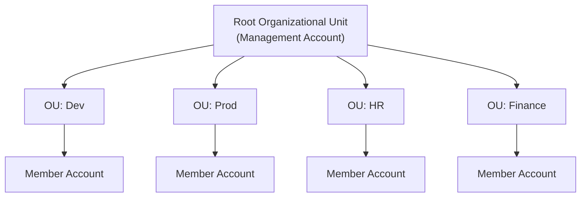
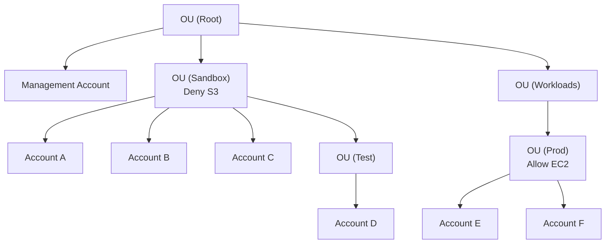
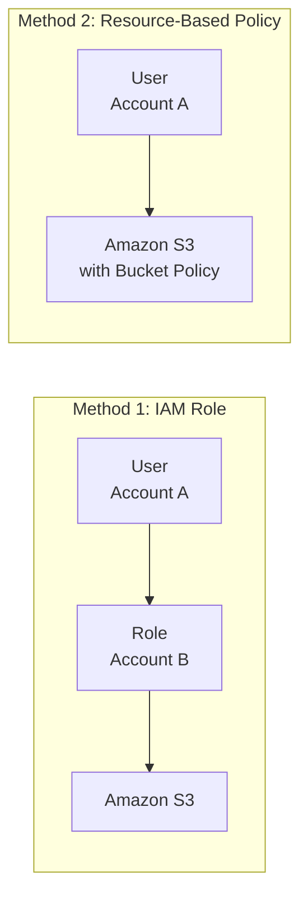
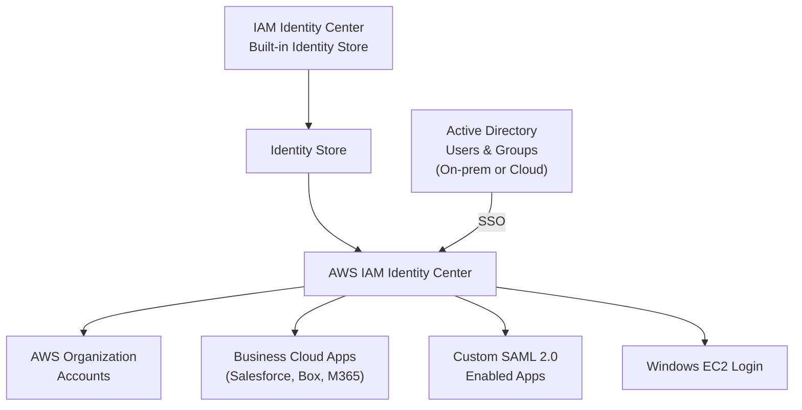
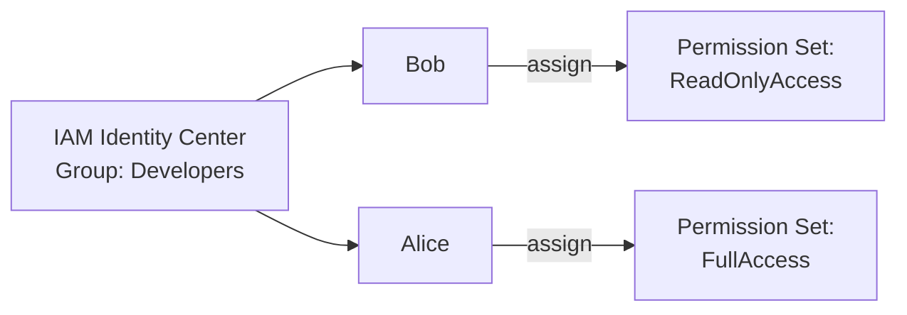
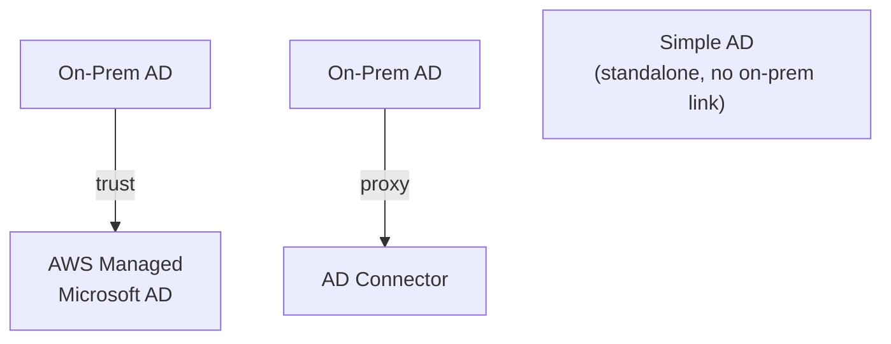
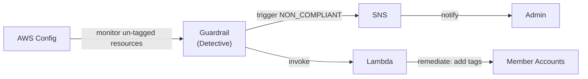
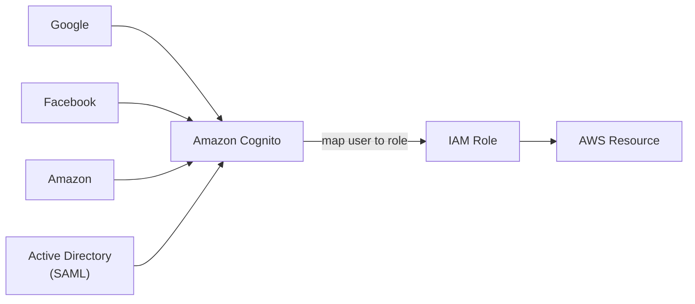

# Advanced Identity in AWS

## Key Concepts

### AWS Organizations
- **Global service** that allows you to manage multiple AWS accounts
- The main account is the **management account**; all other accounts are **member accounts**
- A member account can only be part of **one** organization
- **Consolidated Billing**: a single payment method across all accounts in the organization
- **Pricing benefits from aggregated usage**: volume discounts (e.g., EC2, S3) and **shared Reserved Instance / Savings Plans discounts** across accounts
- An API is available to **automate AWS account creation**

### Organizational Units (OUs)
- Accounts can be grouped into a hierarchy of **Organizational Units (OUs)** under a **Root OU**
- Common OU strategies (from the source):
  - **Business Unit** — e.g., Sales OU, Retail OU, Finance OU
  - **Environmental Lifecycle** — e.g., Prod OU, Dev OU, Test OU
  - **Project-Based** — e.g., Project 1 OU, Project 2 OU, Project 3 OU

### Advantages of AWS Organizations
- Multi-Account strategy vs. one account with multiple VPCs
- Use **tagging standards** for billing purposes
- Enable **CloudTrail** on all accounts, send logs to a central S3 account
- Send **CloudWatch Logs** to a central logging account
- Establish **Cross-Account Roles** for admin purposes
- Security via **Service Control Policies (SCPs)**

### Service Control Policies (SCPs)
- IAM policies applied at the **OU or Account** level to restrict what Users and Roles in that account/OU can do
- **Do NOT apply to the management account** (it retains full admin power)
- Must have an **explicit allow** from the root, through every OU in the direct path, down to the target account — SCPs **do not allow anything by default**, like an IAM policy
- Support **blocklist** and **allowlist** strategies

> [!WARNING]
> SCPs never apply to the management account. If you need to restrict the management account itself, you cannot do it with SCPs — this is a classic exam trap.

Worked example from the source (as stated directly in the slide, SCPs never affect the management account and effects flow down the OU tree):

| Account | Effective Access (per source) |
|---|---|
| Management Account | Can do anything (no SCP applies) |
| Account A | Can do anything EXCEPT S3 (Sandbox OU deny), EXCEPT EC2 (explicit account-level deny) |
| Account B & C | Can do anything EXCEPT S3 (inherited Sandbox OU deny) |
| Account D | Can access EC2 |
| Prod OU, Account E & F | Can do anything |

### AWS Organizations — Tag Policies
- Helps standardize **tags** across resources in an organization
- Ensures consistent tags, audits tagged resources, maintains proper resource categorization
- You define **tag keys and their allowed values**
- Helps with **AWS Cost Allocation Tags** and **Attribute-Based Access Control (ABAC)**
- Prevents non-compliant tagging operations on specified services/resources (has **no effect** on resources that are already untagged)
- Generates a report listing all tagged / non-compliant resources
- Use **EventBridge** to monitor non-compliant tags

### IAM Policy Conditions
IAM policies can include `Condition` blocks to further restrict when a permission applies:

| Condition Key | Purpose |
|---|---|
| `aws:SourceIp` | Restrict the client IP from which API calls are made |
| `aws:RequestedRegion` | Restrict the Region the API calls are made to |
| `ec2:ResourceTag` | Restrict access based on resource tags |
| `aws:MultiFactorAuthPresent` | Force MFA to be present for the action to be allowed |

### IAM for S3 — Bucket vs. Object Level Permissions
- `s3:ListBucket` applies to `arn:aws:s3:::test` → **bucket-level** permission
- `s3:GetObject`, `s3:PutObject`, `s3:DeleteObject` apply to `arn:aws:s3:::test/*` → **object-level** permission

### Resource Policies & `aws:PrincipalOrgID`
- `aws:PrincipalOrgID` can be used in **any resource policy** to restrict access to principals that are members of a specific AWS Organization (e.g., `o-yyyyyyyyyy`)
- Useful to allow access only to accounts inside your organization while blocking users outside of it

### IAM Roles vs. Resource-Based Policies (Cross-Account Access)
There are two ways to grant cross-account access:
1. Attach a **resource-based policy** to the resource (e.g., an S3 bucket policy)
2. Use a **role as a proxy** (the user in Account A assumes a role in Account B)

- **When you assume a role**, you give up your original permissions and take on the permissions of the role
- **When using a resource-based policy**, the principal does **not** have to give up their permissions
- Example use case from the source: a user in Account A needs to scan a DynamoDB table in Account A and dump it into an S3 bucket in Account B
- Resource-based policies are supported by: **Amazon S3 buckets, SNS topics, SQS queues**, etc.

### Amazon EventBridge — Security Model
When an EventBridge rule runs, it needs permission on its target:

| Target Type | Permission Model |
|---|---|
| Lambda, SNS, SQS, S3 buckets, API Gateway | Resource-based policy (e.g., allow EventBridge to invoke) |
| EC2 Auto Scaling, Systems Manager Run Command, ECS task | IAM role |

### IAM Permission Boundaries
- Supported for **users and roles** (NOT groups)
- An advanced feature that uses a **managed policy** to set the **maximum permissions** an IAM entity can get
- Effective permissions = intersection of the Permission Boundary AND the identity-based policy — if either denies/omits a permission, the result has **no permission** for that action
- Can be used in combination with **AWS Organizations SCPs**

**Use cases:**
- Delegate responsibilities to non-administrators (e.g., let them create new IAM users) without risking privilege escalation
- Allow developers to self-assign policies and manage their own permissions, while ensuring they can't "escalate" privileges (make themselves admin)
- Useful to restrict **one specific user**, instead of restricting a whole account via Organizations & SCP

### IAM Policy Evaluation Logic
- AWS evaluates all applicable policies (identity-based, resource-based, permission boundaries, SCPs, session policies) to determine the final Allow/Deny decision
- An explicit **Deny** always overrides an Allow, at any layer

## AWS Services / Features

### AWS IAM Identity Center (successor to AWS Single Sign-On)
Provides **one login (single sign-on)** for:
- All AWS accounts in an **AWS Organizations**
- Business cloud applications (Salesforce, Box, Microsoft 365, …)
- SAML 2.0-enabled applications
- EC2 Windows instances

**Identity providers supported:**
- Built-in identity store in IAM Identity Center
- 3rd party: Active Directory (AD), OneLogin, Okta…

> [!TIP]
> Reducing login to one set of credentials improves enterprise security — SSO reduces the number of attack surfaces, because users only log in once each day and use only one set of credentials.

### IAM Identity Center — Fine-Grained Permissions
- **Multi-Account Permissions**: manage access across AWS accounts in your AWS Organization
- **Permission Sets**: a collection of one or more IAM policies assigned to users/groups to define AWS access; a Permission Set assignment creates an **IAM Role** in the target account that the user assumes
- **Application Assignments**: SSO access to SAML 2.0 business applications — requires URLs, certificates, and metadata
- **Attribute-Based Access Control (ABAC)**: fine-grained permissions based on user attributes stored in the IAM Identity Center Identity Store (e.g., cost center, title, locale) — define permissions once, then change access by changing the attributes

### AWS Directory Services
Background: **Microsoft Active Directory (AD)** is found on Windows Server with AD Domain Services — a database of objects (user accounts, computers, printers, file shares, security groups) enabling centralized security management. Objects are organized into **trees**, and a group of trees is a **forest**.

| Directory Type | Description | On-Prem AD Trust? | MFA |
|---|---|---|---|
| **AWS Managed Microsoft AD** | Create your own AD in AWS; manage users locally | Yes — can establish a **trust** connection with on-prem AD | Supported |
| **AD Connector** | A directory gateway (proxy) that redirects authentication to an on-premises AD; users are managed on-prem | Proxies to on-prem AD (no independent AD in AWS) | Supported |
| **Simple AD** | AD-compatible managed directory on AWS | Cannot be joined with on-premises AD | Not stated |

### IAM Identity Center — Active Directory Setup
Two ways to connect IAM Identity Center to Active Directory:
1. **Connect to an AWS Managed Microsoft AD** (Directory Service) — integration is out of the box
2. **Connect to a Self-Managed Directory** — either:
   - Create a **two-way trust relationship** using AWS Managed Microsoft AD, or
   - Create an **AD Connector**

### AWS Control Tower
- Easy way to set up and govern a **secure, compliant multi-account** AWS environment based on best practices
- **Uses AWS Organizations** to create accounts
- **Benefits:**
  - Automate the setup of your environment in a few clicks
  - Automate ongoing policy management using **guardrails**
  - Detect policy violations and remediate them
  - Monitor compliance through an interactive dashboard

### AWS Control Tower — Guardrails
Guardrails provide ongoing governance for accounts inside a Control Tower environment:

| Guardrail Type | Mechanism | Example |
|---|---|---|
| **Preventive** | Uses SCPs | Restrict Regions across all your accounts |
| **Detective** | Uses AWS Config | Identify untagged resources |

### Amazon Cognito
- Gives users an **identity and data synchronization service**
- A **Single Sign-On (SSO)** solution in AWS — log in with an identity you already have and pass through AWS with that identity
- Supports **public identity providers**: Google, Facebook, Amazon
- Support for **private identity providers**: Active Directory with SAML (as stated in the source: "Secure Assertion Markup Language")

**Identity Management:**
- Based on open standards: **OAuth 2.0**, **SAML 2.0**, **OpenID Connect**
- You can use these with AWS in your application

**Profile Management:**
- Manage profiles of users coming to AWS, without having to have accounts in IAM

**Scale to millions of users:**
- Store profiles in games or apps
- Supports automated social log-ins

**AWS Integration:**
- Cognito controls access to AWS resources
- You define roles and map users to roles that give them the capability they need
- Example: get a Facebook user access into an AWS service

### AWS Resource Access Manager (AWS RAM)
- Enables you to easily and securely **share AWS resources** with any AWS account
- Only the **master account** can enable sharing with AWS Organizations — the organization must be enabled for **all features**
- Eliminates the need to create duplicate resources in multiple accounts
- Three simple steps: **Create a Resource Share** → **Specify resources** → **Specify accounts**
- Stop sharing a resource by **deleting the share** in AWS RAM
- **Security**: use IAM policies to secure who can access resources that you shared or received from another account
- **Pricing**: no additional charge for using AWS RAM

> [!NOTE]
> The source material used for this page range does not cover AWS STS or a dedicated "cross-account role via STS" walkthrough. Cross-account access here is covered only via the Roles-vs-Resource-Policies pattern above. If STS detail is needed, it should be sourced from another page range and added later rather than guessed here.

## Exam Tips
> [!TIP]
> SCPs restrict the **maximum** available permissions in an account/OU — they never grant permissions by themselves, and IAM policies inside the account still need to explicitly allow the action. Think of SCPs as a permission *ceiling*, not a grant.

> [!TIP]
> Permission Boundaries do the same "ceiling" job as SCPs but scoped to a **single user or role**, not a whole account/OU. Use Permission Boundaries when you need to limit one identity without setting up Organizations.

> [!WARNING]
> Assuming a role means giving up your original permissions entirely — you now have only the role's permissions. A resource-based policy (e.g., S3 bucket policy) does NOT require giving up your original permissions. This distinction is a common exam trap.

> [!TIP]
> Know the three AWS Directory Service flavors: **AWS Managed Microsoft AD** (full AD, trusts on-prem), **AD Connector** (proxy only, no user store in AWS), **Simple AD** (standalone, cannot connect to on-prem AD).

> [!TIP]
> IAM Identity Center is the successor to AWS SSO — it provides one login across all AWS Organizations accounts plus SAML 2.0 apps, using either the built-in identity store or a 3rd-party IdP (AD, OneLogin, Okta).

## Related Notes
- [[01-Foundations/02-IAM-Basics]]
- [[08-Security-Identity/02-Security-Encryption]]
- [[00-Index/Exam-Domains/01-Design-Secure-Architectures]]
