# AWS Security & Encryption

## Key Concepts

### Three Types of Encryption
| Type | Where it happens | Purpose |
|---|---|---|
| **Encryption in flight (TLS/SSL)** | Data encrypted before sending, decrypted after receiving | TLS certificates enable HTTPS; ensures no MITM (man-in-the-middle) attack |
| **Server-side encryption at rest** | Data encrypted after being received by the server, decrypted before being sent back | Stored encrypted using a **data key**; the server must have access to the encryption/decryption keys |
| **Client-side encryption** | Data encrypted by the client, never decrypted by the server | Server never sees plaintext; decrypted only by a receiving client; can leverage **Envelope Encryption** |

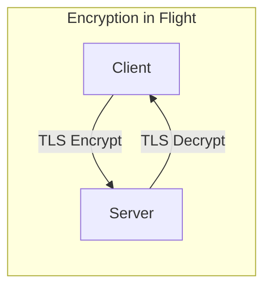

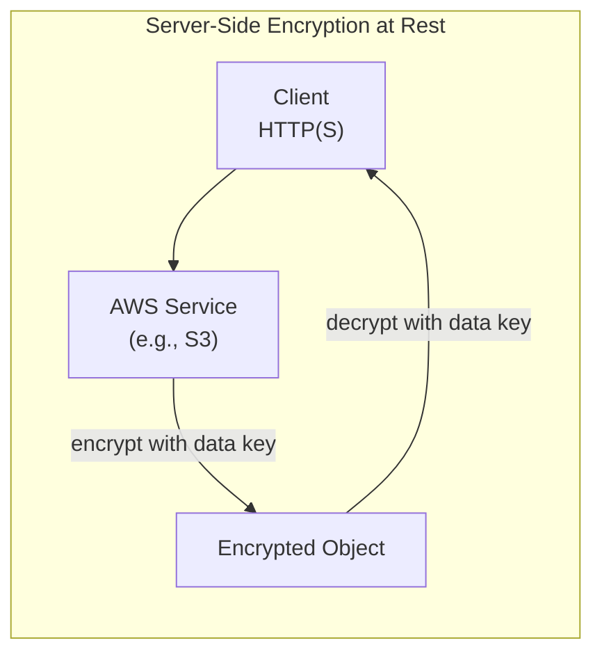

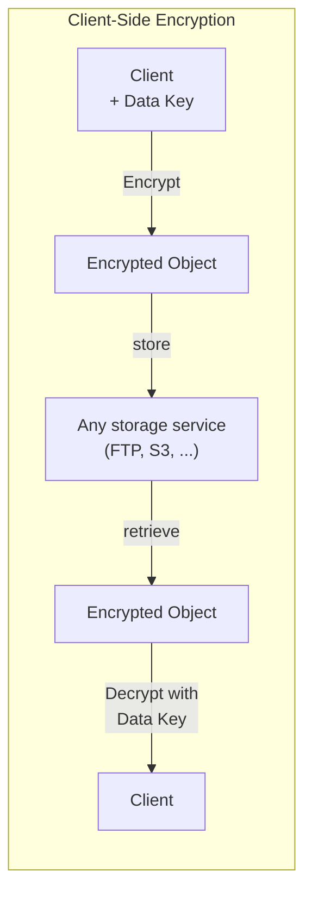

> [!NOTE]
> With client-side encryption the server (storage service) should never be able to decrypt the data — decryption only happens on a receiving client that has the data key.

### AWS KMS (Key Management Service)
- Anytime you hear "encryption" for an AWS service, it's most likely **KMS**
- AWS manages the encryption keys for you
- Fully integrated with **IAM** for authorization
- Easy way to control access to your data
- Audit KMS Key usage using **CloudTrail**
- Seamlessly integrated into most AWS services (EBS, S3, RDS, SSM…)
- **Never** store secrets in plaintext, especially in code
- KMS key encryption is also available through API calls (SDK, CLI); encrypted secrets can be stored in code / environment variables

### KMS Key Types (Symmetric vs. Asymmetric)
| Key Type | Description | Notes |
|---|---|---|
| **Symmetric (AES-256)** | A single key used to both Encrypt and Decrypt | AWS services integrated with KMS use symmetric keys; you never get access to the KMS Key unencrypted — you must call the KMS API to use it |
| **Asymmetric (RSA & ECC key pairs)** | A Public (Encrypt) / Private (Decrypt) key pair | Used for Encrypt/Decrypt or Sign/Verify operations; the public key is downloadable, but the private key stays encrypted; use case: encryption **outside** of AWS by users who can't call the KMS API |

### KMS Key Ownership Types (Cost & Rotation)
| Key Type | Cost | Automatic Rotation |
|---|---|---|
| **AWS Owned Keys** (e.g., SSE-S3, SSE-SQS, SSE-DDB default key) | Free | N/A (managed entirely by AWS) |
| **AWS Managed Key** (e.g., `aws/rds`, `aws/ebs`) | Free | Automatic, every **1 year** |
| **Customer Managed Key** (created in KMS) | $1/month + $0.03 per 10,000 API calls | Automatic (must be enabled) **and** on-demand |
| **Customer Managed Key** (imported) | Key/request charges vary by key type and usage; verify current pricing | **On-demand rotation for supported symmetric encryption keys**; no automatic rotation for imported material |

> [!NOTE]
> AWS KMS supports importing supported **symmetric, asymmetric and HMAC key material**. Import and rotation capabilities depend on key spec, usage and origin.

> [!NOTE] Conflict resolved — KMS API pricing
> An XMind study source stated $0.03 per 1,000 API calls. Verified 2026-07 against the [official KMS pricing page](https://aws.amazon.com/kms/pricing/): the correct rate is **$0.03 per 10,000 requests** (as this note already stated) — the mind map's figure was off by 10x.

> [!WARNING]
> Imported symmetric encryption keys support **on-demand rotation retaining the key ID/ARN**. Imported material does not support scheduled automatic rotation; changing aliases is not the only supported rotation method.

### KMS Key Policies
- Control access to KMS keys — "similar" to S3 bucket policies
- **Key difference:** you cannot control access to a KMS key without a key policy (unlike IAM policies, which are optional if defaults grant access)
- **Default KMS Key Policy**: created automatically if you don't provide one — gives complete access to the key to the **root user** (i.e., the entire AWS account)
- **Custom KMS Key Policy**: define which users/roles can access the key and who can administer it — useful for **cross-account access** to your KMS key

### KMS Multi-Region Keys
- Identical KMS keys in different AWS Regions that can be used **interchangeably**
- Multi-Region keys share the same **key ID**, key material, and automatic rotation
- Encrypt in one Region, decrypt in another — **no need to re-encrypt** or make cross-Region API calls
- Multi-Region keys are **NOT global** — there is one Primary key and Replica keys, and **each is managed independently**
- Use cases: global client-side encryption, encryption on **Global DynamoDB**, **Global Aurora**

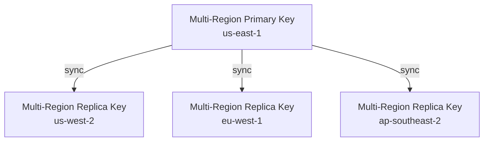

- **Global Tables (DynamoDB) + Multi-Region Keys**: encrypt an attribute client-side with the primary MRK, replicate via Global Tables, then a client in another region can decrypt with the local replica MRK using a low-latency local KMS call — protecting specific fields (e.g., an SSN attribute)
- **Global Aurora + Multi-Region Keys**: same pattern using the **AWS Encryption SDK** to encrypt specific columns client-side — can protect fields even from database admins

### Cross-Region / Cross-Account KMS Operations
**Copying EBS Snapshots across Regions:**
1. An EBS Volume/Snapshot in Region A is encrypted with KMS Key A
2. To copy to Region B, KMS **re-encrypts** the snapshot with KMS Key B in the destination region

**Copying EBS Snapshots across accounts:**
1. Create a snapshot, encrypted with your own KMS Key (Customer Managed Key)
2. Attach a KMS Key Policy to authorize cross-account access
3. Share the encrypted snapshot
4. In the target account, create a copy of the snapshot, encrypted with a CMK in that account
5. Create a volume from the snapshot

**AMI Sharing Process (encrypted via KMS):**
1. AMI in the source account is encrypted with a KMS key from the source account
2. Modify the image's Launch Permission to add the target AWS account
3. Share the KMS key(s) used to encrypt the underlying snapshot with the target account/IAM role
4. The IAM Role/User in the target account needs `DescribeKey`, `ReEncrypt*`, `CreateGrant`, `Decrypt` permissions
5. When launching an EC2 instance from the AMI, the target account can optionally specify a new KMS key in its own account to re-encrypt the volumes

### S3 Replication Encryption Considerations
- Unencrypted objects and objects encrypted with **SSE-S3** are replicated by default
- Objects encrypted with **SSE-C** (customer-provided key) can be replicated
- Objects encrypted with **SSE-KMS** require you to explicitly **enable** the replication option, specify which KMS key to use in the target bucket, adapt the target KMS Key Policy, and grant an IAM role `kms:Decrypt` on the source key and `kms:Encrypt` on the target key
- You might hit **KMS throttling errors** — request a Service Quotas increase if so
- Multi-Region KMS keys are currently treated as **independent keys** by S3 — the object is still decrypted then re-encrypted, not passed through unchanged

## AWS Services / Features

### SSM Parameter Store
- Secure storage for **configuration and secrets**
- Optional seamless encryption using **KMS**
- Serverless, scalable, durable, with an easy SDK
- **Version tracking** of configurations/secrets
- Security enforced through **IAM**
- Notifications via **Amazon EventBridge**
- Integration with **CloudFormation**

**Hierarchy example from the source:**
```
/my-department/my-app/dev/db-url
/my-department/my-app/dev/db-password
/my-department/my-app/prod/db-url
/my-department/my-app/prod/db-password
/my-department/other-app/
/other-department/
/aws/reference/secretsmanager/secret_ID_in_Secrets_Manager
/aws/service/ami-amazon-linux-latest/amzn2-ami-hvm-x86_64-gp2  (public)
```
Applications retrieve values with the `GetParameters` or `GetParametersByPath` API.

**Standard vs. Advanced Parameter Tiers:**
| Feature | Standard | Advanced |
|---|---|---|
| Max parameters (per account/Region) | 10,000 | 100,000 |
| Max size of a parameter value | 4 KB | 8 KB |
| Parameter policies available | No | Yes |
| Cost | No additional charge | Charges apply |
| Storage pricing | Free | $0.05 per advanced parameter per month |

**Parameter Policies (advanced tier only):**
- Assign a **TTL (expiration date)** to a parameter, to force updating or deleting sensitive data such as passwords
- Multiple policies can be assigned at once:
  - **Expiration** — deletes the parameter
  - **ExpirationNotification** — via EventBridge
  - **NoChangeNotification** — via EventBridge

### AWS Secrets Manager
- Newer service, purpose-built for **storing secrets**
- Capability to force **rotation of secrets every X days**
- Automates generation of secrets on rotation (uses a **Lambda function**)
- Integration with **Amazon RDS** (MySQL, PostgreSQL, Aurora)
- Secrets are encrypted using **KMS**
- Mostly meant for **RDS integration**

**Multi-Region Secrets:**
- Replicate secrets across multiple AWS Regions
- Secrets Manager keeps **read replicas** in sync with the primary Secret
- Ability to **promote** a read replica Secret to a standalone Secret
- Use cases: multi-region apps, disaster recovery strategies, multi-region databases

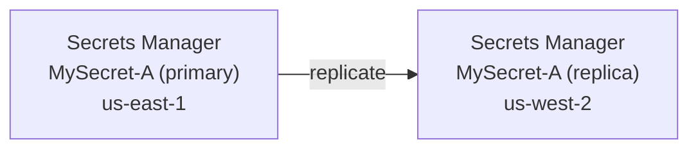

**Pricing:**
- 30-day trial
- $0.40 per secret per month
- $0.05 per 10,000 API calls

### SSM Parameter Store vs. Secrets Manager
| Aspect | SSM Parameter Store | Secrets Manager |
|---|---|---|
| Primary purpose | General configuration & secrets storage | Purpose-built for secrets |
| Automatic secret rotation | Not stated in source | Yes — every X days, via Lambda |
| Encryption | Optional, seamless via KMS | Encrypted using KMS (always) |
| RDS integration | Not stated in source | Yes — MySQL, PostgreSQL, Aurora |
| Multi-Region replication | Not stated in source | Yes — read replicas, promotable |
| Pricing | Standard tier free; Advanced tier $0.05/parameter/month | 30-day trial; $0.40/secret/month + $0.05 per 10,000 API calls |
| Versioning | Yes | Not stated in source |
| Notifications | Via EventBridge (parameter policies) | Not stated in source |

> [!NOTE]
> Only facts explicitly present in the source are listed above; rows marked "Not stated in source" should not be assumed — confirm from official docs only if approved.

### AWS Certificate Manager (ACM)
- Easily provision, manage, and deploy **TLS certificates**
- Provides in-flight encryption (HTTPS) for websites
- Supports both **public and private** TLS certificates
- **Free of charge** for public TLS certificates
- **Automatic renewal** for ACM-generated certificates (60 days before expiry)
- Integrates with: Elastic Load Balancers (CLB, ALB, NLB), CloudFront distributions, APIs on API Gateway
- **Cannot use ACM with EC2** directly

**Requesting a Public Certificate:**
1. List domain names — FQDN (e.g., `corp.example.com`) or wildcard (`*.example.com`)
2. Choose a validation method: **DNS Validation** (preferred, automatable, uses a CNAME record e.g. in Route 53) or **Email Validation** (sends email to WHOIS contact addresses)
3. Verification takes a few hours
4. The public certificate is enrolled for automatic renewal

**Importing a Public Certificate:**
- You can generate a certificate outside ACM and import it
- **No automatic renewal** — you must import a new certificate before expiry
- ACM sends daily expiration events starting 45 days before expiry (configurable), appearing in **EventBridge**
- AWS Config has a managed rule, `acm-certificate-expiration-check`, to check for expiring certificates

**Integration with ALB:** on an ALB, you can set a redirect rule from HTTP to HTTPS.

**ACM + API Gateway endpoint types:**
| Endpoint Type | Description | TLS Certificate Region Requirement |
|---|---|---|
| **Edge-Optimized** (default) | For global clients — requests are routed through CloudFront Edge locations to improve latency, then sent to the API Gateway (which still lives in only one Region) | Certificate must be created in the same Region as CloudFront |
| **Regional** | For clients within the same Region as the API Gateway; can be manually combined with CloudFront for more control over caching and distribution | Certificate must be imported in the same Region as the API stage |
| **Private** | Can be accessed only from your VPC, using an interface VPC endpoint (ENI); access is defined via a resource policy | — |

**Setting up a custom domain for Edge-Optimized (global) endpoints:**
1. Create a **Custom Domain Name** resource in API Gateway
2. Because requests are routed through CloudFront and the API Gateway itself lives in one Region, the **TLS Certificate must be created in the same Region as CloudFront**
3. Set up a **CNAME or alias record** in Route 53
4. TLS certificates are attached to your CloudFront distribution

**Setting up a custom domain for Regional endpoints:**
- For clients in the same Region as your API Gateway (no CloudFront involved), the TLS certificate must be **imported on the API Gateway** in the same Region as the API stage
- Then set up a **CNAME or alias record** in Route 53 to point to your DNS

> [!TIP]
> API Gateway Edge-Optimized endpoints route through CloudFront edge locations but the API Gateway itself still lives in one Region. Regional endpoints are for clients in the same Region and can be manually combined with CloudFront for more control over caching.

### CloudHSM
- **KMS** = AWS manages the encryption software; **CloudHSM** = AWS provisions dedicated encryption **hardware**
- Dedicated **Hardware Security Module (HSM)** — you manage your own encryption keys entirely (not AWS)
- Tamper-resistant, **FIPS 140-2 Level 3** compliant
- Supports both symmetric and asymmetric encryption (SSL/TLS keys)
- **No free tier**
- Must use the **CloudHSM Client Software**
- Redshift supports CloudHSM for database encryption and key management
- Good option to use with **SSE-C** encryption

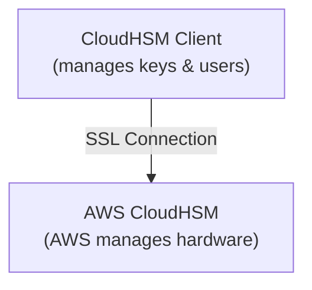

**Clusters:**
- A cluster is a collection of **1 to 28** individual HSMs
- HSMs can be placed in different AZs in a Region — provides higher performance and **Multi-AZ** availability/durability
- Supports **cluster load balancing**
- Other HSMs in the cluster are **automatically kept up to date** when you perform a task (e.g., create a key or user) on one HSM

**Backups:**
- CloudHSM can perform **periodic backups** of users, keys, and policies
- Backups are stored in an **S3 bucket in the same Region** as the cluster
- **Default backup retention policy is 90 days**
- The HSM encrypts data with an **ephemeral backup key (EBK)** before sending it to CloudHSM's backup storage

**HSM Users:**
- HSM users are **distinct from IAM users**
- To manage users on the HSM, you need the **CloudHSM Management Utility (CMU)**
- Each HSM user has a **type**, defining which operations they can perform:

| User Type | Role |
|---|---|
| **Precrypto Officer (PRECO)** | Temporary user |
| **Crypto Officer (CO / PCO)** | Performs user management |
| **Crypto User (CU)** | Key management and cryptographic operations — only a CU can **create a key** in CloudHSM |
| **Appliance User (AU)** | Performs cloning and synchronization operations |

**Monitoring:**
- **AWS CloudTrail** — monitors API calls, such as creation and deletion of clusters, HSMs, and resource tags
- **Amazon CloudWatch** — health of the cluster, and logs from HSM instances

**Pricing:** charges per hour for each HSM you launch — **no free tier**.

**Use Cases:**
- Offload SSL/TLS processing for web servers
- Protect private keys for an issuing certificate authority (CA)
- Enable transparent data encryption (TDE) for Oracle databases

**Integration with AWS services**: via KMS — configure a **KMS Custom Key Store** backed by CloudHSM (e.g., for EBS, S3, RDS).

**CloudHSM vs. KMS:**
| Feature | AWS KMS | AWS CloudHSM |
|---|---|---|
| Tenancy | Multi-Tenant | Single-Tenant |
| Standard | FIPS 140-2 Level 3 | FIPS 140-2 Level 3 |
| Master Keys | AWS Owned CMK / AWS Managed CMK / Customer Managed CMK | Customer Managed CMK only |
| Key Types | Symmetric, Asymmetric, Digital Signing | Symmetric, Asymmetric, Digital Signing & Hashing |
| Key Accessibility | Accessible in multiple AWS Regions (can't access keys outside the Region created in) | Deployed & managed in a VPC; can be shared across VPCs (VPC Peering) |
| Cryptographic Acceleration | None | SSL/TLS Acceleration, Oracle TDE Acceleration |
| Access & Authentication | AWS IAM | You create users and manage their permissions |
| High Availability | AWS-managed service | Add multiple HSMs across different AZs |
| Audit | CloudTrail, CloudWatch | CloudTrail, CloudWatch, MFA support |
| Free Tier | Yes | No |

### AWS WAF (Web Application Firewall)
- Protects web applications from common web exploits at **Layer 7** (HTTP) — vs. Layer 4 (TCP/UDP)
- Deploys on: **Application Load Balancer, API Gateway, CloudFront, AppSync GraphQL API, Cognito User Pool**
- Define **Web ACL (Web Access Control List)** rules:
  - **IP Set** — up to 10,000 IPs per rule (use multiple rules for more)
  - HTTP headers, HTTP body, or URI strings — protects against **SQL injection** and **Cross-Site Scripting (XSS)**
  - Size constraints, geo-match (block by country)
  - **Rate-based rules** — count occurrences of events, useful for DDoS protection
- Web ACLs are **Regional**, except for CloudFront (which is global)
- A **rule group** is a reusable set of rules you can add to a Web ACL

**WAF Behaviors:**
| Behavior | Description |
|---|---|
| Allow all requests, except the ones you specify | "Open to closed" — for when you want to allow most requests |
| Block all requests, except the ones you specify | "Closed to open" |

**Monitoring:** WAF can be monitored for requests that match specified parameters, integrated with **CloudWatch** or **CloudTrail** for logging and monitoring, and integrated with **SNS** for setting alarms.

**Error handling:** WAF returns an **HTTP 403 error (Forbidden)** to requests that don't have access (access denied).

**Configurable default behavior:** you can configure what happens when a request doesn't match any rule — the default can be set to **Allow** or **Deny**.

> [!NOTE]
> Security groups control traffic for associated resources/network interfaces, not entire subnets or a VPC edge. **NACLs** apply at the subnet boundary. Private connectivity does not replace application-layer threat analysis; use WAF where a supported application resource and requirements call for it.

> [!WARNING]
> WAF does **not** support the Network Load Balancer (Layer 4). To get a fixed IP while still using WAF on an ALB, put **Global Accelerator** in front of the ALB, and attach WAF to the ALB (the Web ACL must be in the same Region as the ALB).

### AWS Shield
| | Shield Standard | Shield Advanced |
|---|---|---|
| Cost | Free — activated for every AWS customer | $3,000/month per organization |
| Protection scope | Network flow monitoring; protects against DDoS attacks such as SYN floods, UDP reflection, and other Layer 3/4 attacks | More sophisticated attacks on EC2, ELB, CloudFront, Global Accelerator, Route 53 |
| Support | N/A | 24/7 access to the AWS DDoS Response Team (DRT) |
| Cost protection | N/A | Protects against higher fees caused by usage spikes from a DDoS attack |
| Data transfer | N/A | Also charged for data transferred |
| Visibility & monitoring | N/A | Visibility and reporting; active monitoring |
| Layer 7 mitigation | N/A | Optional DDoS mitigation service — automatic application-layer DDoS mitigation — automatically creates, evaluates, and deploys WAF rules |

### AWS Firewall Manager
- Manages security rules across **all accounts in an AWS Organization**
- A **security policy** is a common set of security rules covering:
  - WAF rules (ALB, API Gateway, CloudFront)
  - AWS Shield Advanced (ALB, CLB, NLB, Elastic IP, CloudFront)
  - Security Groups for EC2, ALB, and ENI resources in a VPC
  - AWS Network Firewall (VPC level)
  - Amazon Route 53 Resolver DNS Firewall
- Policies are created at the **Region level**
- Rules are automatically applied to **new resources as they're created** — good for compliance across current and future accounts in the Organization

### WAF vs. Firewall Manager vs. Shield
- All three are used **together** for comprehensive protection
- Define your Web ACL rules in **WAF**; for granular protection of individual resources, WAF alone is correct
- Use **Firewall Manager** with WAF if you want WAF applied across accounts, want to accelerate WAF configuration, or want to automate protection of new resources
- **Shield Advanced** adds features on top of WAF: dedicated support from the **Shield Response Team (SRT)** and advanced reporting
- If you're prone to frequent DDoS attacks, consider purchasing Shield Advanced
- **Firewall Manager** can also help you deploy **Shield Advanced** across all your accounts

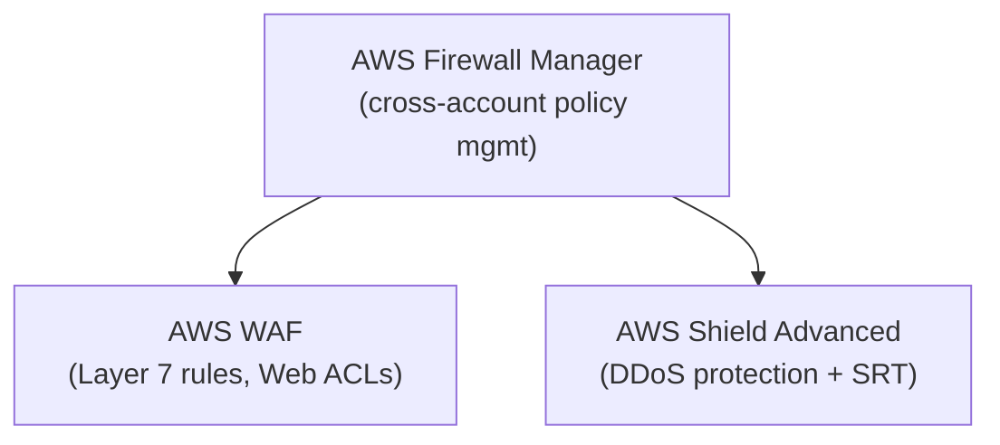

### AWS Network Firewall
Part of the layered network protection story on AWS, alongside: **Network Access Control Lists (NACLs)**, **VPC Security Groups**, **AWS WAF** (against malicious HTTP requests), **AWS Shield / Shield Advanced** (DDoS protection), and **AWS Firewall Manager** (to manage them all across multiple accounts).

**What AWS Network Firewall does:**
- Protects your **entire VPC** — Layer 3 to Layer 7 protection
- Can inspect traffic in any direction: VPC-to-VPC, outbound to internet, inbound from internet, to/from Direct Connect, and Site-to-Site VPN
- Uses the **AWS Gateway Load Balancer** to inspect traffic — AWS manages it with its own appliances, instead of you setting up a third-party appliance

**Rules:**
- Define rules to control anything that happens — supports **thousands of rules**
- Filter by **IP and port** (e.g., filtering 10,000s of IPs)
- Filter by **protocol** (e.g., block SMB protocol for outbound communications)
- Filter at the **domain level** (e.g., only allow outbound traffic to `*.mycorp.com` or a third-party software repo)
- General pattern matching using **regex**
- **Traffic filtering**: Allow, drop, or alert for traffic that matches the rules
- **Active flow inspections**: protects against network threats with intrusion-prevention capabilities — similar to a Gateway Load Balancer appliance, but fully managed by AWS
- Sends logs of rule matches to **S3**, **CloudWatch Logs**, or **Kinesis Data Firehose**

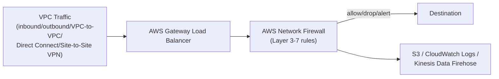

### AWS Best Practices for DDoS Resiliency (as stated in source)
**Edge location mitigation:**
- **CloudFront** — web app delivery at the edge, protects from common attacks (SYN floods, UDP reflection)
- **Global Accelerator** — access your app from the edge, integrates with Shield, helpful when the backend isn't compatible with CloudFront
- **Route 53** — domain name resolution at the edge, includes DDoS protection mechanisms

**Infrastructure layer defense:**
- Protect EC2 against high traffic using Global Accelerator, Route 53, CloudFront, Elastic Load Balancing
- **EC2 Auto Scaling** — helps scale during sudden traffic surges (flash crowd or DDoS)
- **Elastic Load Balancing** — scales with traffic and distributes it across many EC2 instances

**Application layer defense:**
- CloudFront caches static content at edge locations, protecting the backend
- **WAF** on top of CloudFront/ALB filters and blocks requests based on signatures; rate-based rules auto-block bad-actor IPs; managed rules block by IP reputation or anonymous IPs; CloudFront can block specific geographies
- **Shield Advanced** automatic application-layer mitigation creates/evaluates/deploys WAF rules automatically

**Attack surface reduction:**
- Obfuscate AWS resources using CloudFront, API Gateway, ELB to hide backend resources (Lambda, EC2)
- Use **Security Groups and NACLs** to filter traffic at the subnet/ENI level
- **Elastic IPs** are protected by Shield Advanced
- Protect API endpoints by hiding EC2/Lambda behind Edge-Optimized mode or CloudFront + Regional mode, and use WAF + API Gateway (burst limits, header filtering, API keys)

### Amazon GuardDuty
- Intelligent **threat discovery** to protect your AWS account
- Uses machine learning, anomaly detection, and 3rd-party threat data
- One-click enable (30-day trial), no software to install
- **Input data includes:**
  - CloudTrail Event Logs — unusual API calls, unauthorized deployments
  - CloudTrail Management Events — create VPC subnet, create trail, etc.
  - CloudTrail S3 Data Events — GetObject, ListObjects, DeleteObject, etc.
  - VPC Flow Logs — unusual internal traffic, unusual IP addresses
  - DNS Logs — compromised EC2 instances sending encoded data via DNS queries
  - Optional features: EKS Audit Logs, RDS & Aurora, EBS, Lambda, S3 Data Events
- Can set up **EventBridge rules** to be notified of findings — targeting Lambda or SNS
- Has a dedicated finding type for **cryptocurrency attacks**

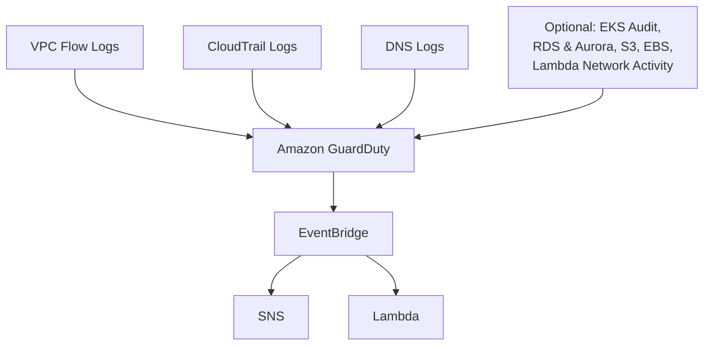

### Amazon Inspector
- Automated **security assessments**
- **For EC2 instances**: leverages the SSM Agent; analyzes unintended network accessibility and the running OS against known vulnerabilities
- **For Container Images pushed to Amazon ECR**: assesses images as they are pushed
- **For Lambda functions**: identifies software vulnerabilities in function code and package dependencies, assessed as functions are deployed
- Reports & integrates with **AWS Security Hub**
- Sends findings to **Amazon EventBridge**

**What Amazon Inspector evaluates:**
- Only EC2 instances, container images, and Lambda functions
- Continuous scanning of infrastructure, only when needed
- **Package vulnerabilities** (EC2, ECR, Lambda) — against a CVE database
- **Network reachability** (EC2 only)
- A **risk score** is associated with each vulnerability for prioritization

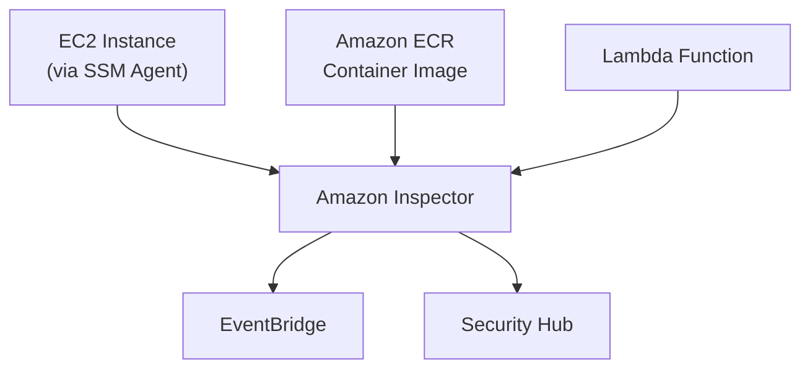

### Amazon Macie
- A fully managed **data security and data privacy** service
- Uses machine learning and pattern matching to **discover and protect sensitive data** in AWS
- Helps identify and alert on sensitive data, such as **Personally Identifiable Information (PII)**

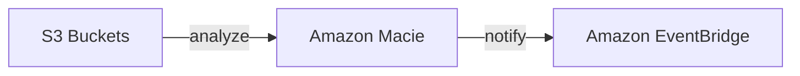

### AWS Security Hub
Provides a comprehensive view of your **security state** and your **compliance with security standards**.

**Features:**
- Aggregates, organizes, and prioritizes your security alerts (findings) across multiple accounts, AWS partner tools, and AWS services: **GuardDuty**, **Inspector**, **Macie**, AWS Partner solutions, **Firewall Manager**, **IAM Access Analyzer**, **Audit Manager**
- Works with **AWS Organizations** to simplify security management across all accounts
- Can run **automated, continuous configuration and compliance checks** based on standards
- Leverages configuration items recorded by **AWS Config**
- Can send security findings to ticketing, chat, email, or automated remediation systems through integration with **CloudWatch Events**
- Findings are stored for **at least 90 days**
- For Security Hub to run compliance checks in an account, you must have **AWS Config enabled** — Security Hub uses a **service-linked role**

**Pricing:** based on the quantity of compliance checks and the quantity of finding ingestion events, on a monthly per-account, per-Region basis.

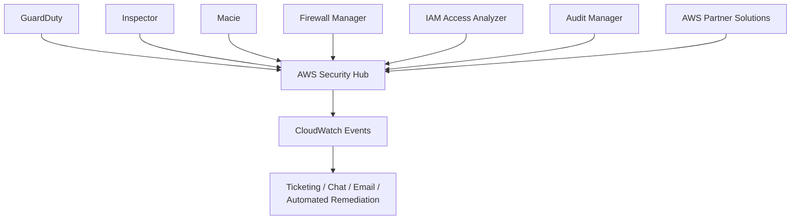

### Amazon Detective
A multi-account service that automatically collects log data from your AWS resources and uses **machine learning**, **statistical analysis**, and **graph theory** to build a linked set of data for faster, more efficient security investigations.

- Can be integrated with **GuardDuty**, **Macie**, and **Security Hub** to identify potential security issues (findings)
- Analyzes trillions of events from multiple data sources:
  - **VPC Flow Logs** — able to analyze IAM role sessions by processing VPC flow records and CloudTrail management events
  - **CloudTrail**
  - **GuardDuty**
- Automatically creates a unified, interactive view of your resources, users, and the interactions between them over time — identify underlying reasons for findings, drill down into relevant historical activities, and quickly determine the root cause of a security concern

**Concepts:**
| Concept | Definition |
|---|---|
| **Finding** | A security issue detected by GuardDuty |
| **Entity** | An item extracted from the incoming data; has a type (IP addresses, EC2 instances, users) |
| **Relationship** | Activity that occurs between individual entities |
| **Scope time** | The first and last times the suspicious activity was observed |

- Needs to be enabled on a **per-Region** basis
- If you use GuardDuty, Detective will **process two weeks of log data** upon activation
- **Limits**: maintains up to **a year** of aggregated findings for analysis

**Use Cases:** assign degrees of urgency to security findings; incident investigation; hunting for hidden security threats.

**Detective vs. GuardDuty vs. Security Hub:**
- **GuardDuty** is a threat detection service — monitors for malicious activity and unauthorized behavior
- **Security Hub** aggregates, organizes, and prioritizes security alerts/findings from multiple AWS services (GuardDuty, Inspector, Macie, AWS Partner solutions)
- **Detective** simplifies the process of investigating security findings and identifying the root cause

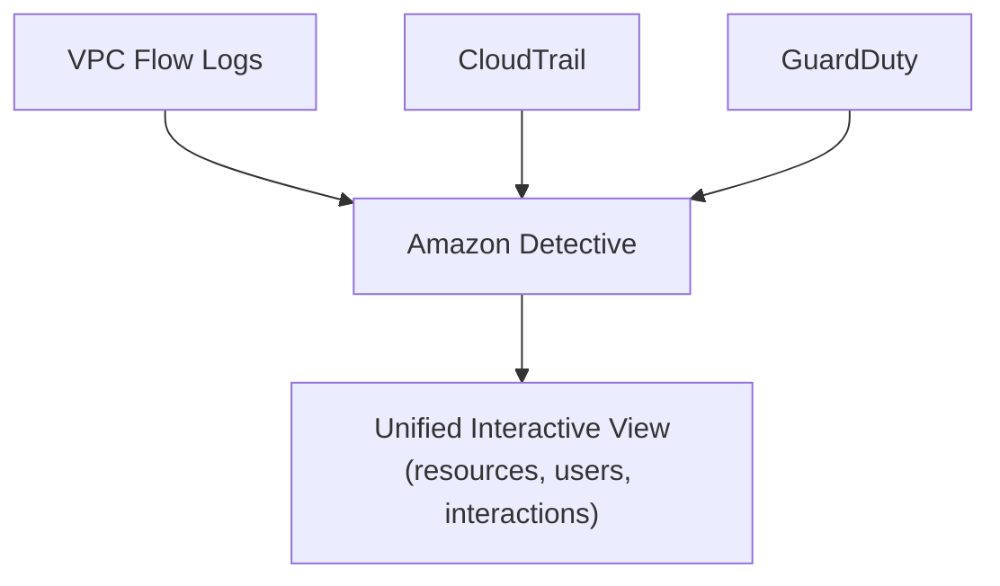

### AWS Artifact
A resource for **compliance-related information** — a self-service central repository of AWS security and compliance reports.

- On-demand access to AWS and Independent Software Vendor (ISV) compliance reports
- On-demand accept, terminate, and download compliance agreements with AWS
- An **audit artifact** is a piece of evidence that shows an organization is following a documented process

**Artifact Reports include:**
- ISO reports
- Service Organization Control (SOC) reports
- Payment Card Industry (PCI) reports
- Certifications that validate the implementation and operating effectiveness of controls

**Artifact Agreements include:**
- Nondisclosure Agreement (NDA)
- Business Associate Addendum (BAA) — required for companies subject to the **HIPAA Act**, to ensure Protected Health Information (PHI) is appropriately safeguarded

**Use Cases:** understand AWS's security and compliance posture; manage select online agreements at scale; assess third-party security and compliance.

### AWS Audit Manager
Audits your AWS usage on a regular basis, to simplify risk management and simplify compliance with regulations.

**Features:**
- Automates evidence collection for policies, procedures, activities, and creation of audit reports
- Manage and upload evidence from on-premises or multi-cloud environments
- View analytics data for assessments on the Audit Manager dashboard — identify non-compliant evidence that needs to be remediated
- Create frameworks with standard or custom controls, based on your specific internal audit requirements
- Frameworks can be shared with other accounts or replicated into another AWS Region

**Concepts:**
| Concept | Description |
|---|---|
| **Assessment** | Based on a framework (a collection of controls); has two states — **Active** (currently collecting evidence) or **Inactive** (stops collecting evidence) |
| **Assessment report** | Summarizes evidence gathered from an assessment; placed in an S3 bucket |
| **Delegation** | Delegates a control set to a subject-matter expert for review and validation of evidence; an account can be an **Audit owner** or a **Delegate** |
| **Framework library** | **Standard Frameworks** (prebuilt by AWS) or **Custom Frameworks** (you define controls & data source mappings) |

**Pricing:** charged based on the number of resource assessments performed, and for assessment reports stored in S3.

**Use Case:** makes it easier to assess whether your policies, procedures, and activities are operating effectively — to make sure auditors follow the rules and regulations set by the organization.

## Exam Tips
> [!TIP]
> "Encryption" on an AWS exam question almost always means **KMS**. If the question is about encryption keys you fully control on dedicated hardware (compliance-driven, single-tenant), think **CloudHSM** instead.

> [!TIP]
> Know the KMS key type/cost/rotation matrix cold: AWS Owned (free, no rotation choice) vs. AWS Managed (free, auto-rotates yearly) vs. Customer Managed created (auto or on-demand rotation) vs. Customer Managed imported (on-demand rotation for supported symmetric encryption keys; no automatic rotation).

> [!WARNING]
> A default KMS Key Policy grants full access to the account root user — but a **custom** key policy is required for cross-account KMS access. Unlike IAM policies, you cannot rely on identity-based policies alone to grant access to a KMS key; the key policy must allow it too.

> [!TIP]
> Secrets Manager = secrets that need **rotation** (especially RDS credentials) + native Lambda-driven rotation + multi-region replication. SSM Parameter Store = general config/secrets storage, cheaper, with a hierarchical path structure and optional KMS encryption.

> [!TIP]
> Shield Standard is free and automatic for everyone (Layer 3/4). Shield Advanced ($3,000/month) adds Layer 7 auto-mitigation via WAF, 24/7 DRT access, and cost protection — and only covers EC2, ELB, CloudFront, Global Accelerator, and Route 53.

> [!WARNING]
> WAF cannot be attached directly to a Network Load Balancer (Layer 4 only) — pair Global Accelerator (fixed IP) with an ALB + WAF when you need both a static IP and Layer 7 filtering.

> [!TIP]
> Differentiate the detection/assessment services: **GuardDuty** = continuous threat detection from logs (CloudTrail, VPC Flow Logs, DNS logs) using ML. **Inspector** = vulnerability assessment of EC2/ECR/Lambda against CVEs. **Macie** = sensitive data (PII) discovery in S3. **Security Hub** = aggregates findings from all of the above into one dashboard. **Detective** = investigates the root cause behind those findings using graph analysis. **Audit Manager** = continuous compliance/audit evidence collection. **Artifact** = on-demand repository of AWS's own compliance reports (ISO, SOC, PCI) and agreements (NDA, BAA).

> [!TIP]
> **AWS Network Firewall** protects an entire VPC (Layer 3-7, any traffic direction) using the AWS Gateway Load Balancer under the hood — different from **WAF**, which only filters HTTP/HTTPS (Layer 7) traffic to specific resources like an ALB or CloudFront.

## Related Notes
- [[08-Security-Identity/01-Advanced-Identity]]
- [[01-Foundations/02-IAM-Basics]]
- [[03-Storage/03-S3-Security]]
- [[00-Index/Exam-Domains/01-Design-Secure-Architectures]]

## Checked corrections — 2026-11-09

Only the changes listed here were verified in this audit; other course-derived details still need checking when used.

- Corrected security group attachment scope and imported KMS key types/on-demand rotation.
  - [AWS documentation](https://docs.aws.amazon.com/vpc/latest/userguide/vpc-security-groups.html)
  - [AWS documentation](https://docs.aws.amazon.com/kms/latest/developerguide/importing-keys.html)
  - [AWS documentation](https://aws.amazon.com/blogs/security/how-to-use-on-demand-rotation-for-aws-kms-imported-keys/)
