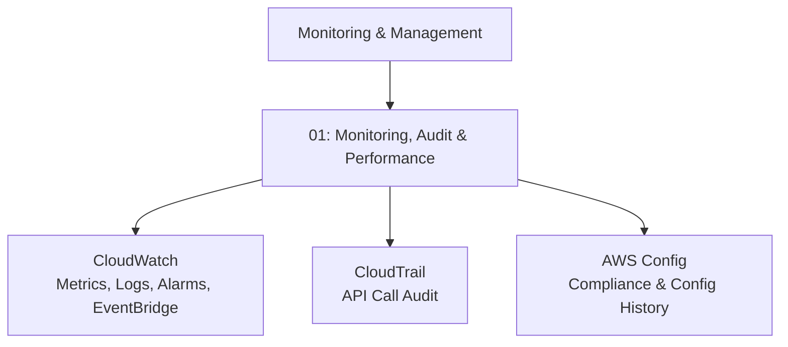

# Monitoring & Management — Cluster MOC

## Key Concepts

This cluster covers how AWS Solutions Architects observe, audit, and govern resources across an account: performance monitoring and alerting (CloudWatch), API call auditing (CloudTrail), and configuration/compliance tracking (AWS Config), tied together via EventBridge event routing.

## Notes in This Cluster

- [[01-Monitoring-Audit-Performance]] — CloudWatch (metrics, logs, alarms, EventBridge, Insights family) vs. CloudTrail (API audit) vs. AWS Config (compliance/configuration history), including a direct comparison table and an Elastic Load Balancer worked example.

## AWS Services / Features

## Exam Tips
> [!TIP]
> When a question mixes up CloudWatch, CloudTrail, and Config, anchor on the one-line distinction in [[01-Monitoring-Audit-Performance]]: performance vs. audit vs. compliance.

## Related Notes
- [[01-Monitoring-Audit-Performance]]
