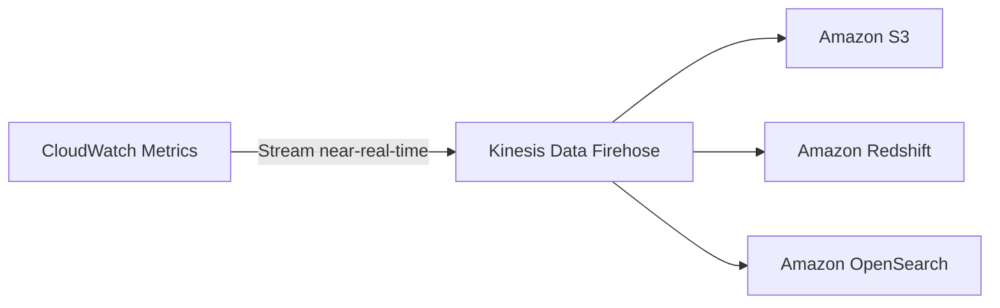
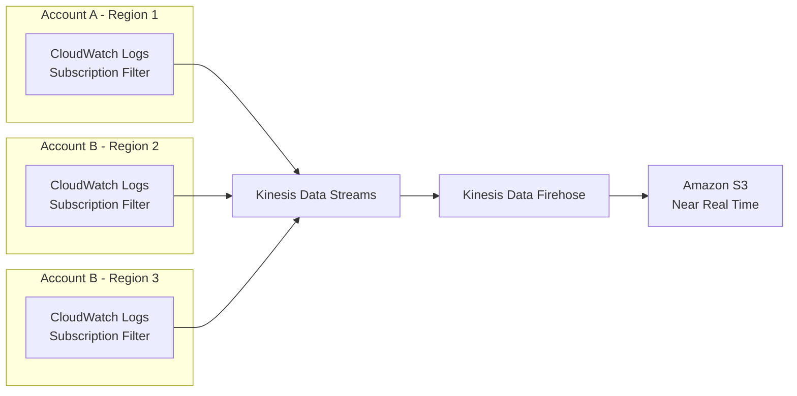
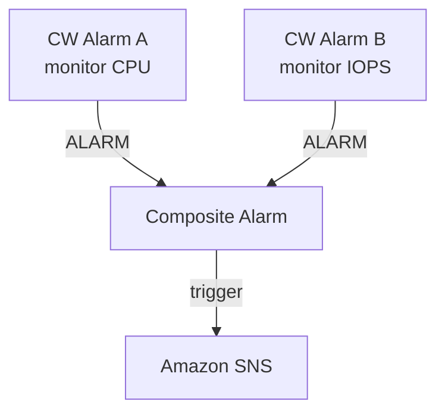
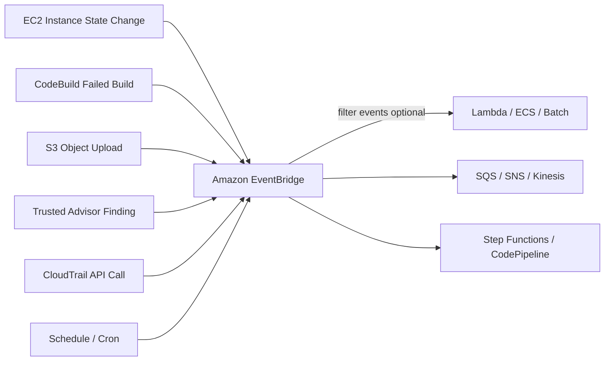
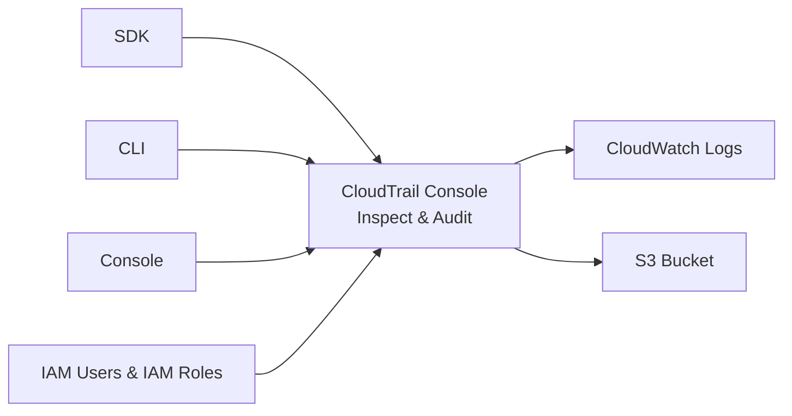
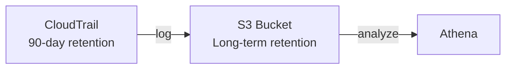
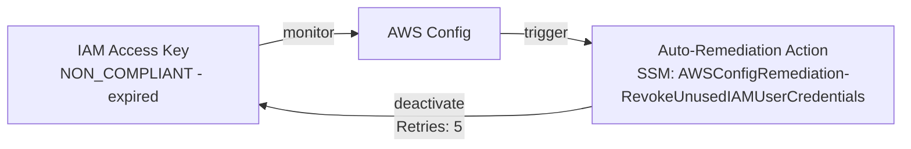
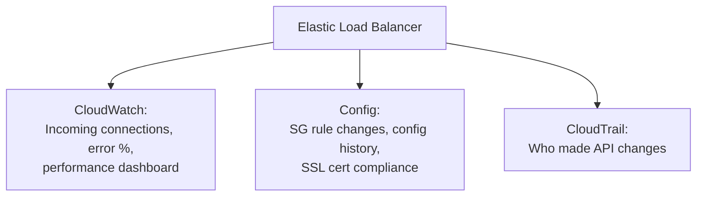

# Monitoring, Audit & Performance — CloudWatch, CloudTrail & AWS Config

## Key Concepts

- Three distinct services cover three distinct jobs: **CloudWatch** (performance monitoring, metrics, alarms, logs, events), **CloudTrail** (audit of *who did what* via API calls), and **AWS Config** (compliance/configuration history of *what a resource looked like over time*).
- **Amazon EventBridge** (formerly CloudWatch Events) is the event-routing layer that ties these together — it can react to CloudTrail API calls, scheduled cron jobs, or service state changes, and route them to targets like Lambda, SNS, SQS, Step Functions.

> [!NOTE]
> This is not in the study sources: **AWS X-Ray** (distributed tracing) does not appear anywhere in the source PDF text used for this vault. The comparison below therefore covers CloudWatch, CloudTrail, and AWS Config only — the three services the source explicitly compares. Want me to look up X-Ray in official AWS docs (only after you approve), or skip it?

## AWS Services / Features

### Amazon CloudWatch — Metrics

- CloudWatch provides metrics for every AWS service.
- **Metric**: a variable to monitor (e.g., `CPUUtilization`, `NetworkIn`).
- Metrics belong to **namespaces**.
- **Dimension**: an attribute of a metric (instance ID, environment, etc.) — up to **30 dimensions per metric**.
- Metrics have timestamps.
- You can build **CloudWatch dashboards** of metrics — dashboards commonly cover **billing, performance, and security monitoring** use cases.
- You can create **CloudWatch Custom Metrics** (e.g., for RAM usage, which isn't provided out-of-the-box).

> [!WARNING]
> Out-of-the-box EC2 metrics are high level only: disk, CPU, network. **RAM is not a default EC2 metric** — you must push it as a custom metric via the CloudWatch Unified Agent.

### CloudWatch Metric Streams

- Continually streams CloudWatch metrics to a destination of your choice, near-real-time, low latency.
- Destinations: **Kinesis Data Firehose** (and its downstream destinations — S3, Redshift, OpenSearch), or 3rd-party providers (Datadog, Dynatrace, New Relic, Splunk, Sumo Logic).
- Option to filter metrics to stream only a subset.



### CloudWatch Logs

- **Log group**: arbitrary name, usually representing an application.
- **Log stream**: instances within an application / log files / containers.
- Can define **log expiration policies** (never expire, 1 day to 10 years).
- CloudWatch Logs can send logs to: **Amazon S3** (exports), **Kinesis Data Streams**, **Kinesis Data Firehose**, **AWS Lambda**, **OpenSearch**.
- Logs are **encrypted by default**; can set up **KMS-based encryption** with your own keys.

**Log Sources**: SDK, CloudWatch Logs Agent, CloudWatch Unified Agent, Elastic Beanstalk (app logs), ECS (container logs), AWS Lambda (function logs), VPC Flow Logs, API Gateway, CloudTrail (based on filter), Route 53 (DNS query logs).

### CloudWatch Logs Insights

- Search and analyze log data stored in CloudWatch Logs (e.g., find a specific IP, count "ERROR" occurrences).
- Purpose-built query language; automatically discovers fields from AWS services and JSON log events.
- Fetch desired event fields, filter on conditions, calculate aggregate statistics, sort events, limit results.
- Can save queries and add them to CloudWatch Dashboards.
- Can query **multiple Log Groups** across **different AWS accounts**.

> [!WARNING]
> CloudWatch Logs Insights is a **query engine, not a real-time engine**. For real-time processing use Logs Subscriptions instead.

### CloudWatch Logs — S3 Export vs. Subscriptions

| Feature | S3 Export | Logs Subscriptions |
|---|---|---|
| API | `CreateExportTask` | Subscription Filter |
| Timing | Not near-real-time — can take **up to 12 hours** to become available | **Real-time** (to Kinesis Data Streams/Lambda) or **near-real-time** (to Kinesis Data Firehose) |
| Destinations | Amazon S3 | Kinesis Data Streams, Kinesis Data Firehose, Lambda |
| Use case | Long-term archival | Live processing/analysis |

- **Cross-Account Subscriptions**: send log events to resources (KDS, KDF) in a different AWS account, using a Destination Access Policy and an IAM Role that can be assumed cross-account.
- **Multi-Account & Multi-Region Aggregation**: each account/region sends via a Subscription Filter into Kinesis Data Streams → Kinesis Data Firehose → centralized S3 bucket.



### CloudWatch Logs for EC2

- By default, **no logs from an EC2 machine go to CloudWatch**.
- You need to run a **CloudWatch agent** on the EC2 instance to push the log files you want.
- Make sure IAM permissions are correct.
- The CloudWatch Logs agent can also be set up **on-premises**.

### CloudWatch Logs Agent vs. Unified Agent

| | CloudWatch Logs Agent (old) | CloudWatch Unified Agent |
|---|---|---|
| Scope | Logs only | Logs **and** system-level metrics |
| Destination | CloudWatch Logs only | CloudWatch Logs + CloudWatch Metrics |
| Metrics collected | — | CPU (active, guest, idle, system, user, steal), Disk (free/used/total, IOPS), RAM (free/inactive/used/total/cached), Netstat, Processes, Swap Space |
| Config | Per-agent | **Centralized configuration via SSM Parameter Store** |
| Works on | EC2, on-premises | EC2, on-premises |

### CloudWatch Alarms

- Alarms trigger notifications for any metric (sampling, %, max, min, etc.).
- **Alarm States**: `OK`, `INSUFFICIENT_DATA`, `ALARM`.
- **Period**: length of time in seconds to evaluate the metric. High-resolution custom metrics: 10 sec, 30 sec, or multiples of 60 sec.
- **Alarm Targets**: Stop / Terminate / Reboot / Recover an EC2 instance, trigger an Auto Scaling action, or send a notification to **Amazon SNS**.
- Alarms can be created based on **CloudWatch Logs Metrics Filters**.
- To test an alarm, force its state via CLI:
  ```
  aws cloudwatch set-alarm-state --alarm-name "myalarm" --state-value ALARM --state-reason "testing purposes"
  ```

### Composite Alarms

- A regular CloudWatch Alarm monitors a **single metric**.
- A **Composite Alarm** monitors the **states of multiple other alarms** using AND/OR conditions.
- Helpful to reduce "alarm noise."



### EC2 Instance Recovery

- Triggered by a CloudWatch Alarm on **`StatusCheckFailed_System`**.
- **Status Checks**:
  - **Instance status** = checks the EC2 VM itself.
  - **System status** = checks the underlying hardware.
  - **Attached EBS status** = checks attached EBS volumes.
- Recovery preserves the **same Private IP, Public IP, Elastic IP, metadata, and placement group**.

### CloudWatch Network Synthetic Monitor

- Monitors and detects network issues between apps hosted on AWS and an on-premises data center.
- Identifies network performance degradation (packet loss, latency, jitter).
- **No agents required** to be installed.
- Tests ICMP or TCP traffic to IPv4 on-premises destinations through **Direct Connect** or **Site-to-Site VPN** connections.
- Publishes data to CloudWatch Metrics.

### Amazon EventBridge (formerly CloudWatch Events)

- **Schedule**: cron jobs (scheduled scripts).
- **Event Pattern**: event rules that react to a service doing something.
- Triggers Lambda functions, sends SQS/SNS messages, and more.

**Example sources**: EC2 instance state change, CodeBuild failed build, S3 object upload, Trusted Advisor new finding, CloudTrail (any API call), Schedule/Cron.

**Example destinations by category**:
| Category | Targets |
|---|---|
| Compute | Lambda, AWS Batch, ECS Task |
| Integration | SQS, SNS, Kinesis Data Streams |
| Orchestration | Step Functions, CodePipeline, CodeBuild |
| Maintenance | SSM, EC2 Actions |



- **Event buses** can be accessed by other AWS accounts using **resource-based policies**.
- You can **archive events** (all or filtered) sent to an event bus, indefinitely or for a set period, and **replay archived events**.
- **Schema Registry**: EventBridge can analyze events on your bus and infer a schema, letting you generate application code that knows in advance how event data is structured. Schemas can be versioned.
- **Resource-based Policy use case**: allow/deny events from another AWS account or region — e.g., aggregate all events from your AWS Organization into a single account/region.

### CloudWatch Insights Family

| Insight | Purpose | Scope |
|---|---|---|
| **Container Insights** | Collect/aggregate/summarize metrics and logs from containers | ECS, EKS, Kubernetes on EC2, Fargate (both ECS/EKS); needs a containerized CloudWatch Agent for Kubernetes discovery |
| **Lambda Insights** | Monitor/troubleshoot serverless apps — CPU time, memory, disk, network, cold starts, worker shutdowns | Provided as a **Lambda Layer** |
| **Contributor Insights** | Find "Top-N" contributors from log data (e.g., top IPs, bad hosts, heaviest network users) | Works on any AWS-generated logs (VPC Flow Logs, DNS, etc.); custom or sample rules |
| **Application Insights** | Automated dashboards to surface potential app problems | EC2-hosted apps (Java, .NET, IIS, databases) plus EBS, RDS, ELB, ASG, Lambda, SQS, DynamoDB, S3, ECS, EKS, SNS, API Gateway; powered by **SageMaker**; findings sent to **EventBridge** and **SSM OpsCenter** |

### AWS CloudTrail

- Provides **governance, compliance, and audit** for your AWS account.
- **Enabled by default.**
- Gets a history of events/API calls made within your AWS account via Console, SDK, CLI, or AWS services.
- Can send logs to **CloudWatch Logs** or **S3**.
- A trail can apply to **All Regions (default)** or a **single Region**.

> [!TIP]
> If a resource is deleted in AWS and you don't know why — **investigate CloudTrail first.**



### CloudTrail Event Types

| Event type | Logged by default? | Details |
|---|---|---|
| **Management Events** | Yes | Operations on account resources — e.g., configuring security (`IAM AttachRolePolicy`), routing rules (`EC2 CreateSubnet`), logging setup (`CloudTrail CreateTrail`). Can separate **Read Events** (no modification) from **Write Events** (may modify). |
| **Data Events** | No (high volume) | S3 object-level activity (`GetObject`, `PutObject`, `DeleteObject` — separable into Read/Write), Lambda function execution (`Invoke` API). |
| **Insights Events** | Opt-in | See below. |

### CloudTrail Insights

- Detects unusual activity in your account: inaccurate resource provisioning, hitting service limits, bursts of IAM actions, gaps in periodic maintenance activity.
- Analyzes normal **management events** to build a baseline, then continuously analyzes **write events** to detect unusual patterns.
- Anomalies appear in the CloudTrail console; the event is sent to **Amazon S3**; an **EventBridge event** is generated for automation.

### CloudTrail Events Retention

- Events are stored in CloudTrail for **90 days**.
- To retain beyond 90 days, log events to **S3** and query with **Athena**.



### EventBridge + CloudTrail (Intercept API Calls)

- CloudTrail logs any API call; EventBridge can react to that call in near real time.
- Example: a `DeleteTable` API call on DynamoDB → CloudTrail logs it → EventBridge event → SNS alert to the user.
- Example: `AssumeRole` via IAM → CloudTrail → EventBridge → SNS. Or `AuthorizeSecurityGroupIngress` on EC2 → CloudTrail → EventBridge → SNS.

### AWS Config

- Helps with **auditing and recording compliance** of your AWS resources.
- Helps **record configurations and changes over time**.
- Answers questions like: *Is there unrestricted SSH access to my security groups? Do my buckets have public access? How has my ALB configuration changed over time?*
- Can receive **SNS notifications** for any changes.
- **Per-region service** — can be aggregated across regions and accounts.
- Configuration data can be stored in **S3** and analyzed with **Athena**.

### Config Rules

- Use **AWS managed config rules** (75+) or **custom config rules** (defined in Lambda).
  - Example: evaluate if each EBS disk is `gp2`.
  - Example: evaluate if each EC2 instance is `t2.micro`.
- Rules evaluate/trigger: for each config change, and/or at regular time intervals.
- **AWS Config Rules does not prevent actions from happening — there's no "deny."**
- **Pricing**: no free tier; $0.003 per configuration item recorded per region; $0.001 per config rule evaluation per region.
- AWS Config Resource view shows: compliance of a resource over time, configuration of a resource over time, and CloudTrail API calls of a resource over time.

### Config Rules — Remediation

- Automate remediation of non-compliant resources using **SSM Automation Documents**.
- Use AWS-managed Automation Documents, or create custom ones (which can invoke a Lambda function).
- Can set **Remediation Retries** if a resource is still non-compliant after auto-remediation.



### Config Rules — Notifications

- Use **EventBridge** to trigger notifications when resources become non-compliant (route to Lambda, SNS, SQS, etc.).
- Can also send **all events** (configuration changes, compliance state) directly to **SNS** — filter with SNS filtering or client-side.

### AWS Trusted Advisor

- Scans your AWS account and gives recommendations across multiple categories: **security, performance, cost/billing**, and more.
- With a paid support plan, you can receive additional recommendations for **performance and cost**.
- **Dashboard categories**: Cost Optimization, Performance, Security, Fault Tolerance, Service Limits, MFA on Root Account, S3 Bucket Permissions.
- **Recommended Actions are color-coded**:
  - **Red** = take action now
  - **Yellow** = you might consider this
  - **Green** = good job (no problem detected)

> [!TIP]
> Trusted Advisor's red/yellow/green color coding is a common exam recall point: red = act now, yellow = consider it, green = you're good.

### AWS Compute Optimizer

- Recommends optimal AWS resources to **reduce costs and improve performance**.
- Uses **machine learning** to analyze historical utilization metrics.
- Generates recommendations for: **EC2 instances, EC2 Auto Scaling groups, EBS volumes, Lambda functions**.

### Amazon Managed Grafana

- A **data visualization service** for querying, correlating, and visualizing operational metrics, logs, and traces from multiple sources.
- Server deployment, setup, scaling, and maintenance are **handled by AWS**.
- **Integrated data sources**: CloudWatch, OpenSearch Service, X-Ray, IoT SiteWise, Timestream, Managed Service for Prometheus.
- **Components**:
  - **Workspaces** — a logically isolated Grafana server.
  - **Users/Teams**.
  - **Data sources** — combine data from various sources into a single dashboard. Includes **TestDB** (generates random walk data for testing/experiments), **Mixed** (query multiple data sources in the same panel), and **Dashboard** (use a result set from another panel in the same dashboard).
  - **Panel** — a visual representation of one or more queries.
  - **Dashboard** — consists of one or more panels, arranged into one or more rows.
- **Pricing**: charged based on the **active user license per workspace**, charged **per active editor or administrator per workspace**, and charged **per active API user**.

### Amazon Managed Service for Prometheus

- A **managed monitoring service for container environments** — monitor and alert on the performance of containerized workloads.
- Uses the open-source **PromQL** (Prometheus Query Language) — filter, aggregate, and alarm on metrics for performance visibility.
- No need to scale or manage the underlying infrastructure — scales ingestion, storage, alerting, and querying of operational metrics as workload increases.
- **Integrated with Amazon EKS and Amazon ECS**.
- Supports **multi-AZ replication within a Region**.

### AWS Personal Health Dashboard

- View important events and changes affecting your AWS environment — a place to learn about the **availability and operations of AWS services**, and view **personalized communications** about your AWS account or organization.
- **Benefits**:
  - Personalized view of service health.
  - Proactive notifications — configure **AWS Health Aware** to receive alerts (e.g., an alert if a maintenance event is scheduled for one of your EC2 instances).
  - Detailed troubleshooting guidance.
  - Integration and automation — can use **EventBridge** to build custom rules.
  - Fine-grained access control via **IAM** — set up permissions based on event metadata.
  - Aggregate health events across **AWS Organizations** — can use AWS Health to aggregate notifications.

> [!TIP]
> AWS Personal Health Dashboard is personalized, account/organization-specific service health and event data — pair it with EventBridge for automated alerting (e.g., scheduled EC2 maintenance) and with IAM for fine-grained, event-metadata-based access control.

## Comparison: CloudWatch vs. CloudTrail vs. Config

| | **CloudWatch** | **CloudTrail** | **AWS Config** |
|---|---|---|---|
| Core purpose | Performance monitoring (metrics, CPU, network, etc.) & dashboards; events & alerting; log aggregation & analysis | Record **API calls** made within your account by everyone (governance, compliance, audit) | Record **configuration changes** and evaluate resources against **compliance rules** |
| Answers | "How is my resource performing?" | "**Who** did **what**, and when?" | "**What did this resource look like** at a point in time, and is it compliant?" |
| Scope | Region-scoped (metrics/logs per region) | **Global service**; a trail applies to all regions (default) or a single region | Per-region service; can aggregate across regions/accounts |
| Default state | Basic metrics on by default | **Enabled by default** | Must be set up / rules configured |
| Retention | Per log group policy (never expire → 10 years) | **90 days**, then S3 + Athena for longer | Configuration history retained; can export to S3 |
| Enforcement | Alarms trigger actions (SNS, Auto Scaling, EC2 recovery) | No enforcement — audit trail only | Rules **do not prevent actions** ("no deny"); remediation is reactive via SSM Automation |

### Worked Example: Elastic Load Balancer

| Service | What it tells you about the ELB |
|---|---|
| **CloudWatch** | Monitor Incoming Connections metric; visualize error codes as % over time; build a dashboard for load balancer performance |
| **Config** | Track security group rules for the LB; track configuration changes over time; ensure an SSL certificate is always assigned (compliance) |
| **CloudTrail** | Track **who** made API calls that changed the Load Balancer |



## Exam Tips
> [!TIP]
> The one-line exam distinction: **CloudWatch = performance/metrics, CloudTrail = who-did-what API audit, Config = configuration/compliance history.** The source's own ELB worked example is a great mental model to reuse for any resource.

> [!TIP]
> **CloudTrail is a global service and is enabled by default** with 90-day retention. If asked how to keep CloudTrail events longer than 90 days, the answer is: export/log to **S3** and query with **Athena**.

> [!WARNING]
> **AWS Config Rules cannot block or deny an action** — they only evaluate compliance after the fact and can trigger remediation via SSM Automation Documents. Don't confuse this with a preventative control like an SCP or IAM policy.

> [!WARNING]
> No EC2 logs reach CloudWatch **by default** — you must install the CloudWatch (Unified) Agent. Similarly, RAM/memory is **not** a default EC2 CloudWatch metric; it requires the Unified Agent as a custom metric.

> [!WARNING]
> Don't confuse **CloudWatch Logs S3 Export** (batch, up to 12 hours delay, via `CreateExportTask`) with **CloudWatch Logs Subscriptions** (real-time/near-real-time, via Kinesis Data Streams/Firehose/Lambda). If the exam scenario needs speed, it's Subscriptions, not Export.

> [!TIP]
> A **Composite Alarm** combines multiple existing alarms with AND/OR logic — used specifically to reduce alarm noise, not to monitor a new metric directly.

> [!TIP]
> EC2 Instance Recovery is triggered by **`StatusCheckFailed_System`** (hardware-level), not `StatusCheckFailed_Instance` (VM-level) — recovery preserves the same private/public/elastic IP, metadata, and placement group.

## Related Notes
- [[00-Cluster-MOC]]
- [[01-Getting-Started-AWS]]
