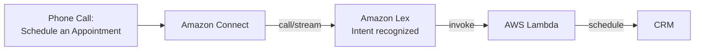

# AWS Machine Learning Services

## Key Concepts

This section of the source surveys AWS's pre-built Machine Learning / AI services — most of these let you consume ML capabilities via an API without building or training your own models. **Amazon SageMaker AI** supports broader custom model development; other services also offer task-specific customization, such as Rekognition Custom Labels and Comprehend custom classifiers.

### Simplified ML Process (from SageMaker AI slide)
The source illustrates the ML process using an example of predicting an exam score:
1. **Historical data** — e.g., years of experience in IT, years of experience with AWS, time spent on the course
2. **Label** the data
3. **Build** an ML model
4. **Train and tune** the model
5. **Apply model** to new data
6. **Prediction** — e.g., "PASS WITH 906 score"

## AWS Services / Features

### Amazon Rekognition
- Finds objects, people, text, and scenes in images and videos using ML
- Facial analysis and facial search to do user verification, people counting
- Create a database of "familiar faces" or compare against celebrities
- Use cases: Labeling, Content Moderation, Text Detection, Face Detection and Analysis (gender, age range, emotions…), Face Search and Verification, Celebrity Recognition; verify current video features rather than relying on retired Person Pathing
- Video search workflow: store video files in an S3 bucket, run Rekognition against that bucket, then use the analysis results coming out of Rekognition for enhanced search to identify videos that contain what you're looking for

**Rekognition – Content Moderation**
- Detects content that is inappropriate, unwanted, or offensive (images and videos)
- Used in social media, broadcast media, advertising, and e-commerce situations to create a safer user experience
- Set a **Minimum Confidence Threshold** for items that will be flagged
- Flag sensitive content for manual review in **Amazon Augmented AI (A2I)**
- Helps comply with regulations

### Amazon Transcribe
- Automatically converts speech to text
- Uses a deep learning process called **automatic speech recognition (ASR)** to convert speech to text quickly and accurately
- Automatically removes Personally Identifiable Information (PII) using **Redaction**
- Supports **Automatic Language Identification** for multi-lingual audio
- Use cases: transcribe customer service calls, automate closed captioning and subtitling, generate metadata for media assets to create a fully searchable archive
- Full video delivery workflow: transcribe audio/video to text, put the transcript in an S3 bucket, then translate it with Amazon Translate — this integration of Transcribe + Translate forms a full video delivery solution

### Amazon Polly
- Turns text into lifelike speech using deep learning
- Allows you to create applications that talk

**Polly – Lexicon & SSML**
- Customize the pronunciation of words with **Pronunciation lexicons**
  - Stylized words: `St3ph4ne` => "Stephane"
  - Acronyms: `AWS` => "Amazon Web Services"
- Upload the lexicons and use them in the `SynthesizeSpeech` operation
- Generate speech from plain text, or from documents marked up with **Speech Synthesis Markup Language (SSML)** — enables more customization:
  - Emphasizing specific words or phrases
  - Using phonetic pronunciation
  - Including breathing sounds, whispering
  - Using the Newscaster speaking style

### Amazon Translate
- Natural and accurate language translation
- Allows you to localize content — such as websites and applications — for international users, and to easily translate large volumes of text efficiently
- Localization: supporting multiple languages in application development, giving support for other languages
- Components: an **Encoder** reads the source text, a **Decoder** outputs the translated text
- Languages supported (per source): Arabic, Chinese (both traditional and simplified), Czech, English, French, German, Japanese, Portuguese, Russian, Spanish, Turkish
- Use cases: on-demand language translation, supporting different languages on a website, generating subtitle files

> [!WARNING]
> Text translation supports pairs among the documented languages. The **real-time document translation** feature has narrower English-to/from-supported-language rules; do not apply that restriction to all Translate operations.

### Amazon Lex & Amazon Connect
- **Amazon Lex** (same technology that powers Alexa):
  - Automatic Speech Recognition (ASR) to convert speech to text
  - Natural Language Understanding (NLU) to recognize the intent of text/callers
  - Helps build chatbots, call center bots
- **Amazon Connect**:
  - Receive calls, create contact flows, cloud-based virtual contact center
  - Can integrate with other CRM systems or AWS
  - No upfront payments, 80% cheaper than traditional contact center solutions

### Amazon Comprehend
- For **Natural Language Processing (NLP)**
- Fully managed and serverless service
- Uses machine learning to find insights and relationships in text:
  - Language of the text
  - Extracts key phrases, places, people, brands, or events
  - Understands how positive or negative the text is (sentiment)
  - Analyzes text using tokenization and parts of speech
  - For speech, first convert audio to text with **Transcribe**, then analyze that text with Comprehend
  - Automatically organizes a collection of text files by topic
- Sample use cases: analyze customer interactions (emails) to find what leads to a positive or negative experience; create and group articles by topics that Comprehend will uncover

### Amazon Comprehend Medical
- Detects and returns useful information in unstructured clinical text: physician's notes, discharge summaries, test results, case notes
- Uses NLP to detect **Protected Health Information (PHI)** via the `DetectPHI` API
- Store your documents in Amazon S3, analyze real-time data with Kinesis Data Firehose, or use Amazon Transcribe to transcribe patient narratives into text that can then be analyzed by Comprehend Medical

### Amazon SageMaker AI
- Fully managed service for developers / data scientists to build ML models
- Typically difficult to do all the ML processes in one place plus provision servers — SageMaker AI addresses this
- See the simplified ML process example under Key Concepts above

### Amazon Forecast
- Fully managed service that uses machine learning to deliver highly accurate forecasts
- Example: predicting the future sales of a raincoat — the idea is that it's going to be 50% more accurate, and reduces forecasting time from months to hours
- Use cases: Product Demand Planning, Financial Planning, Resource Planning
- Procedure:
  1. Take your historical time-series data
  2. Add your product features — prices, discounts, website traffic, locations, or any other data to enhance your model
  3. Upload this data into Amazon S3
  4. Start Amazon Forecast — it creates a forecasting model
  5. Use that forecasting model to predict the future (e.g., "sales of raincoats are going to be $50,000 next year")

### Amazon Kendra
- Fully managed document search service powered by Machine Learning
- Extract answers from within a document (text, PDF, HTML, PowerPoint, MS Word, FAQs…)
- Natural language search capabilities
- Learns from user interactions/feedback to promote preferred results (**Incremental Learning**)
- Ability to manually fine-tune search results (importance of data, freshness, custom, …)
- Data sources: Amazon S3, Amazon RDS, Google Drive, MS SharePoint, MS OneDrive, 3rd party/APNs/custom

### Amazon Personalize (Optional — Explicitly Out of SAA-C03 Scope)
- Fully managed ML service to build apps with real-time personalized recommendations
- Example: personalized product recommendations/re-ranking, customized direct marketing
- Example: user bought gardening tools, provide recommendations on the next one to buy
- Same technology used by Amazon.com
- Integrates into existing websites, applications, SMS, email marketing systems, …
- Implement in days, not months (you don't need to build, train, and deploy ML solutions yourself)
- Use cases: retail stores, media and entertainment…

> [!NOTE] Conflict resolved — Personalize integration channels
> An XMind study source listed "SNS" instead of "SMS" here. Verified 2026-07 against [AWS's official Personalize page](https://aws.amazon.com/pm/personalize/): *"integrating highly relevant recommendations into your existing website, app, push notifications, SMS, and more"* — this note's original **SMS** was correct; the mind map's "SNS" appears to be an SMS/SNS acronym mix-up.

### Amazon Textract
- Automatically extracts text, handwriting, and data from any scanned documents using AI and ML
- Extract data from forms and tables
- Read and process any type of document (PDFs, images, …)
- Use cases: Financial Services (e.g., invoices, financial reports), Healthcare (e.g., medical records, insurance claims), Public Sector (e.g., tax forms, ID documents, passports)

### Amazon Fraud Detector
- Detect online fraud faster using machine learning
- Build, deploy, and manage fraud detection models
- Gain insights from your historical data
- Free with the AWS Free Tier — up to 30,000 fraud predictions per month
- Fully managed service
- Use cases: identify suspicious online payments, detect new account fraud, prevent trial and loyalty program abuse, improve account takeover detection

### AWS Machine Learning — Summary (per source)
| Service | Function |
|---|---|
| Rekognition | Face detection, labeling, celebrity recognition |
| Transcribe | Audio to text (e.g., subtitles) |
| Polly | Text to audio |
| Translate | Translations |
| Lex | Build conversational bots — chatbots |
| Connect | Cloud contact center |
| Comprehend | Natural language processing |
| SageMaker | Machine learning for every developer and data scientist |
| Forecast | Highly accurate forecasts from historical time-series data |
| Kendra | ML-powered search engine |
| Personalize | Real-time personalized recommendations |
| Textract | Detect text and data in documents |
| Fraud Detector | Detect online fraud using machine learning |

## Exam Tips
> [!TIP]
> Match the service to the input/output direction: **Transcribe** = speech → text; **Polly** = text → speech; **Translate** = text → text (different language). Don't mix these up.

> [!TIP]
> **Textract** extracts text/data/handwriting *from documents* (forms, tables, scans). **Comprehend** analyzes *text you already have* for meaning (sentiment, key phrases, entities, language, topics). **Kendra** is a *search engine* over your documents. A common exam pattern is "extract data from scanned forms" → Textract, vs. "understand sentiment in customer emails" → Comprehend, vs. "let users search across our document repository in natural language" → Kendra.

> [!WARNING]
> **Comprehend Medical** is a distinct service from Comprehend — it's specialized for unstructured *clinical* text (physician's notes, discharge summaries) and detecting PHI via `DetectPHI`. Don't confuse it with general-purpose Comprehend.

> [!TIP]
> **Lex** vs **Connect**: Lex is the conversational/chatbot engine (ASR + NLU, same tech as Alexa); Connect is the cloud contact center that receives calls and builds contact flows. They're typically used together (Connect receives the call, Lex recognizes intent, Lambda executes the action).

> [!TIP]
> Use **SageMaker AI** for broader model building/training/deployment. Managed AI APIs can also support custom models within their specialty, including Rekognition Custom Labels and Comprehend custom classification.

## Related Notes
- [[00-Cluster-MOC]]

## Checked corrections — 2026-11-09

Only the changes listed here were verified in this audit; other course-derived details still need checking when used.

- Corrected Translate feature restrictions, Comprehend input and custom-model claims; labeled Personalize out of scope.
  - [AWS documentation](https://docs.aws.amazon.com/translate/latest/dg/what-is-languages.html)
  - [AWS documentation](https://docs.aws.amazon.com/comprehend/latest/dg/what-is.html)
  - [AWS documentation](https://docs.aws.amazon.com/rekognition/latest/customlabels-dg/what-is.html)
  - [AWS documentation](https://docs.aws.amazon.com/aws-certification/latest/solutions-architect-associate-03/saa-03-out-of-scope-services.html)
