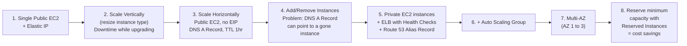
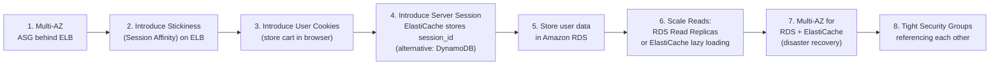
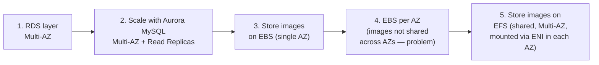
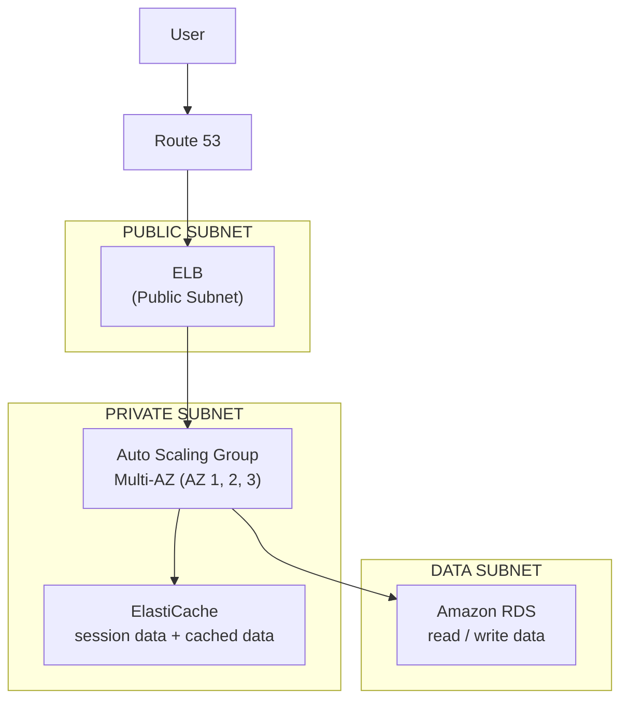
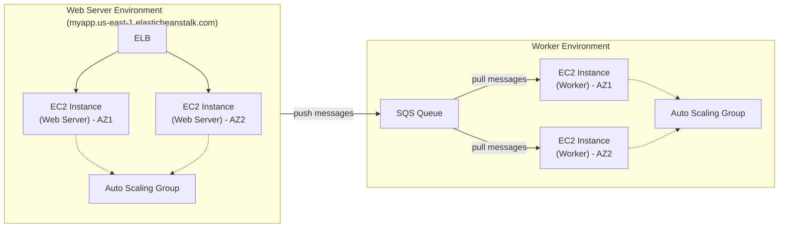

# Classic Solutions Architecture

## Key Concepts

### Section Purpose
- The source frames this as "the best part of the course" — understanding how all previously-learned AWS technologies work together
- The lecture walks through the Solutions Architect journey using three progressively harder sample case studies:
  - **WhatIsTheTime.com** — a stateless web app
  - **MyClothes.com** — a stateful web app (e-commerce, shopping cart)
  - **MyWordPress.com** — a stateful web app needing shared file storage
- Also covers instantiating applications quickly, and Elastic Beanstalk

### WhatIsTheTime.com — Stateless Web App
- Requirements from the source: no database needed, can accept downtime initially, must be able to scale fully both vertically and horizontally with no downtime eventually
- The architecture evolves through these stages:

- Key lessons captured at each stage:
  - **Elastic IP** attached to a single public EC2 instance — works, but no scaling and no HA
  - **Vertical scaling** (resizing to a bigger instance type, e.g. to M5) causes **downtime** during the upgrade
  - **Horizontal scaling** with public EC2 instances (no EIP) requires **Route 53 DNS A Record** with a TTL (e.g. 1 hour) — but a stale DNS record can point to an instance that has since been terminated
  - The fix: move instances to **private subnets**, front them with an **ELB + health checks**, and use a **Route 53 Alias Record** (not a plain A record) pointing at the load balancer
  - Add an **Auto Scaling Group** so instances are managed and replaced automatically
  - Make the app **Multi-AZ** (spanning Availability Zone 1 to 3) to survive an AZ-level disaster
  - Reserve minimum ASG capacity with **Reserved Instances** for cost savings, since a baseline number of instances will always be running

### MyClothes.com — Stateful Web App
- Requirements from the source: online clothing store with a shopping cart, hundreds of concurrent users, must scale and stay as stateless as possible, users must not lose their cart, and user details (address etc.) must persist in a database

- **ELB Stickiness (Session Affinity)**: routes a given user consistently to the same backend instance
- **Web Cookies approach** (store shopping cart client-side): keeps the app stateless, but has trade-offs per the source:
  - HTTP requests are heavier
  - Security risk — cookies can be altered
  - Cookies must be validated
  - Cookies must be less than 4 KB
- **Server Session approach**: send only a `session_id` in the cookie; store/retrieve actual session data in **ElastiCache** (or **DynamoDB** as an alternative)
- **RDS** stores persistent user data (address, name, etc.)
- **Scaling reads** — two approaches given in the source:
  - **RDS Read Replicas**: RDS Master handles writes, replicates to read replicas
  - **Lazy Loading (cache-aside) with ElastiCache**: read from cache on a hit; on a miss, read from RDS and populate the cache
- **Multi-AZ** applied to both **ElastiCache** and **RDS** for disaster recovery
- **Security Groups** reference each other for tight security:
  - EC2 security group only accepts traffic from the LB's security group
  - RDS security group only accepts traffic from the EC2 security group
  - ElastiCache security group only accepts traffic from the EC2 security group
  - Only the LB has HTTP/HTTPS open to `0.0.0.0/0`

### MyWordPress.com — Stateful Web App with Shared Storage
- Requirements from the source: fully scalable WordPress site, correctly displaying picture uploads across instances, user data and blog content stored in MySQL

- **Aurora MySQL** chosen over plain RDS MySQL because it makes Multi-AZ and Read Replicas easier
- **EBS Volume** for image storage works for a **single-instance application**, but is tied to one Availability Zone — an EBS volume in AZ-1 is not visible to an instance in AZ-2
- **EFS** solves this: it is a distributed, Multi-AZ file system mounted via an **ENI** in each AZ, so all instances (in any AZ) see the same uploaded images
- Lecture summary from the source: "Aurora Database to have easy Multi-AZ and Read-Replicas • Storing data in EBS (single instance application) • Vs Storing data in EFS (distributed application)"

### Instantiating Applications Quickly
- Problem: launching a full stack (EC2, EBS, RDS) from scratch is slow — installing applications, inserting initial/recovery data, configuring everything, then launching
- Ways to speed this up, per the source:
  - **EC2 Instances**:
    - **Golden AMI** — install applications and OS dependencies beforehand, launch instances directly from that AMI
    - **Bootstrap via User Data** — for dynamic configuration at launch time
    - **Hybrid** — mix of Golden AMI and User Data (this is what **Elastic Beanstalk** does)
  - **RDS Databases**: restore from a **snapshot** — schema and data are ready immediately
  - **EBS Volumes**: restore from a **snapshot** — the disk is already formatted and populated with data

### Typical Web App 3-Tier Architecture
- The source presents a canonical reference diagram combining everything learned:

- Three subnet tiers: **PUBLIC SUBNET** (ELB), **PRIVATE SUBNET** (ASG of app servers + ElastiCache), **DATA SUBNET** (RDS)

### Elastic Beanstalk
- **Developer problems on AWS** the source identifies: managing infrastructure, deploying code, configuring databases/load balancers, scaling — while most web apps share the same underlying architecture (ALB + ASG), and developers just want their code to run, consistently, across environments
- **Elastic Beanstalk Overview**:
  - A **developer-centric** view of deploying an application on AWS
  - Uses components already covered: EC2, ASG, ELB, RDS, etc.
  - A **managed service**: automatically handles capacity provisioning, load balancing, scaling, application health monitoring, instance configuration
  - Only the **application code** is the developer's responsibility — but you still have full control over configuration
  - **Elastic Beanstalk itself is free; you pay for the underlying resources** (EC2, ELB, RDS, etc.)
- **Elastic Beanstalk Components**:
  - **Application** — a collection of Elastic Beanstalk components (environments, versions, configurations)
  - **Application Version** — an iteration of your application code
  - **Environment** — a collection of AWS resources running one application version at a time; tiers are **Web Server Environment Tier** and **Worker Environment Tier**; you can create multiple environments (dev, test, prod)
  - Workflow: Create Application → Upload Version → Launch Environment → Manage Environment (update version / deploy new version)
- **Supported Platforms** (per the source): Go, Java SE, Java with Tomcat, .NET Core on Linux, .NET on Windows Server, Node.js, PHP, Python, Ruby, Packer Builder, Single Container Docker, Multi-container Docker, Preconfigured Docker

### Web Server Tier vs. Worker Tier

- Worker tier **scales based on the number of SQS messages**; the web server tier can push messages into the SQS queue for the worker tier to process asynchronously

### Elastic Beanstalk Deployment Modes
- **Single Instance** — great for Dev: one EC2 instance with an Elastic IP, plus one RDS instance (single AZ)
- **High Availability with Load Balancer** — great for Prod: an ALB in front of an Auto Scaling Group spanning Availability Zone 1 and 2, with an RDS Master + RDS Standby (Multi-AZ)

## AWS Services / Features

| Service | Role in these architectures |
|---|---|
| Amazon EC2 | Compute; public or private instances behind a load balancer |
| Elastic IP | Static public IP for a single instance (no scaling) |
| Route 53 | DNS — A Records (TTL-based) or Alias Records (pointing to AWS resources like ELB) |
| Elastic Load Balancing (ELB) | Distributes traffic, performs health checks, supports session Stickiness |
| Auto Scaling Group (ASG) | Automatically replaces/scales EC2 instances, supports Multi-AZ |
| Amazon RDS | Relational database; supports Read Replicas (scale reads) and Multi-AZ (DR) |
| Amazon Aurora | MySQL/PostgreSQL-compatible; simplifies Multi-AZ and Read Replicas |
| Amazon ElastiCache | In-memory cache; used for session storage and lazy-loading cache-aside pattern |
| Amazon DynamoDB | Alternative to ElastiCache for storing session data |
| Amazon EBS | Block storage tied to a single AZ; good for single-instance apps |
| Amazon EFS | Distributed, Multi-AZ file system; good for apps needing shared storage across instances |
| AWS Elastic Beanstalk | Managed PaaS wrapping EC2/ASG/ELB/RDS for developer-centric deployment |
| Amazon SQS | Decouples Web Tier from Worker Tier in Elastic Beanstalk |

## Exam Tips
> [!TIP]
> The **evolution path** (single EC2 → vertical scaling → horizontal scaling with DNS → ELB + health checks → ASG → Multi-AZ → Reserved Instances for baseline capacity) is a recurring exam narrative. Recognize *why* each step is needed, not just the end state.

> [!TIP]
> For stateful apps, know the **three ways to preserve session/cart state**: (1) ELB Stickiness, (2) Client-side Web Cookies, (3) Server-side session in ElastiCache or DynamoDB. Each has different trade-offs the exam may probe.

> [!TIP]
> **EBS vs EFS** for a distributed/scaled application: EBS is single-AZ and attaches to one instance at a time; EFS is Multi-AZ and mountable by many instances concurrently. When a scenario says "multiple EC2 instances across AZs need to share the same files," the answer is EFS (or S3), not EBS.

> [!WARNING]
> A plain **Route 53 A Record with TTL** can go stale and point to a terminated instance. An **Alias Record** pointing at an ELB (or other AWS resource) avoids this problem — the exam frequently tests A Record vs Alias Record distinctions.

> [!WARNING]
> Elastic Beanstalk's **Worker Tier** pulls from an **SQS queue** — it does not receive direct HTTP traffic. If a scenario describes background/async job processing decoupled via a queue, that is the Worker Tier pattern, not the Web Server Tier.

> [!TIP]
> Elastic Beanstalk is **free** — you only pay for the underlying resources it provisions (EC2, ELB, RDS, etc.).

## Related Notes
- [[02-More-Solutions-Architecture]]
- [[03-Disaster-Recovery-Migrations]]
- [[00-Cluster-MOC]]
