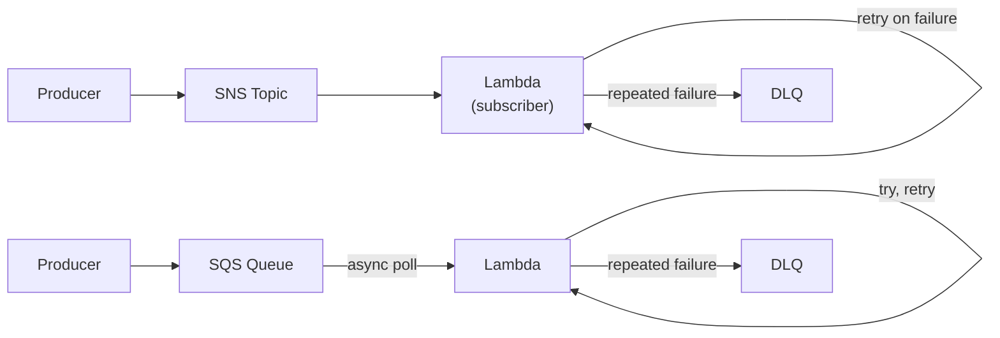
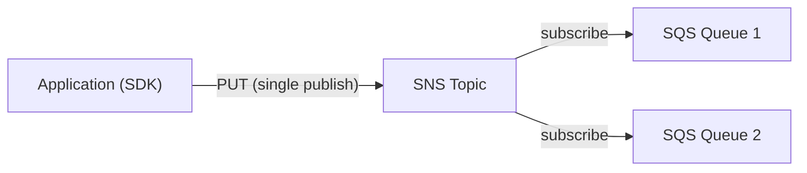
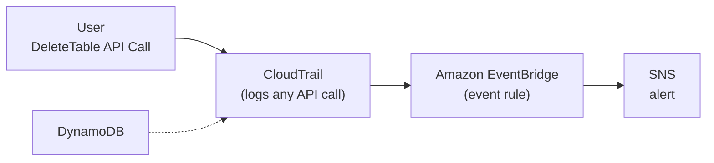
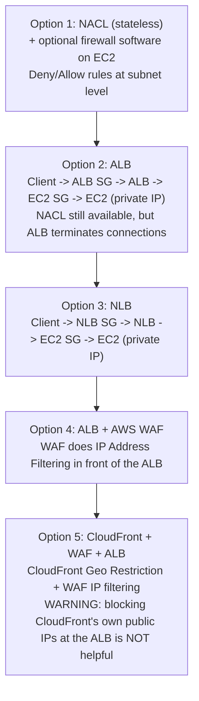
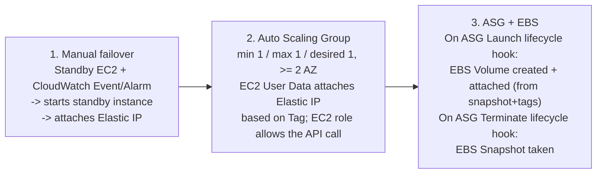

# More Solutions Architecture

## Key Concepts

### Lambda, SNS & SQS Patterns
- The source shows message-processing reliability patterns combining Lambda, SNS, and SQS:
  - **SQS + Lambda**: Lambda polls SQS **asynchronously**; failed processing triggers **retries**; after repeated failures, messages go to a **Dead Letter Queue (DLQ)**
  - **SQS FIFO + Lambda**: same retry pattern, but a failed message in a FIFO queue **blocks** the queue until it's resolved or moved to a DLQ ("Try, retry... blocking DLQ")
  - **SNS + Lambda**: SNS pushes to Lambda directly; failures trigger retries as well

### Fan-Out Pattern
- **Option 1**: an application (via SDK) issues multiple direct `PUT` calls to separate SQS queues — tightly coupled, more application logic
- **Option 2 — Fan Out**: application publishes **once** to an **SNS topic**; multiple **SQS queues subscribe** to that topic and each receives a copy of the message

### S3 Event Notifications
- S3 can emit events such as `S3:ObjectCreated`, `S3:ObjectRemoved`, `S3:ObjectRestore`, `S3:Replication`, etc.
- Events can be filtered by **object name** (e.g. `*.jpg`)
- Common use case: generate thumbnails of images uploaded to S3
- Destinations: **Lambda Function**, **SQS**, **SNS**
- You can create as many S3 event notification rules as desired
- Delivery is typically within seconds, but the source notes it **can sometimes take a minute or longer**

### S3 Event Notifications with Amazon EventBridge
- All S3 bucket events can be routed through **Amazon EventBridge**
- Benefits over native S3 event notifications:
  - **Advanced filtering** with JSON rules (metadata, object size, name...)
  - **Multiple destinations** — over 18 AWS services, e.g. Step Functions, Kinesis Data Streams / Firehose
  - **EventBridge capabilities**: Archive, Replay Events, reliable delivery

### EventBridge — Intercepting API Calls
- **CloudTrail** logs any API call; **EventBridge** can react to specific API events (e.g. a `DeleteTable` API call) and route them to a target such as **SNS** for an alert, providing near real-time notification of dangerous/sensitive actions

### API Gateway — AWS Service Integration
- API Gateway can integrate directly with AWS services without a Lambda in between
- Example from the source (Kinesis Data Streams): **Client → API Gateway → Kinesis Data Streams → Kinesis Data Firehose → Amazon S3** (records sent, then stored as `.json` files)

### Caching Strategies
- The source presents a general caching stack across a request path:
  - **CloudFront** (edge caching, closest to the client)
  - **API Gateway** (caching for API responses)
  - **Application-level caching**: Redis, Memcached, DAX (for DynamoDB) sitting between App Logic (EC2/Lambda) and the Database
  - **S3** also has caching behavior via CloudFront
- Considerations when choosing a caching strategy: **Caching, TTL, Network, Computation, Cost, Latency**

### Blocking an IP Address — Progressive Options
- The source walks through several layers at which you can block a client IP, from EC2-level up to the edge:

- Key distinctions:
  - **NACL**: subnet-level, stateless, supports explicit **Deny** and **Allow** rules — can block a specific IP
  - **Security Groups**: instance/ALB/NLB-level, **stateful**, only support **Allow** rules (no explicit Deny) — cannot block a specific IP by itself
  - **AWS WAF**: attaches to ALB (or CloudFront/API Gateway) and supports **IP Address Filtering** rules directly
  - **CloudFront + WAF**: adds **Geo Restriction** at the edge; but per the source, trying to block CloudFront's own IPs at the ALB layer is **NOT helpful**, since CloudFront uses many public IPs

### High Performance Computing (HPC) on AWS
- The cloud is well suited to HPC: create a very high number of resources quickly, speed up time-to-results by adding more resources, pay only for what's used
- Use cases: genomics, computational chemistry, financial risk modeling, weather prediction, machine learning, deep learning, autonomous driving
- **Data Management & Transfer**:
  - **AWS Direct Connect** — move GB/s of data to the cloud over a private, secure network
  - **Snowball & Snowmobile** — move PB of data to the cloud
  - **AWS DataSync** — move large amounts of data between on-premises and S3, EFS, FSx for Windows
- **Compute and Networking**:
  - EC2 Instances: CPU-optimized, GPU-optimized; Spot Instances/Spot Fleets for cost savings + Auto Scaling
  - **EC2 Placement Groups: Cluster** — same rack, same AZ, low latency, 10 Gbps network
  - **EC2 Enhanced Networking (SR-IOV)**: higher bandwidth, higher PPS, lower latency
    - **Elastic Network Adapter (ENA)** — up to 100 Gbps
    - **Intel 82599 VF** — up to 10 Gbps (**LEGACY**)
  - **Elastic Fabric Adapter (EFA)** — improved ENA for HPC, Linux only; great for inter-node communication and tightly coupled workloads; leverages the **Message Passing Interface (MPI)** standard; bypasses the underlying Linux OS for low-latency, reliable transport
- **Storage**:
  - Instance-attached: **EBS** (up to 256,000 IOPS with io2 Block Express), **Instance Store** (millions of IOPS, linked to the EC2 instance, low latency)
  - Network storage: **Amazon S3** (large blob, not a file system), **Amazon EFS** (IOPS scale with total size, or provisioned IOPS), **Amazon FSx for Lustre** (HPC-optimized distributed file system, millions of IOPS, backed by S3)
- **Automation and Orchestration**:
  - **AWS Batch** — supports multi-node parallel jobs spanning multiple EC2 instances; schedule jobs and launch EC2 instances accordingly
  - **AWS ParallelCluster** — open-source cluster management tool to deploy HPC on AWS; configured with text files; automates creation of VPC, Subnet, cluster type, instance types; can enable EFA on the cluster

### Creating a Highly Available EC2 Instance (Single-Instance HA Patterns)
- The source presents three progressively more automated ways to keep a single-purpose EC2 app highly available:

- Pattern 1: a **standby EC2 instance** is monitored; a **CloudWatch Event/Alarm** triggers starting the standby instance and attaching the Elastic IP to it
- Pattern 2: an **Auto Scaling Group** with min=1, max=1, desired=1, spanning **2+ AZs**; EC2 **User Data** (based on instance Tag) re-attaches the Elastic IP to whichever instance the ASG launches; the EC2 instance role must allow the API call to attach the EIP
- Pattern 3: adds **EBS** persistence via **ASG lifecycle hooks** — on **Launch**, a new EBS volume is created (from the latest snapshot + tags) and attached; on **Terminate**, an EBS snapshot is taken before the instance goes away — so data isn't lost even though instances are ephemeral

## AWS Services / Features

| Service | Role |
|---|---|
| Amazon SNS | Pub/sub messaging; fan-out to multiple SQS queues or Lambda; single publish → multiple subscribers |
| Amazon SQS (Standard & FIFO) | Decoupling / buffering; supports DLQ for repeated failures; FIFO blocks on failed message until resolved |
| AWS Lambda | Event-driven compute; polls SQS or is invoked by SNS/S3/EventBridge |
| Amazon EventBridge | Event bus; advanced filtering, many destinations, archive/replay; can react to CloudTrail-logged API calls |
| AWS CloudTrail | Logs API calls; source for EventBridge to detect sensitive actions (e.g. `DeleteTable`) |
| Amazon API Gateway | Can integrate directly with AWS services (e.g. Kinesis) without Lambda |
| Amazon CloudFront | Edge caching; Geo Restriction |
| AWS WAF | IP Address Filtering; attaches to ALB, CloudFront, API Gateway |
| Network ACL (NACL) | Stateless, subnet-level; supports explicit Deny rules to block an IP |
| Security Groups | Stateful, instance/LB-level; Allow rules only |
| EC2 Placement Groups (Cluster) | Low-latency, high-throughput networking for HPC within one AZ |
| Elastic Network Adapter (ENA) / EFA | Enhanced networking for HPC; EFA is Linux-only, MPI-based |
| AWS Batch | Multi-node parallel batch jobs across EC2 instances |
| AWS ParallelCluster | Open-source HPC cluster orchestration on AWS |
| Amazon FSx for Lustre | HPC-optimized distributed file system backed by S3 |

## Exam Tips
> [!TIP]
> **Fan-out pattern = SNS + multiple SQS subscribers.** If a scenario needs one event to trigger several independent, decoupled consumers (each with its own queue and retry/DLQ behavior), the answer is SNS fanning out to SQS — not one application making multiple direct PUT calls.

> [!TIP]
> Prefer **S3 Event Notifications routed through EventBridge** over native S3 events when you need advanced JSON filtering (by metadata or object size) or more than the native few destinations (Lambda/SQS/SNS) — EventBridge supports 18+ destinations plus archive/replay.

> [!WARNING]
> **Security Groups cannot explicitly deny/block a specific IP** — they only support Allow rules. To block a specific IP, use a **NACL** (stateless, supports Deny) or **AWS WAF** (IP Address Filtering rule).

> [!WARNING]
> When CloudFront sits in front of an ALB, **blocking IPs at the ALB security group does not help** block end users, because CloudFront's own public IPs (which vary) are what reach the ALB. Do IP/Geo filtering at **CloudFront + WAF**, closer to the actual client.

> [!TIP]
> For HPC exam scenarios: **EFA** = Linux-only, MPI-based, tightly-coupled inter-node communication. **ENA** = general enhanced networking up to 100 Gbps. **Placement Groups (Cluster)** = same rack/AZ for low latency. **FSx for Lustre** = the go-to HPC file system, backed by S3.

> [!TIP]
> The **ASG + EBS lifecycle hook pattern** (create/attach EBS on Launch, snapshot on Terminate) is how you preserve state on an otherwise stateless, auto-scaled single-instance-style EC2 architecture — remember this combination for exam scenarios needing both HA and persistent single-instance data.

## Related Notes
- [[01-Classic-Solutions-Architecture]]
- [[03-Disaster-Recovery-Migrations]]
- [[04-Other-Services]]
- [[00-Cluster-MOC]]
