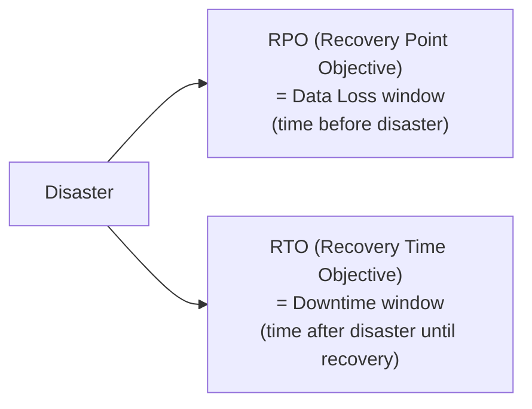
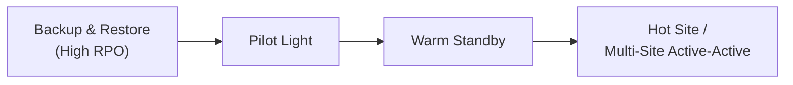
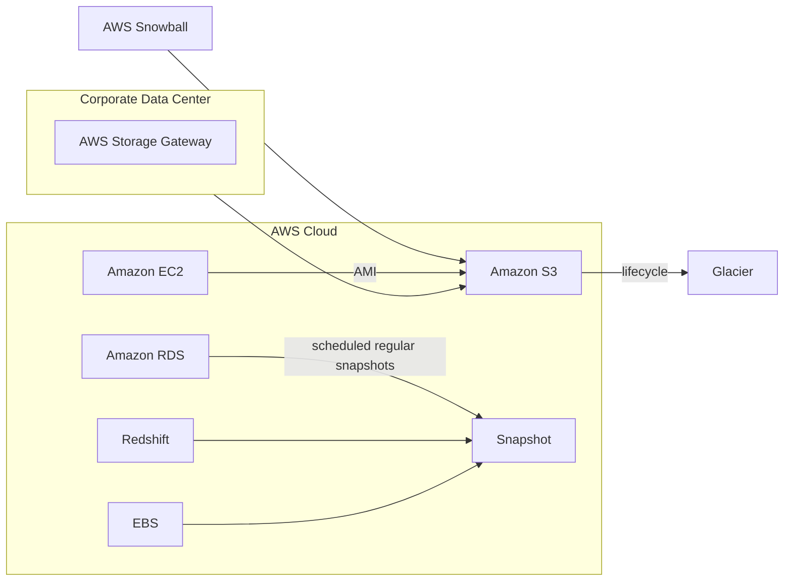
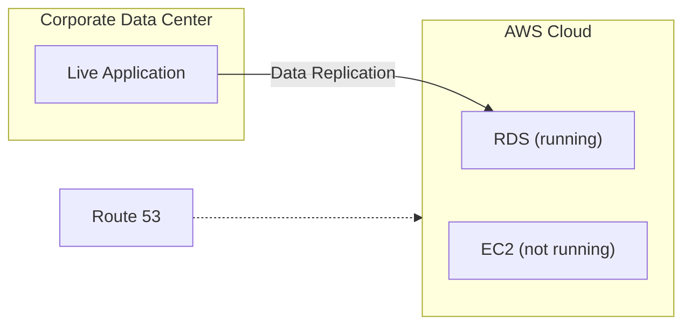
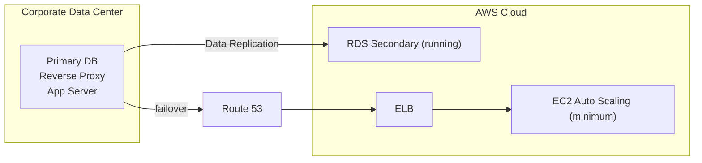
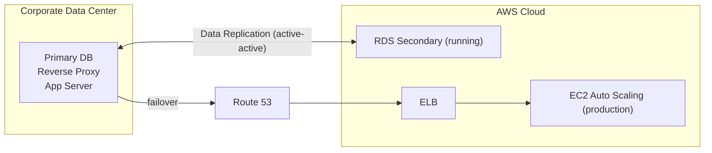
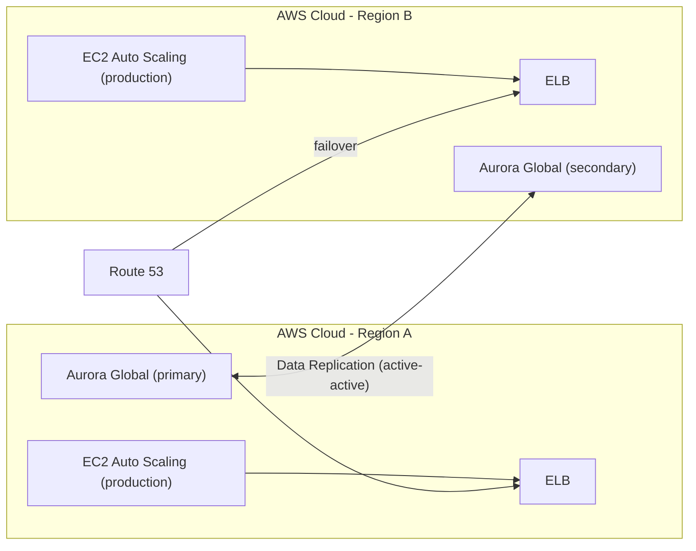
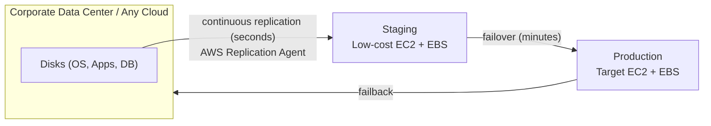
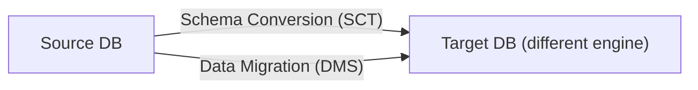
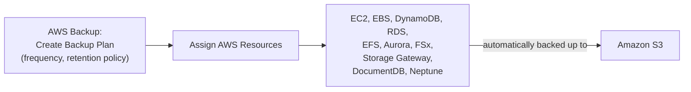

# Disaster Recovery & Migrations

## Key Concepts

### Disaster Recovery Overview
- **Disaster**: any event that has a negative impact on a company's business continuity or finances
- **Disaster Recovery (DR)**: preparing for and recovering from a disaster
- Three kinds of DR scenarios, per the source:
  - **On-premise → On-premise**: traditional DR, very expensive
  - **On-premise → AWS Cloud**: hybrid recovery
  - **AWS Cloud Region A → AWS Cloud Region B**
- Two terms to know:
  - **RPO — Recovery Point Objective**: how much data loss (measured in time) is acceptable
  - **RTO — Recovery Time Objective**: how much downtime is acceptable

### The Four DR Strategies
- Ordered by the source from slowest/cheapest to fastest/most expensive ("Faster RTO" arrow):

#### Backup and Restore (High RPO)

- Regular backups/snapshots pushed to S3 (or Glacier via lifecycle policy); recovery means restoring from those backups — simplest and cheapest, but **highest RPO/RTO**

#### Pilot Light

- A **small, critical core** of the system (e.g. the database) is **always running** in the cloud; the rest (e.g. EC2 app servers) is **provisioned but not running**
- Very similar to Backup and Restore, but **faster** since the critical systems are already up

#### Warm Standby

- A **full system is up and running, but at minimum size**; upon disaster, the environment scales up to production load

#### Multi-Site / Hot Site Approach

- **Very low RTO** (minutes or seconds) — but **very expensive**
- **Full production scale** running in both AWS and on-premises, active-active

#### All-AWS Multi-Region Active-Active

- Both regions run production-scale AWS infrastructure with **Aurora Global Database** replicating between a primary and secondary — the pattern the source shows for a fully AWS-native active-active setup

### DR Strategy Comparison

| Strategy | RPO | RTO | Cost | What's running before disaster |
|---|---|---|---|---|
| **Backup & Restore** | High (hours) | Slowest (hours) | Lowest | Nothing — only backups/snapshots in S3/Glacier |
| **Pilot Light** | Lower | Faster than B&R | Low-Medium | Only the critical core (e.g. DB) running; app servers provisioned but off |
| **Warm Standby** | Low | Fast | Medium-High | Full system running at **minimum** scale; scales up on failover |
| **Multi-Site / Hot Site (Active-Active)** | Very low / near-zero | Fastest (minutes or seconds) | Highest | Full **production-scale** system running in both sites simultaneously |

> [!IMPORTANT]
> This RTO/RPO/cost ordering — **Backup & Restore < Pilot Light < Warm Standby < Multi-Site Active-Active**, with RTO/RPO decreasing and cost increasing left to right — is one of the most heavily tested patterns in the exam (Domain 2, Task 2.2). Memorize the ordering and what's actually "running" in each.

### Disaster Recovery Tips (from the source)
- **Backup**: EBS Snapshots, RDS automated backups/snapshots; regular pushes to S3 / S3 IA / Glacier with Lifecycle Policy and Cross-Region Replication; from on-premises use **Snowball** or **Storage Gateway**
- **High Availability**: use **Route 53** to migrate DNS from Region to Region; RDS Multi-AZ, ElastiCache Multi-AZ, EFS, S3; **Site-to-Site VPN** as a recovery path if Direct Connect fails
- **Replication**: RDS Cross-Region Replication, **Aurora Global Databases**; database replication from on-premises to RDS; **Storage Gateway**
- **Automation**: CloudFormation / Elastic Beanstalk to re-create a whole environment; recover/reboot EC2 instances with CloudWatch alarms; Lambda functions for custom automation
- **Chaos**: intentionally inject failure to test resilience (the source cites Netflix's "simian-army" randomly terminating EC2 instances)

### AWS Elastic Disaster Recovery (DRS)
- Formerly named **CloudEndure Disaster Recovery**
- Quickly and easily recover physical, virtual, and cloud-based servers into AWS
- Example use cases: protect critical databases (Oracle, MySQL, SQL Server), enterprise apps (SAP), protect data from ransomware attacks
- **Continuous block-level replication** of servers

### Database Migration Service (DMS)
- Quickly and securely migrate databases to AWS; resilient, self-healing
- The **source database remains available** during the migration
- Supports:
  - **Homogeneous migrations** — e.g. Oracle → Oracle
  - **Heterogeneous migrations** — e.g. Microsoft SQL Server → Aurora
  - **Continuous Data Replication** using **CDC (Change Data Capture)**
  - **One-time data migration** into RDS and EC2-based databases
- Use DMS-managed provisioned replication resources or a supported **DMS Serverless** configuration; you do not universally create/manage an EC2 instance yourself.
- **Continuous replication** can also **consolidate databases into a petabyte-scale data warehouse** by streaming data to **Redshift and S3**
- Replication can run from data center → AWS or AWS → data center (reverse direction); **on-premises to on-premises replication is not supported**
- **Basic Schema Copy**: quickly migrate a database schema to the target instance — creates tables and primary keys only in the target; does **not** migrate secondary indexes, foreign keys, or stored procedures. For a more customizable schema migration process, use **AWS SCT** instead
- **Pricing**: pay for the compute resources used during the migration process, plus any additional log storage; data cache for most replications and inbound data transfer is free

**DMS Sources and Targets** (per the source):
| | Examples |
|---|---|
| Sources | On-premises and EC2 databases (Oracle, MS SQL Server, MySQL, MariaDB, PostgreSQL, MongoDB, SAP, DB2); Azure SQL Database; Amazon RDS (all, including Aurora); Amazon S3; DocumentDB |
| Targets | On-premises and EC2 databases (Oracle, MS SQL Server, MySQL, MariaDB, PostgreSQL, SAP); Amazon RDS; Redshift, DynamoDB, S3; OpenSearch Service; Kinesis Data Streams; Apache Kafka; DocumentDB & Amazon Neptune; Redis & Babelfish |

### AWS Schema Conversion Tool (SCT)
- Converts a database's **schema** from one engine to another (e.g. OLTP: SQL Server/Oracle → MySQL, PostgreSQL, Aurora; OLAP: Teradata/Oracle → Redshift)
- Prefer compute-intensive instances to optimize conversions
- **You do NOT need SCT if migrating between the same DB engine** — e.g. on-premise PostgreSQL → RDS PostgreSQL doesn't need schema conversion since the engine is unchanged (RDS is just the platform)
- DMS + SCT together: SCT converts the schema, DMS migrates and replicates the data

### DMS — Continuous Replication & Multi-AZ
- Typical setup: source Oracle DB on-premises → **AWS DMS Replication Instance** (in a public subnet) → **Amazon RDS for MySQL** (target, in a private subnet); a server with AWS SCT installed does the schema conversion; DMS does the **full load + CDC**
- **Multi-AZ DMS Deployment**: when enabled, DMS provisions and maintains a **synchronous standby replication instance** in a different AZ
  - Advantages: data redundancy, eliminates I/O freezes, minimizes latency spikes

### RDS & Aurora MySQL / PostgreSQL Migrations
- **RDS MySQL → Aurora MySQL**:
  - Option 1: DB Snapshot from RDS MySQL, restored as an Aurora MySQL DB
  - Option 2: create an **Aurora Read Replica** from RDS MySQL; once replication lag reaches 0, promote it to its own DB cluster (can take time and cost money)
- **External MySQL → Aurora MySQL**:
  - Option 1: use **Percona XtraBackup** to create a file backup in S3, then create an Aurora MySQL DB from S3
  - Option 2: create an Aurora MySQL DB, then use **mysqldump** to migrate data (slower than the S3 method)
  - Use **DMS** if both databases are up and running
- **RDS PostgreSQL → Aurora PostgreSQL**: same snapshot / read-replica-promotion options as MySQL
- **External PostgreSQL → Aurora PostgreSQL**: create a backup, put it in S3, import using the **aws_s3 Aurora extension**; or use DMS if both DBs are live

### On-Premise Migration Strategy Toolkit
- **VM Import/Export**: download Amazon Linux 2 AMI as a VM (`.iso`) for VMware, KVM, VirtualBox (Oracle VM), Microsoft Hyper-V; migrate existing apps into EC2; create a DR repository strategy for on-premises VMs; can export VMs back from EC2 to on-premises
- **AWS Application Discovery Service**: gathers information about on-premises servers to plan a migration — server utilization and dependency mappings; tracked via **AWS Migration Hub**
- **AWS Database Migration Service (DMS)**: replicates On-premise ⇄ AWS, AWS ⇄ AWS, AWS ⇄ On-premise; works with Oracle, MySQL, DynamoDB, etc.
- **AWS Application Migration Service (MGN)**: incremental replication of on-premises live servers to AWS

### AWS Migration Hub
- Helps you **discover the tools you need** to simplify migration and modernization
- Provides a **central location** to collect server and application inventory data for the **assessment, planning, and tracking** of migrations to AWS
- Also helps **accelerate application modernization** following migration
- Use cases: assess and plan your migration; automate lift-and-shift migrations to AWS; refactor legacy applications
- How Migration Hub relates to the other migration services (per the source):
  - **Application Migration Service (MGN)** — quickly realize the benefits of migrating applications to the cloud
  - **Application Discovery Service** — helps enterprise customers plan migration projects by gathering information about their on-premises data centers
  - **Database Migration Service (DMS)** — helps you migrate databases to AWS easily and securely
  - **Server Migration Service (SMS)** — makes it easier and faster to migrate thousands of on-premises workloads to AWS
  - **Snow Family** — used where there's a lack of consistent network connectivity
  - **DataSync** — a data transfer service that automates moving data between on-premises storage and S3 or EFS
  - **Transfer Family** — fully managed support for file transfers directly into and out of S3 or EFS

### AWS Application Discovery Service (detail)
- Plan migration projects by gathering info about on-premises data centers; server utilization data and dependency mapping matter for migrations
- Gathers usage and configuration data about on-premises servers to plan your migration to AWS
- Gains a comprehensive snapshot of on-premises inventory to work with AWS experts and accelerate the migration
- **Protects collected data by encrypting it in transit to AWS and at rest** within the service's data store
- **Agentless Discovery** (AWS Agentless Discovery Connector): VM inventory, configuration, and performance history (CPU, memory, disk usage)
- **Agent-based Discovery** (AWS Application Discovery Agent): system configuration, system performance, running processes, network connection details between systems
- Resulting data viewable within **AWS Migration Hub**
- Use cases:
  - **Discover on-premises server inventory**
  - **Map network communication patterns** — examine the connections between applications and servers to uncover unknown servers, better understand dependencies, and establish move groups
  - **Mobilize for migration**

### AWS Application Migration Service (MGN) — detail
- The "AWS evolution" of **CloudEndure Migration**, replacing the older **AWS Server Migration Service (SMS)**
- A **lift-and-shift (rehost)** solution to simplify migrating applications to AWS
- Migrates applications from **any source infrastructure that runs supported operating systems**
- Converts physical, virtual, and cloud-based servers to run natively on AWS
- Supports a wide range of platforms, OSes, and databases; minimal downtime, reduced costs
- **Modernize** your applications during migration with options such as:
  - Disaster recovery
  - Operating system conversion
  - License conversion
- Additional features:
  - Migrate applications running on **other public clouds** to AWS
  - Migrate your **EC2 workloads across AWS Regions, Availability Zones, or accounts**
- Flow: source disks (OS/Apps/DB) → **AWS Replication Agent** → continuous replication → **Staging** (low-cost EC2 + EBS) → **cutover** → **Production** (target EC2 + EBS)

**SMS vs MGN** (per the source):
| | Replication Method |
|---|---|
| **MGN** | Continuous, **block-level** replication |
| **SMS** | Incremental, **snapshot-based** replication |

### AWS Server Migration Service (SMS) — legacy, superseded by MGN
> [!WARNING]
> Per the source, AWS Server Migration Service (SMS) is the **legacy** migration tool being superseded by **AWS Application Migration Service (MGN)** — see the "SMS vs MGN" comparison above.

- An **agentless service** for migrating thousands of on-premises workloads to AWS
- SMS orchestrates server migrations by:
  - Automating **incremental replication** of live server volumes to the AWS cloud
  - Allowing customers to **schedule replications**
  - Tracking the replication progress of a group of servers via the **Management Console**
- Features:
  - Each server volume replicated is saved as a **new AMI**
  - Creates a **new EBS snapshot** with every replication
  - Can migrate virtual machines from **VMware vSphere** and **Windows Hyper-V** to AWS
  - Can replicate on-premises servers to AWS for **up to 90 days**
  - Able to migrate large volumes **up to 16 TB**
  - Offers **multi-server migration support** — migrate entire application stacks
- **AWS Server Migration Service Connector**: a pre-configured **FreeBSD virtual machine** (in OVA format); to use AWS SMS, first deploy the SMS Connector virtual appliance on each of your on-premises VMware environments
- **Security**: replicated server volumes are **encrypted in transit by TLS**
- **Pricing**: charges apply for every S3 usage and EBS snapshot created by AWS SMS

### AWS Backup
- **Fully managed** service: centrally manage and automate backups across AWS services — no custom scripts or manual processes needed
- Supported services (per the source): EC2/EBS, S3, RDS (all engines)/Aurora/DynamoDB, DocumentDB/Neptune, EFS/FSx (Lustre & Windows File Server), AWS Storage Gateway (Volume Gateway)
- Supports **cross-region** and **cross-account** backups
- Supports **PITR (Point-In-Time Recovery)** for supported services
- On-Demand and Scheduled backups; **tag-based backup policies**
- **Backup Plans** define: backup frequency (every 12 hours, daily, weekly, monthly, or cron expression), backup window, transition to Cold Storage (Never/Days/Weeks/Months/Years), retention period (Always/Days/Weeks/Months/Years)

### AWS Backup Vault Lock
- Enforces a **WORM (Write Once Read Many)** state for all backups stored in an AWS Backup Vault
- Additional layer of defense against:
  - Inadvertent or malicious delete operations
  - Updates that shorten or alter retention periods
- **Compliance mode after its grace period expires** prevents anyone, including root, from deleting protected recovery points before retention expires. During grace time it can still be removed; authorized users can remove a **governance-mode** lock.

### VMware Cloud on AWS
- For customers already using VMware Cloud to manage their on-premises data center who want to extend capacity to AWS while continuing to use VMware Cloud software
- Use cases: migrate VMware vSphere-based workloads to AWS; run production workloads across VMware vSphere-based private/public/hybrid environments; have a disaster recovery strategy
- Architecture: on-premises vCenter/vSphere environment ↔ vSphere-based **VMware Cloud on AWS** ↔ AWS services (EC2, S3, Direct Connect, FSx, RDS, Redshift)

### Transferring Large Amounts of Data into AWS
- Worked example from the source: transferring **200 TB** over a **100 Mbps** internet connection
  - **Over the internet / Site-to-Site VPN**: immediate to set up; takes 200(TB)×1000(GB)×1000(MB)×8(Mb)/100 Mbps = 16,000,000s ≈ **185 days**
  - **Over Direct Connect (1 Gbps)**: long one-time setup (over a month); takes 200(TB)×1000(GB)×8(Gb)/1 Gbps = 1,600,000s ≈ **18.5 days**
  - **Over Snowball**: about **1 week** end-to-end; can be combined with DMS
  - For **on-going** replication/transfers: **Site-to-Site VPN or Direct Connect with DMS or DataSync**

## AWS Services / Features

| Service | Purpose |
|---|---|
| AWS Elastic Disaster Recovery (DRS) | Continuous block-level replication for DR; formerly CloudEndure DR |
| AWS Database Migration Service (DMS) | Live migration/replication using provisioned replication resources or supported DMS Serverless configurations |
| AWS Schema Conversion Tool (SCT) | Converts DB schema between different engines (not needed for same-engine migrations) |
| AWS Application Migration Service (MGN) | Lift-and-shift server migration; successor to CloudEndure Migration / replaces SMS; continuous block-level replication |
| AWS Server Migration Service (SMS) | Legacy, agentless, incremental snapshot-based server migration — superseded by MGN |
| AWS Application Discovery Service | Gathers on-premises server data (agentless or agent-based) to plan migrations, feeds Migration Hub |
| AWS Migration Hub | Central tracking point for discovery and migration progress |
| AWS Backup | Centralized, managed backup across many AWS services; Backup Plans, PITR, cross-region/account |
| AWS Backup Vault Lock | Governance or compliance retention; irreversible compliance protection after grace time |
| VM Import/Export | Move VM images between on-premises hypervisors and EC2 |
| VMware Cloud on AWS | Run VMware vSphere workloads on AWS infrastructure |
| AWS Snowball / Snowmobile | Physical data transfer devices for large-scale one-time transfers |
| AWS DataSync | Ongoing large-scale data transfer between on-premises and S3/EFS/FSx |
| Aurora Global Database | Cross-Region reads and DR; standard topology has one primary write Region, not multi-Region active-active writes |

## Exam Tips
> [!TIP]
> Master the **4 DR strategies in order** (Backup & Restore → Pilot Light → Warm Standby → Multi-Site Active-Active): RTO/RPO decrease and cost increases as you move right. Given a scenario's RTO/RPO/budget constraints, pick the cheapest strategy that still meets them.

> [!TIP]
> **Pilot Light** = only the core (e.g., DB) is running; app/compute is off until needed. **Warm Standby** = the *whole* stack is running, just at minimum/reduced capacity, and scales up on failover. Don't confuse "nothing but DB running" (pilot light) with "everything running small" (warm standby).

> [!WARNING]
> **DMS keeps the source database available/online during migration** — it is not a "stop the source, then copy" tool. This is a common exam distractor.

> [!WARNING]
> You do **not** need SCT when the source and target use the **same database engine** (e.g., on-prem PostgreSQL → RDS PostgreSQL). SCT is only for **heterogeneous** (cross-engine) schema conversions.

> [!TIP]
> For protection against deletion **even by root**, select **AWS Backup Vault Lock compliance mode after the grace period**, and retain backups for the required period. Governance mode alone does not provide that irreversible guarantee.

> [!TIP]
> For "how do I move X TB of data into AWS fastest/cheapest given Y Mbps," do the **math**: internet/VPN transfer time vs Snowball's fixed ~1 week. If calculated transfer time over the network exceeds about a week, Snowball usually wins.

> [!WARNING]
> **AWS Application Migration Service (MGN)** replaced the older **AWS Server Migration Service (SMS)** and is the evolution of CloudEndure Migration — if you see "SMS" in an old question bank, know MGN is the current lift-and-shift tool. Mechanism difference: **MGN** uses **continuous, block-level replication**; **SMS** uses **incremental, snapshot-based replication**.

## Related Notes
- [[01-Classic-Solutions-Architecture]]
- [[02-More-Solutions-Architecture]]
- [[05-White-Papers-Architectures]]
- [[00-Cluster-MOC]]

## Checked corrections — 2026-11-09

Only the changes listed here were verified in this audit; other course-derived details still need checking when used.

- Qualified Vault Lock guarantees by mode/grace period, Aurora Global Database write topology and DMS compute options.
  - [AWS documentation](https://docs.aws.amazon.com/aws-backup/latest/devguide/vault-lock.html)
  - [AWS documentation](https://docs.aws.amazon.com/AmazonRDS/latest/AuroraUserGuide/aurora-global-database.html)
  - [AWS documentation](https://docs.aws.amazon.com/dms/latest/userguide/CHAP_Serverless.html)
