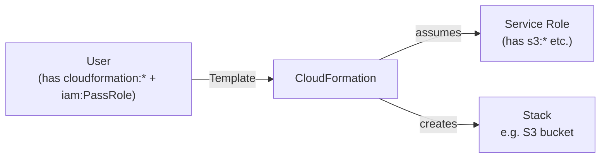
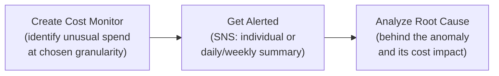
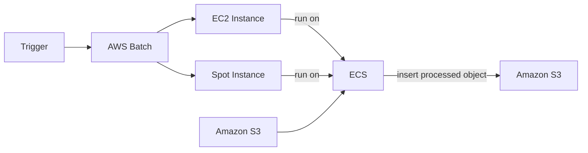

# Other Services

## Key Concepts

> [!NOTE]
> This section is the source's own "grab-bag" — an overview of services that "might come up in a few questions" but don't warrant a full dedicated section.

### AWS CloudFormation
- A **mixture of graphical interface and coding** — used for rapid deployment, to mirror existing internal architectures, and to take advantage of templates created by others
- **Declarative** way of outlining your AWS infrastructure, for (almost) any resource type
- Example from the source: "I want a security group, I want two EC2 instances using this security group, I want an S3 bucket, I want a load balancer (ELB) in front of these machines" — CloudFormation creates all of it, in the right order, with the exact configuration specified
- **Stacks** are implementations of templates — a Stack is the running set of resources CloudFormation created from a given template
- **Change Sets** are used for modifying Stacks — they let you preview how proposed changes to a Stack impact your running resources before applying them
- **Benefits (1/2) — Infrastructure as Code**:
  - No resources are manually created — good for control
  - Changes to infrastructure are reviewed through code
  - **Cost**: each resource within a stack is tagged with an identifier so you can see how much a stack costs; you can estimate resource costs using the template
  - Savings strategy: in Dev, automate deleting templates at 5 PM and recreating them at 8 AM
- **Benefits (2/2) — Productivity**:
  - Ability to destroy and re-create infrastructure on the fly
  - Automated diagram generation for templates
  - Declarative programming — no need to figure out ordering/orchestration yourself
  - Don't reinvent the wheel — leverage existing templates from the web and existing documentation
  - Supports (almost) all AWS resources; use **custom resources** for anything not natively supported
- **CloudFormation + Infrastructure Composer**: visualize a stack's resources and the relationships between them (example: a WordPress CloudFormation stack)
- **CloudFormation Service Role**: an IAM role that allows CloudFormation to create/update/delete stack resources on your behalf
  - Lets you give users the ability to create/update/delete stack resources **even if they lack permissions to work with those resources directly** — supports the **least privilege principle**
  - The user must have `iam:PassRole` permission to pass the service role to CloudFormation

### CloudFormer
- CloudFormation formulates and distributes a cloud architecture; **CloudFormer** takes what you already have in an AWS account and turns it into a template — effectively reverse-engineering your existing resources into a CloudFormation template
- Use case: **rebuild your entire architecture** — e.g., you want a separate AWS account and want to mirror your architecture for **testing, development, or prototyping**

### AWS OpsWorks
- A **configuration management service** — you want to deploy a particular type of server with a particular set of services and applications running on it
- Allows you to define a configuration that can be deployed through AWS:
  - **Code-based configuration**: instance deployment, service deployment, application deployment
  - **Operate**: application updates, infrastructure updates
- **Automated deployment modes**:
  - **OpsWorks Stacks** (the initial OpsWorks mode) — a collection of **layers**, where a layer can be any AWS service or any runtime environment. Example: a layer of MySQL + a layer of Red Hat + a custom application layer, put together = a Red Hat Linux server running MySQL
  - **OpsWorks for Chef Automate** — instead of layers, **Cookbooks** contain **recipes** (defined configuration settings), which can be defined by an admin, by AWS, or by a third party
  - **OpsWorks for Puppet Enterprise** — uses **Master servers** with preconfigured **modules**, which are the equivalent of layers
- **Prebuilt layers / recipes / modules** include: Ruby, PHP, Node.js, Java, Amazon RDS, HA (High Availability) Proxy, MySQL
- **Use cases**:
  - In the cloud: Chef, Puppet
  - On-premises: Stacks — AWS can take advantage of automated deployment on your local network too
  - Example: when migrating 100s of servers into the cloud and you want to deploy them all together in a consistent, automated way

### AWS Command Line Interface (AWS CLI)
- A **unified tool** to manage your AWS services
- Lets you control multiple AWS services from the command line, and **automate them through scripts**

### Amazon Simple Email Service (SES)
- Fully managed service to send emails **securely, globally, at scale**
- Allows **inbound/outbound** emails
- Reputation dashboard, performance insights, anti-spam feedback
- Provides statistics: email deliveries, bounces, feedback loop results, email opens
- Supports **DKIM (DomainKeys Identified Mail)** and **SPF (Sender Policy Framework)**
- Flexible IP deployment: shared, dedicated, and customer-owned IPs
- Send emails via AWS Console, APIs, or SMTP
- Use cases: transactional, marketing, and bulk email communications

### Amazon Pinpoint
- Scalable **2-way** (outbound/inbound) marketing communications service
- Supports **email, SMS, push, voice, and in-app messaging** — one of the main use cases is **SMS**, where customers receive an SMS that you send from Pinpoint
- Ability to segment and personalize messages with the right content per customer — you can create **groups and segments**
- Can receive replies; scales to **billions of messages per day**
- Use cases: run campaigns by sending marketing email in bulk, or transactional SMS messages
- **Creating automation**: all events such as text success, text delivered, and replies are delivered to **Amazon SNS**, **Kinesis Data Firehose**, and **CloudWatch Logs** — you can build any kind of automation easily on top of Amazon Pinpoint
- **Pinpoint vs SNS/SES**: with SNS & SES, *you* manage each message's audience, content, and delivery schedule yourself — this is the responsibility of your application, which is a lot of work and may not be very scalable; with **Pinpoint**, you create message templates, delivery schedules, highly-targeted segments, and full campaigns, all managed by Pinpoint — Pinpoint is the **next evolution of SNS and SES** for a full-blown marketing communications service

### AWS Systems Manager (SSM) — Feature Set
- Lets you **gain operational insights** into AWS and on-premises resources — centralizes operational data from multiple services and automates tasks across your resources
- Is a **secure end-to-end management solution for hybrid cloud environments** — the operations hub for your AWS applications and resources, broken into **four core feature groups**: Operations Management, Application Management, Change Management, Node Management
- **Use cases**: centralize operational data; automatically resolve application issues (use operational data to manage applications); implement best practices; remediate security events
- **Session Manager**: start a secure shell on EC2 and on-premises servers
  - No SSH access, bastion hosts, or SSH keys needed; no port 22 needed (better security)
  - Supports Linux, macOS, and Windows
  - Can send session log data to S3 or CloudWatch Logs
- **Run Command**: execute a document (script) or run a command
  - Runs across multiple instances using resource groups; no SSH needed
  - Output can go to AWS Console, S3, or CloudWatch Logs
  - Can send status notifications (In progress, Success, Failed) to SNS
  - Integrated with IAM & CloudTrail; can be invoked via EventBridge
- **Patch Manager**: automates patching of managed instances
  - OS updates, application updates, security updates; supports EC2 and on-premises servers, Linux/macOS/Windows
  - Patch on-demand or on a schedule using **Maintenance Windows**
  - Scans instances and generates a patch compliance report (missing patches)
- **Maintenance Windows**: defines a schedule for actions on instances (e.g. OS patching, driver updates, software installs)
  - Contains: Schedule, Duration, set of registered instances, set of registered tasks
- **Automation**: simplifies common maintenance/deployment tasks for EC2 and other AWS resources (e.g. restart instances, create an AMI, create an EBS snapshot)
  - Uses **Automation Runbooks** (SSM Documents defining actions), pre-defined or custom
  - Can be triggered: manually (Console/CLI/SDK), by **EventBridge**, on a schedule via **Maintenance Windows**, or by **AWS Config** for rule remediations

### AWS License Manager
- For **centrally managing software licenses** across AWS and on-premises
- Gives you control and visibility into license usage, allowing you to **limit licensing overages** and **reduce the risk of noncompliance and misreporting**
- **Supports a variety of licensing models**: Perpetual (lifetime license), Floating (shareable licenses), Subscription (with expiration date), Usage-based (with specific terms based on usage)
- **Concepts**:
  - **License configurations** — allow you to modify the number of licenses and usage limits; you can use **AWS RAM** to share license configurations
  - **License reports** — a **License configuration report** (number of licenses consumed) and a **Resource report** (tracked resources and license consumption); can track the history of license configurations; reports are published directly to an **S3 bucket**
  - **License type conversion** — convert a license type without redeploying existing workloads
  - You can purchase licenses from: **AWS Marketplace**, **AWS Data Exchange**, or direct from a seller with managed entitlements
- **Monitoring**: can track licenses for EC2, AWS Systems Manager Managed Instances, Amazon RDS Oracle license, and BYOL software from AWS Marketplace

### AWS Service Catalog
- Allows you to **create, manage, and distribute catalogs of approved products** to end-users — these IT services can include virtual machine images, servers, software, and databases
- Create, share, organize, and govern your curated **IaC templates** — manage deployed IT services, applications, resources, and metadata to achieve consistent governance of your IaC
  - Quickly find and deploy approved, self-service cloud resources
  - Stay agile while improving governance over resources across multiple accounts
- A **regional service**
- **Use cases**: automate access to ML notebooks; apply access controls; provision resources for AWS accounts; accelerate provisioning of CI/CD pipelines

### AWS Proton
- A **managed delivery service** for deploying container and serverless applications — uses templates to define and maintain standard application stacks, including the architecture, infrastructure resources, and the CI/CD pipeline
- **Concepts**:
  - **Templates** — manage and provision resources using IaC. An **Environment Template** is shared infrastructure used by multiple applications/resources; a **Service Template** is the infrastructure required to deploy and manage a single application or microservice
  - **Environments** — contain resources shared across AWS Proton service instances (VPC, Clusters, Load Balancers, API Gateways)
  - **Services** — an instantiation of a service template, including service instances and pipelines; a service instance is a collection of AWS resources used to run an application in an environment
- Can use **EventBridge** to receive notifications when the state of AWS Proton changes — an event rule captures status changes
- **Pricing**: charged for the AWS resources you create to store and run your application

### AWS Management Console — Resource Groups
- A **Resource Group** is a collection of AWS resources that are all in the **same AWS region**, matching criteria provided in a query
- Two types of queries you can build a group on: **Tag-based** and **CloudFormation stack-based**

### AWS Well-Architected Tool
- Helps you **review the state of your applications and workloads** against architectural best practices, and identify opportunities for improvement
- **Use cases**:
  - Workload sharing and collaboration
  - Tailor guidance with **custom lenses** — combine your own best practices with AWS Well-Architected best practices to gain insight into overall architectural health
  - Realize sustainability goals — use the AWS Well-Architected **sustainability pillar** to learn best practices for minimizing environmental impact

### AWS Budgets
- Create budgets to plan your service usage, service costs, and instance reservations
- The information in AWS Budgets **updates three times a day**
- Can set custom alerts when your usage exceeds (or is forecasted to exceed) your budgeted amount

### AWS Cost & Usage Report (CUR)
- Tracks your AWS usage and provides estimated charges associated with your account
- Contains **the most comprehensive set of cost and usage data available**
- Publishes your AWS billing reports to an **Amazon S3** bucket
  - AWS updates the report in your bucket **once a day**, in **CSV** format
- Can receive reports that break down your costs:
  - By the hour, day, or month
  - By product or product resource
  - By tags that you define yourself
- **Use Cases**:
  - Deliver report files to your Amazon S3 bucket
  - Update the report **up to three times a day**
  - Create, retrieve, and delete your reports using the AWS CUR API Reference
- **Pricing**: Cost and Usage Reports are **free of charge**, but standard Amazon S3 rates apply (for storage of the delivered report files)

### Cost Explorer
- **Disabled by default** — once enabled, takes **24 hours** to give you analysis
- Visualize, understand, and manage AWS costs and usage over time
- Gives you detail about spending **before the end-of-month bill**, and also gives you recommendations to save money
- Create custom reports analyzing cost and usage data
- **Console-based service** — allows you to visually see and analyze how you are spending
- Analyze data at a high level (total costs/usage across all accounts) or at **monthly, hourly, or resource-level granularity**
- Tags are user-defined key-value pairs — filter by tag, and see all of the expenses associated with that tag
- Choose an optimal **Savings Plan** (alternative to Reserved Instances) to lower your bill
- Create **annual, quarterly, monthly, or even daily budgets**
- **Forecast usage up to 18 months** based on previous usage
- Cost Explorer is essentially a **fancy wrapper over Cost and Usage Reports (CUR)**
- The source walks through several Cost Explorer views: Monthly Cost by AWS Service, Hourly & Resource-Level costs, Savings Plan recommendations, and Forecast Usage

### AWS Cost Anomaly Detection
- Continuously monitors cost and usage using **Machine Learning** to detect unusual spending
- Learns your unique historic spend pattern to detect one-time spikes and/or continuous cost increases — **you don't need to define thresholds manually**
- Can monitor: AWS services, member accounts, cost allocation tags, or cost categories
- Sends an anomaly detection report with **root-cause analysis**
- Notification options: individual alerts or daily/weekly summary, via **SNS**

### AWS Outposts
- For **hybrid cloud**: businesses keeping on-premises infrastructure alongside cloud infrastructure, normally requiring two separate ways of managing IT (AWS console/CLI/APIs vs on-premises tooling)
- **Outposts Racks** = physical server racks AWS installs in your on-premises data center, offering the same AWS infrastructure, services, APIs, and tools as in the cloud
- AWS sets up and manages the Outposts Rack; **you are responsible for the Outposts Rack's physical security**
- Benefits: low-latency access to on-premises systems, local data processing, data residency, easier migration from on-premises to cloud, fully managed service
- Some services that work on Outposts (per the source): EC2, EBS, S3, EKS, ECS, RDS, EMR

### AWS Batch
- Fully managed **batch processing** at any scale
- Efficiently runs 100,000s of computing batch jobs on AWS
- A "batch" job has a **start and an end** (as opposed to a continuous/always-on process)
- Acts as a **decoupling mechanism**: a "batch" is a bundle, a group of processors run based on a logical decision sequence — you put commands together into a batch and execute them as a unit
- Enables you to run batch computing workloads of any scale on AWS using EC2
- Batch dynamically launches EC2 instances or Spot Instances, and provisions the right amount of compute/memory
- You submit or schedule batch jobs and **AWS Batch does the rest**
- Batch jobs are defined as **Docker images** and run on **ECS, EKS, or Fargate**
- Helps with cost optimization and reduces focus on infrastructure
- **How you manage work through AWS Batch:**
  - **Set up a job** — e.g., a script such as a Python script
  - **Put the job in a job queue**, backed by a **compute environment** — a managed compute environment
  - **Execute the job** — used to automate any administration task
- **Provisioning model:** an AWS Batch job uses either **On-Demand** or **Spot** instances
- Described as: **AWS Batch gives you the "engine"** — no need to build the EC2 instance manually

**AWS Batch vs Lambda**:
| | Lambda | Batch |
|---|---|---|
| Time limit | Yes (bounded) | No time limit |
| Runtimes | Limited runtimes | Any runtime, as long as packaged as a Docker image |
| Disk space | Limited temporary disk space | Relies on EBS / instance store for disk space |
| Compute model | Serverless | Relies on EC2 (can be managed by AWS) |

### Amazon AppFlow
- Fully managed integration service to securely transfer data between **SaaS applications and AWS**
- **Sources**: Salesforce, SAP, Zendesk, Slack, ServiceNow
- **Destinations**: AWS services like S3, Redshift, or non-AWS like Snowflake and Salesforce
- **Frequency**: on a schedule, in response to events, or on demand
- Data transformation capabilities: filtering and validation
- Encrypted over the public internet, or privately over **AWS PrivateLink**
- Avoids writing custom integration code — leverage APIs immediately

### AWS Amplify
- A set of tools and services to develop and deploy scalable full-stack **web and mobile applications**, letting frontend web and mobile developers **easily build, ship, and host** full-stack applications on AWS — **easy to scale**
- Tagline: **build full-stack web and mobile apps in hours**
  - Create an AWS backend for your web, iOS, or Android app — with **authentication, data, storage**
  - Visually build a frontend UI with a **design-to-code Figma integration**, and connect the UI to a backend
  - Deploy and host fast, secure, reliable websites and server-side rendered apps
  - Extend your app with **175+ AWS services** to support new use cases
- Capabilities: Authentication, Storage, API (REST, GraphQL), CI/CD, PubSub, Analytics, AI/ML Predictions, Monitoring, and more
- Connect source code from GitHub, AWS CodeCommit, Bitbucket, GitLab, or upload directly
- Architecture: configure the backend via the **Amplify CLI** (using services like S3, Cognito, AppSync, API Gateway, DynamoDB, Lambda, SageMaker, Lex); connect the frontend to the backend via **Amplify Frontend Libraries**; build and deploy via the **Amplify Console** (using CloudFront)

### AWS Device Farm
- An **application testing service**
- Improve the quality of your web and mobile applications by **testing across desktop browsers and real mobile devices hosted in the AWS Cloud**

### Amazon API Gateway
- **Create, maintain, and secure APIs at any scale**
- **API Types**:
  - **RESTful APIs** — optimized for serverless workloads and HTTP backends, using **HTTP APIs**
  - **WebSocket APIs** — build real-time, two-way communication applications, such as chat apps and streaming dashboards

### Instance Scheduler on AWS
- An **AWS solution** deployed through CloudFormation — **not a standalone AWS service**
- Automatically starts/stops AWS resources to reduce costs (**up to 70%**)
- Example: stop a company's EC2 instances outside business hours
- Supports **EC2 instances, EC2 Auto Scaling Groups, and RDS instances**
- Schedules are managed in a **DynamoDB table**
- Uses resource **tags** and **Lambda** to stop/start instances
- Supports **cross-account and cross-region** resources
- Reference: https://aws.amazon.com/solutions/implementations/instance-scheduler-on-aws/

## AWS Services / Features

| Service | One-line summary |
|---|---|
| AWS CloudFormation | Declarative Infrastructure as Code across nearly all AWS resources; Stacks implement templates, Change Sets preview stack modifications |
| CloudFormer | Reverse-engineers existing AWS account resources into a CloudFormation template, to rebuild/mirror architecture in another account |
| AWS OpsWorks | Configuration management service (Stacks/layers, Chef Automate cookbooks/recipes, Puppet Enterprise modules) for automated server deployment |
| AWS CLI | Unified command-line tool to manage and script/automate multiple AWS services |
| Amazon SES | Managed transactional/marketing/bulk email sending, DKIM/SPF support |
| Amazon Pinpoint | 2-way, multi-channel (email/SMS/push/voice/in-app) marketing campaign engine, built on top of segments/templates/campaigns; automation events flow to SNS/Kinesis Data Firehose/CloudWatch Logs |
| AWS Systems Manager | Operations hub (4 feature groups) — Session Manager (shell, no SSH), Run Command, Patch Manager, Maintenance Windows, Automation (runbooks) |
| AWS License Manager | Centrally manage/track software licenses (perpetual, floating, subscription, usage-based) across AWS and on-premises |
| AWS Service Catalog | Regional service to create/distribute catalogs of approved, self-service IT products/IaC templates with governance |
| AWS Proton | Managed delivery service for container/serverless apps using Environment & Service templates (IaC + CI/CD pipeline) |
| AWS Management Console Resource Groups | Group same-region AWS resources by tag-based or CloudFormation stack-based query |
| AWS Well-Architected Tool | Review workloads against best practices (incl. custom lenses, sustainability pillar) and identify improvement opportunities |
| AWS Budgets | Plan usage/costs/reservations and set custom alerts when spend exceeds a threshold; updates 3x/day |
| AWS Cost & Usage Report (CUR) | Most comprehensive cost/usage dataset, delivered to S3 as CSV, up to 3x/day; free (S3 storage rates apply) |
| Cost Explorer | Visualize/forecast AWS cost & usage, recommend Savings Plans |
| AWS Cost Anomaly Detection | ML-based cost spike detection with root-cause analysis and SNS alerts |
| AWS Outposts | AWS infrastructure racks physically installed on-premises |
| AWS Batch | Managed batch job scheduling on EC2/Spot via ECS/EKS/Fargate, Docker-based |
| Amazon AppFlow | Managed SaaS ⇄ AWS data integration (Salesforce, SAP, Slack, etc. ⇄ S3, Redshift, etc.) |
| AWS Amplify | Full-stack web/mobile app dev framework with managed backend + frontend + CI/CD; build apps in hours, extend with 175+ AWS services |
| AWS Device Farm | Application testing service — test web/mobile apps across desktop browsers and real mobile devices hosted in the AWS Cloud |
| Amazon API Gateway | Create, maintain, and secure APIs at any scale — RESTful (HTTP) APIs for serverless workloads, and WebSocket APIs for real-time two-way apps |
| Instance Scheduler on AWS | CloudFormation-deployed solution to auto start/stop EC2/ASG/RDS on a schedule for cost savings |

## Exam Tips
> [!TIP]
> **CloudFormation Service Role** is the answer whenever a scenario needs a user to deploy a stack (e.g., create an S3 bucket) **without being directly granted S3 permissions** — the role does the work, the user just needs `iam:PassRole` + CloudFormation permissions. This enforces least privilege.

> [!TIP]
> **Change Sets** preview how a template change will affect a running Stack before you apply it — don't confuse this with **CloudFormer**, which does the reverse: turning existing AWS resources into a new template.

> [!TIP]
> **AWS OpsWorks** is the configuration-management answer (Chef/Puppet-style: Stacks/layers, Cookbooks/recipes, Master servers/modules) when a scenario needs to deploy a specific, repeatable server configuration — including on-premises via Stacks.

> [!WARNING]
> Don't confuse **SES** (you control audience/content/schedule yourself, transactional/marketing/bulk email only) with **Pinpoint** (built-in campaign management: templates, segments, schedules, multi-channel including SMS/push/voice/in-app) — Pinpoint is the next evolution of SNS and SES for full-blown marketing communications.

> [!TIP]
> **AWS Device Farm** is the answer for "test our web/mobile app across real devices and browsers" scenarios — it runs tests on desktop browsers and real mobile devices hosted in the AWS Cloud, without you owning a physical device lab.

> [!TIP]
> **Amazon API Gateway API types**: choose **RESTful APIs (HTTP APIs)** for standard serverless/HTTP backends, and **WebSocket APIs** when the scenario needs real-time, two-way communication (chat apps, streaming dashboards).

> [!TIP]
> **Systems Manager Session Manager** is the go-to answer for "SSH into EC2 without opening port 22, without a bastion host, without managing SSH keys."

> [!TIP]
> **AWS Batch vs Lambda**: if a job has **no time limit**, needs **any runtime** (via Docker image), or needs significant **disk space** (EBS/instance store), choose Batch over Lambda.

> [!TIP]
> **Instance Scheduler on AWS is a solution (deployed via CloudFormation), not a native AWS service** — remember this distinction if a question tests whether it appears in the service catalog directly.

> [!WARNING]
> **AWS Cost Anomaly Detection** requires **no manual threshold configuration** — it uses ML to learn your spend pattern. If an exam option says "you must set a cost threshold," that's describing a budget/alarm, not Cost Anomaly Detection.

> [!TIP]
> **AWS Budgets vs Cost Explorer vs CUR**: **Budgets** = set a threshold and get alerted when you exceed it (updates 3x/day). **Cost Explorer** = visualize/forecast spend and get Savings Plan recommendations (a "fancy wrapper" over CUR; disabled by default, 24h to activate). **CUR** = the raw, most granular/comprehensive cost & usage dataset, delivered to an S3 bucket as CSV (free, but S3 storage rates apply).

> [!TIP]
> **AWS Outposts**: you get AWS services on-premises, but **physical security of the rack is your responsibility** — AWS manages the software/hardware operations, not physical access control.

## Related Notes
- [[02-More-Solutions-Architecture]]
- [[03-Disaster-Recovery-Migrations]]
- [[05-White-Papers-Architectures]]
- [[00-Cluster-MOC]]

## Additional Scope Gaps Closed — 2026-11-09

### AWS Serverless Application Repository
A repository for discovering and deploying reusable serverless applications, with private sharing and public publication options. Use it to reuse packaged serverless applications; it is not a replacement for Lambda compute or API Gateway. Check the template and its requested permissions before deployment. [AWS documentation](https://docs.aws.amazon.com/serverlessrepo/latest/devguide/what-is-serverlessrepo.html).

### AWS Wavelength
Places supported AWS compute/storage in telecommunications-provider networks for applications needing very low latency to mobile/edge users. Contrast with **CloudFront** content caching, **Local Zones** near metropolitan users and **Outposts** at customer sites. Region/carrier/service availability matters. [AWS documentation](https://docs.aws.amazon.com/wavelength/latest/developerguide/what-is-wavelength.html).

Recall prompts: Which service distributes reusable serverless application packages? Which deployment option puts compute close to a carrier's mobile-network users? Explain why each is different from a CDN.
