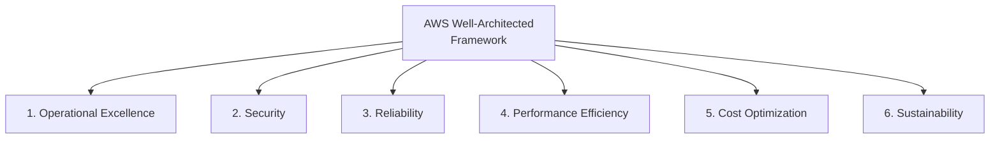

# White Papers & Architectures

## Key Concepts

### Section Overview
The source covers, in this section:
- Well-Architected Framework Whitepaper
- Well-Architected Tool
- AWS Trusted Advisor
- Reference architectures resources (for real-world use)
- Disaster Recovery on AWS Whitepaper

### Well-Architected Framework — General Guiding Principles
Reference: https://aws.amazon.com/architecture/well-architected

Per the source, the general guiding principles are:
- Stop guessing your capacity needs
- Test systems at production scale
- Automate to make architectural experimentation easier
- Allow for evolutionary architectures
- Design based on changing requirements
- Drive architectures using data
- Improve through game days
- Simulate applications for flash sale days

### Well-Architected Framework — The 6 Pillars

> [!IMPORTANT]
> Pillars can reinforce one another, but real designs **do make trade-offs based on business requirements**. For example, additional resilience can increase cost. AWS generally does not trade away security or operational excellence for other pillars.

### AWS Well-Architected Tool
- **Free tool** to review your architectures against the 6 pillars of the Well-Architected Framework and adopt architectural best practices
- How it works:
  1. Select your workload and answer questions
  2. Review your answers against the 6 pillars
  3. Obtain advice — videos and documentation, generate a report, view results in a dashboard
- Console: https://console.aws.amazon.com/wellarchitected

### AWS Trusted Advisor
- **No installation needed** — a high-level AWS account assessment tool
- Analyzes your AWS accounts and provides recommendations across **6 categories**, per the source:
  1. Cost Optimization
  2. Performance
  3. Security
  4. Fault Tolerance
  5. Service Limits
  6. Operational Excellence
- Full-check entitlement depends on the **current support plan**. AWS now lists Business Support+, Enterprise Support and Unified Operations; older slide plan names and pricing are historical.
- Supports **programmatic access** via the AWS Support API

### More Architecture Examples
- The source's closing summary of the architectural patterns explored across the course:
  - **Classic**: EC2, ELB, RDS, ElastiCache, etc.
  - **Serverless**: S3, Lambda, DynamoDB, CloudFront, API Gateway, etc.
- For further real-world architectures, the source points to:
  - https://aws.amazon.com/architecture/
  - https://aws.amazon.com/solutions/

## AWS Services / Features

| Service / Resource | Purpose |
|---|---|
| Well-Architected Framework (whitepaper) | Guiding principles + 6 pillars for evaluating architecture quality |
| AWS Well-Architected Tool | Free, self-service tool in the console to review a specific workload against the 6 pillars |
| AWS Trusted Advisor | Account-wide automated checks across 6 categories; full-check access depends on current support-plan entitlement |
| AWS Architecture Center (aws.amazon.com/architecture) | Reference architectures for real-world designs |
| AWS Solutions Library (aws.amazon.com/solutions) | Pre-built, deployable solution architectures (e.g. Instance Scheduler) |

## Exam Tips
> [!TIP]
> Memorize the **6 pillars** exactly: Operational Excellence, Security, Reliability, Performance Efficiency, Cost Optimization, Sustainability. Choose trade-offs from the workload requirements; do not memorize a false rule that the pillars never compete.

> [!TIP]
> **Well-Architected Tool** = reviews a *specific workload* you select, via a self-guided Q&A, and is **free**. **Trusted Advisor** = reviews your *whole account* automatically across 6 categories (Cost Optimization, Performance, Security, Fault Tolerance, Service Limits, Operational Excellence) — don't mix these two up.

> [!WARNING]
> Check the [current Trusted Advisor support documentation](https://docs.aws.amazon.com/awssupport/latest/user/trusted-advisor.html) for full versus Basic-plan checks; do not use legacy Business/Developer plan names as permanent eligibility rules.

> [!TIP]
> Note that **Trusted Advisor's 6 categories** are similar in spirit to, but not identical wording to, the **Well-Architected Framework's 6 pillars** — Trusted Advisor uses Cost Optimization, Performance, Security, Fault Tolerance, Service Limits, Operational Excellence (no separate "Reliability" or "Sustainability" category, and "Fault Tolerance"/"Service Limits" replace them).

## Related Notes
- [[01-Classic-Solutions-Architecture]]
- [[02-More-Solutions-Architecture]]
- [[03-Disaster-Recovery-Migrations]]
- [[04-Other-Services]]
- [[00-Cluster-MOC]]

## Checked corrections — 2026-11-09

Only the changes listed here were verified in this audit; other course-derived details still need checking when used.

- Corrected the no-trade-offs claim and removed obsolete support-plan entitlement assumptions.
  - [AWS documentation](https://docs.aws.amazon.com/wellarchitected/latest/userguide/waf.html)
  - [AWS documentation](https://docs.aws.amazon.com/awssupport/latest/user/trusted-advisor.html)
