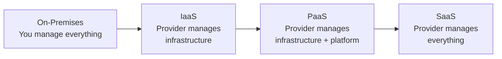

---
tags:
  - aws
  - cloud-practitioner
  - cloud-concepts
  - fundamentals
domain: Cloud Concepts
aliases:
  - "Cloud Computing"
  - "Cloud Fundamentals"
  - "IaaS PaaS SaaS"
  - "CAPEX OPEX"
  - "5 Characteristics"
status: not-started
date: 2026-07-01
---

# Cloud Computing Fundamentals

## What is Cloud Computing?

Cloud computing is the **on-demand delivery** of compute power, database storage, applications, and other IT resources through a cloud services platform with **pay-as-you-go pricing**.

- Provision exactly the right type and size of resources you need
- Access as many resources as you need, almost instantly
- AWS owns and maintains the network-connected hardware; you provision and use what you need

---

## Five Characteristics of Cloud Computing

| Characteristic | Description |
|---|---|
| On-demand self-service | Users provision resources without human interaction from the provider |
| Broad network access | Resources available over the network; accessible by diverse client platforms |
| Multi-tenancy & resource pooling | Multiple customers share the same infrastructure with security/privacy |
| Rapid elasticity and scalability | Automatically scale up/down; appear unlimited to the user |
| Measured service | Usage is monitored, controlled, and reported — pay for what you use |

---

## Six Advantages of Cloud Computing

1. **Trade CAPEX for OPEX** — Pay On-Demand; don't own hardware; reduced TCO & OPEX
2. **Benefit from massive economies of scale** — Prices reduced as AWS operates at large scale
3. **Stop guessing capacity** — Scale based on actual measured usage
4. **Increase speed and agility** — New IT resources available in minutes
5. **Stop spending money running data centers** — Focus on your applications, not infrastructure
6. **Go global in minutes** — Deploy in multiple AWS Regions around the world

---

## Problems Solved by the Cloud

- **Flexibility** — change resource types when needed
- **Cost-Effectiveness** — pay as you go, only for what you use
- **Scalability** — accommodate larger loads by scaling hardware or adding nodes
- **Elasticity** — scale out and scale in when needed
- **High-availability & fault-tolerance** — build across data centers
- **Agility** — rapidly develop, test, and launch applications

---

## Cloud Deployment Models

| Model | Description | Key Points |
|---|---|---|
| **Public Cloud** | Resources owned/operated by third-party provider, delivered over internet | AWS, Azure, GCP |
| **Private Cloud** | Cloud services used by a single organization, not exposed to the public | Complete control; meets specific business needs |
| **Hybrid Cloud** | Keep some servers on-premises, extend capabilities to the cloud | Control sensitive assets; flexibility |

---

## Types of Cloud Computing (Service Models)

| Model | What Provider Manages | AWS Example | Other Examples |
|---|---|---|---|
| **IaaS** (Infrastructure as a Service) | Networking, storage, servers, virtualization | Amazon EC2 | GCP, Azure, Rackspace |
| **PaaS** (Platform as a Service) | + OS, middleware, runtime | Elastic Beanstalk | Heroku, Google App Engine |
| **SaaS** (Software as a Service) | Everything | Rekognition | Gmail, Dropbox, Zoom |
| **FaaS** (Function as a Service) | Infrastructure + servers; event-driven | AWS Lambda | — |
| **CaaS** (Container as a Service) | Container orchestration; platform-agnostic | ECS Fargate, EKS | — |

> [!tip]
> FaaS = run code without servers (Lambda). CaaS = run containers without managing servers (Fargate). Both are forms of "serverless" on AWS.

---

## AWS Pricing Fundamentals

AWS has 3 pricing fundamentals following the pay-as-you-go model:

1. **Compute** — Pay for compute time
2. **Storage** — Pay for data stored in the Cloud
3. **Data Transfer OUT** — Data transfer IN is **free**

> [!tip]
> The exam loves asking what's free on AWS. **Data transfer IN to AWS is always free.** You only pay for data going OUT.

---

## Problems with Traditional IT

- Pay for data center rent, power, cooling, maintenance
- Adding/replacing hardware takes time
- Scaling is limited
- Must hire 24/7 monitoring team
- Difficult disaster recovery

> [!note]
> Understanding WHY cloud exists helps answer scenario questions: "A company needs to reduce upfront hardware costs and scale quickly" → cloud computing.

## Exam Tips

> [!tip]
> - **5 characteristics + 6 advantages** — these appear directly on the exam. Memorize both lists.
> - "Trade CAPEX for OPEX" = trade upfront cost for ongoing operational cost
> - IaaS = most control, SaaS = least control (but easiest to use)
> - Hybrid = on-premises + cloud; perfect for "sensitive data must stay on-premises" scenarios

## Related Notes
- [[02-AWS-Global-Infrastructure]]
- [[03-Well-Architected-Framework]]
- [[04-Cloud-Adoption-Migration]]
