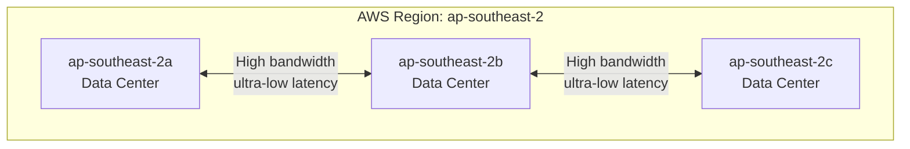

---
tags:
  - aws
  - cloud-practitioner
  - cloud-concepts
  - global-infrastructure
domain: Cloud Concepts
aliases:
  - "Regions"
  - "Availability Zones"
  - "AZ"
  - "Edge Locations"
  - "Global Infrastructure"
status: not-started
date: 2026-07-01
---

# AWS Global Infrastructure

## Overview

AWS global infrastructure consists of:
- **AWS Regions**
- **AWS Availability Zones**
- **AWS Data Centers**
- **AWS Edge Locations / Points of Presence**

Reference: https://infrastructure.aws/

---

## AWS Regions

- A **Region** is a **cluster of data centers** in a geographic area
- Naming convention: `us-east-1`, `eu-west-3`, `ap-southeast-2`
- Most AWS services are **region-scoped** (you select a region)
- Data **never leaves a region** without your explicit permission

### How to Choose a Region?

| Factor | Consideration |
|---|---|
| **Compliance** | Data governance / legal requirements — data stays in region |
| **Proximity** | Closer to customers = reduced latency |
| **Available services** | Not every service/feature is available in every region |
| **Pricing** | Pricing varies region to region |

> [!tip]
> Exam scenario: "A company must store data in Europe due to GDPR" → choose an EU region.

---

## AWS Availability Zones (AZs)

- Each region has **multiple AZs** (usually 3, minimum 3, maximum 6)
- Example for Sydney (`ap-southeast-2`): `ap-southeast-2a`, `ap-southeast-2b`, `ap-southeast-2c`
- Each AZ = one or more **discrete data centers** with redundant power, networking, and connectivity
- AZs are **separate from each other** — isolated from disasters
- Connected with **high bandwidth, ultra-low latency networking**

> [!tip]
> AZs exist to provide **high availability** and **fault tolerance**. Deploy across multiple AZs to survive a data center failure.

---

## AWS Edge Locations / Points of Presence

- Amazon has **400+ Points of Presence** (400+ Edge Locations & 10+ Regional Caches)
- Located in **90+ cities across 40+ countries**
- Used by **CloudFront** (CDN) to deliver content to end users with **lower latency**
- Also used by Route 53, WAF, Shield

---

## Global vs Regional Services

| Scope | Examples |
|---|---|
| **Global** | IAM, Route 53, CloudFront, WAF |
| **Regional** | EC2, Elastic Beanstalk, Lambda, Rekognition |

> [!warning]
> IAM is global — users, groups, and roles are not region-specific. S3 buckets have globally unique names but data is stored in a specific region.

---

## AWS History (Context)

| Year | Event |
|---|---|
| 2002 | Internally launched |
| 2003 | Idea to market AWS infrastructure |
| 2004 | Launched publicly with SQS |
| 2006 | Re-launched with SQS, S3 & EC2 |
| 2007 | Launched in Europe |
| 2023 | $90 billion annual revenue; 31% cloud market share |

---

## Exam Tips

> [!tip]
> - **Region** = cluster of data centers = geographic area
> - **AZ** = one or more discrete data centers within a region; isolated from other AZs
> - **Edge Location** = 400+ locations used for content delivery (CloudFront)
> - Deploying to **multiple AZs** = high availability; deploying to **multiple Regions** = disaster recovery + global reach

## Related Notes
- [[01-Cloud-Computing-Fundamentals]]
- [[03-Well-Architected-Framework]]
