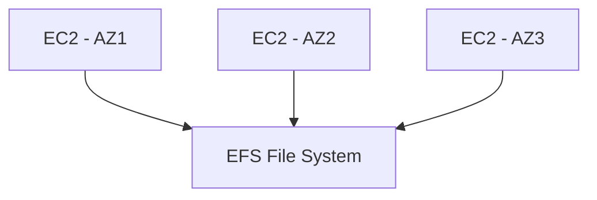

---
tags:
  - aws
  - cloud-practitioner
  - technology
  - s3
  - ebs
  - efs
  - storage
domain: Cloud Technology and Services
aliases:
  - "S3"
  - "EBS"
  - "EFS"
  - "Storage"
  - "Snow Family"
  - "Storage Gateway"
  - "AWS Backup"
status: not-started
date: 2026-07-01
---

# Storage — S3, EBS, EFS, and More

## EBS (Elastic Block Store)

- **Network drive** attached to EC2 instances (like a network USB stick)
- Persists data even after EC2 termination
- **Bound to a specific AZ** — cannot attach to an instance in another AZ
- Mounted to **one instance at a time** (at the Cloud Practitioner level)
- Must snapshot to move across AZs/Regions

### EBS Features
| Feature | Details |
|---|---|
| Delete on Termination | Root volume: deleted by default; extra volumes: NOT deleted by default |
| EBS Snapshots | Point-in-time backup; can copy across AZ/Region |
| Snapshot Archive | 75% cheaper; 24–72 hour restore time |
| Recycle Bin | Retain deleted snapshots (1 day to 1 year) |

### AMI vs EBS Snapshot

| | AMI | EBS Snapshot |
|---|---|---|
| What it captures | Entire EC2 instance (all volumes + OS + metadata + block device mapping) | A single EBS volume |
| Use case | Deploy identical instances; share pre-configured environments | Backup a volume; copy data across AZ/Region |
| Launch | Used to launch a new EC2 instance | Must create a new EBS volume from it first |

> [!tip]
> AMI = whole server image (OS + data + config). Snapshot = backup of one disk. An AMI contains one or more snapshots under the hood.

### EC2 Instance Store
- **Physical hardware disk** attached to the EC2 host
- Very high I/O performance (higher than EBS)
- **Ephemeral** — data LOST when instance is stopped/terminated
- Use for: buffer, cache, scratch data, temporary content

---

## EFS (Elastic File System)

- Managed **Network File System (NFS)**
- Can be mounted to **100s of EC2 instances simultaneously**
- Works with **Linux EC2 only** (not Windows)
- **Multi-AZ** — highly available and scalable
- **Pay per use** (no capacity planning); 3× more expensive than EBS gp2
- **EFS-IA** (Infrequent Access): up to 92% cheaper; automatic lifecycle policy moves files not accessed for N days

---

## EBS vs EFS vs Instance Store

| Feature | EBS | EFS | Instance Store |
|---|---|---|---|
| Type | Block storage | File system | Physical disk |
| Scope | Single AZ | Multi-AZ | Physical host |
| Multi-attach | No (CCP level) | Yes (100s) | No |
| Persistence | Yes | Yes | Ephemeral |
| Linux only? | No | Yes | No |
| Cost | Moderate | Higher | Included with instance |

---

## Amazon FSx

- Launch **3rd-party high-performance file systems** on AWS (fully managed)

| FSx Type | Use Case |
|---|---|
| FSx for Windows File Server | Windows-native; SMB protocol; AD integration |
| FSx for Lustre | High-performance computing; ML; analytics |

---

## Amazon S3 — Simple Storage Service

### Overview
- **Infinitely scalable** object storage
- Store **any type of file** (objects)
- Max object size: **5 TB**; for objects >5 GB, use multi-part upload
- Buckets have **globally unique names** but are **region-specific**
- URL format: `https://bucket-name.s3.amazonaws.com/prefix/object`

### Use Cases
Backup & restore, disaster recovery, archive, hybrid cloud, media hosting, data lakes, static website hosting, software delivery

### S3 Security
- **User-based**: IAM policies (who can access)
- **Resource-based**: Bucket policies (bucket-level rules; cross-account access), ACLs
- An IAM principal can access an S3 object if: the IAM policy ALLOWS OR the bucket policy ALLOWS, AND there's no explicit DENY

### S3 Static Website Hosting
URL format: `https://bucket-name.s3-website-region.amazonaws.com`
- Must enable static website hosting on the bucket
- Bucket must be public

### S3 Versioning
- Protect against accidental deletes and overwrites
- Must be enabled at the bucket level
- Any version can be restored
- Delete creates a "delete marker" — doesn't actually delete

### S3 Replication
- **CRR** (Cross-Region Replication) — compliance, lower latency for different regions
- **SRR** (Same-Region Replication) — log aggregation, live replication between prod and test
- Versioning must be enabled in both source and destination
- Replication is asynchronous

---

## S3 Storage Classes

| Class | Access Pattern | Availability | Min Duration | Key Feature |
|---|---|---|---|---|
| **S3 Standard** | Frequently accessed | 99.99% | None | 11 9s durability; 3+ AZs |
| **S3 Standard-IA** | Infrequent | 99.9% | 30 days | Lower cost; retrieval fee |
| **S3 One Zone-IA** | Infrequent | 99.5% | 30 days | Single AZ; cheapest IA |
| **S3 Glacier Instant Retrieval** | Quarterly | 99.9% | 90 days | Millisecond retrieval |
| **S3 Glacier Flexible Retrieval** | Archive | 99.99% | 90 days | Expedited (1–5 min), Standard (3–5h), Bulk (5–12h) |
| **S3 Glacier Deep Archive** | Long-term archive | 99.99% | 180 days | Cheapest; Standard 12h, Bulk 48h |
| **S3 Intelligent-Tiering** | Unknown pattern | 99.9% | None | Auto-moves tiers; monitoring fee; no retrieval fee |

> [!tip]
> Durability is **11 9s (99.999999999%)** for ALL storage classes. Availability varies.

### Lifecycle Rules
- Transition actions: move objects between storage classes based on age
- Expiration actions: automatically delete objects after N days

### S3 Pre-Signed URLs
- Generate a **time-limited URL** granting temporary access to a private S3 object
- Signed with your security credentials — recipient doesn't need an AWS account
- Use cases:
  - Temporary file downloads (e.g., a download link that expires in 1 hour)
  - Secure file uploads (user uploads directly to S3 without exposing credentials)
  - Secure video streaming
- The URL includes the expiration time; after expiry, access is denied

> [!tip]
> "A company wants to give a user temporary access to download a private S3 file without making it public" → S3 Pre-Signed URL.

### S3 Multipart Upload
- Recommended for objects **≥ 100 MB** (required above 5 GB)
- Upload parts in parallel → improved throughput
- Can pause and resume uploads; failed part retransmissions don't restart the whole upload

---

## S3 Encryption

| Encryption Type | Who Manages Key | Description |
|---|---|---|
| SSE-S3 | AWS | AWS-managed keys; default |
| SSE-KMS | KMS | Customer controls keys in KMS; audit trail |
| SSE-C | Customer | Customer provides key; AWS does NOT store key |
| Client-side | Customer | Encrypt before uploading |

---

## AWS Snow Family

Physical devices for **offline data migration** and edge computing:

| Device | Storage | Use Case |
|---|---|---|
| **Snowcone** | 8–14 TB | Small, portable; IoT/edge |
| **Snowball Edge** | ~80 TB | Large-scale data migration; edge compute |
| **Snowmobile** | Up to 100 PB | Exabyte-scale; truck arrives at your data center |

- Use Snow when network transfer would take **too long or too expensive**
- **AWS OpsHub**: GUI to manage Snow devices (no CLI needed)

---

## AWS Storage Gateway

Hybrid cloud bridge — connect **on-premises storage to AWS cloud**:

| Gateway Type | Protocol | Use Case |
|---|---|---|
| S3 File Gateway | NFS/SMB | Store files as S3 objects |
| FSx File Gateway | SMB | On-premises access to FSx for Windows |
| Volume Gateway | iSCSI | Block storage backed by S3/EBS |
| Tape Gateway | Virtual Tape Library | Replace physical tape backup with S3/Glacier |

---

## Exam Tips

> [!tip]
> - EBS = block storage, one EC2, one AZ, persists after termination
> - EFS = file system, many EC2s, multi-AZ, Linux only
> - Instance Store = fastest, ephemeral (data lost on stop)
> - S3 Standard = frequently accessed; S3 Glacier = archive; S3 Intelligent-Tiering = unknown pattern
> - S3 replication requires versioning enabled
> - Snow family = offline transfer; Snowmobile for petabyte-scale

> [!warning]
> S3 is NOT a file system — it's object storage. S3 objects are accessed via URL, not mounted. Use EFS for a shared file system.

## Related Notes
- [[03-Databases]]
- [[01-EC2-Compute]]
