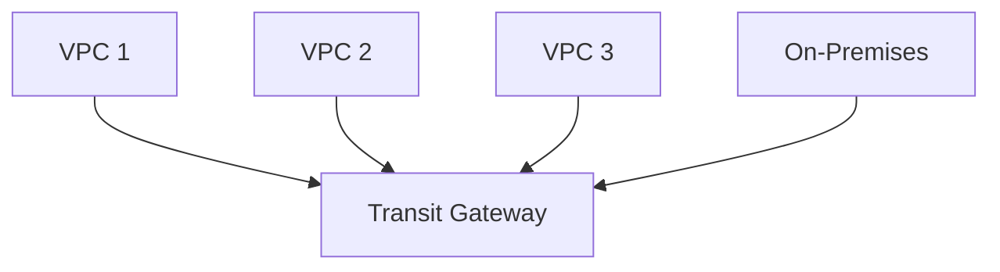

---
tags:
  - aws
  - cloud-practitioner
  - technology
  - additional-services
domain: Cloud Technology and Services
aliases:
  - "Amazon Q"
  - "WorkSpaces"
  - "AppStream"
  - "IoT Core"
  - "Amplify"
  - "SES"
  - "Connect"
status: not-started
date: 2026-07-01
---

# Additional In-Scope AWS Services

These services appear on the official CLF-C02 in-scope list and are tested in Task Statement 3.8 and related areas.

---

## Amazon Q

- AWS's **AI-powered assistant** built into the AWS console and developer tools
- **Amazon Q Business**: generative AI assistant for organizations; answers questions from your internal documents, wikis, and knowledge bases
- **Amazon Q Developer**: AI coding assistant; helps with writing, debugging, and explaining code in IDEs
- Powered by Amazon Bedrock foundation models
- Integrated into AWS Console (ask questions about your AWS environment)

> [!tip]
> Amazon Q is the newest and most prominent AI service AWS has added to the exam. Expect questions about it as an enterprise AI assistant for productivity.

---

## End User Computing

### Amazon AppStream 2.0
- **Fully managed application streaming service**
- Stream desktop applications to any device via browser
- No need to install applications on end-user devices
- Use case: deliver software to remote workers or contractors without managing endpoints

### Amazon WorkSpaces
- **Managed cloud desktop (VDI — Virtual Desktop Infrastructure)**
- Persistent Windows or Linux desktop in the cloud
- Access from any device; pay per user/month or per hour
- Replaces physical desktops for remote workers

### Amazon WorkSpaces Secure Browser
- Managed cloud browser for accessing internal websites and SaaS apps
- Isolates web sessions from local devices
- Use case: secure access to web apps without exposing corporate data to end-user devices

> [!tip]
> "A company wants to give employees access to a Windows desktop from any device" → WorkSpaces. "A company wants to stream a specific app (not a full desktop)" → AppStream 2.0.

---

## Frontend Web and Mobile

### AWS Amplify
- **Full-stack platform** for building web and mobile applications
- Provides: hosting, authentication, APIs, storage, CI/CD
- Integrates with popular frameworks (React, Angular, Vue, Next.js)
- Connects to backend AWS services (Lambda, DynamoDB, Cognito, S3)
- Free tier available

### AWS AppSync
- **Managed GraphQL API service**
- Enables real-time data sync and offline capabilities for mobile/web apps
- Connects to data sources: DynamoDB, Lambda, RDS, HTTP APIs
- Built-in conflict resolution for offline sync

> [!tip]
> Amplify = full-stack mobile/web app development platform. AppSync = managed GraphQL API for real-time data.

---

## Business Applications

### Amazon SES (Simple Email Service)
- **Cloud email service** for sending transactional and marketing emails
- High-volume, low-cost email sending
- Use cases: order confirmations, password resets, marketing campaigns, notifications
- Handles: email authentication (SPF, DKIM, DMARC), bounce/complaint handling

### Amazon Connect
- **Cloud-based contact center service** (omnichannel)
- Pay per minute used (no upfront costs)
- Integrates with **Amazon Lex** for AI-powered chatbots and voice agents
- Use case: replace traditional on-premises call center with cloud-based solution

---

## Internet of Things (IoT)

### AWS IoT Core
- **Managed IoT cloud service** that connects IoT devices to AWS
- Devices can communicate over MQTT, HTTPS, LoRaWAN
- Scale to billions of messages per day
- Integrates with Lambda, S3, DynamoDB, Kinesis for processing IoT data
- Secure device communication with authentication and authorization

> [!tip]
> "A company has thousands of sensors that need to send data to the cloud" → AWS IoT Core.

---

## Analytics

### Amazon OpenSearch Service
- **Managed search and analytics engine** (successor to Amazon Elasticsearch Service)
- Real-time search, log analytics, monitoring
- Use cases: application search, log analysis, security analytics, clickstream analysis
- Integrates with Kinesis, DynamoDB, S3, Lambda

---

## Networking

### AWS Transit Gateway
- **Network transit hub** that connects VPCs and on-premises networks
- Instead of VPC peering (one-to-one), Transit Gateway is a central hub (one-to-many)
- Supports: VPC-to-VPC routing, VPN attachments, Direct Connect integration
- Simplifies complex network topologies; reduces operational overhead

> [!tip]
> VPC Peering = connect 2 VPCs (one-to-one, non-transitive). Transit Gateway = connect many VPCs and on-premises (hub-and-spoke).

### AWS PrivateLink
- Provides **private connectivity** between VPCs and AWS services without exposing traffic to the internet
- Also called **VPC Interface Endpoints** (for services other than S3 and DynamoDB)
- Keeps traffic within the AWS network; does not require IGW, NAT, VPN, or Direct Connect

---

## Management and Governance

### AWS Compute Optimizer
- **ML-powered recommendations** for right-sizing AWS compute resources
- Analyzes: EC2 instances, Auto Scaling groups, Lambda functions, EBS volumes
- Identifies over-provisioned resources to reduce costs
- Identifies under-provisioned resources to improve performance
- Free to use

> [!tip]
> "Which service helps identify oversized EC2 instances to reduce costs?" → AWS Compute Optimizer (or Trusted Advisor for broader checks).

### AWS License Manager
- Manage software licenses from vendors (Microsoft, Oracle, IBM, SAP)
- Track license usage across EC2 and on-premises
- Prevent license violations; automate license tracking
- Useful when migrating BYOL workloads to AWS

### AWS Service Catalog
- Create and manage **catalogs of approved IT products** for AWS
- Allows IT administrators to create pre-approved CloudFormation templates
- End users can self-service deploy approved resources (within guardrails)
- Ensures compliance and governance while enabling self-service

### AWS Audit Manager
- **Continuously audit** AWS usage to assess risk and compliance
- Automates evidence collection for audits
- Supports: GDPR, HIPAA, PCI DSS, SOC 2, ISO 27001 frameworks
- Generates audit-ready reports

### AWS Firewall Manager
- **Centrally manage firewall rules** across multiple AWS accounts and resources
- Manage: AWS WAF rules, Shield Advanced protections, Security Groups, Network Firewall policies
- Works across AWS Organizations
- Enforces consistent security policies at scale

### AWS Resource Access Manager (RAM)
- **Share AWS resources** across AWS accounts within an Organization
- Resources you can share: VPC subnets, Transit Gateways, Route 53 Resolver rules, etc.
- Reduces operational overhead; no need to duplicate resources in each account

---

## Storage

### AWS Backup
- **Centralized, managed backup service** across AWS services
- Create backup policies to automate backups
- Supported services: EC2, EBS, S3, RDS, DynamoDB, EFS, FSx, Storage Gateway, DocumentDB
- Consolidates backup monitoring into a single dashboard
- Supports cross-region and cross-account backups

> [!tip]
> "A company wants to automate and centralize backups across all their AWS services" → AWS Backup.

### AWS Elastic Disaster Recovery (DRS)
- **Quickly recover** IT systems (physical, virtual, cloud) into AWS after a disaster
- Continuously replicates servers into AWS at low cost
- On disaster: launch recovery instances in minutes on AWS
- Replaces older AWS CloudEndure Disaster Recovery

---

## Migration and Transfer

### AWS Schema Conversion Tool (AWS SCT)
- Automatically converts **database schemas** from one engine to another
- Used alongside DMS for heterogeneous migrations (e.g., Oracle → Aurora PostgreSQL)
- Converts: stored procedures, views, functions
- Reports on what can be auto-converted vs. what requires manual effort

### Migration Evaluator (formerly TSO Logic)
- **Business case builder** for cloud migration
- Analyzes current on-premises environment to estimate AWS costs
- Provides projected costs and ROI for migrating to AWS
- Helps justify migration investment to leadership

---

## Exam Tips

> [!tip]
> - Amazon Q = AI assistant built into AWS (Q Business for orgs, Q Developer for code)
> - WorkSpaces = cloud desktop (VDI); AppStream 2.0 = cloud app streaming
> - SES = send email; Connect = cloud contact center
> - IoT Core = connect IoT devices to AWS
> - Transit Gateway = hub for many VPCs (vs VPC Peering = one-to-one)
> - AWS Backup = centralized backup for all AWS services
> - Compute Optimizer = right-sizing recommendations via ML
> - Firewall Manager = manage WAF/Shield rules across accounts

## Related Notes
- [[04-Networking]]
- [[06-Monitoring-Management]]
- [[05-Compliance-Governance]]
