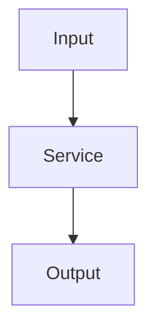

# Add AWS Service Note

Create a comprehensive deep-dive note for an AWS service in the relevant topic-cluster folder.

**Usage:** `/add-service <ServiceName> [cluster]`

## Instructions

Given `$ARGUMENTS` as the AWS service name and optional cluster, infer the cluster folder if not given (`01-Foundations`, `02-Compute-EC2`, `03-Storage`, `04-Databases`, `05-Networking-Content-Delivery`, `06-Containers-Serverless`, `07-Integration-Messaging`, `08-Security-Identity`, `09-Monitoring-Management`, `10-Machine-Learning`, `11-Architecture-Patterns`) and create `<cluster>/<ServiceName>.md` with:

```markdown
---
tags: [aws, saa-c03, services, <service-tag>]
domain: <cluster-name>
exam-domains: [N, ...]
status: not-started
date: <today's date>
---

# <Service Name>

## What It Is
One-sentence definition of what the service does.

## Key Features
- Feature 1
- Feature 2

## Use Cases
- Use case 1
- Use case 2

## How It Works


## Pricing Model
- On-demand / managed / serverless

## Exam Tips
> [!TIP]
> - Key differentiators vs similar services
> - Common exam trick questions

## Integration with Other Services
- [[Amazon-S3]]
- [[Amazon-EC2]]

## Related Notes
- [[Services-Cheatsheet]]
```

After writing the file, add a `[[<cluster>/<ServiceName>]]` link in the cluster's `00-Cluster-MOC.md` and, if relevant, the matching `00-Index/Exam-Domains/0N-*.md` file(s).
