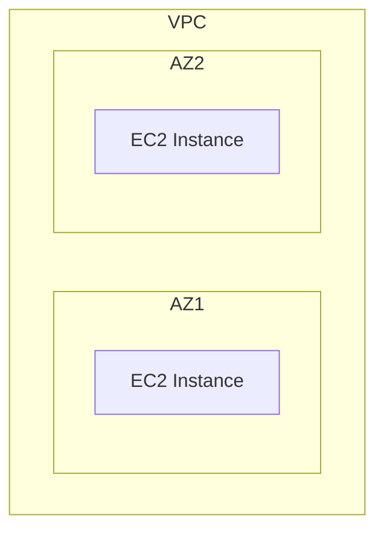

# Feedback: Mermaid Diagram Rules for Vault Files

## CRITICAL: Never use `\n` in Mermaid blocks

Obsidian renders Mermaid natively. `\n` is invalid in Mermaid node label syntax and breaks diagrams. Use `<br>` for line breaks.

```
❌ WRONG:  A["Amazon EC2\n(Compute)"]
✅ CORRECT: A["Amazon EC2<br>(Compute)"]

❌ WRONG:  B --> C[Data stored in\nS3 bucket]
✅ CORRECT: B --> C[Data stored in<br>S3 bucket]
```

This applies to ALL Mermaid node labels `[...]`, edge labels `|...|`, and quoted strings `"..."` inside any ```mermaid block.

## Mermaid Graph Direction
- Use `graph TD` (top-down) for most flow diagrams
- Use `graph LR` (left-right) for pipelines/sequences
- Use `graph TB` only when explicitly needed

## Mermaid Subgraphs for AWS Architecture
Use subgraphs to represent VPCs, AZs, regions:

